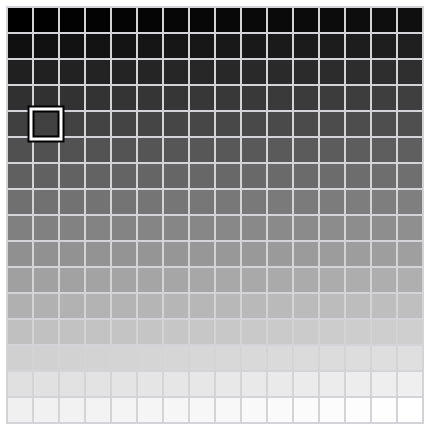
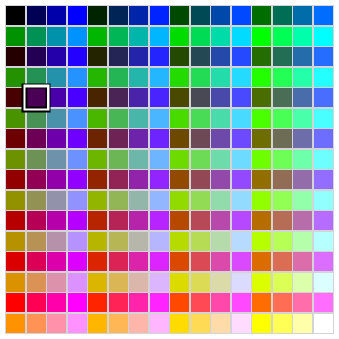
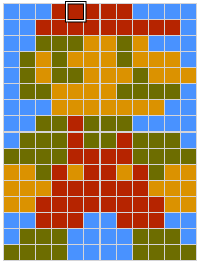
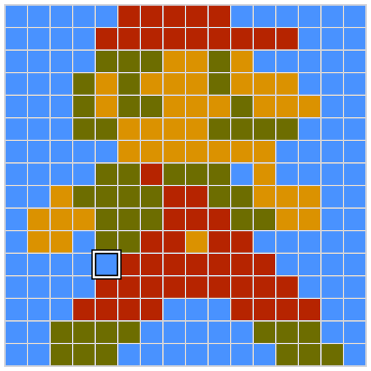

# How a computer works

Architecture & Deployment <!-- .element: class="subtitle" -->

**Notes:**

What a computer physically does when it runs a program, from the bottom up, and
what the processes of a deployment actually are.

---

### The main components of a computer

- Processor (**CPU**: **c**entral **p**rocessing **u**nit)
- Memory (**RAM**: **r**andom **a**ccess **m**emory)
- Storage
- Input and output (**I/O**)
- The bus that connects them

**Notes:**

TODO.

---

## Binary

---

### Eight bits

01010011

**Notes:**

A **bit** is a single binary digit: 0 or 1. Eight bits make a **byte**, the
unit a computer's memory is counted in.

Eight bits can be set in 2⁸ = 256 different ways, from `00000000` to
`11111111`.

Nothing in the bits themselves says what they mean. They can be a number, but
also a shade of gray, a color or a letter, as the next slides show. The meaning
comes from the program that reads them, not from the bits.

---

### Numbers as binary

<table class="font-mono text-5xl">
  <tbody>
    <tr>
      <td class="border-b-0! px-2! text-center!">0</td>
      <td class="border-b-0! px-2! text-center!">1</td>
      <td class="border-b-0! px-2! text-center!">0</td>
      <td class="border-b-0! px-2! text-center!">1</td>
      <td class="border-b-0! px-2! text-center!">0</td>
      <td class="border-b-0! px-2! text-center!">0</td>
      <td class="border-b-0! px-2! text-center!">1</td>
      <td class="border-b-0! px-2! text-center!">1</td>
    </tr>
    <tr class="text-2xl text-blue-500">
      <td class="border-b-0! px-2! text-center!">27 128</td>
      <td class="border-b-0! px-2! text-center!">26 64</td>
      <td class="border-b-0! px-2! text-center!">25 32</td>
      <td class="border-b-0! px-2! text-center!">24 16</td>
      <td class="border-b-0! px-2! text-center!">23 8</td>
      <td class="border-b-0! px-2! text-center!">22 4</td>
      <td class="border-b-0! px-2! text-center!">21 2</td>
      <td class="border-b-0! px-2! text-center!">20 1</td>
    </tr>
  </tbody>
</table>

010100112 = 8310

**Notes:**

Read as a number written in base 2 (binary), each position is worth twice the
position to its right, as each position of a decimal number is worth ten times
the position to its right. The rightmost position is worth 20 = 1,
and the leftmost 27 = 128.

`01010011` has a 1 in four positions, worth 64, 16, 2 and 1, so it is the
decimal number 64 + 16 + 2 + 1 = **83**. The small number after each number says
which base it is written in: 010100112 is in base 2, and
8310 in base 10.

A byte read this way holds any whole number from 0 (`00000000`) to 255
(`11111111`): 256 numbers, one for each way of setting its eight bits.

---

### Gray levels as binary

<code>01010011</code> = 83 of 255: about 67% black

**Notes:**

One way to use a byte is as a shade of gray: 0 is black, 255 is white, and the
254 integers in between are increasingly lighter grays. The grid shows all 256
of them, in order, 16 per row: 0 at the top left, 255 at the bottom right.

The highlighted cell is 83, in the sixth row (80 to 95), fourth column. It is
83 / 255 ≈ 33% of the way from black to white, so it is a dark gray, about 67%
black.

An image stored with one byte per pixel this way is an 8-bit grayscale image.

---

### Colors as binary

<code class="text-4xl">01010011</code> = about 29% red, 57% green, 100% blue

**Notes:**

The same byte can also be a color. A screen makes every color it shows by
mixing red, green and blue light, so a color can be stored as three numbers:
how much red, how much green and how much blue. This is called **RGB**.

Eight bits do not divide by three, so one common scheme, **8-bit color**, gives
3 bits to red, 3 to green and 2 to blue. Blue gets fewer bits because the human
eye is least sensitive to it. Red and green each have 2³ = 8 levels, from 0 to
7, and blue has 2² = 4 levels, from 0 to 3.

Read that way, `01010011` is:

- red `010`, 2 of 7, about 29%: a little red;
- green `100`, 4 of 7, about 57%: some green;
- blue `11`, 3 of 3, 100%: all the blue there is.

A little red, some green and full blue make a light sky blue. The grid shows
all 256 colors in the same order as the gray levels, and the highlighted cell
is in the same place: it is the same byte, 83, read differently.

---

### Images as binary

<code class="text-4xl">01010011</code> = red 2, green 4, blue 3

**Notes:**

An image is a grid of **pixels**, short for "picture elements", and each pixel
is one color. With the 8-bit colors of the previous slide, each pixel is one
byte, so the whole image is a list of numbers, one per pixel, row by row.

This is Mario, the character of _Super Mario Bros._, released by Nintendo in
1985 for the NES (Nintendo Entertainment System), a game console of the 8-bit
era. He is 12 pixels wide and 16 high: 192 pixels, so 192 bytes. He is redrawn
here with the 8-bit colors of the previous slide.

The highlighted pixel, in the sky next to his cap, is the byte `01010011` of the
previous slides: red 2 of 7, green 4 of 7 and blue 3 of 3, a light sky blue.

Today's images and screens use more bits per pixel: one byte for each of red,
green and blue, 24 bits per pixel, which gives 256 levels each and over 16
million colors. It is the `rgb()` notation of CSS: the blue of the sky is
`rgb(73, 146, 255)` (2/7, 4/7 and 3/3 of 255), or `#4992ff` in hexadecimal. A
photo from a modern camera is the same grid of numbers at a much larger scale:
a 1920 × 1080 image has over 2 million pixels, and at 3 bytes per pixel, it
takes about 6 MB before it is compressed.

---

### Videos as binary

<code class="text-3xl">01010011</code> → <code class="text-3xl">11010000</code> → <code class="text-3xl">10100100</code>

**Notes:**

A video is a sequence of images, called **frames**, shown one after the other
fast enough for the eye to see movement instead of separate pictures. Since each
image is a list of numbers, a video is a longer list of numbers: one image after
the other.

This Mario walks with 3 frames of 16 × 16 pixels, each shown for an eighth of a
second: 8 frames per second. At one byte per pixel, each frame is 256 bytes, and
the whole animation is 3 × 256 = 768 bytes, played over and over.

The highlighted pixel stays in the same place, but its byte changes from one
frame to the next: `01010011`, the blue of the sky and the byte of the
previous slides, then `11010000`, the skin
of his hand, then `10100100`, the red of his overalls. Nothing moves on a
screen: each pixel only changes color.

A modern video works the same way at a much larger scale. A 1920 × 1080 frame
at 3 bytes per pixel is about 6 MB, as on the previous slide, and a video
usually shows 30 frames per second: about 187 MB for every second of video.
That is why videos are always compressed, for example by storing only what
changes from one frame to the next.

---

### Text as binary

<table class="mx-auto font-mono text-sm [&_td]:px-[0.5ch]!">
  <tr>
    <td></td><td></td><td></td>
    <td colspan="3">
      

        <svg viewBox="0 0 230 56" class="absolute inset-0 h-full w-full" aria-label="Plus 32">
          <path d="M20 52 V30 H180 V52" fill="none" stroke="#d9480f" stroke-width="3" />
          <path d="M173 44 L180 53 L187 44" fill="none" stroke="#d9480f" stroke-width="3" />
          <text x="100" y="22" text-anchor="middle" font-size="22" fill="#d9480f">+32</text>
        </svg>
      

    </td>
  </tr>
  <tr>
    <td>SP32</td><td>048</td><td>&#64;64</td><td>P80</td><td>&#96;96</td><td>p112</td>
  </tr>
  <tr>
    <td>&#33;33</td><td>149</td><td>A65</td><td>Q81</td><td>a97</td><td>q113</td>
  </tr>
  <tr>
    <td>&#34;34</td><td>250</td><td>B66</td><td>R82</td><td>b98</td><td>r114</td>
  </tr>
  <tr>
    <td>&#35;35</td><td>351</td><td>C67</td><td class="bg-yellow-200 font-bold">S83</td><td>c99</td><td class="bg-yellow-200 font-bold">s115</td>
  </tr>
  <tr>
    <td>&#36;36</td><td>452</td><td>D68</td><td>T84</td><td>d100</td><td>t116</td>
  </tr>
  <tr>
    <td>&#37;37</td><td>553</td><td>E69</td><td>U85</td><td>e101</td><td>u117</td>
  </tr>
  <tr>
    <td>&#38;38</td><td>654</td><td>F70</td><td>V86</td><td>f102</td><td>v118</td>
  </tr>
  <tr>
    <td>&#39;39</td><td>755</td><td>G71</td><td>W87</td><td>g103</td><td>w119</td>
  </tr>
  <tr>
    <td>&#40;40</td><td>856</td><td>H72</td><td>X88</td><td>h104</td><td>x120</td>
  </tr>
  <tr>
    <td>&#41;41</td><td>957</td><td>I73</td><td>Y89</td><td>i105</td><td>y121</td>
  </tr>
  <tr>
    <td>&#42;42</td><td>&#58;58</td><td>J74</td><td>Z90</td><td>j106</td><td>z122</td>
  </tr>
  <tr>
    <td>&#43;43</td><td>&#59;59</td><td>K75</td><td>&#91;91</td><td>k107</td><td>&#123;123</td>
  </tr>
  <tr>
    <td>&#44;44</td><td>&#60;60</td><td>L76</td><td>&#92;92</td><td>l108</td><td>&#124;124</td>
  </tr>
  <tr>
    <td>&#45;45</td><td>&#61;61</td><td>M77</td><td>&#93;93</td><td>m109</td><td>&#125;125</td>
  </tr>
  <tr>
    <td>&#46;46</td><td>&#62;62</td><td>N78</td><td>&#94;94</td><td>n110</td><td>&#126;126</td>
  </tr>
  <tr>
    <td>&#47;47</td><td>&#63;63</td><td>O79</td><td>&#95;95</td><td>o111</td><td>DEL127</td>
  </tr>
</table>

**Notes:**

Text is numbers too: a character table gives every character a number, its
**code point**. The table that most others build on is **ASCII** (American
Standard Code for Information Interchange), from 1963. It has 128 characters,
numbered 0 to 127.

The slide shows codes 32 to 127, in columns of 16. Codes 0 to 31 are control
characters, such as the line feed (10) that ends a line, which are not printed.
`SP` (32) is the space, and `DEL` (127) is another control character.

Some things worth noticing:

- The digits are characters like any other: the character `0` is code point 48,
  not code point 0.
- The uppercase letters start at 65, with `A`, and the lowercase ones at 97,
  with `a`: the lowercase letters come exactly 32 after the uppercase ones.
- `S`, highlighted, is 83: the byte `01010011` of the previous slides, read as
  a letter. Its lowercase `s`, also highlighted, is 83 + 32 = 115.

**UTF-8**, the encoding of almost all text on the web today, can store over a
million characters, from every writing system and emoji. Its first 128 code
points are the ASCII table, and UTF-8 stores each of them as a single byte, the
same as in ASCII. `S` is 83 and `s` is 115 in both, so text written only in
ASCII characters is also valid UTF-8.

---

### Transforming data is arithmetic

| Letter | Code point |                         Binary                          |
| :----: | :--------: | :-----------------------------------------------------: |
|  `S`   |     83     | <code>01010011</code> |
|  `s`   |    115     | <code>01110011</code> |

**Notes:**

`s` is `S` plus 32. In binary, 32 is the value of a single bit, the sixth from
the right (bit 5, counting from 0), and that is the only bit that differs
between the two letters. The same is true of every other letter of the table:
`B` (66) and `b` (98), all the way to `Z` (90) and `z` (122).

So changing the case of a letter is adding or subtracting 32, which is the same
as flipping that single bit.

A computer does not know what letters are. It only manipulates numbers, but
since letters, colors and images are all stored as numbers, manipulating
numbers is enough to manipulate any data.

---

## Electricity

---

### A closed circuit

<logic-diagram name="closed-circuit" controls="none" theme="light" style="width: 640px; margin: 0 auto">
</logic-diagram>

**Notes:**

A circuit is a loop: current leaves the battery from its `+` end, goes through
the switch and the lamp, and comes back to the battery's `-` end.

When the switch is open, the loop is broken and no current flows anywhere in
it, so the lamp stays dark. When the switch is closed, the loop is complete,
current flows and the lamp lights up.

---

### The electromagnet

<logic-diagram name="sounder-circuit" controls="none" theme="light" style="width: 640px; margin: 0 auto">
</logic-diagram>

**Notes:**

TODO: the same circuit with a sounder in place of the lamp. Current through a
coil makes an electromagnet, which pulls down an iron bar that clicks.

---

### The telegraph

<logic-diagram name="telegraph-two-wires" controls="none" theme="light" style="width: 800px; margin: 0 auto">
</logic-diagram>

**Notes:**

TODO: a circuit with a purpose: the same loop stretched between two towns, with
a key in place of the switch. It works over about 30 km, and needs a line there
and back.

---

### The earth as ground

<logic-diagram name="telegraph" controls="none" theme="light" style="width: 800px; margin: 0 auto">
</logic-diagram>

**Notes:**

TODO: the earth completes the circuit, which saves one of the two long wires.

---

### The telegraph repeater

<logic-diagram name="telegraph-repeater" controls="none" theme="light" style="width: 800px; margin: 0 auto">
</logic-diagram>

**Notes:**

TODO: the relay is a sounder that closes a contact instead of clicking, so a
weak current switches on a fresh one from a local battery, and the line goes
further.

---

### The ground symbol

<logic-diagram name="telegraph-repeater-grounds" controls="none" theme="light" style="width: 800px; margin: 0 auto">
</logic-diagram>

**Notes:**

TODO: shorthand for a stake in the earth.

---

### The source symbol

<logic-diagram name="telegraph-repeater-sources" controls="none" theme="light" style="width: 800px; margin: 0 auto">
</logic-diagram>

**Notes:**

TODO: a battery's `+` end alone, since its other end is in the ground anyway.

---

### The relay

<logic-diagram name="relay-single" controls="none" theme="light" style="width: 640px; margin: 0 auto">
</logic-diagram>

**Notes:**

TODO: a switch controlled by current.

---

## Logic

---

### A relay

<!-- .element: class="corner-title" -->

  <logic-diagram id="relay-single" name="relay-single" controls="none" theme="light" style="width: 600px">
  </logic-diagram>
  <truth-table for="relay-single" theme="light"></truth-table>

**Notes:**

TODO: the simplest truth table: 0 in gives 0 out, 1 in gives 1 out.

---

### NOT

<!-- .element: class="corner-title fragment" -->

  <logic-diagram id="relay-not" name="relay-not" controls="none" theme="light" style="width: 600px">
  </logic-diagram>
  <truth-table for="relay-not" theme="light"></truth-table>

**Notes:**

TODO: a relay whose contact is closed at rest.

---

### AND

<!-- .element: class="corner-title fragment" -->

  <logic-diagram id="relay-and" name="relay-and" controls="none" theme="light" style="width: 600px">
  </logic-diagram>
  <truth-table for="relay-and" theme="light"></truth-table>

**Notes:**

TODO: two relays in series. The room gives the truth table before the demo
fills it.

---

### OR

<!-- .element: class="corner-title fragment" -->

  <logic-diagram id="relay-or" name="relay-or" controls="none" theme="light" style="width: 600px">
  </logic-diagram>
  <truth-table for="relay-or" theme="light"></truth-table>

**Notes:**

TODO: two relays in parallel.

---

### XOR

<!-- .element: class="corner-title fragment" -->

  <logic-diagram id="relay-xor" name="relay-xor" controls="none" theme="light" style="width: 600px">
  </logic-diagram>
  <truth-table for="relay-xor" theme="light"></truth-table>

**Notes:**

TODO: both contacts of each relay, wired like the two switches of a staircase
light: the lamp is lit when exactly one input is on. Left for students to play
with.

---

### The buffer and NOT symbols

<!-- .element: class="corner-title" -->

  <logic-diagram id="buffer-and-not" name="buffer-and-not" controls="none" theme="light" style="width: 520px">
  </logic-diagram>
  <truth-table for="buffer-and-not" theme="light"></truth-table>

**Notes:**

TODO: a triangle stands for a relay. The buffer's lamp follows A, like the
single relay's; the NOT's does the opposite. The only difference between the
two symbols is the circle at the tip.

---

### The AND symbol

<!-- .element: class="corner-title" -->

  <logic-diagram id="and-gate" name="and-gate" controls="none" theme="light" style="width: 520px">
  </logic-diagram>
  <truth-table for="and-gate" theme="light"></truth-table>

**Notes:**

TODO: the two relays in series, drawn as one symbol.

---

### The inversion bubble

<!-- .element: class="corner-title" -->

  <logic-diagram id="inversion-bubble" name="inversion-bubble" controls="none" theme="light" style="width: 600px">
  </logic-diagram>
  <truth-table for="inversion-bubble" theme="light"></truth-table>

**Notes:**

TODO: an AND, the same AND followed by a NOT, and a NAND. NAND is the second
row with the NOT's triangle left out and its circle kept: the circle alone means
inversion. The last two lamps always agree.

---

### Logic gates

<!-- .element: class="corner-title" -->

  <logic-diagram id="gate-gallery" name="gate-gallery" controls="none" theme="light" style="width: 480px">
  </logic-diagram>
  

    <truth-table for="gate-gallery" columns="A,BUFFER,NOT" theme="light"></truth-table>
    <truth-table for="gate-gallery" columns="A,B,AND,NAND" theme="light"></truth-table>
    <truth-table for="gate-gallery" columns="A,B,OR,NOR,XOR" theme="light"></truth-table>
  

**Notes:**

TODO: the symbols that stand for the relay circuits from now on.

---

## Computing

---

### Adding in decimal

<table class="font-mono text-5xl">
  <tbody>
    <tr class="text-3xl text-red-500">
      <td class="border-b-0! px-2! text-center!"></td>
      <td class="border-b-0! px-2! text-center!">1</td>
      <td class="border-b-0! px-2! text-center!">1</td>
      <td class="border-b-0! px-2! text-center!"></td>
    </tr>
    <tr>
      <td class="border-b-0! px-2! text-center!"></td>
      <td class="border-b-0! px-2! text-center!"></td>
      <td class="border-b-0! px-2! text-center!">5</td>
      <td class="border-b-0! px-2! text-center!">8</td>
    </tr>
    <tr>
      <td class="border-b-0! px-2! text-center!">+</td>
      <td class="border-b-0! px-2! text-center!"></td>
      <td class="border-b-0! px-2! text-center!">6</td>
      <td class="border-b-0! px-2! text-center!">7</td>
    </tr>
    <tr>
      <td class="border-b-0! px-2! text-center! border-t-4! [border-top-style:solid]!"></td>
      <td class="border-b-0! px-2! text-center! border-t-4! [border-top-style:solid]!">1</td>
      <td class="border-b-0! px-2! text-center! border-t-4! [border-top-style:solid]!">2</td>
      <td class="border-b-0! px-2! text-center! border-t-4! [border-top-style:solid]!">5</td>
    </tr>
  </tbody>
</table>

**Notes:**

Add column by column, from the right:

- Add the digits of the rightmost column: 8 + 7 = 15, which does not fit in one
  digit. Write the 5 and carry the 1 into the next column, the tens.
- The next column adds three digits, 5 + 6 and the carry, which makes 12: write
  the 2 and carry the 1 again.
- Nothing is left to add in the hundreds column but the carry, so it becomes the
  third digit. The final sum is 125.

This is classic **addition with carry**, the technique taught in school when you
learn to add multi-digit numbers.

---

### Adding in binary

<table class="font-mono text-5xl">
  <tbody>
    <tr class="text-3xl text-red-500">
      <td class="border-b-0! px-2! text-center!"></td>
      <td class="border-b-0! px-2! text-center!">1</td>
      <td class="border-b-0! px-2! text-center!">1</td>
      <td class="border-b-0! px-2! text-center!">1</td>
      <td class="border-b-0! px-2! text-center!"></td>
    </tr>
    <tr>
      <td class="border-b-0! px-2! text-center!"></td>
      <td class="border-b-0! px-2! text-center!">0</td>
      <td class="border-b-0! px-2! text-center!">1</td>
      <td class="border-b-0! px-2! text-center!">1</td>
      <td class="border-b-0! px-2! text-center! relative">17</td>
    </tr>
    <tr>
      <td class="border-b-0! px-2! text-center!">+</td>
      <td class="border-b-0! px-2! text-center!">0</td>
      <td class="border-b-0! px-2! text-center!">0</td>
      <td class="border-b-0! px-2! text-center!">1</td>
      <td class="border-b-0! px-2! text-center! relative">13</td>
    </tr>
    <tr>
      <td class="border-b-0! px-2! text-center! border-t-4! [border-top-style:solid]!"></td>
      <td class="border-b-0! px-2! text-center! border-t-4! [border-top-style:solid]! relative">123 8</td>
      <td class="border-b-0! px-2! text-center! border-t-4! [border-top-style:solid]! relative">022 4</td>
      <td class="border-b-0! px-2! text-center! border-t-4! [border-top-style:solid]! relative">121 2</td>
      <td class="border-b-0! px-2! text-center! relative border-t-4! [border-top-style:solid]!">01020 1</td>
    </tr>
  </tbody>
</table>

**Notes:**

The same method, in binary instead of decimal, to add `0111` (7 in decimal) and
`0011` (3 in decimal):

- In the rightmost column, `1` + `1` = `10` in binary (2 in decimal): write the
  0 and carry the 1, as 8 + 7 = 15 does in decimal.
- In the next column adds three bits, 1 + 1 and the carry, which makes `11` in
  binary (3 in decimal): write a 1 and carry a 1.
- In the next column, 0 + 1 and the carry makes `10` in binary (2 in decimal):
  write a 0 and carry a 1.
- The carry goes into the final column. 0 + 0 and the carry makes `1` in binary
  (1 in decimal). The final sum is `1010` (10 in decimal).

Every column does the same thing: it adds two bits and the carry from the column
on its right, and gives a sum bit and a carry for the column on its left.

---

### The sum and carry of two bits

  

    <table class="fragment m-0! font-mono text-4xl font-bold text-[#1d1d1f]" data-fragment-index="1">
      <thead>
        <tr>
          <th class="px-[0.5em]! py-[0.2em]! text-center! font-sans font-semibold [border-bottom:2px_solid_#1d1d1f]!">A</th>
          <th class="px-[0.5em]! py-[0.2em]! text-center! font-sans font-semibold [border-bottom:2px_solid_#1d1d1f]!">B</th>
          <th class="px-[0.5em]! py-[0.2em]! text-center! font-sans font-semibold [border-bottom:2px_solid_#1d1d1f]! [border-left:3px_solid_#1d1d1f]!">SUM</th>
        </tr>
      </thead>
      <tbody>
        <tr>
          <td class="px-[0.5em]! py-[0.15em]! text-center! [border-bottom:1px_solid_#a3a3a8]!">0</td>
          <td class="px-[0.5em]! py-[0.15em]! text-center! [border-bottom:1px_solid_#a3a3a8]!">0</td>
          <td class="px-[0.5em]! py-[0.15em]! text-center! [border-bottom:1px_solid_#a3a3a8]! [border-left:3px_solid_#1d1d1f]!">0</td>
        </tr>
        <tr>
          <td class="px-[0.5em]! py-[0.15em]! text-center! [border-bottom:1px_solid_#a3a3a8]!">0</td>
          <td class="px-[0.5em]! py-[0.15em]! text-center! [border-bottom:1px_solid_#a3a3a8]!">1</td>
          <td class="px-[0.5em]! py-[0.15em]! text-center! [border-bottom:1px_solid_#a3a3a8]! [border-left:3px_solid_#1d1d1f]!">1</td>
        </tr>
        <tr>
          <td class="px-[0.5em]! py-[0.15em]! text-center! [border-bottom:1px_solid_#a3a3a8]!">1</td>
          <td class="px-[0.5em]! py-[0.15em]! text-center! [border-bottom:1px_solid_#a3a3a8]!">0</td>
          <td class="px-[0.5em]! py-[0.15em]! text-center! [border-bottom:1px_solid_#a3a3a8]! [border-left:3px_solid_#1d1d1f]!">1</td>
        </tr>
        <tr>
          <td class="px-[0.5em]! py-[0.15em]! text-center! [border-bottom:1px_solid_#a3a3a8]!">1</td>
          <td class="px-[0.5em]! py-[0.15em]! text-center! [border-bottom:1px_solid_#a3a3a8]!">1</td>
          <td class="px-[0.5em]! py-[0.15em]! text-center! [border-bottom:1px_solid_#a3a3a8]! [border-left:3px_solid_#1d1d1f]!">0</td>
        </tr>
      </tbody>
    </table>
    
XOR

  

  

    <table class="fragment m-0! font-mono text-4xl font-bold text-[#1d1d1f]" data-fragment-index="2">
      <thead>
        <tr>
          <th class="px-[0.5em]! py-[0.2em]! text-center! font-sans font-semibold [border-bottom:2px_solid_#1d1d1f]!">A</th>
          <th class="px-[0.5em]! py-[0.2em]! text-center! font-sans font-semibold [border-bottom:2px_solid_#1d1d1f]!">B</th>
          <th class="px-[0.5em]! py-[0.2em]! text-center! font-sans font-semibold [border-bottom:2px_solid_#1d1d1f]! [border-left:3px_solid_#1d1d1f]! whitespace-nowrap">Carry out</th>
        </tr>
      </thead>
      <tbody>
        <tr>
          <td class="px-[0.5em]! py-[0.15em]! text-center! [border-bottom:1px_solid_#a3a3a8]!">0</td>
          <td class="px-[0.5em]! py-[0.15em]! text-center! [border-bottom:1px_solid_#a3a3a8]!">0</td>
          <td class="px-[0.5em]! py-[0.15em]! text-center! [border-bottom:1px_solid_#a3a3a8]! [border-left:3px_solid_#1d1d1f]!">0</td>
        </tr>
        <tr>
          <td class="px-[0.5em]! py-[0.15em]! text-center! [border-bottom:1px_solid_#a3a3a8]!">0</td>
          <td class="px-[0.5em]! py-[0.15em]! text-center! [border-bottom:1px_solid_#a3a3a8]!">1</td>
          <td class="px-[0.5em]! py-[0.15em]! text-center! [border-bottom:1px_solid_#a3a3a8]! [border-left:3px_solid_#1d1d1f]!">0</td>
        </tr>
        <tr>
          <td class="px-[0.5em]! py-[0.15em]! text-center! [border-bottom:1px_solid_#a3a3a8]!">1</td>
          <td class="px-[0.5em]! py-[0.15em]! text-center! [border-bottom:1px_solid_#a3a3a8]!">0</td>
          <td class="px-[0.5em]! py-[0.15em]! text-center! [border-bottom:1px_solid_#a3a3a8]! [border-left:3px_solid_#1d1d1f]!">0</td>
        </tr>
        <tr>
          <td class="px-[0.5em]! py-[0.15em]! text-center! [border-bottom:1px_solid_#a3a3a8]!">1</td>
          <td class="px-[0.5em]! py-[0.15em]! text-center! [border-bottom:1px_solid_#a3a3a8]!">1</td>
          <td class="px-[0.5em]! py-[0.15em]! text-center! [border-bottom:1px_solid_#a3a3a8]! [border-left:3px_solid_#1d1d1f]!">1</td>
        </tr>
      </tbody>
    </table>
    
AND

  

**Notes:**

Adding two bits, as in the rightmost column of a binary addition, gives two
bits: a sum and a carry. The sum is 1 when exactly one of the two bits is 1.
The carry is 1 only when both are, since 1 + 1 = `10` in binary.

As you may or may not have noticed, it just so happens that these are exactly
the truth tables of XOR and AND.

---

### The half adder

<!-- .element: class="corner-title" -->

<logic-diagram id="half-adder" name="half-adder" names="true" controls="none" theme="light" style="width: 700px; margin: 0 auto">
</logic-diagram>
<truth-table for="half-adder" theme="light"></truth-table>

**Notes:**

The binary sum and carry truth tables, built with logic gates: A and B go into
both an XOR and an AND. The XOR gives the sum bit, `SUM`, and the AND gives the
carry bit, `Cout` ("carry out"), which goes out to the next column on the left.

It is only half an adder because it adds two bits and nothing else. That is
enough for the rightmost column of an addition, but every other column also has
to add the carry coming in from the column on its right.

---

### The full adder

<!-- .element: class="corner-title" -->

<logic-diagram id="full-adder" name="full-adder" names="true" controls="none" theme="light" style="width: 960px; margin: 0 auto">
</logic-diagram>
<truth-table for="full-adder" split="2" theme="light"></truth-table>

**Notes:**

A full adder adds three bits: A, B and the carry in, `Cin`, from the column on
its right. It is two half adders and an OR gate:

- The first half adder, on the left, adds A and B, as in the previous circuit.
- The second half adder, in the middle, adds the carry in to the first sum bit.
  Its sum is the full adder's sum bit, `SUM`.
- Each half adder can produce a carry, and the OR combines them: the carry out,
  `Cout`, is 1 when either one carries. The first carries when A and B are both
  1, the second when exactly one of them is 1 and so is the carry in. Put
  simply, the carry out is 1 when at least two of the three inputs are 1.

The two half adders never carry at the same time: when A and B are both 1, their
sum bit is 0, so the second half adder has nothing to carry. That is why a plain
OR is enough to combine them. When all three inputs are 1, the first half adder
carries and the second one's sum is 1: `SUM` and `Cout` are both 1, which is
`11` in binary, 3.

---

### The full adder as a block

<!-- .element: class="hidden" -->

<logic-diagram name="full-adder-block" names="true" controls="none" theme="light" style="width: 480px; margin: 0 auto">
</logic-diagram>

**Notes:**

TODO.

---

### 4-bit ripple-carry adder

<!-- .element: class="corner-title" -->

<!-- TODO: the design lists this one as supplementary material, not shown in
     the session. -->

<logic-diagram name="four-bit-adder" names="true" controls="none" theme="light" style="width: 900px; margin: 0 auto">
</logic-diagram>

**Notes:**

TODO: four full adders, the carry rippling from right to left.

---

## Remembering

---

### SR latch

<!-- .element: class="corner-title" -->

<logic-diagram name="sr-latch" names="true" controls="none" theme="light" style="width: 640px; margin: 0 auto">
</logic-diagram>

**Notes:**

TODO: memory from feedback, an output wired back into an input.

---

### D latch

<!-- .element: class="corner-title" -->

<logic-diagram name="d-latch" names="true" controls="none" theme="light" style="width: 800px; margin: 0 auto">
</logic-diagram>

**Notes:**

TODO: storing a data bit on demand.

---

### The D latch as a block

<!-- .element: class="hidden" -->

<logic-diagram name="d-latch-block" names="true" controls="none" theme="light" style="width: 480px; margin: 0 auto">
</logic-diagram>

**Notes:**

TODO.

---

### Selector

<!-- .element: class="corner-title" -->

<logic-diagram name="selector" names="true" highlight="true" controls="none" theme="light" style="width: 640px; margin: 0 auto">
</logic-diagram>

**Notes:**

A selector chooses which of its data inputs reaches its output. SELECT picks
one: while it is 0, `D0` reaches the output `Y`, and while it is 1, `D1` does.

Each data input goes through an AND. SELECT opens one AND directly and the
other through a NOT, so exactly one AND is open at a time: the one whose data
input gets through. The OR then passes on whatever comes out of the open AND.

Its usual name is a **multiplexer**, or MUX: several inputs share a single
output, one at a time.

---

### 2-to-4 decoder

<!-- .element: class="corner-title" -->

<logic-diagram name="decoder-2-to-4" names="true" highlight="true" controls="none" theme="light" style="width: 640px; margin: 0 auto">
</logic-diagram>

**Notes:**

The selector's mirror image: one input, DATA, sent to one of four outputs. The
address, `A1` and `A0`, read as a two-bit binary number, picks which output:
`Y0` for `00`, `Y1` for `01`, `Y2` for `10`, `Y3` for `11`. The other outputs
stay at 0.

The ANDs have three inputs instead of two, and work the same way: the output is
1 only when all three inputs are 1. Each AND gets DATA and one line of each
address bit, which runs down two lines, as it is and inverted by a NOT. Each AND
taps a different pair of lines, so that for a given address only one AND has
both its address inputs at 1. That AND lets DATA through.

It is called **2-to-4** because a decoder is counted by its address bits: 2 bits
can say 2² = 4 different numbers, so they choose among 4 outputs. A 3-bit
address gives a 3-to-8 decoder, and so on.

A decoder with a data input like this one is also called a **demultiplexer**, or
DEMUX, the multiplexer's mirror image, and a demultiplexer is counted by its
data instead: one data input to four outputs is a **1-to-4** demultiplexer. Both
names are right for this circuit.

---

### The decoder as a block

<!-- .element: class="hidden" -->

<logic-diagram name="decoder-block" names="true" highlight="true" controls="none" theme="light" style="width: 480px; margin: 0 auto">
</logic-diagram>

**Notes:**

The same decoder drawn as a box: the address picks which of the four outputs
DATA reaches. The circuit inside does not change; the box hides it so that the
diagrams that use it stay readable.

---

### 4-to-1 selector

<!-- .element: class="corner-title" -->

<logic-diagram name="selector-4-to-1" names="true" highlight="true" controls="none" theme="light" style="width: 640px; margin: 0 auto">
</logic-diagram>

**Notes:**

The selector again, with four data inputs, `D0` to `D3`. One SELECT input can
only choose between two, so it takes two select bits, `S1` and `S0`, read as a
binary number: `00` lets `D0` through, `01` for `D1`, `10` for `D2` and `11` for
`D3`.

The select bits are wired like the decoder's address bits, each one as it is and
inverted, so that only one AND is open at a time. The OR has four inputs instead
of two, and works the same way: its output is 1 when any of its inputs is 1, so
it passes on whatever comes out of the open AND.

It is named **4-to-1** because a multiplexer is counted by its data: four inputs
to one output. Its two select bits are the same as the decoder's two address
bits, which is why it is called 4-to-1 while the decoder is called 2-to-4.

---

### The selector as a block

<!-- .element: class="hidden" -->

<logic-diagram name="selector-block" names="true" highlight="true" controls="none" theme="light" style="width: 480px; margin: 0 auto">
</logic-diagram>

**Notes:**

The same 4-to-1 selector drawn as a box: the select bits pick which of the four
data inputs reaches the output.

---

### Addressable memory

<!-- .element: class="corner-title" -->

<logic-diagram name="addressable-memory" names="true" highlight="true" controls="none" theme="light" style="width: 530px; margin: 0 auto">
</logic-diagram>

**Notes:**

TODO: writing and reading a cell by its address. Two address bits give four
cells of one bit each.

---

### A 4-bit address gives a 16-byte memory

<!-- TODO: the cells' contents, if any, for the trace. -->

  
0000

  
0001

  
0010

  
0011

  
0100

  
0101

  
0110

  
0111

  
1000

  
1001

  
1010

  
1011

  
1100

  
1101

  
1110

  
1111

**Notes:**

TODO: 4 address bits give 2⁴ = 16 addresses, and each addressed cell holds 8
bits.

---

## Ticking

---

### Buzzer

<!-- .element: class="corner-title" -->

<logic-diagram name="relay-buzzer" controls="none" theme="light" style="width: 640px; margin: 0 auto">
</logic-diagram>

**Notes:**

TODO: a relay feeding its own coil. Where a clock comes from.

---

### Oscillator

<!-- .element: class="corner-title" -->

<logic-diagram name="not-oscillator" names="true" controls="none" theme="light" style="width: 560px; margin: 0 auto">
</logic-diagram>

**Notes:**

The buzzer, drawn with a gate. A relay feeding its own coil through its normally
closed contact is a NOT gate whose output goes back to its input. Its output
never agrees with its input, so it keeps flipping, as fast as the gate can
switch. A circuit whose output keeps switching back and forth on its own is an
oscillator.

---

### Clock

<!-- .element: class="corner-title" -->

<logic-diagram name="clock-lamp" names="true" controls="none" theme="light" style="width: 480px; margin: 0 auto">
</logic-diagram>

**Notes:**

An oscillator that switches at a steady pace is a computer's clock, drawn from
now on as this symbol. Every tick of the clock moves the computer on by one
step.

A real computer's clock does not use a NOT gate, whose pace drifts with
temperature and voltage: it uses a quartz crystal, which vibrates at a very
stable frequency, billions of ticks per second in a modern processor.

---

## Counting

---

### Edge-triggered D-type flip-flop

<!-- .element: class="corner-title" -->

<logic-diagram name="d-flip-flop-manual" names="true" controls="none" theme="light" style="width: 900px; margin: 0 auto">
</logic-diagram>

**Notes:**

TODO: Q only changes when the clock rises. With Q̅ fed back into D, it changes
on every other tick: half the clock's frequency.

---

### Two latches make a flip-flop

<!-- .element: class="hidden" -->

<logic-diagram name="d-flip-flop-latches" names="true" controls="none" theme="light" style="width: 720px; margin: 0 auto">
</logic-diagram>

**Notes:**

The edge-triggered D flip-flop is two D latches in a row, and a NOT gate. The
first latch gets DATA, and the clock through the NOT: it is open, following DATA,
while the clock is low. The second latch gets the first one's Q, and the clock
directly: it is open while the clock is high, and copies the first latch.

The two latches are never open together, so DATA never runs straight through to Q.
When the clock rises, the first latch closes on the value DATA had just before, and
the second one opens and passes that value on to Q. Q only changes when the
clock rises.

---

### The D flip-flop as a block

<!-- .element: class="hidden" -->

<logic-diagram name="d-flip-flop-block-manual" names="true" controls="none" theme="light" style="width: 480px; margin: 0 auto">
</logic-diagram>

**Notes:**

The same flip-flop drawn as a box, as the counter will use it. The wedge on the
clock input marks it as edge-triggered: Q only takes DATA's value when CLK rises.

---

### Frequency divider

<!-- .element: class="corner-title" -->

<logic-diagram name="frequency-divider" names="true" controls="none" theme="light" style="width: 400px; margin: 0 auto">
</logic-diagram>

<table class="mt-8 text-[#1d1d1f]">
  <tbody>
    <tr>
      <th class="border-b-0! py-0! pr-6! text-right! align-middle font-sans text-3xl">CLK</th>
      <td class="p-0! w-14 h-12 text-center! align-middle font-mono text-3xl [border-bottom:4px_solid_currentColor]!"></td>
      <td class="p-0! w-14 h-12 text-center! align-middle font-mono text-3xl border-b-0! [border-top:4px_solid_currentColor]! [border-left:4px_solid_currentColor]!"></td>
      <td class="p-0! w-14 h-12 text-center! align-middle font-mono text-3xl [border-bottom:4px_solid_currentColor]! [border-left:4px_solid_currentColor]!"></td>
      <td class="p-0! w-14 h-12 text-center! align-middle font-mono text-3xl border-b-0! [border-top:4px_solid_currentColor]! [border-left:4px_solid_currentColor]!"></td>
      <td class="p-0! w-14 h-12 text-center! align-middle font-mono text-3xl [border-bottom:4px_solid_currentColor]! [border-left:4px_solid_currentColor]!"></td>
      <td class="p-0! w-14 h-12 text-center! align-middle font-mono text-3xl border-b-0! [border-top:4px_solid_currentColor]! [border-left:4px_solid_currentColor]!"></td>
      <td class="p-0! w-14 h-12 text-center! align-middle font-mono text-3xl [border-bottom:4px_solid_currentColor]! [border-left:4px_solid_currentColor]!"></td>
      <td class="p-0! w-14 h-12 text-center! align-middle font-mono text-3xl border-b-0! [border-top:4px_solid_currentColor]! [border-left:4px_solid_currentColor]!"></td>
    </tr>
    <tr>
      <td class="border-b-0! p-0! h-6" colspan="9"></td>
    </tr>
    <tr>
      <th class="border-b-0! py-0! pr-6! text-right! align-middle font-sans text-3xl">Q</th>
      <td class="p-0! w-14 h-12 text-center! align-middle font-mono text-3xl [border-bottom:4px_solid_currentColor]!">0</td>
      <td class="p-0! w-14 h-12 text-center! align-middle font-mono text-3xl border-b-0! [border-top:4px_solid_currentColor]! [border-left:4px_solid_currentColor]!">1</td>
      <td class="p-0! w-14 h-12 text-center! align-middle font-mono text-3xl border-b-0! [border-top:4px_solid_currentColor]!">1</td>
      <td class="p-0! w-14 h-12 text-center! align-middle font-mono text-3xl [border-bottom:4px_solid_currentColor]! [border-left:4px_solid_currentColor]!">0</td>
      <td class="p-0! w-14 h-12 text-center! align-middle font-mono text-3xl [border-bottom:4px_solid_currentColor]!">0</td>
      <td class="p-0! w-14 h-12 text-center! align-middle font-mono text-3xl border-b-0! [border-top:4px_solid_currentColor]! [border-left:4px_solid_currentColor]!">1</td>
      <td class="p-0! w-14 h-12 text-center! align-middle font-mono text-3xl border-b-0! [border-top:4px_solid_currentColor]!">1</td>
      <td class="p-0! w-14 h-12 text-center! align-middle font-mono text-3xl [border-bottom:4px_solid_currentColor]! [border-left:4px_solid_currentColor]!">0</td>
    </tr>
  </tbody>
</table>

**Notes:**

A D flip-flop feeding its Q̅ back into its D: on every rising edge of the clock,
it stores the opposite of what it holds, so Q flips. Q therefore goes through
one full cycle, off then on, for every two cycles of the clock: half the clock's
frequency.

The timing diagram underneath shows it, with time running from left to right.
Each time CLK steps up, Q steps, up or down. A real flip-flop takes a moment to
respond, which the drawing leaves out.

Q goes 0, 1, 0, 1, one step per cycle of the clock: it counts, but with a single
binary digit. To count higher, halve the frequency again: a second flip-flop
gives the next digit.

---

### Program counter

<!-- .element: class="corner-title fragment" data-fragment-index="2" -->

<logic-diagram name="counter" names="true" controls="none" theme="light" style="width: 760px; margin: 0 auto">
</logic-diagram>

<table class="mt-8 text-[#1d1d1f]">
  <tbody>
    <tr>
      <th class="border-b-0! py-0! pr-6! text-right! align-middle font-sans text-2xl">CLK</th>
      <td class="p-0! w-8 h-10 text-center! align-middle font-mono text-2xl [border-bottom:4px_solid_currentColor]!"></td>
      <td class="p-0! w-8 h-10 text-center! align-middle font-mono text-2xl border-b-0! [border-top:4px_solid_currentColor]! [border-left:4px_solid_currentColor]!"></td>
      <td class="p-0! w-8 h-10 text-center! align-middle font-mono text-2xl [border-bottom:4px_solid_currentColor]! [border-left:4px_solid_currentColor]!"></td>
      <td class="p-0! w-8 h-10 text-center! align-middle font-mono text-2xl border-b-0! [border-top:4px_solid_currentColor]! [border-left:4px_solid_currentColor]!"></td>
      <td class="p-0! w-8 h-10 text-center! align-middle font-mono text-2xl [border-bottom:4px_solid_currentColor]! [border-left:4px_solid_currentColor]!"></td>
      <td class="p-0! w-8 h-10 text-center! align-middle font-mono text-2xl border-b-0! [border-top:4px_solid_currentColor]! [border-left:4px_solid_currentColor]!"></td>
      <td class="p-0! w-8 h-10 text-center! align-middle font-mono text-2xl [border-bottom:4px_solid_currentColor]! [border-left:4px_solid_currentColor]!"></td>
      <td class="p-0! w-8 h-10 text-center! align-middle font-mono text-2xl border-b-0! [border-top:4px_solid_currentColor]! [border-left:4px_solid_currentColor]!"></td>
      <td class="p-0! w-8 h-10 text-center! align-middle font-mono text-2xl [border-bottom:4px_solid_currentColor]! [border-left:4px_solid_currentColor]!"></td>
      <td class="p-0! w-8 h-10 text-center! align-middle font-mono text-2xl border-b-0! [border-top:4px_solid_currentColor]! [border-left:4px_solid_currentColor]!"></td>
      <td class="p-0! w-8 h-10 text-center! align-middle font-mono text-2xl [border-bottom:4px_solid_currentColor]! [border-left:4px_solid_currentColor]!"></td>
      <td class="p-0! w-8 h-10 text-center! align-middle font-mono text-2xl border-b-0! [border-top:4px_solid_currentColor]! [border-left:4px_solid_currentColor]!"></td>
      <td class="p-0! w-8 h-10 text-center! align-middle font-mono text-2xl [border-bottom:4px_solid_currentColor]! [border-left:4px_solid_currentColor]!"></td>
      <td class="p-0! w-8 h-10 text-center! align-middle font-mono text-2xl border-b-0! [border-top:4px_solid_currentColor]! [border-left:4px_solid_currentColor]!"></td>
      <td class="p-0! w-8 h-10 text-center! align-middle font-mono text-2xl [border-bottom:4px_solid_currentColor]! [border-left:4px_solid_currentColor]!"></td>
      <td class="p-0! w-8 h-10 text-center! align-middle font-mono text-2xl border-b-0! [border-top:4px_solid_currentColor]! [border-left:4px_solid_currentColor]!"></td>
    </tr>
    <tr>
      <td class="border-b-0! p-0! h-6" colspan="17"></td>
    </tr>
    <tr>
      <th class="border-b-0! py-0! pr-6! text-right! align-middle font-sans text-2xl">Q0</th>
      <td class="p-0! w-8 h-10 text-center! align-middle font-mono text-2xl [border-bottom:4px_solid_currentColor]!">0</td>
      <td class="p-0! w-8 h-10 text-center! align-middle font-mono text-2xl border-b-0! [border-top:4px_solid_currentColor]! [border-left:4px_solid_currentColor]!">1</td>
      <td class="p-0! w-8 h-10 text-center! align-middle font-mono text-2xl border-b-0! [border-top:4px_solid_currentColor]!">1</td>
      <td class="p-0! w-8 h-10 text-center! align-middle font-mono text-2xl [border-bottom:4px_solid_currentColor]! [border-left:4px_solid_currentColor]!">0</td>
      <td class="p-0! w-8 h-10 text-center! align-middle font-mono text-2xl [border-bottom:4px_solid_currentColor]!">0</td>
      <td class="p-0! w-8 h-10 text-center! align-middle font-mono text-2xl border-b-0! [border-top:4px_solid_currentColor]! [border-left:4px_solid_currentColor]!">1</td>
      <td class="p-0! w-8 h-10 text-center! align-middle font-mono text-2xl border-b-0! [border-top:4px_solid_currentColor]!">1</td>
      <td class="p-0! w-8 h-10 text-center! align-middle font-mono text-2xl [border-bottom:4px_solid_currentColor]! [border-left:4px_solid_currentColor]!">0</td>
      <td class="p-0! w-8 h-10 text-center! align-middle font-mono text-2xl [border-bottom:4px_solid_currentColor]!">0</td>
      <td class="p-0! w-8 h-10 text-center! align-middle font-mono text-2xl border-b-0! [border-top:4px_solid_currentColor]! [border-left:4px_solid_currentColor]!">1</td>
      <td class="p-0! w-8 h-10 text-center! align-middle font-mono text-2xl border-b-0! [border-top:4px_solid_currentColor]!">1</td>
      <td class="p-0! w-8 h-10 text-center! align-middle font-mono text-2xl [border-bottom:4px_solid_currentColor]! [border-left:4px_solid_currentColor]!">0</td>
      <td class="p-0! w-8 h-10 text-center! align-middle font-mono text-2xl [border-bottom:4px_solid_currentColor]!">0</td>
      <td class="p-0! w-8 h-10 text-center! align-middle font-mono text-2xl border-b-0! [border-top:4px_solid_currentColor]! [border-left:4px_solid_currentColor]!">1</td>
      <td class="p-0! w-8 h-10 text-center! align-middle font-mono text-2xl border-b-0! [border-top:4px_solid_currentColor]!">1</td>
      <td class="p-0! w-8 h-10 text-center! align-middle font-mono text-2xl [border-bottom:4px_solid_currentColor]! [border-left:4px_solid_currentColor]!">0</td>
    </tr>
    <tr>
      <td class="border-b-0! p-0! h-6" colspan="17"></td>
    </tr>
    <tr>
      <th class="border-b-0! py-0! pr-6! text-right! align-middle font-sans text-2xl">Q1</th>
      <td class="p-0! w-8 h-10 text-center! align-middle font-mono text-2xl [border-bottom:4px_solid_currentColor]!">0</td>
      <td class="p-0! w-8 h-10 text-center! align-middle font-mono text-2xl [border-bottom:4px_solid_currentColor]!">0</td>
      <td class="p-0! w-8 h-10 text-center! align-middle font-mono text-2xl [border-bottom:4px_solid_currentColor]!">0</td>
      <td class="p-0! w-8 h-10 text-center! align-middle font-mono text-2xl border-b-0! [border-top:4px_solid_currentColor]! [border-left:4px_solid_currentColor]!">1</td>
      <td class="p-0! w-8 h-10 text-center! align-middle font-mono text-2xl border-b-0! [border-top:4px_solid_currentColor]!">1</td>
      <td class="p-0! w-8 h-10 text-center! align-middle font-mono text-2xl border-b-0! [border-top:4px_solid_currentColor]!">1</td>
      <td class="p-0! w-8 h-10 text-center! align-middle font-mono text-2xl border-b-0! [border-top:4px_solid_currentColor]!">1</td>
      <td class="p-0! w-8 h-10 text-center! align-middle font-mono text-2xl [border-bottom:4px_solid_currentColor]! [border-left:4px_solid_currentColor]!">0</td>
      <td class="p-0! w-8 h-10 text-center! align-middle font-mono text-2xl [border-bottom:4px_solid_currentColor]!">0</td>
      <td class="p-0! w-8 h-10 text-center! align-middle font-mono text-2xl [border-bottom:4px_solid_currentColor]!">0</td>
      <td class="p-0! w-8 h-10 text-center! align-middle font-mono text-2xl [border-bottom:4px_solid_currentColor]!">0</td>
      <td class="p-0! w-8 h-10 text-center! align-middle font-mono text-2xl border-b-0! [border-top:4px_solid_currentColor]! [border-left:4px_solid_currentColor]!">1</td>
      <td class="p-0! w-8 h-10 text-center! align-middle font-mono text-2xl border-b-0! [border-top:4px_solid_currentColor]!">1</td>
      <td class="p-0! w-8 h-10 text-center! align-middle font-mono text-2xl border-b-0! [border-top:4px_solid_currentColor]!">1</td>
      <td class="p-0! w-8 h-10 text-center! align-middle font-mono text-2xl border-b-0! [border-top:4px_solid_currentColor]!">1</td>
      <td class="p-0! w-8 h-10 text-center! align-middle font-mono text-2xl [border-bottom:4px_solid_currentColor]! [border-left:4px_solid_currentColor]!">0</td>
    </tr>
    <tr>
      <td class="border-b-0! p-0! h-6" colspan="17"></td>
    </tr>
    <tr>
      <th class="border-b-0! py-0! pr-6! text-right! align-middle font-sans text-2xl">Q2</th>
      <td class="p-0! w-8 h-10 text-center! align-middle font-mono text-2xl [border-bottom:4px_solid_currentColor]!">0</td>
      <td class="p-0! w-8 h-10 text-center! align-middle font-mono text-2xl [border-bottom:4px_solid_currentColor]!">0</td>
      <td class="p-0! w-8 h-10 text-center! align-middle font-mono text-2xl [border-bottom:4px_solid_currentColor]!">0</td>
      <td class="p-0! w-8 h-10 text-center! align-middle font-mono text-2xl [border-bottom:4px_solid_currentColor]!">0</td>
      <td class="p-0! w-8 h-10 text-center! align-middle font-mono text-2xl [border-bottom:4px_solid_currentColor]!">0</td>
      <td class="p-0! w-8 h-10 text-center! align-middle font-mono text-2xl [border-bottom:4px_solid_currentColor]!">0</td>
      <td class="p-0! w-8 h-10 text-center! align-middle font-mono text-2xl [border-bottom:4px_solid_currentColor]!">0</td>
      <td class="p-0! w-8 h-10 text-center! align-middle font-mono text-2xl border-b-0! [border-top:4px_solid_currentColor]! [border-left:4px_solid_currentColor]!">1</td>
      <td class="p-0! w-8 h-10 text-center! align-middle font-mono text-2xl border-b-0! [border-top:4px_solid_currentColor]!">1</td>
      <td class="p-0! w-8 h-10 text-center! align-middle font-mono text-2xl border-b-0! [border-top:4px_solid_currentColor]!">1</td>
      <td class="p-0! w-8 h-10 text-center! align-middle font-mono text-2xl border-b-0! [border-top:4px_solid_currentColor]!">1</td>
      <td class="p-0! w-8 h-10 text-center! align-middle font-mono text-2xl border-b-0! [border-top:4px_solid_currentColor]!">1</td>
      <td class="p-0! w-8 h-10 text-center! align-middle font-mono text-2xl border-b-0! [border-top:4px_solid_currentColor]!">1</td>
      <td class="p-0! w-8 h-10 text-center! align-middle font-mono text-2xl border-b-0! [border-top:4px_solid_currentColor]!">1</td>
      <td class="p-0! w-8 h-10 text-center! align-middle font-mono text-2xl border-b-0! [border-top:4px_solid_currentColor]!">1</td>
      <td class="p-0! w-8 h-10 text-center! align-middle font-mono text-2xl [border-bottom:4px_solid_currentColor]! [border-left:4px_solid_currentColor]!">0</td>
    </tr>
    <tr>
      <td class="border-b-0! p-0! h-6" colspan="17"></td>
    </tr>
    <tr>
      <th class="border-b-0! py-0! pr-6!"></th>
      <td class="border-b-0! p-0! w-8 h-10 text-center! align-middle font-mono text-2xl text-blue-500"></td>
      <td class="border-b-0! p-0! w-8 h-10 text-center! align-middle font-mono text-2xl text-blue-500">1</td>
      <td class="border-b-0! p-0! w-8 h-10 text-center! align-middle font-mono text-2xl text-blue-500"></td>
      <td class="border-b-0! p-0! w-8 h-10 text-center! align-middle font-mono text-2xl text-blue-500">2</td>
      <td class="border-b-0! p-0! w-8 h-10 text-center! align-middle font-mono text-2xl text-blue-500"></td>
      <td class="border-b-0! p-0! w-8 h-10 text-center! align-middle font-mono text-2xl text-blue-500">3</td>
      <td class="border-b-0! p-0! w-8 h-10 text-center! align-middle font-mono text-2xl text-blue-500"></td>
      <td class="border-b-0! p-0! w-8 h-10 text-center! align-middle font-mono text-2xl text-blue-500">4</td>
      <td class="border-b-0! p-0! w-8 h-10 text-center! align-middle font-mono text-2xl text-blue-500"></td>
      <td class="border-b-0! p-0! w-8 h-10 text-center! align-middle font-mono text-2xl text-blue-500">5</td>
      <td class="border-b-0! p-0! w-8 h-10 text-center! align-middle font-mono text-2xl text-blue-500"></td>
      <td class="border-b-0! p-0! w-8 h-10 text-center! align-middle font-mono text-2xl text-blue-500">6</td>
      <td class="border-b-0! p-0! w-8 h-10 text-center! align-middle font-mono text-2xl text-blue-500"></td>
      <td class="border-b-0! p-0! w-8 h-10 text-center! align-middle font-mono text-2xl text-blue-500">7</td>
      <td class="border-b-0! p-0! w-8 h-10 text-center! align-middle font-mono text-2xl text-blue-500"></td>
      <td class="border-b-0! p-0! w-8 h-10 text-center! align-middle font-mono text-2xl text-blue-500">0</td>
    </tr>
  </tbody>
</table>

**Notes:**

Three frequency dividers in a chain. The first is clocked by the clock, and each
next one by the Q̅ of the one before, so each flips when the one before goes
back to 0, and runs at half its frequency.

Read each column of the timing diagram from the bottom up, Q2 then Q1 then Q0,
as a binary number: `000`, `001`, `010`, `011` … up to `111`, then `000` again.
The counter adds 1 on every clock cycle. A computer's program counter is built
the same way, with more digits, but it only counts when the control unit tells
it to, and a jump can set it to a new value.

---

## Running a program

---

### The instruction set

<!-- The code and the address sit close together, to read as the instruction's
     8 bits. -->
<table style="font-size: 0.85em">
  <thead>
    <tr>
      <th>Operation</th>
      <th class="text-right! pr-1!">Code</th>
      <th class="pl-1!">Address</th>
      <th>Effect</th>
    </tr>
  </thead>
  <tbody>
    <tr><td><code>LOAD x</code></td><td class="text-right! pr-1!"><code>0001</code></td><td class="pl-1!"><code>xxxx</code></td><td>memory[x] → acc</td></tr>
    <tr><td><code>STORE x</code></td><td class="text-right! pr-1!"><code>0100</code></td><td class="pl-1!"><code>xxxx</code></td><td>acc → memory[x]</td></tr>
    <tr><td><code>ADD x</code></td><td class="text-right! pr-1!"><code>0010</code></td><td class="pl-1!"><code>xxxx</code></td><td>acc + memory[x] → acc</td></tr>
    <tr><td><code>SUB x</code></td><td class="text-right! pr-1!"><code>0011</code></td><td class="pl-1!"><code>xxxx</code></td><td>acc − memory[x] → acc</td></tr>
    <tr><td><code>JUMP x</code></td><td class="text-right! pr-1!"><code>0110</code></td><td class="pl-1!"><code>xxxx</code></td><td>go to instruction x</td></tr>
    <tr><td><code>JUMPZ x</code></td><td class="text-right! pr-1!"><code>1000</code></td><td class="pl-1!"><code>xxxx</code></td><td>if acc = 0, go to instruction x</td></tr>
    <tr><td><code>HALT</code></td><td class="text-right! pr-1!"><code>1111</code></td><td class="pl-1!"></td><td>stop</td></tr>
  </tbody>
</table>

**Notes:**

The codes are those of Ben Eater's 8-bit computer, linked from the next slide,
so the instructions read the same there.

TODO: an instruction is 4 bits of operation and 4 bits of address: eight bits,
read one more way.

---

<!-- .slide: class="full-diagram" -->

### The machine

<!-- .element: class="hidden" -->

<!-- TODO: first draft, static: its steps are to follow the trace. See
     "Architecture Diagrams" in `course/CONTRIBUTING.md`. -->



**Notes:**

TODO: the components built in the first half, connected. The counter is the
program counter, the adder is in the ALU, the flip-flops hold the accumulator,
the instruction register and the memory cells, the decoder picks a memory cell
from its address, and the selector chooses whether the program counter or the
instruction gives the address.

Every value, instructions included, travels on the shared **data bus**, and
addresses travel on the **address bus**, to the memory. The control unit directs
everything with control signals: which component, the memory included, puts its
value on the data bus, which one takes it in on the next tick, what the ALU
computes, and which address the selector lets through. Only one component puts
a value on the bus at a time.

Blue paths carry data, 8 bits at once, and orange paths carry addresses, 4 bits
at once. An instruction arrives in the instruction register as 8 bits of data;
its 4 bits of address then leave in orange, to the selector, or to the program
counter for a jump. Single wires carry 1 bit each. Two control signals are drawn
all the way: the one that tells the selector which address to let through, and
**subtract**, which tells the ALU to subtract instead of add for `SUB`. The ALU
answers on the **zero** wire, whether its last result was 0, which `JUMPZ`
reads. The memory's R/W wire is one of the other control signals, seen only
where it arrives: it tells the memory whether to put a cell's value on the data
bus or to take the value on the bus into the cell.

The control unit repeats the same cycle for every instruction:

1. **Fetch**: the program counter's address goes to the memory, the
   instruction at that address comes back into the instruction register, and
   the program counter adds 1.
2. **Decode**: the control unit reads the instruction's 4 bits of operation to
   know what to do.
3. **Execute**: it tells the other components what to put on the buses and
   what to take from them. `LOAD`, `STORE`, `ADD` and `SUB` use the memory
   again, at the instruction's address, which the selector lets through instead
   of the program counter's; `JUMP` only changes the program counter.

The clock is connected to every component that holds a value: the registers,
the program counter and the control unit. On each tick they all take their new
values at once, so each step's result is ready, and stays put, before the next
step uses it. The ALU and the selector hold nothing: their output follows their
inputs. That is why the accumulator can feed the ALU and take its result back:
it only takes the new value on the tick, then holds it.

The program uses the three building blocks of structured programming.
**Sequence**: the program counter adds 1 after each instruction, so they run one
after the other. **Selection**: `JUMPZ` chooses between two ways forward,
depending on the last result. **Iteration**: `JUMP 0` goes back to repeat the
loop, and `JUMPZ` decides when to leave it. Every `if` and every loop of a
programming language comes down to such jumps, conditional or not.

This machine simplifies one thing that every real processor does differently:
its ALU takes a number straight from memory, over the data bus. A real processor
never computes on a value in memory. It first copies the value into a register,
even when a single instruction does both, and its ALU only ever works on
registers.

To learn more: this machine is close to the SAP-1 ("Simple-As-Possible")
teaching computer, which Ben Eater builds on breadboards, control signals
included, in his [8-bit computer](https://eater.net/8bit) video series.

---

<!-- TODO: draft, the transition from the toy machine to the machine at boot.
     Kept whole: the OS part calls back to its isolation column. -->

### Since the 70s

  

    
Faster

    <ul>
      <li>Higher clock speeds</li>
      <li>Caches</li>
      <li>Pipelining</li>
      <li>Branch prediction</li>
      <li>Out-of-order execution</li>
      <li>Floating-point unit (FPU)</li>
      <li>Vector instructions (SIMD)</li>
      <li>Several cores</li>
    </ul>
  

  

    
Isolated

    <ul>
      <li>Kernel and user modes</li>
      <li>Virtual memory</li>
      <li>Non-executable memory</li>
      <li>Hardware virtualization</li>
    </ul>
  

Also: 64 bits for more memory · lower power use ·
more on one chip · specialized units

**Notes:**

TODO: the machine of the trace is still how a modern processor works: it reads
instructions from memory and executes them, one after the other. Almost
everything that changed since the microprocessors of the 1970s, such as the
Intel 8080 (1974), an 8-bit processor close to the toy machine that could use
64 KB of memory at most, makes it faster or keeps programs apart, without
changing that model.

Most of the speed improvements are invisible to the program:

- **Caches** keep recently used memory close to the processor, which reads it
  much faster than RAM.
- **Pipelining** starts the next instruction before the current one has
  finished, as on an assembly line.
- **Branch prediction** guesses which way a jump will go, so the pipeline does
  not have to wait.
- **Out-of-order execution** runs instructions in a different order when the
  result is the same, and puts the results back in program order.
- The **FPU** computes with fractional numbers, such as 3.14, in hardware, and
  **SIMD** applies
  one instruction to several numbers at once.

The processor still behaves as if it ran one instruction after the other. The
exception is **several cores**: several processors on one chip, really running
at the same time.

The isolation improvements are what lets an operating system keep processes
apart:

- In **user mode**, the processor refuses instructions that only the operating
  system may use, such as talking to devices directly. The operating system
  runs in **kernel mode**.
- **Virtual memory** gives each process its own addresses, so it cannot read or
  write another process's memory.
- **Non-executable memory** stops data from being run as instructions.
- **Hardware virtualization** lets one machine run several virtual machines,
  such as your server.

The 8080 had none of these: any program could do anything. They existed on
1960s mainframes, and came to microprocessors in the 1980s, with the Motorola
68000 and the Intel 80286 and 80386.

Other changes do not fit either column: 64-bit processors can address far more
memory than the 8080's 64 KB, power use matters as much as speed in phones and
data centers, components that were separate chips are now on the processor
(memory controller, graphics), and some units only do one job, such as
encryption or neural networks.

---

<!-- .slide: class="full-diagram" -->

### The machine at boot

<!-- .element: class="hidden" -->

<!-- TODO: second version of the machine, to compare with the first, for the
     booting slide in the OS part. It keeps the first one's layout on purpose,
     so that the differences stand out. -->



**Notes:**

TODO: a modern machine, drawn like the toy one. Its numbers are those of an
x86-64 processor, the kind your cloud server runs on. Its firmware chip and its
disk controller sit on the same buses as the memory. The storage does not: the
processor cannot address the bytes on the disk, only the disk controller, which
it asks to copy them into memory. At power-on, the processor starts at an
address that leads to the firmware, which is read but never written. The
firmware has the bootloader copied from the storage into the memory and jumps to
it, and the bootloader does the same with the kernel. A program is only bytes
copied into memory, then jumped to.

The toy machine could never do this: with 4-bit addresses, its memory has 16
bytes. A modern processor works with 64 bits at a time, and its addresses are 64
bits too, enough to address far more memory than any computer has. Today's
processors only use 48 to 57 of those bits, which is still plenty.

It also has more than one register to compute with: an x86-64 processor has 16
general-purpose registers, and the ALU can take its operands from any of them
and write its result into any of them. Values from memory are loaded into a
register before the ALU uses them, and stored back afterwards. A modern
processor also has several ALUs, and works on several instructions in the same
tick when they do not depend on each other. A register can also hold an
address: that is how a program walks through memory, one address after the
other, without a separate instruction for each one.

Between the processor and the buses are its caches, small and fast memories that
keep copies of recently used memory, since memory is far and slow. The processor
looks in L1 first, then L2, then L3, each larger and slower than the one before,
and only then asks the memory. L1 and L2 belong to a core; L3 is shared by all
of a processor's cores.

Its instructions are not all the same size, as the toy machine's were: an
x86-64 instruction is 1 to 15 bytes long, and there is no fixed split between
operation and address.

A modern computer no longer has a single shared bus, as drawn here. The
processor reaches the memory, the firmware and the devices through separate,
faster connections. What the drawing shows still holds: everything has an
address, and data travels between the processor and what it addresses.

---

<!-- .slide: class="full-diagram" data-transition="none" -->

### The machine at boot, opaque

<!-- .element: class="hidden" -->



**Notes:**

TODO: the same machine with its processor drawn as a box, to follow the boot.

---

<!-- TODO: draft notes for the OS part, to split into several slides. Ideas
     for the 15 to 20 minutes, most of the time on the first four:
     - Program and process: two SSH sessions are two bash processes running
       the same program. Everything on the deployment diagram is a process.
     - Sharing the processor, then several cores (the next slide).
     - Isolation, and channels as its consequence: files (session 3), pipes
       (session 4), sockets (networking). The arrows on the diagram are these
       channels. The most time goes here.
     - The kernel and system calls: how isolation is enforced, and the shell
       is a program, not the operating system.
     - Everything else on one "it also does" slide, a line each.
     - Not in the session: paging, scheduling algorithms, interrupts and
       drivers in any detail. -->

### The operating system

- Runs programs as processes
- Shares the processor between them
- Gives each its own memory
- Hides the hardware
- Organizes the disk into files
- Handles the network
- Decides who may do what
- Connects processes
- Through system calls only

**Notes:**

TODO: the operating system is the program that manages the computer for all the
others. Its responsibilities:

1. **It runs programs.** It loads a program from the disk into memory and
   starts it. A running program is a **process**. The same program can run as
   several processes at once: two SSH sessions to your server are two `bash`
   processes running the same program.
2. **It shares the processor.** It switches each core from one process to the
   next many times per second, so that they all make progress.
3. **It gives each process its own memory.** A process cannot read or write
   another process's memory: they are **isolated**. The processor itself
   enforces this, with virtual memory.
4. **It hides the hardware.** Programs ask to read a file or to send bytes over
   the network. They never move a disk's head or talk to a specific model of
   network card: **drivers**, parts of the operating system, do that for them.
5. **It organizes the disk.** Without it, a disk is billions of bytes. The
   operating system organizes them into **files** with names, in
   **directories**. A file is only a sequence of bytes: as with the eight bits
   at the start, its meaning comes from the program that reads it.
6. **It handles the network.** It implements TCP/IP, and gives programs
   **sockets** to send and receive data.
7. **It decides who may do what**, with users, groups and permissions.
8. **It connects processes.** Since processes are isolated, they can only
   communicate through channels the operating system provides:
   - **files**, which one process writes and another reads;
   - **pipes**, which send one process's output to another's input;
   - **sockets**, the same channels as over the network, on the same machine
     or between machines;
   - **shared memory**, a region that two processes both ask the operating
     system for, which both then see. It is the fastest channel, since nothing
     is copied, but also the hardest to use correctly: the processes must take
     turns, or they change the same data at the same time. PostgreSQL's
     processes, one per connection, share their cached data this way.
9. **It is the only way in.** Programs ask the operating system for all of this
   with **system calls**. The processor runs programs in **user mode**, where
   the instructions that control the hardware are refused, and the operating
   system in **kernel mode**.

The core of the operating system, which runs in kernel mode, is the
**kernel**. On your server, it is the Linux kernel. Programs such as the shell,
`ls` or `ssh` are not the operating system: they are ordinary programs that
make system calls, like the programs you write.

---

### Several cores

  

    
One core

    
Programs take turns: <strong>concurrent</strong>

  

  

    
Several cores

    
Programs run at the same time: <strong>parallel</strong>

  

Processes and threads are the units the operating system
puts on a core

**Notes:**

TODO: a modern processor has several **cores**, each a complete processor that
executes its own instructions. A laptop typically has between 4 and 16.

With a single core, the operating system switches the processor between
programs so fast that they seem to run at once. They are **concurrent**: they
take turns. With several cores, several programs really run at the same
moment. They are **parallel**.

A program cannot choose a core itself. It asks the operating system for more
processes or **threads** (several flows of instructions inside one process,
sharing its memory), and the operating system decides which core runs each one
and when.

For a web developer, this means:

- A single thread runs on only one core at a time, however many the machine
  has. Node.js runs all your JavaScript on a single thread. It can still handle
  many requests at once, because waiting for the network does not need a core:
  the operating system tells it when data has arrived. But the JavaScript code
  for all those requests takes turns on one core. Node.js does use a few
  threads of its own, for example to read files, but not to run your code,
  unless you create worker threads yourself.
- For most web applications, one Node.js process is enough: they spend most of
  their time waiting for the database or the network. Running several copies
  only helps when the JavaScript itself does heavy work, such as rendering
  pages on the server, or so that one copy keeps serving while another
  restarts.
- nginx works like Node.js: one worker handles thousands of connections. It
  starts one worker per core, so that it can use them all.
- PHP works the other way: a PHP process waits, doing nothing else, while the
  database answers. PHP-FPM keeps a pool of PHP processes, often more than
  there are cores, so that one can run while the others wait.
- The Erlang virtual machine, which runs Elixir, starts one scheduler per core
  and spreads its own lightweight processes across them.
- Threads that share memory can change the same data at the same time, which
  causes bugs that only appear sometimes. Processes cannot, because they are
  isolated.

<!-- TODO: call back when the improved deployments run Guess It as a Node.js
     process, and in a PHP-FPM deployment if one is kept as an additional
     exercise. -->

---

<!-- TODO: draft, to place in the OS part. The callback worth making is to the
     trace: the program counter starts at 0, and a real processor also starts
     at a fixed address. -->

### Booting

1. Power on: the processor runs the **firmware** (UEFI), from a chip on the
   motherboard
2. The firmware loads the **bootloader** (GRUB) from the disk
3. The bootloader loads the **kernel** (Linux) into memory
4. The kernel starts the **first process** (systemd)
5. systemd starts **everything else**: SSH, nginx, your application

**Notes:**

TODO: when a computer is switched on, its memory is empty: there is no program
in it to run yet. Starting it, called **booting**, is a chain of programs, each
loading the next one into memory and handing over to it.

1. When the power comes on, the processor starts at a fixed address, as the
   program counter of the trace starts at 0. That address does not lead to the
   memory but to a chip on the motherboard, which holds the **firmware**. It
   checks and prepares the hardware, the memory included, then looks for a
   disk to start from. The modern firmware is **UEFI**, which replaced the
   older **BIOS**.
2. The firmware loads the **bootloader** from the disk and runs it. On Linux,
   it is usually GRUB. Its job is to find the operating system on the disk.
3. The bootloader loads the **kernel** into memory and runs it. The kernel
   prepares everything it manages: the drivers, the memory, the other cores,
   and the disk's file system.
4. The kernel starts a single program: the **first process**, with process ID
   1. On your Ubuntu server, it is **systemd**.
5. systemd starts everything else the machine has to run, such as the SSH
   server you connect to and the web server of your deployments. Every other
   process on the machine was started by systemd, or by a process that systemd
   started.

Your server is a virtual machine, so its firmware is not on a real chip: the
cloud provider's hypervisor provides it. The chain is otherwise the same.
