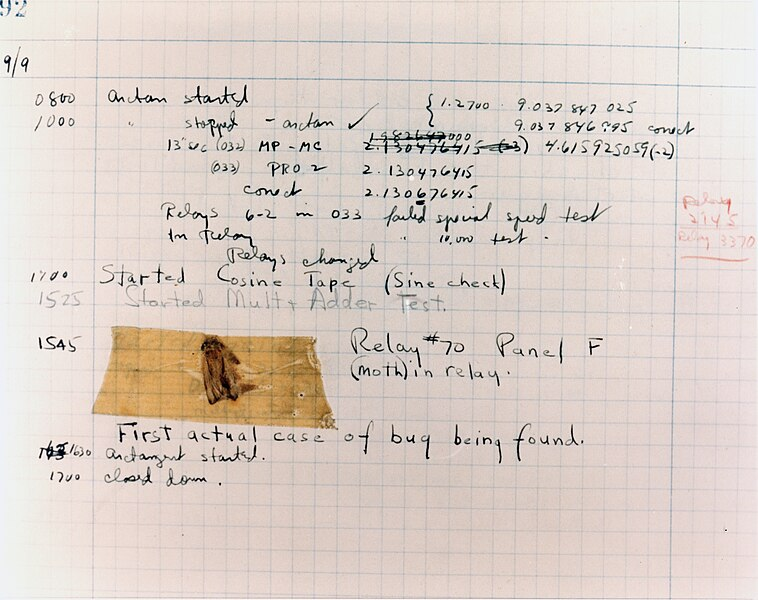
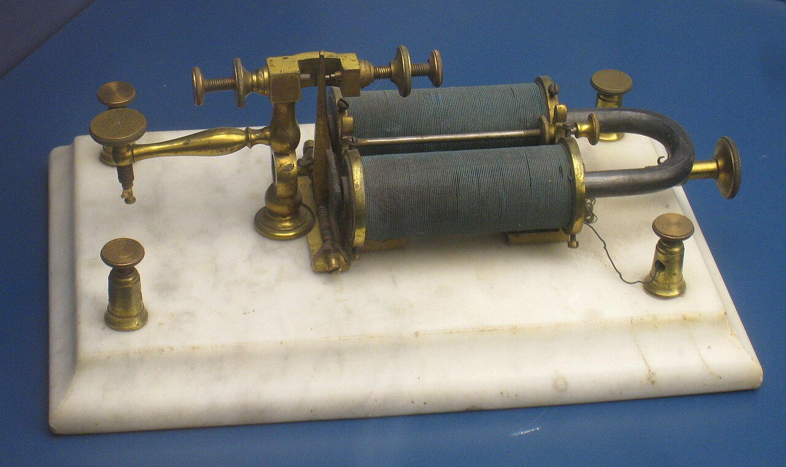
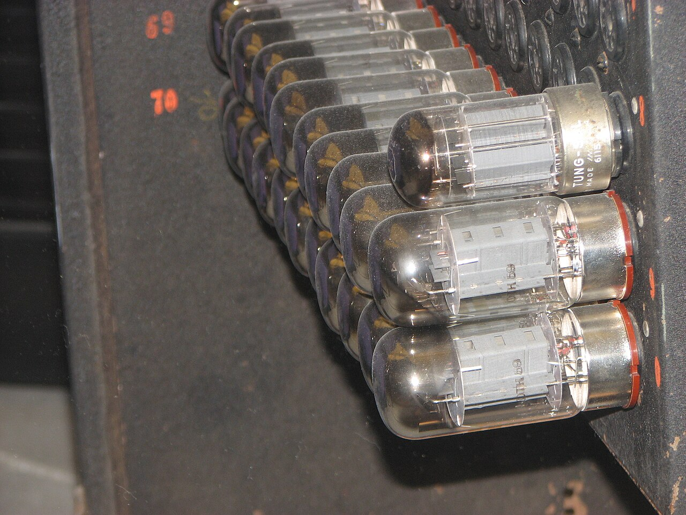
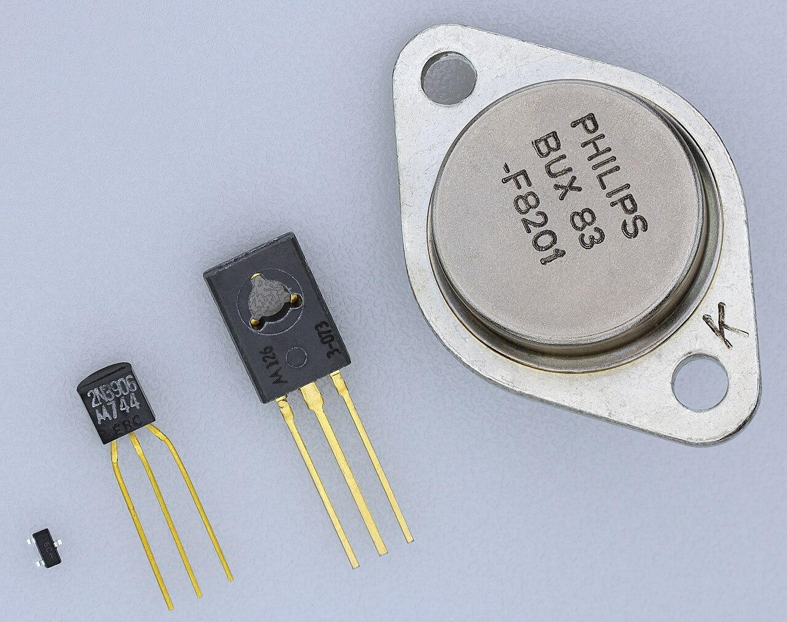
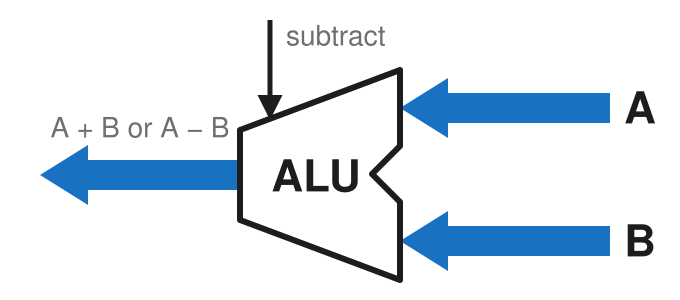

# How a computer works

Architecture & Deployment <!-- .element: class="subtitle" -->

**Notes:**

What a computer physically does when it runs a program, from the bottom up, and
what the processes of a deployment actually are.

---

### The main components of a computer

- Processor (**CPU**: **c**entral **p**rocessing **u**nit)
- Memory (**RAM**: **r**andom **a**ccess **m**emory)
- Storage (**disk** or **SSD**: **s**olid **s**tate **d**rive)
- Input and output (**I/O**)
- The **buses** that connect them

**Notes:**

Most of the components you may think about when you think about a computer, like
the screen, keyboard, mouse, network card, USB ports, etc., are **I/O**: they
let the computer communicate with the outside world.

They are not really what a computer fundamentally is: a computer is a machine
that runs programs, and the programs are what make it do things. From that point
of view, the main components are the CPU, memory, storage and buses. The rest is
just various forms of I/O.

---

## Binary

---

### Eight bits

01010011

**Notes:**

A **bit** is a single binary digit: 0 or 1. Eight bits make a **byte**, the
unit a computer's memory is counted in.

Eight bits can be set in 2⁸ = 256 different ways, from `00000000` to
`11111111`.

Nothing in the bits themselves says what they mean. They can be a number, but
also a shade of gray, a color or a letter, as the next slides show. The meaning
comes from the program that reads them, not from the bits.

---

### Numbers as binary

<table class="font-mono text-5xl">
  <tbody>
    <tr>
      <td class="border-b-0! px-2! text-center!">0</td>
      <td class="border-b-0! px-2! text-center!">1</td>
      <td class="border-b-0! px-2! text-center!">0</td>
      <td class="border-b-0! px-2! text-center!">1</td>
      <td class="border-b-0! px-2! text-center!">0</td>
      <td class="border-b-0! px-2! text-center!">0</td>
      <td class="border-b-0! px-2! text-center!">1</td>
      <td class="border-b-0! px-2! text-center!">1</td>
    </tr>
    <tr class="text-2xl text-blue-500">
      <td class="border-b-0! px-2! text-center!">27 128</td>
      <td class="border-b-0! px-2! text-center!">26 64</td>
      <td class="border-b-0! px-2! text-center!">25 32</td>
      <td class="border-b-0! px-2! text-center!">24 16</td>
      <td class="border-b-0! px-2! text-center!">23 8</td>
      <td class="border-b-0! px-2! text-center!">22 4</td>
      <td class="border-b-0! px-2! text-center!">21 2</td>
      <td class="border-b-0! px-2! text-center!">20 1</td>
    </tr>
  </tbody>
</table>

010100112 = 8310

**Notes:**

Read as a number written in base 2 (binary), each position is worth twice the
position to its right, as each position of a decimal number is worth ten times
the position to its right. The rightmost position is worth 20 = 1,
and the leftmost 27 = 128.

`01010011` has a 1 in four positions, worth 64, 16, 2 and 1, so it is the
decimal number 64 + 16 + 2 + 1 = **83**. The small number after each number says
which base it is written in: 010100112 is in base 2, and
8310 in base 10.

A byte read this way holds any whole number from 0 (`00000000`) to 255
(`11111111`): 256 numbers, one for each way of setting its eight bits.

---

### Gray levels as binary

<code>01010011</code> = 83 of 255: about 67% black

**Notes:**

One way to use a byte is as a shade of gray: 0 is black, 255 is white, and the
254 integers in between are increasingly lighter grays. The grid shows all 256
of them, in order, 16 per row: 0 at the top left, 255 at the bottom right.

The highlighted cell is 83, in the sixth row (80 to 95), fourth column. It is
83 / 255 ≈ 33% of the way from black to white, so it is a dark gray, about 67%
black.

An image stored with one byte per pixel this way is an 8-bit grayscale image.

---

### Colors as binary

<code class="text-4xl">01010011</code> = about 29% red, 57% green, 100% blue

**Notes:**

The same byte can also be a color. A screen makes every color it shows by
mixing red, green and blue light, so a color can be stored as three numbers:
how much red, how much green and how much blue. This is called **RGB**.

Eight bits do not divide by three, so one common scheme, **8-bit color**, gives
3 bits to red, 3 to green and 2 to blue. Blue gets fewer bits because the human
eye is least sensitive to it. Red and green each have 2³ = 8 levels, from 0 to
7, and blue has 2² = 4 levels, from 0 to 3.

Read that way, `01010011` is:

- red `010`, 2 of 7, about 29%: a little red;
- green `100`, 4 of 7, about 57%: some green;
- blue `11`, 3 of 3, 100%: all the blue there is.

A little red, some green and full blue make a light sky blue. The grid shows
all 256 colors in the same order as the gray levels, and the highlighted cell
is in the same place: it is the same byte, 83, read differently.

---

### Images as binary

<code class="text-4xl">01010011</code> = red 2, green 4, blue 3

**Notes:**

An image is a grid of **pixels**, short for "picture elements", and each pixel
is one color. With the 8-bit colors of the previous slide, each pixel is one
byte, so the whole image is a list of numbers, one per pixel, row by row.

This is Mario, the character of _Super Mario Bros._, released by Nintendo in
1985 for the NES (Nintendo Entertainment System), a game console of the 8-bit
era. He is 12 pixels wide and 16 high: 192 pixels, so 192 bytes. He is redrawn
here with the 8-bit colors of the previous slide.

The highlighted pixel, in the sky next to his cap, is the byte `01010011` of the
previous slides: red 2 of 7, green 4 of 7 and blue 3 of 3, a light sky blue.

Today's images and screens use more bits per pixel: one byte for each of red,
green and blue, 24 bits per pixel, which gives 256 levels each and over 16
million colors. It is the `rgb()` notation of CSS: the blue of the sky is
`rgb(73, 146, 255)` (2/7, 4/7 and 3/3 of 255), or `#4992ff` in hexadecimal. A
photo from a modern camera is the same grid of numbers at a much larger scale:
a 1920 × 1080 image has over 2 million pixels, and at 3 bytes per pixel, it
takes about 6 MB before it is compressed.

---

### Videos as binary

<code class="text-3xl">01010011</code> → <code class="text-3xl">11010000</code> → <code class="text-3xl">10100100</code>

**Notes:**

A video is a sequence of images, called **frames**, shown one after the other
fast enough for the eye to see movement instead of separate pictures. Since each
image is a list of numbers, a video is a longer list of numbers: one image after
the other.

This Mario walks with 3 frames of 16 × 16 pixels, each shown for an eighth of a
second: 8 frames per second. At one byte per pixel, each frame is 256 bytes, and
the whole animation is 3 × 256 = 768 bytes, played over and over.

The highlighted pixel stays in the same place, but its byte changes from one
frame to the next: `01010011`, the blue of the sky and the byte of the
previous slides, then `11010000`, the skin
of his hand, then `10100100`, the red of his overalls. Nothing moves on a
screen: each pixel only changes color.

A modern video works the same way at a much larger scale. A 1920 × 1080 frame
at 3 bytes per pixel is about 6 MB, as on the previous slide, and a video
usually shows 30 frames per second: about 187 MB for every second of video.
That is why videos are always compressed, for example by storing only what
changes from one frame to the next.

---

### Text as binary

<table class="mx-auto font-mono text-sm [&_td]:px-[0.5ch]!">
  <tr>
    <td></td><td></td><td></td>
    <td colspan="3">
      

        <svg viewBox="0 0 230 56" class="absolute inset-0 h-full w-full" aria-label="Plus 32">
          <path d="M20 52 V30 H180 V52" fill="none" stroke="#d9480f" stroke-width="3" />
          <path d="M173 44 L180 53 L187 44" fill="none" stroke="#d9480f" stroke-width="3" />
          <text x="100" y="22" text-anchor="middle" font-size="22" fill="#d9480f">+32</text>
        </svg>
      

    </td>
  </tr>
  <tr>
    <td>SP32</td><td>048</td><td>&#64;64</td><td>P80</td><td>&#96;96</td><td>p112</td>
  </tr>
  <tr>
    <td>&#33;33</td><td>149</td><td>A65</td><td>Q81</td><td>a97</td><td>q113</td>
  </tr>
  <tr>
    <td>&#34;34</td><td>250</td><td>B66</td><td>R82</td><td>b98</td><td>r114</td>
  </tr>
  <tr>
    <td>&#35;35</td><td>351</td><td>C67</td><td class="bg-yellow-200 font-bold">S83</td><td>c99</td><td class="bg-yellow-200 font-bold">s115</td>
  </tr>
  <tr>
    <td>&#36;36</td><td>452</td><td>D68</td><td>T84</td><td>d100</td><td>t116</td>
  </tr>
  <tr>
    <td>&#37;37</td><td>553</td><td>E69</td><td>U85</td><td>e101</td><td>u117</td>
  </tr>
  <tr>
    <td>&#38;38</td><td>654</td><td>F70</td><td>V86</td><td>f102</td><td>v118</td>
  </tr>
  <tr>
    <td>&#39;39</td><td>755</td><td>G71</td><td>W87</td><td>g103</td><td>w119</td>
  </tr>
  <tr>
    <td>&#40;40</td><td>856</td><td>H72</td><td>X88</td><td>h104</td><td>x120</td>
  </tr>
  <tr>
    <td>&#41;41</td><td>957</td><td>I73</td><td>Y89</td><td>i105</td><td>y121</td>
  </tr>
  <tr>
    <td>&#42;42</td><td>&#58;58</td><td>J74</td><td>Z90</td><td>j106</td><td>z122</td>
  </tr>
  <tr>
    <td>&#43;43</td><td>&#59;59</td><td>K75</td><td>&#91;91</td><td>k107</td><td>&#123;123</td>
  </tr>
  <tr>
    <td>&#44;44</td><td>&#60;60</td><td>L76</td><td>&#92;92</td><td>l108</td><td>&#124;124</td>
  </tr>
  <tr>
    <td>&#45;45</td><td>&#61;61</td><td>M77</td><td>&#93;93</td><td>m109</td><td>&#125;125</td>
  </tr>
  <tr>
    <td>&#46;46</td><td>&#62;62</td><td>N78</td><td>&#94;94</td><td>n110</td><td>&#126;126</td>
  </tr>
  <tr>
    <td>&#47;47</td><td>&#63;63</td><td>O79</td><td>&#95;95</td><td>o111</td><td>DEL127</td>
  </tr>
</table>

**Notes:**

Text is numbers too: a character table gives every character a number, its
**code point**. The table that most others build on is **ASCII** (American
Standard Code for Information Interchange), from 1963. It has 128 characters,
numbered 0 to 127.

The slide shows codes 32 to 127, in columns of 16. Codes 0 to 31 are control
characters, such as the line feed (10) that ends a line, which are not printed.
`SP` (32) is the space, and `DEL` (127) is another control character.

Some things worth noticing:

- The digits are characters like any other: the character `0` is code point 48,
  not code point 0.
- The uppercase letters start at 65, with `A`, and the lowercase ones at 97,
  with `a`: the lowercase letters come exactly 32 after the uppercase ones.
- `S`, highlighted, is 83: the byte `01010011` of the previous slides, read as
  a letter. Its lowercase `s`, also highlighted, is 83 + 32 = 115.

**UTF-8**, the encoding of almost all text on the web today, can store over a
million characters, from every writing system and emoji. Its first 128 code
points are the ASCII table, and UTF-8 stores each of them as a single byte, the
same as in ASCII. `S` is 83 and `s` is 115 in both, so text written only in
ASCII characters is also valid UTF-8.

---

### Transforming data is arithmetic

| Letter | Code point |                         Binary                          |
| :----: | :--------: | :-----------------------------------------------------: |
|  `S`   |     83     | <code>01010011</code> |
|  `s`   |    115     | <code>01110011</code> |

**Notes:**

`s` is `S` plus 32. In binary, 32 is the value of a single bit, the sixth from
the right (bit 5, counting from 0), and that is the only bit that differs
between the two letters. The same is true of every other letter of the table:
`B` (66) and `b` (98), all the way to `Z` (90) and `z` (122).

So changing the case of a letter is adding or subtracting 32, which is the same
as flipping that single bit.

A computer does not know what letters are. It only manipulates numbers, but
since letters, colors and images are all stored as numbers, manipulating
numbers is enough to manipulate any data.

---

## Electricity

---

### A closed circuit

<logic-diagram name="closed-circuit" controls="none" theme="light" style="width: 640px; margin: 0 auto">
</logic-diagram>

**Notes:**

A circuit is a loop: current leaves the battery from its `+` end, goes through
the switch and the lamp, and comes back to the battery's `-` end.

When the switch is open, the loop is broken and no current flows anywhere in
it, so the lamp stays dark. When the switch is closed, the loop is complete,
current flows and the lamp lights up.

---

### The electromagnet

<logic-diagram name="sounder-circuit" controls="none" theme="light" style="width: 640px; margin: 0 auto">
</logic-diagram>

**Notes:**

The same circuit, with a **sounder** in place of the lamp. A sounder is a coil
of wire around a piece of iron. When current flows through the coil, the iron
becomes a magnet, an **electromagnet**, and pulls down an iron bar, which
clicks. When the current stops, the iron is no longer a magnet, and a spring
pulls the bar back up.

Closing the switch makes one click, and opening it makes another. The sounder
turns current into movement, which can be heard.

---

### The telegraph

<logic-diagram name="telegraph-two-wires" controls="none" theme="light" style="width: 800px; margin: 0 auto">
</logic-diagram>

**Notes:**

The same loop, stretched between two towns. This is the **telegraph**: the first
long-distance "instant" communication system (milliseconds instead of minutes
for optical telegraphs, or days by horse).

The switch is now a **key**, a switch that stays closed only while it is
pressed. Pressing the key in one town makes the sounder click in the other.

Telegraph operators sent letters in **Morse code**, as short and long presses of
the key, and the operator at the other end listened to the clicks to read them.

The circuit is still a loop, so it needs two long wires between the towns: one
for the current to go there, and one for it to come back.

---

### The earth as ground

<logic-diagram name="telegraph" controls="none" theme="light" style="width: 800px; margin: 0 auto">
</logic-diagram>

**Notes:**

The earth conducts electricity. With a metal stake driven into the ground at
each end of the line, the current can come back through the earth instead of
through a second wire. The earth completes the circuit, and the telegraph needs
only one long wire instead of two, which only costs half as much.

A connection to the earth is called a **ground**.

---

### The telegraph repeater

<logic-diagram name="telegraph-repeater" controls="none" theme="light" style="width: 800px; margin: 0 auto">
</logic-diagram>

**Notes:**

A long wire resists the current, which gets weaker with distance. Past a certain
length, it is too weak to pull the sounder's bar.

The solution is a station halfway, with a **relay**. A relay is a sounder whose
bar closes a contact instead of clicking. The contact connects a fresh battery,
at the halfway station, to the next stretch of line. The weak current that
arrives only has to move the bar, and the strong current from the fresh battery
carries the signal on to the next town. A line can have as many relays as it
needs, one every stretch.

The name comes from the relay stations of the old postal routes, where tired
horses were swapped for fresh ones.

---

### The ground symbol

<logic-diagram name="telegraph-repeater-grounds" controls="none" theme="light" style="width: 800px; margin: 0 auto">
</logic-diagram>

**Notes:**

The same repeater, with each stake in the earth replaced by the **ground
symbol**. Every ground is connected to every other one through the earth, so a
current that goes into one ground can come back out of another.

In a computer, ground is not the earth, but a wire that all the circuits share
to send their current back. It is drawn with the same symbol.

---

### The source symbol

<logic-diagram name="telegraph-repeater-sources" controls="none" theme="light" style="width: 800px; margin: 0 auto">
</logic-diagram>

**Notes:**

Each battery's `-` end is connected to the ground, so there is no need to draw
it. Only its `+` end is drawn, as a **power source**: a point that supplies
current, which comes back through the ground.

The source is marked `V`, for **voltage**: the electrical "pressure" with which
a battery pushes current around a circuit, measured in **volts**. Both words
come from Alessandro Volta, the Italian physicist who invented the battery
in 1800.

The ground and the source are the two symbols used in all the circuits from now
on.

---

### The relay

<logic-diagram name="relay-single" controls="none" theme="light" style="width: 640px; margin: 0 auto">
</logic-diagram>

**Notes:**

The relay alone, much like the one used in the telegraph repeater. A relay is a
**switch controlled by current**: current through its coil closes its contact.

It connects two separate circuits. The first one goes from a source through the
switch A and the relay's coil to the ground. The second one goes from another
source through the relay's contact and the lamp to the ground. No current goes
from one circuit to the other, but the first one controls the second.

Much like the telegraph, the relay's second circuit could in turn control
another relay, and so on. This is what makes it possible to build circuits out
of relays.

---

## Logic

---

### A relay

<!-- .element: class="corner-title" -->

  <logic-diagram id="relay-single" name="relay-single" controls="none" theme="light" style="width: 600px">
  </logic-diagram>
  <truth-table for="relay-single" theme="light"></truth-table>

**Notes:**

From now on, **1 means current, and 0 means no current**. The input A is 1 when
its switch is closed, and the output OUT is 1 when the lamp is lit.

A **truth table** lists the output for every possible value of the inputs. This
one is the simplest there is: 0 in gives 0 out, and 1 in gives 1 out. The relay
does not change the value.

---

### NOT

<!-- .element: class="corner-title fragment" -->

  <logic-diagram id="relay-not" name="relay-not" controls="none" theme="light" style="width: 600px">
  </logic-diagram>
  <truth-table for="relay-not" theme="light"></truth-table>

**Notes:**

A relay has a second contact, which is closed when there is no current in the
coil, and opens when the coil pulls the bar. If the lamp is connected to this
top contact instead of the bottom one, the lamp is lit when A is 0, and goes out
when A is 1.

The output is the opposite of the input: this is **NOT**, the `!` operator of
most programming languages, also called an **inverter**.

---

### AND

<!-- .element: class="corner-title fragment" -->

  <logic-diagram id="relay-and" name="relay-and" controls="none" theme="light" style="width: 600px">
  </logic-diagram>
  <truth-table for="relay-and" theme="light"></truth-table>

**Notes:**

Two relays **in series**: the current goes through A's contact, then through B's
contact, before it reaches the lamp. Both contacts must be closed for current to
get through, so the lamp is lit only when A **and** B are 1.

This is **AND**, the `&&` operator of most programming languages.

---

### OR

<!-- .element: class="corner-title fragment" -->

  <logic-diagram id="relay-or" name="relay-or" controls="none" theme="light" style="width: 600px">
  </logic-diagram>
  <truth-table for="relay-or" theme="light"></truth-table>

**Notes:**

Two relays **in parallel**: each one has its own source and its own path to the
lamp. Current gets through either one of them, so the lamp is lit when A **or**
B is 1, or both.

This is **OR**, the `||` operator of most programming languages.

---

### XOR

<!-- .element: class="corner-title fragment" -->

  <logic-diagram id="relay-xor" name="relay-xor" controls="none" theme="light" style="width: 600px">
  </logic-diagram>
  <truth-table for="relay-xor" theme="light"></truth-table>

**Notes:**

This circuit uses both contacts of each relay. It is wired like the light of a
staircase, which has a switch at the bottom and one at the top: flipping either
switch changes the light, whatever the position of the other one.

The lamp is lit when exactly one of A and B is 1, but not when both are. This is
**XOR**, for "exclusive or": A or B, but not both.

Most programming languages write it `^`. For two booleans, it is the same as
`!=`: the output is 1 when the two inputs are different.

---

### The first bug that was caught (1947)

**Notes:**

Early computers were built out of relays like the ones of the previous circuits:
they are called **electromechanical** computers, because their switches are
moved by electromagnets.

On 9 September 1947, the operators of the Harvard Mark II, a relay computer,
found a moth trapped between the contacts of relay number 70, which stopped it
from working. They taped the moth into the machine's log book, with the note
"First actual case of bug being found".

Engineers already called a fault a "bug" before that, which is the joke of the
note: this time, it was a real one. Debugging these computers could mean
finding the actual insect in the machine.

_Picture: Naval Surface Warfare Center, Dahlgren, 1988, public domain, from
[Wikimedia Commons](https://commons.wikimedia.org/wiki/File:First_Computer_Bug,_1947.jpg)_

---

### The buffer and NOT symbols

<!-- .element: class="corner-title" -->

  <logic-diagram id="buffer-and-not" name="buffer-and-not" controls="none" theme="light" style="width: 520px">
  </logic-diagram>
  <truth-table for="buffer-and-not" theme="light"></truth-table>

**Notes:**

Drawing every relay with its coil, contacts, source and ground quickly becomes
unreadable, so each circuit gets a symbol, called a **logic gate**. The symbols
leave out the sources and grounds, and only show the inputs and outputs.

The triangle stands for a single relay, and is called a **buffer**: its output
follows A. The NOT is the same triangle with a small circle on its output, and
its output is the opposite of A. That circle is the only difference between the
two symbols.

---

### The AND symbol

<!-- .element: class="corner-title" -->

  <logic-diagram id="and-gate" name="and-gate" controls="none" theme="light" style="width: 520px">
  </logic-diagram>
  <truth-table for="and-gate" theme="light"></truth-table>

**Notes:**

The AND circuit, its two relays in series, drawn as a single symbol. Its truth
table is the same as the relay circuit's: the output is 1 only when A and B are
both 1.

---

### The inversion bubble

<!-- .element: class="corner-title" -->

  <logic-diagram id="inversion-bubble" name="inversion-bubble" controls="none" theme="light" style="width: 600px">
  </logic-diagram>
  <truth-table for="inversion-bubble" theme="light"></truth-table>

**Notes:**

Three gates fed by the same A and B: an AND, the same AND followed by a NOT, and
a **NAND**, for "not AND".

The NAND is drawn as an AND with a small circle on its output, like the NOT. It
has the same behavior as the AND followed by a NOT, but drawn as a single gate:
its symbol is a contraction of the two.

The small circle means **inversion**: the output is the opposite of what the
gate would give without it. That is why the last two outputs always agree,
whatever A and B are.

Also notice that a gate can have an output of 1 when all its inputs are 0. If
you do not understand why, go back to the first relay circuit and study it
again. Understand that the current that flows to the lamp comes from the source,
not from the input. Inputs only control whether the source's current can reach
the lamp. The source is not drawn in the gate symbols, but it is always there.

---

### Logic gates

<!-- .element: class="corner-title" -->

  <logic-diagram id="gate-gallery" name="gate-gallery" controls="none" theme="light" style="width: 480px">
  </logic-diagram>
  

    <truth-table for="gate-gallery" columns="A,BUFFER,NOT" theme="light"></truth-table>
    <truth-table for="gate-gallery" columns="A,B,AND,NAND" theme="light"></truth-table>
    <truth-table for="gate-gallery" columns="A,B,OR,NOR,XOR" theme="light"></truth-table>
  

**Notes:**

The classic logic gates used in the rest of the circuits, all fed by the same A
and B, with their truth tables:

- The **buffer** and **NOT** only take A.
- **AND** is 1 when both inputs are 1, and **NAND** is its opposite.
- **OR** is 1 when at least one input is 1, and **NOR**, "not OR", is its
  opposite.
- **XOR** is 1 when exactly one input is 1.

Each gate stands for a relay circuit like the ones before.

---

### Same logic, different switches

  

    
    
Relay ~1940

  

  

    
    
Vacuum tube ~1945

  

  

    
    
Transistor ~1955

  

**Notes:**

The circuits of this course are drawn with relays, but any switch controlled by
electricity can build the same gates. Computers have been built from three
kinds:

- **Relays**, like this telegraph relay from the 1850s. The first computers,
  such as Konrad Zuse's Z3 in 1941, were built out of relays. A relay moves a
  metal bar, so it is slow, and it wears out.
- **Vacuum tubes**, here on a panel of ENIAC, finished in 1945, which had over
  17,000 of them. In a glass tube emptied of air, a small voltage controls a
  current that flows through the vacuum. Nothing moves, so they are much faster
  than relays, but they are bulky, get hot, use a lot of electricity, and burn
  out like light bulbs.
- **Transistors**, invented at Bell Labs in 1947, and used in computers from the
  mid-1950s. A small current or voltage controls a larger one through a solid
  crystal, usually of silicon. Nothing moves either, and they are much smaller,
  faster, cooler and more reliable than vacuum tubes. The ones in the picture
  are single transistors; a modern processor packs billions of much smaller ones
  onto one chip.

The gates built out of any of them work the same way: the logic does not depend
on what the switches are made of.

_Pictures from Wikimedia Commons: [telegraph relay][telegraph-relay] by Daderot,
public domain; [ENIAC tubes][eniac-tubes] by Erik Pitti, CC BY 2.0;
[transistors][transistors] by Mister rf, CC BY-SA 3.0_

---

## Computing

---

### Adding in decimal

<table class="font-mono text-5xl">
  <tbody>
    <tr class="text-3xl text-red-500">
      <td class="border-b-0! px-2! text-center!"></td>
      <td class="border-b-0! px-2! text-center!">1</td>
      <td class="border-b-0! px-2! text-center!">1</td>
      <td class="border-b-0! px-2! text-center!"></td>
    </tr>
    <tr>
      <td class="border-b-0! px-2! text-center!"></td>
      <td class="border-b-0! px-2! text-center!"></td>
      <td class="border-b-0! px-2! text-center!">5</td>
      <td class="border-b-0! px-2! text-center!">8</td>
    </tr>
    <tr>
      <td class="border-b-0! px-2! text-center!">+</td>
      <td class="border-b-0! px-2! text-center!"></td>
      <td class="border-b-0! px-2! text-center!">6</td>
      <td class="border-b-0! px-2! text-center!">7</td>
    </tr>
    <tr>
      <td class="border-b-0! px-2! text-center! border-t-4! [border-top-style:solid]!"></td>
      <td class="border-b-0! px-2! text-center! border-t-4! [border-top-style:solid]!">1</td>
      <td class="border-b-0! px-2! text-center! border-t-4! [border-top-style:solid]!">2</td>
      <td class="border-b-0! px-2! text-center! border-t-4! [border-top-style:solid]!">5</td>
    </tr>
  </tbody>
</table>

**Notes:**

Add column by column, from the right:

- Add the digits of the rightmost column: 8 + 7 = 15, which does not fit in one
  digit. Write the 5 and carry the 1 into the next column, the tens.
- The next column adds three digits, 5 + 6 and the carry, which makes 12: write
  the 2 and carry the 1 again.
- Nothing is left to add in the hundreds column but the carry, so it becomes the
  third digit. The final sum is 125.

This is classic **addition with carry**, the technique taught in school when you
learn to add multi-digit numbers.

---

### Adding in binary

<table class="font-mono text-5xl">
  <tbody>
    <tr class="text-3xl text-red-500">
      <td class="border-b-0! px-2! text-center!"></td>
      <td class="border-b-0! px-2! text-center!">1</td>
      <td class="border-b-0! px-2! text-center!">1</td>
      <td class="border-b-0! px-2! text-center!">1</td>
      <td class="border-b-0! px-2! text-center!"></td>
    </tr>
    <tr>
      <td class="border-b-0! px-2! text-center!"></td>
      <td class="border-b-0! px-2! text-center!">0</td>
      <td class="border-b-0! px-2! text-center!">1</td>
      <td class="border-b-0! px-2! text-center!">1</td>
      <td class="border-b-0! px-2! text-center! relative">17</td>
    </tr>
    <tr>
      <td class="border-b-0! px-2! text-center!">+</td>
      <td class="border-b-0! px-2! text-center!">0</td>
      <td class="border-b-0! px-2! text-center!">0</td>
      <td class="border-b-0! px-2! text-center!">1</td>
      <td class="border-b-0! px-2! text-center! relative">13</td>
    </tr>
    <tr>
      <td class="border-b-0! px-2! text-center! border-t-4! [border-top-style:solid]!"></td>
      <td class="border-b-0! px-2! text-center! border-t-4! [border-top-style:solid]! relative">123 8</td>
      <td class="border-b-0! px-2! text-center! border-t-4! [border-top-style:solid]! relative">022 4</td>
      <td class="border-b-0! px-2! text-center! border-t-4! [border-top-style:solid]! relative">121 2</td>
      <td class="border-b-0! px-2! text-center! relative border-t-4! [border-top-style:solid]!">01020 1</td>
    </tr>
  </tbody>
</table>

**Notes:**

The same method, in binary instead of decimal, to add `0111` (7 in decimal) and
`0011` (3 in decimal):

- In the rightmost column, `1` + `1` = `10` in binary (2 in decimal): write the
  0 and carry the 1, as 8 + 7 = 15 does in decimal.
- The next column adds three bits, 1 + 1 and the carry, which makes `11` in
  binary (3 in decimal): write a 1 and carry a 1.
- In the next column, 0 + 1 and the carry makes `10` in binary (2 in decimal):
  write a 0 and carry a 1.
- The carry goes into the final column. 0 + 0 and the carry makes `1` in binary
  (1 in decimal). The final sum is `1010` (10 in decimal).

Every column does the same thing: it adds two bits and the carry from the column
on its right, and gives a sum bit and a carry for the column on its left.

---

### The sum and carry of two bits

  

    <table class="fragment m-0! font-mono text-4xl font-bold text-[#1d1d1f]" data-fragment-index="1">
      <thead>
        <tr>
          <th class="px-[0.5em]! py-[0.2em]! text-center! font-sans font-semibold [border-bottom:2px_solid_#1d1d1f]!">A</th>
          <th class="px-[0.5em]! py-[0.2em]! text-center! font-sans font-semibold [border-bottom:2px_solid_#1d1d1f]!">B</th>
          <th class="px-[0.5em]! py-[0.2em]! text-center! font-sans font-semibold [border-bottom:2px_solid_#1d1d1f]! [border-left:3px_solid_#1d1d1f]!">SUM</th>
        </tr>
      </thead>
      <tbody>
        <tr>
          <td class="px-[0.5em]! py-[0.15em]! text-center! [border-bottom:1px_solid_#a3a3a8]!">0</td>
          <td class="px-[0.5em]! py-[0.15em]! text-center! [border-bottom:1px_solid_#a3a3a8]!">0</td>
          <td class="px-[0.5em]! py-[0.15em]! text-center! [border-bottom:1px_solid_#a3a3a8]! [border-left:3px_solid_#1d1d1f]!">0</td>
        </tr>
        <tr>
          <td class="px-[0.5em]! py-[0.15em]! text-center! [border-bottom:1px_solid_#a3a3a8]!">0</td>
          <td class="px-[0.5em]! py-[0.15em]! text-center! [border-bottom:1px_solid_#a3a3a8]!">1</td>
          <td class="px-[0.5em]! py-[0.15em]! text-center! [border-bottom:1px_solid_#a3a3a8]! [border-left:3px_solid_#1d1d1f]!">1</td>
        </tr>
        <tr>
          <td class="px-[0.5em]! py-[0.15em]! text-center! [border-bottom:1px_solid_#a3a3a8]!">1</td>
          <td class="px-[0.5em]! py-[0.15em]! text-center! [border-bottom:1px_solid_#a3a3a8]!">0</td>
          <td class="px-[0.5em]! py-[0.15em]! text-center! [border-bottom:1px_solid_#a3a3a8]! [border-left:3px_solid_#1d1d1f]!">1</td>
        </tr>
        <tr>
          <td class="px-[0.5em]! py-[0.15em]! text-center! [border-bottom:1px_solid_#a3a3a8]!">1</td>
          <td class="px-[0.5em]! py-[0.15em]! text-center! [border-bottom:1px_solid_#a3a3a8]!">1</td>
          <td class="px-[0.5em]! py-[0.15em]! text-center! [border-bottom:1px_solid_#a3a3a8]! [border-left:3px_solid_#1d1d1f]!">0</td>
        </tr>
      </tbody>
    </table>
    
XOR

  

  

    <table class="fragment m-0! font-mono text-4xl font-bold text-[#1d1d1f]" data-fragment-index="2">
      <thead>
        <tr>
          <th class="px-[0.5em]! py-[0.2em]! text-center! font-sans font-semibold [border-bottom:2px_solid_#1d1d1f]!">A</th>
          <th class="px-[0.5em]! py-[0.2em]! text-center! font-sans font-semibold [border-bottom:2px_solid_#1d1d1f]!">B</th>
          <th class="px-[0.5em]! py-[0.2em]! text-center! font-sans font-semibold [border-bottom:2px_solid_#1d1d1f]! [border-left:3px_solid_#1d1d1f]! whitespace-nowrap">Carry out</th>
        </tr>
      </thead>
      <tbody>
        <tr>
          <td class="px-[0.5em]! py-[0.15em]! text-center! [border-bottom:1px_solid_#a3a3a8]!">0</td>
          <td class="px-[0.5em]! py-[0.15em]! text-center! [border-bottom:1px_solid_#a3a3a8]!">0</td>
          <td class="px-[0.5em]! py-[0.15em]! text-center! [border-bottom:1px_solid_#a3a3a8]! [border-left:3px_solid_#1d1d1f]!">0</td>
        </tr>
        <tr>
          <td class="px-[0.5em]! py-[0.15em]! text-center! [border-bottom:1px_solid_#a3a3a8]!">0</td>
          <td class="px-[0.5em]! py-[0.15em]! text-center! [border-bottom:1px_solid_#a3a3a8]!">1</td>
          <td class="px-[0.5em]! py-[0.15em]! text-center! [border-bottom:1px_solid_#a3a3a8]! [border-left:3px_solid_#1d1d1f]!">0</td>
        </tr>
        <tr>
          <td class="px-[0.5em]! py-[0.15em]! text-center! [border-bottom:1px_solid_#a3a3a8]!">1</td>
          <td class="px-[0.5em]! py-[0.15em]! text-center! [border-bottom:1px_solid_#a3a3a8]!">0</td>
          <td class="px-[0.5em]! py-[0.15em]! text-center! [border-bottom:1px_solid_#a3a3a8]! [border-left:3px_solid_#1d1d1f]!">0</td>
        </tr>
        <tr>
          <td class="px-[0.5em]! py-[0.15em]! text-center! [border-bottom:1px_solid_#a3a3a8]!">1</td>
          <td class="px-[0.5em]! py-[0.15em]! text-center! [border-bottom:1px_solid_#a3a3a8]!">1</td>
          <td class="px-[0.5em]! py-[0.15em]! text-center! [border-bottom:1px_solid_#a3a3a8]! [border-left:3px_solid_#1d1d1f]!">1</td>
        </tr>
      </tbody>
    </table>
    
AND

  

**Notes:**

Adding two bits, as in the rightmost column of a binary addition, gives two
bits: a sum and a carry. The sum is 1 when exactly one of the two bits is 1.
The carry is 1 only when both are, since 1 + 1 = `10` in binary.

As you may or may not have noticed, it just so happens that these are exactly
the truth tables of XOR and AND.

---

### The half adder

<!-- .element: class="corner-title" -->

<logic-diagram id="half-adder" name="half-adder" names="true" controls="none" theme="light" style="width: 700px; margin: 0 auto">
</logic-diagram>
<truth-table for="half-adder" theme="light"></truth-table>

**Notes:**

The binary sum and carry truth tables, built with logic gates: A and B go into
both an XOR and an AND. The XOR gives the sum bit, `SUM`, and the AND gives the
carry bit, `Cout` ("carry out"), which goes out to the next column on the left.

It is only half an adder because it adds two bits and nothing else. That is
enough for the rightmost column of an addition, but every other column also has
to add the carry coming in from the column on its right.

---

### The full adder

<!-- .element: class="corner-title" -->

<logic-diagram id="full-adder" name="full-adder" names="true" controls="none" theme="light" style="width: 960px; margin: 0 auto">
</logic-diagram>
<truth-table for="full-adder" split="2" theme="light"></truth-table>

  
  
  
  

**Notes:**

A full adder adds three bits: A, B and the carry in, `Cin`, from the column on
its right. It is two half adders and an OR gate:

- The first half adder, on the left, adds A and B, as in the previous circuit.
- The second half adder, in the middle, adds the carry in to the first sum bit.
  Its sum is the full adder's sum bit, `SUM`.
- Each half adder can produce a carry, and the OR combines them: the carry out,
  `Cout`, is 1 when either one carries. The first carries when A and B are both
  1, the second when exactly one of them is 1 and so is the carry in. Put
  simply, the carry out is 1 when at least two of the three inputs are 1.

The two half adders never carry at the same time: when A and B are both 1, their
sum bit is 0, so the second half adder has nothing to carry. That is why a plain
OR is enough to combine them. When all three inputs are 1, the first half adder
carries and the second one's sum is 1: `SUM` and `Cout` are both 1, which is
`11` in binary, 3.

---

### The full adder as a block

<!-- .element: class="hidden" -->

<logic-diagram name="full-adder-block" names="true" controls="none" theme="light" style="width: 480px; margin: 0 auto">
</logic-diagram>

**Notes:**

This is how a full adder is usually drawn: the same circuit, but hidden inside a
box. The inputs and outputs are the same, and its behavior is unchanged.

---

### 4-bit ripple-carry adder

<!-- .element: class="corner-title" -->

<logic-diagram name="four-bit-adder" names="true" controls="none" theme="light" style="width: 900px; margin: 0 auto">
</logic-diagram>

**Notes:**

If we can add one bit with carry, we can add four bits with carry: four full
adders, one for each column of the addition. The carry out of each adder goes
into the carry in of the next one on the left, so **the carry ripples through
the four adders**. The final carry out is the carry of the whole addition, which
is 1 when the sum is 16 or more (a situation also known as an overflow: a sum of
16 or more does not fit in four bits).

And if we can add 4 bits, we can add 8 bits, and 16, and 32, and so on: just
keep chaining full adders together, with the carry rippling from right to left.
Modern CPUs use faster circuits to add many bits at once, but the ripple-carry
adder is the simplest way to do it.

---

### The ALU

**A**rithmetic **L**ogic **U**nit

**Notes:**

A processor's adder is part of its **ALU**, its **arithmetic logic unit**. It
takes two numbers, A and B, and gives back a result. A **control signal** tells
it which operation to perform.

A circuit that can add can also subtract, because A − B is the same as A + (−B).
Negative numbers are written in binary in a way called **two's complement**,
where −B is obtained by inverting every bit of B and adding 1. With an inverter
on each bit of B, switched on by a single "subtract" signal, and that same
signal used as the first adder's carry in to add the 1, the same adder computes
A − B instead of A + B.

A modern processor's ALU can do much more than add and subtract. It can also
apply **logic operations** like AND, OR, XOR and NOT to every bit of its
operands at once, compare two numbers, or shift their bits left or right. Each
is a circuit built out of gates, and the control signals choose which one gives
the result.

---

## Remembering

---

### SR latch

<!-- .element: class="corner-title" -->

<logic-diagram name="sr-latch" names="true" controls="none" theme="light" style="width: 640px; margin: 0 auto">
</logic-diagram>

**Notes:**

Two NOR gates, each one's output wired back into the other one's input. This is
**feedback**: an output that comes back to an input.

- Turning SET on makes Q̅ 0. The NOR that gives Q then has both its inputs at 0,
  so Q becomes 1.
- Turning RESET on does the opposite: Q becomes 0, and Q̅ becomes 1.
- When SET and RESET are both off, nothing forces the outputs anymore, and each
  NOR keeps the other one where it is: **Q stays at the last value it was
  given**.

The circuit **remembers** one bit: whether it was last set or reset. It is
called a **latch**, like a door latch that stays where it was pushed. Q̅, "not
Q", is always the opposite of Q.

Turning SET and RESET on at the same time is not allowed (by convention): it
would force both outputs to 0, and then Q̅ would no longer be the opposite of Q.

---

### D latch

<!-- .element: class="corner-title" -->

<logic-diagram name="d-latch" names="true" controls="none" theme="light" style="width: 800px; margin: 0 auto">
</logic-diagram>

  
  
  
  

**Notes:**

The SR latch, with two AND gates and a NOT in front of it, to store a bit on
demand. DATA is the bit to store, and WRITE says when to store it.

- While WRITE is 1, DATA goes to SET, and its opposite, through the NOT, goes to
  RESET. A 1 sets the latch and a 0 resets it, so **Q follows DATA**.
- While WRITE is 0, both ANDs give 0, the latch gets neither SET nor RESET, and
  **Q keeps the last value of DATA**, whatever DATA does afterwards.

Because of the NOT, SET and RESET can never be on at the same time, so the
forbidden state of the SR latch cannot happen.

---

### The D latch as a block

<!-- .element: class="hidden" -->

<logic-diagram name="d-latch-block" names="true" controls="none" theme="light" style="width: 480px; margin: 0 auto">
</logic-diagram>

**Notes:**

This is how a D latch is usually drawn: the same circuit, but hidden inside a
box. The inputs and outputs are the same, and its behavior is unchanged.

---

### Selector

<!-- .element: class="corner-title" -->

<logic-diagram name="selector" names="true" highlight="true" controls="none" theme="light" style="width: 640px; margin: 0 auto">
</logic-diagram>

**Notes:**

A selector chooses which of its data inputs reaches its output. SELECT picks
one: while it is 0, `D0` reaches the output `Y`, and while it is 1, `D1` does.

Each data input goes through an AND. SELECT opens one AND directly and the
other through a NOT, so exactly one AND is open at a time: the one whose data
input gets through. The OR then passes on whatever comes out of the open AND.

Its usual name is a **multiplexer**, or MUX: several inputs share a single
output, one at a time.

---

### 2-to-4 decoder

<!-- .element: class="corner-title" -->

<logic-diagram name="decoder-2-to-4" names="true" highlight="true" controls="none" theme="light" style="width: 640px; margin: 0 auto">
</logic-diagram>

**Notes:**

The selector's mirror image: one input, DATA, sent to one of four outputs. The
address, `A1` and `A0`, read as a two-bit binary number, picks which output:
`Y0` for `00`, `Y1` for `01`, `Y2` for `10`, `Y3` for `11`. The other outputs
stay at 0.

The ANDs have three inputs instead of two, and work the same way: the output is
1 only when all three inputs are 1. Each AND gets DATA and one line of each
address bit, which runs down two lines, as it is and inverted by a NOT. Each AND
taps a different pair of lines, so that for a given address only one AND has
both its address inputs at 1. That AND lets DATA through.

It is called **2-to-4** because a decoder is counted by its address bits: 2 bits
can say 2² = 4 different numbers, so they choose among 4 outputs. A 3-bit
address gives a 3-to-8 decoder, and so on.

A decoder with a data input like this one is also called a **demultiplexer**, or
DEMUX, the multiplexer's mirror image, and a demultiplexer is counted by its
data instead: one data input to four outputs is a **1-to-4** demultiplexer. Both
names are right for this circuit.

---

### The decoder as a block

<!-- .element: class="hidden" -->

<logic-diagram name="decoder-block" names="true" highlight="true" controls="none" theme="light" style="width: 480px; margin: 0 auto">
</logic-diagram>

**Notes:**

The same decoder drawn as a box: the address picks which of the four outputs
DATA reaches. The circuit inside does not change; the box hides it so that the
diagrams that use it stay readable.

---

### 4-to-1 selector

<!-- .element: class="corner-title" -->

<logic-diagram name="selector-4-to-1" names="true" highlight="true" controls="none" theme="light" style="width: 640px; margin: 0 auto">
</logic-diagram>

**Notes:**

The selector again, with four data inputs, `D0` to `D3`. One SELECT input can
only choose between two, so it takes two select bits, `S1` and `S0`, read as a
binary number: `00` lets `D0` through, `01` for `D1`, `10` for `D2` and `11` for
`D3`.

The select bits are wired like the decoder's address bits, each one as it is and
inverted, so that only one AND is open at a time. The OR has four inputs instead
of two, and works the same way: its output is 1 when any of its inputs is 1, so
it passes on whatever comes out of the open AND.

It is named **4-to-1** because a multiplexer is counted by its data: four inputs
to one output. Its two select bits are the same as the decoder's two address
bits, which is why it is called 4-to-1 while the decoder is called 2-to-4.

---

### The selector as a block

<!-- .element: class="hidden" -->

<logic-diagram name="selector-block" names="true" highlight="true" controls="none" theme="light" style="width: 480px; margin: 0 auto">
</logic-diagram>

**Notes:**

The same 4-to-1 selector drawn as a box: the select bits pick which of the four
data inputs reaches the output.

---

### Addressable memory

<!-- .element: class="corner-title" -->

<logic-diagram name="addressable-memory" names="true" highlight="true" controls="none" theme="light" style="width: 530px; margin: 0 auto">
</logic-diagram>

  
  
  
  

**Notes:**

The decoder, four D latches and the selector, put together: a memory of four
cells of one bit each. Each cell is a D latch, and the two address bits, `A1`
and `A0`, choose which one is used. Each cell's output is labelled with its
address.

- **Writing**: DATA goes to every cell, but WRITE goes through the decoder,
  which only sends it to the cell at the address. Only that cell stores DATA,
  and the others keep their value.
- **Reading**: the selector gets the same address, and passes the value of the
  cell at that address on to OUT.

Any cell can be reached directly by its address, in any order. This is the
**random access** of RAM, random access memory.

---

### A 4-bit address gives a 16-byte memory

  
0000

  
0001

  
0010

  
0011

  
0100

  
0101

  
0110

  
0111

  
1000

  
1001

  
1010

  
1011

  
1100

  
1101

  
1110

  
1111

**Notes:**

4 address bits give 2⁴ possibilities, which is 16 addresses. How many bits of
data can be stored at each address is up to the designer: one bit, one byte (8
bits), or more. This can be achieved by wiring enough D latches to each address
and having the decoder select them all at once.

Modern memory is generally addressable per byte, meaning that each address gives
8 bits of data. A 4-bit address gives 16 bytes, a 16-bit address gives 65,536
bytes (64 KiB), and a 32-bit address gives 4,294,967,296 bytes (4 GiB).

---

## Ticking

---

### Buzzer

<!-- .element: class="corner-title" -->

<logic-diagram name="relay-buzzer" controls="none" theme="light" style="width: 640px; margin: 0 auto">
</logic-diagram>

**Notes:**

A relay whose coil is fed through its own contact, the one that is closed at
rest. When the switch is closed:

1. Current flows through the contact into the coil.
2. The coil pulls the bar, which opens the contact.
3. The coil no longer gets current, so it releases the bar, which closes the
   contact again, and everything starts over.

The bar keeps moving back and forth on its own, as long as the switch is closed,
and buzzes. Old electric doorbells work this way.

---

### Oscillator

<!-- .element: class="corner-title" -->

<logic-diagram name="not-oscillator" names="true" controls="none" theme="light" style="width: 560px; margin: 0 auto">
</logic-diagram>

**Notes:**

The buzzer, drawn with a gate. A relay feeding its own coil through its normally
closed contact is a NOT gate whose output goes back to its input. Its output
never agrees with its input, so it keeps flipping, as fast as the gate can
switch. A circuit whose output keeps switching back and forth on its own is an
**oscillator**.

---

### Clock

<!-- .element: class="corner-title" -->

<logic-diagram name="clock-lamp" names="true" controls="none" theme="light" style="width: 480px; margin: 0 auto">
</logic-diagram>

**Notes:**

An oscillator that switches at a steady pace is a **clock**, drawn from now on
as this symbol. Computers use a clock to keep everything in step: every tick of
the clock is one step of what a computer is doing.

A real computer's clock does not use a NOT gate, whose pace drifts with
temperature and voltage: it uses a quartz crystal, which vibrates at a very
stable frequency, billions of ticks per second in a modern processor.

---

## Counting

---

### Edge-triggered D-type flip-flop

<!-- .element: class="corner-title" -->

<logic-diagram name="d-flip-flop" names="true" controls="none" theme="light" style="width: 900px; margin: 0 auto">
</logic-diagram>

  
  
  
  

**Notes:**

The edge-triggered D-type flip-flop is a peculiar circuit that can be very
useful in a computer. You may notice that it is in fact two D latches in a row,
with an additional NOT gate.

Clicking the clock pauses it at its current level. Paused, it splits in two:
clicking its 0/1 half flips the level by hand, one edge at a time, and its ▶
half lets it run again. This works on every clock from here on.

---

### Two latches make a flip-flop

<!-- .element: class="hidden" -->

<logic-diagram name="d-flip-flop-latches" clock="running" names="true" controls="none" theme="light" style="width: 720px; margin: 0 auto">
</logic-diagram>

**Notes:**

This time represented with blocks, the edge-triggered D flip-flop is two D
latches in a row, and a NOT gate. The first latch gets DATA, and the clock
through the NOT: it is open, following DATA, while the clock is low (0). The
second latch gets the first one's Q, and the clock directly: it is open while
the clock is high (1), and copies the first latch.

The two latches are never open together, so DATA never runs straight through to
Q. When the clock rises from 0 to 1, the first latch closes on the value DATA
had just before, and the second one opens and passes that value on to Q. Q only
changes when the clock rises from 0 to 1.

Pause the clock to step through it by hand: lower CLK and change DATA, then
raise CLK and see which latch opens.

---

### The D flip-flop as a block

<!-- .element: class="hidden" -->

<logic-diagram name="d-flip-flop-block" names="true" controls="none" theme="light" style="width: 480px; margin: 0 auto">
</logic-diagram>

**Notes:**

The same flip-flop drawn as a box. The wedge on the clock input marks it as
edge-triggered: Q only takes DATA's value when CLK rises. Pause the clock to
raise CLK by hand.

---

### Frequency divider

<!-- .element: class="corner-title" -->

<logic-diagram name="frequency-divider" names="true" controls="none" theme="light" style="width: 400px; margin: 0 auto">
</logic-diagram>

<table class="fragment mt-8 text-[#1d1d1f]" data-fragment-index="0">
  <tbody>
    <tr>
      <th class="border-b-0! py-0! pr-6! text-right! align-middle font-sans text-3xl">CLK</th>
      <td class="p-0! w-14 h-12 text-center! align-middle font-mono text-3xl [border-bottom:4px_solid_currentColor]!"></td>
      <td class="p-0! w-14 h-12 text-center! align-middle font-mono text-3xl border-b-0! [border-top:4px_solid_currentColor]! [border-left:4px_solid_currentColor]!"></td>
      <td class="p-0! w-14 h-12 text-center! align-middle font-mono text-3xl [border-bottom:4px_solid_currentColor]! [border-left:4px_solid_currentColor]!"></td>
      <td class="p-0! w-14 h-12 text-center! align-middle font-mono text-3xl border-b-0! [border-top:4px_solid_currentColor]! [border-left:4px_solid_currentColor]!"></td>
      <td class="p-0! w-14 h-12 text-center! align-middle font-mono text-3xl [border-bottom:4px_solid_currentColor]! [border-left:4px_solid_currentColor]!"></td>
      <td class="p-0! w-14 h-12 text-center! align-middle font-mono text-3xl border-b-0! [border-top:4px_solid_currentColor]! [border-left:4px_solid_currentColor]!"></td>
      <td class="p-0! w-14 h-12 text-center! align-middle font-mono text-3xl [border-bottom:4px_solid_currentColor]! [border-left:4px_solid_currentColor]!"></td>
      <td class="p-0! w-14 h-12 text-center! align-middle font-mono text-3xl border-b-0! [border-top:4px_solid_currentColor]! [border-left:4px_solid_currentColor]!"></td>
    </tr>
    <tr>
      <td class="border-b-0! p-0! h-6" colspan="9"></td>
    </tr>
    <tr>
      <th class="border-b-0! py-0! pr-6! text-right! align-middle font-sans text-3xl">Q</th>
      <td class="p-0! w-14 h-12 text-center! align-middle font-mono text-3xl [border-bottom:4px_solid_currentColor]!">0</td>
      <td class="p-0! w-14 h-12 text-center! align-middle font-mono text-3xl border-b-0! [border-top:4px_solid_currentColor]! [border-left:4px_solid_currentColor]!">1</td>
      <td class="p-0! w-14 h-12 text-center! align-middle font-mono text-3xl border-b-0! [border-top:4px_solid_currentColor]!">1</td>
      <td class="p-0! w-14 h-12 text-center! align-middle font-mono text-3xl [border-bottom:4px_solid_currentColor]! [border-left:4px_solid_currentColor]!">0</td>
      <td class="p-0! w-14 h-12 text-center! align-middle font-mono text-3xl [border-bottom:4px_solid_currentColor]!">0</td>
      <td class="p-0! w-14 h-12 text-center! align-middle font-mono text-3xl border-b-0! [border-top:4px_solid_currentColor]! [border-left:4px_solid_currentColor]!">1</td>
      <td class="p-0! w-14 h-12 text-center! align-middle font-mono text-3xl border-b-0! [border-top:4px_solid_currentColor]!">1</td>
      <td class="p-0! w-14 h-12 text-center! align-middle font-mono text-3xl [border-bottom:4px_solid_currentColor]! [border-left:4px_solid_currentColor]!">0</td>
    </tr>
  </tbody>
</table>

**Notes:**

A D flip-flop feeding its Q̅ back into its D: on every rising edge of the clock,
it stores the opposite of what it holds, so Q flips. Q therefore goes through
one full cycle, off then on, for every two cycles of the clock: half the clock's
frequency.

The frequency of the output is half that of the input, so this circuit is a
**frequency divider**.

The timing diagram underneath shows it, with time running from left to right.
Each time CLK steps up, Q steps, up or down. A real flip-flop takes a moment to
respond, which the drawing leaves out.

Pause the clock to follow it one edge at a time.

---

### Program counter

<!-- .element: class="corner-title fragment" data-fragment-index="2" -->

<logic-diagram name="counter" names="true" controls="none" theme="light" style="width: 760px; margin: 0 auto">
</logic-diagram>

<table class="mt-8 text-[#1d1d1f]">
  <tbody>
    <tr>
      <th class="border-b-0! py-0! pr-6! text-right! align-middle font-sans text-2xl">CLK</th>
      <td class="p-0! w-8 h-10 text-center! align-middle font-mono text-2xl [border-bottom:4px_solid_currentColor]!"></td>
      <td class="p-0! w-8 h-10 text-center! align-middle font-mono text-2xl border-b-0! [border-top:4px_solid_currentColor]! [border-left:4px_solid_currentColor]!"></td>
      <td class="p-0! w-8 h-10 text-center! align-middle font-mono text-2xl [border-bottom:4px_solid_currentColor]! [border-left:4px_solid_currentColor]!"></td>
      <td class="p-0! w-8 h-10 text-center! align-middle font-mono text-2xl border-b-0! [border-top:4px_solid_currentColor]! [border-left:4px_solid_currentColor]!"></td>
      <td class="p-0! w-8 h-10 text-center! align-middle font-mono text-2xl [border-bottom:4px_solid_currentColor]! [border-left:4px_solid_currentColor]!"></td>
      <td class="p-0! w-8 h-10 text-center! align-middle font-mono text-2xl border-b-0! [border-top:4px_solid_currentColor]! [border-left:4px_solid_currentColor]!"></td>
      <td class="p-0! w-8 h-10 text-center! align-middle font-mono text-2xl [border-bottom:4px_solid_currentColor]! [border-left:4px_solid_currentColor]!"></td>
      <td class="p-0! w-8 h-10 text-center! align-middle font-mono text-2xl border-b-0! [border-top:4px_solid_currentColor]! [border-left:4px_solid_currentColor]!"></td>
      <td class="p-0! w-8 h-10 text-center! align-middle font-mono text-2xl [border-bottom:4px_solid_currentColor]! [border-left:4px_solid_currentColor]!"></td>
      <td class="p-0! w-8 h-10 text-center! align-middle font-mono text-2xl border-b-0! [border-top:4px_solid_currentColor]! [border-left:4px_solid_currentColor]!"></td>
      <td class="p-0! w-8 h-10 text-center! align-middle font-mono text-2xl [border-bottom:4px_solid_currentColor]! [border-left:4px_solid_currentColor]!"></td>
      <td class="p-0! w-8 h-10 text-center! align-middle font-mono text-2xl border-b-0! [border-top:4px_solid_currentColor]! [border-left:4px_solid_currentColor]!"></td>
      <td class="p-0! w-8 h-10 text-center! align-middle font-mono text-2xl [border-bottom:4px_solid_currentColor]! [border-left:4px_solid_currentColor]!"></td>
      <td class="p-0! w-8 h-10 text-center! align-middle font-mono text-2xl border-b-0! [border-top:4px_solid_currentColor]! [border-left:4px_solid_currentColor]!"></td>
      <td class="p-0! w-8 h-10 text-center! align-middle font-mono text-2xl [border-bottom:4px_solid_currentColor]! [border-left:4px_solid_currentColor]!"></td>
      <td class="p-0! w-8 h-10 text-center! align-middle font-mono text-2xl border-b-0! [border-top:4px_solid_currentColor]! [border-left:4px_solid_currentColor]!"></td>
    </tr>
    <tr>
      <td class="border-b-0! p-0! h-6" colspan="17"></td>
    </tr>
    <tr>
      <th class="border-b-0! py-0! pr-6! text-right! align-middle font-sans text-2xl">Q0</th>
      <td class="p-0! w-8 h-10 text-center! align-middle font-mono text-2xl [border-bottom:4px_solid_currentColor]!">0</td>
      <td class="p-0! w-8 h-10 text-center! align-middle font-mono text-2xl border-b-0! [border-top:4px_solid_currentColor]! [border-left:4px_solid_currentColor]!">1</td>
      <td class="p-0! w-8 h-10 text-center! align-middle font-mono text-2xl border-b-0! [border-top:4px_solid_currentColor]!">1</td>
      <td class="p-0! w-8 h-10 text-center! align-middle font-mono text-2xl [border-bottom:4px_solid_currentColor]! [border-left:4px_solid_currentColor]!">0</td>
      <td class="p-0! w-8 h-10 text-center! align-middle font-mono text-2xl [border-bottom:4px_solid_currentColor]!">0</td>
      <td class="p-0! w-8 h-10 text-center! align-middle font-mono text-2xl border-b-0! [border-top:4px_solid_currentColor]! [border-left:4px_solid_currentColor]!">1</td>
      <td class="p-0! w-8 h-10 text-center! align-middle font-mono text-2xl border-b-0! [border-top:4px_solid_currentColor]!">1</td>
      <td class="p-0! w-8 h-10 text-center! align-middle font-mono text-2xl [border-bottom:4px_solid_currentColor]! [border-left:4px_solid_currentColor]!">0</td>
      <td class="p-0! w-8 h-10 text-center! align-middle font-mono text-2xl [border-bottom:4px_solid_currentColor]!">0</td>
      <td class="p-0! w-8 h-10 text-center! align-middle font-mono text-2xl border-b-0! [border-top:4px_solid_currentColor]! [border-left:4px_solid_currentColor]!">1</td>
      <td class="p-0! w-8 h-10 text-center! align-middle font-mono text-2xl border-b-0! [border-top:4px_solid_currentColor]!">1</td>
      <td class="p-0! w-8 h-10 text-center! align-middle font-mono text-2xl [border-bottom:4px_solid_currentColor]! [border-left:4px_solid_currentColor]!">0</td>
      <td class="p-0! w-8 h-10 text-center! align-middle font-mono text-2xl [border-bottom:4px_solid_currentColor]!">0</td>
      <td class="p-0! w-8 h-10 text-center! align-middle font-mono text-2xl border-b-0! [border-top:4px_solid_currentColor]! [border-left:4px_solid_currentColor]!">1</td>
      <td class="p-0! w-8 h-10 text-center! align-middle font-mono text-2xl border-b-0! [border-top:4px_solid_currentColor]!">1</td>
      <td class="p-0! w-8 h-10 text-center! align-middle font-mono text-2xl [border-bottom:4px_solid_currentColor]! [border-left:4px_solid_currentColor]!">0</td>
    </tr>
    <tr>
      <td class="border-b-0! p-0! h-6" colspan="17"></td>
    </tr>
    <tr>
      <th class="border-b-0! py-0! pr-6! text-right! align-middle font-sans text-2xl">Q1</th>
      <td class="p-0! w-8 h-10 text-center! align-middle font-mono text-2xl [border-bottom:4px_solid_currentColor]!">0</td>
      <td class="p-0! w-8 h-10 text-center! align-middle font-mono text-2xl [border-bottom:4px_solid_currentColor]!">0</td>
      <td class="p-0! w-8 h-10 text-center! align-middle font-mono text-2xl [border-bottom:4px_solid_currentColor]!">0</td>
      <td class="p-0! w-8 h-10 text-center! align-middle font-mono text-2xl border-b-0! [border-top:4px_solid_currentColor]! [border-left:4px_solid_currentColor]!">1</td>
      <td class="p-0! w-8 h-10 text-center! align-middle font-mono text-2xl border-b-0! [border-top:4px_solid_currentColor]!">1</td>
      <td class="p-0! w-8 h-10 text-center! align-middle font-mono text-2xl border-b-0! [border-top:4px_solid_currentColor]!">1</td>
      <td class="p-0! w-8 h-10 text-center! align-middle font-mono text-2xl border-b-0! [border-top:4px_solid_currentColor]!">1</td>
      <td class="p-0! w-8 h-10 text-center! align-middle font-mono text-2xl [border-bottom:4px_solid_currentColor]! [border-left:4px_solid_currentColor]!">0</td>
      <td class="p-0! w-8 h-10 text-center! align-middle font-mono text-2xl [border-bottom:4px_solid_currentColor]!">0</td>
      <td class="p-0! w-8 h-10 text-center! align-middle font-mono text-2xl [border-bottom:4px_solid_currentColor]!">0</td>
      <td class="p-0! w-8 h-10 text-center! align-middle font-mono text-2xl [border-bottom:4px_solid_currentColor]!">0</td>
      <td class="p-0! w-8 h-10 text-center! align-middle font-mono text-2xl border-b-0! [border-top:4px_solid_currentColor]! [border-left:4px_solid_currentColor]!">1</td>
      <td class="p-0! w-8 h-10 text-center! align-middle font-mono text-2xl border-b-0! [border-top:4px_solid_currentColor]!">1</td>
      <td class="p-0! w-8 h-10 text-center! align-middle font-mono text-2xl border-b-0! [border-top:4px_solid_currentColor]!">1</td>
      <td class="p-0! w-8 h-10 text-center! align-middle font-mono text-2xl border-b-0! [border-top:4px_solid_currentColor]!">1</td>
      <td class="p-0! w-8 h-10 text-center! align-middle font-mono text-2xl [border-bottom:4px_solid_currentColor]! [border-left:4px_solid_currentColor]!">0</td>
    </tr>
    <tr>
      <td class="border-b-0! p-0! h-6" colspan="17"></td>
    </tr>
    <tr>
      <th class="border-b-0! py-0! pr-6! text-right! align-middle font-sans text-2xl">Q2</th>
      <td class="p-0! w-8 h-10 text-center! align-middle font-mono text-2xl [border-bottom:4px_solid_currentColor]!">0</td>
      <td class="p-0! w-8 h-10 text-center! align-middle font-mono text-2xl [border-bottom:4px_solid_currentColor]!">0</td>
      <td class="p-0! w-8 h-10 text-center! align-middle font-mono text-2xl [border-bottom:4px_solid_currentColor]!">0</td>
      <td class="p-0! w-8 h-10 text-center! align-middle font-mono text-2xl [border-bottom:4px_solid_currentColor]!">0</td>
      <td class="p-0! w-8 h-10 text-center! align-middle font-mono text-2xl [border-bottom:4px_solid_currentColor]!">0</td>
      <td class="p-0! w-8 h-10 text-center! align-middle font-mono text-2xl [border-bottom:4px_solid_currentColor]!">0</td>
      <td class="p-0! w-8 h-10 text-center! align-middle font-mono text-2xl [border-bottom:4px_solid_currentColor]!">0</td>
      <td class="p-0! w-8 h-10 text-center! align-middle font-mono text-2xl border-b-0! [border-top:4px_solid_currentColor]! [border-left:4px_solid_currentColor]!">1</td>
      <td class="p-0! w-8 h-10 text-center! align-middle font-mono text-2xl border-b-0! [border-top:4px_solid_currentColor]!">1</td>
      <td class="p-0! w-8 h-10 text-center! align-middle font-mono text-2xl border-b-0! [border-top:4px_solid_currentColor]!">1</td>
      <td class="p-0! w-8 h-10 text-center! align-middle font-mono text-2xl border-b-0! [border-top:4px_solid_currentColor]!">1</td>
      <td class="p-0! w-8 h-10 text-center! align-middle font-mono text-2xl border-b-0! [border-top:4px_solid_currentColor]!">1</td>
      <td class="p-0! w-8 h-10 text-center! align-middle font-mono text-2xl border-b-0! [border-top:4px_solid_currentColor]!">1</td>
      <td class="p-0! w-8 h-10 text-center! align-middle font-mono text-2xl border-b-0! [border-top:4px_solid_currentColor]!">1</td>
      <td class="p-0! w-8 h-10 text-center! align-middle font-mono text-2xl border-b-0! [border-top:4px_solid_currentColor]!">1</td>
      <td class="p-0! w-8 h-10 text-center! align-middle font-mono text-2xl [border-bottom:4px_solid_currentColor]! [border-left:4px_solid_currentColor]!">0</td>
    </tr>
    <tr>
      <td class="border-b-0! p-0! h-6" colspan="17"></td>
    </tr>
    <tr>
      <th class="border-b-0! py-0! pr-6!"></th>
      <td class="border-b-0! p-0! w-8 h-10 text-center! align-middle font-mono text-2xl text-blue-500"></td>
      <td class="border-b-0! p-0! w-8 h-10 text-center! align-middle font-mono text-2xl text-blue-500">1</td>
      <td class="border-b-0! p-0! w-8 h-10 text-center! align-middle font-mono text-2xl text-blue-500"></td>
      <td class="border-b-0! p-0! w-8 h-10 text-center! align-middle font-mono text-2xl text-blue-500">2</td>
      <td class="border-b-0! p-0! w-8 h-10 text-center! align-middle font-mono text-2xl text-blue-500"></td>
      <td class="border-b-0! p-0! w-8 h-10 text-center! align-middle font-mono text-2xl text-blue-500">3</td>
      <td class="border-b-0! p-0! w-8 h-10 text-center! align-middle font-mono text-2xl text-blue-500"></td>
      <td class="border-b-0! p-0! w-8 h-10 text-center! align-middle font-mono text-2xl text-blue-500">4</td>
      <td class="border-b-0! p-0! w-8 h-10 text-center! align-middle font-mono text-2xl text-blue-500"></td>
      <td class="border-b-0! p-0! w-8 h-10 text-center! align-middle font-mono text-2xl text-blue-500">5</td>
      <td class="border-b-0! p-0! w-8 h-10 text-center! align-middle font-mono text-2xl text-blue-500"></td>
      <td class="border-b-0! p-0! w-8 h-10 text-center! align-middle font-mono text-2xl text-blue-500">6</td>
      <td class="border-b-0! p-0! w-8 h-10 text-center! align-middle font-mono text-2xl text-blue-500"></td>
      <td class="border-b-0! p-0! w-8 h-10 text-center! align-middle font-mono text-2xl text-blue-500">7</td>
      <td class="border-b-0! p-0! w-8 h-10 text-center! align-middle font-mono text-2xl text-blue-500"></td>
      <td class="border-b-0! p-0! w-8 h-10 text-center! align-middle font-mono text-2xl text-blue-500">0</td>
    </tr>
  </tbody>
</table>

**Notes:**

Three frequency dividers in a chain. The first is clocked by the clock, and each
next one by the Q̅ of the one before, so each flips when the one before goes
back to 0, and runs at half its frequency.

Read each column of the timing diagram from the bottom up, Q2 then Q1 then Q0:
`000`, `001`, `010`, `011` … up to `111`, then `000` again.

If you read them as binary numbers, they count from 0 to 7, then back to 0. This
is a **3-bit counter**. It counts up by 1 on every clock cycle, and wraps around
to 0 after 7. We have a circuit that can count.

Pause the clock to count one edge at a time.

Computers use similar counters to keep track of where they are in a program. The
program counter allows them to step through a program one instruction at a time.
They also have additional logic to allow them to jump to a different
instruction, or to stop counting when the program is finished.

---

## Running a program

**Notes:**

We mentioned that binary data can represent numbers, colors, images, videos, and
text. There is one thing we left out: a computer can also run a program, which
is a sequence of instructions that tell it what to do.

---

### The instruction set

<!-- The code and the address sit close together, to read as the instruction's
     8 bits. -->
<table style="font-size: 0.85em">
  <thead>
    <tr>
      <th>Operation</th>
      <th class="text-right! pr-1!">Code</th>
      <th class="pl-1!">Address</th>
      <th>Effect</th>
    </tr>
  </thead>
  <tbody>
    <tr class="fragment" data-fragment-index="1"><td><code>LOAD x</code></td><td class="text-right! pr-1!"><code>0001</code></td><td class="pl-1!"><code>xxxx</code></td><td>memory[x] → acc</td></tr>
    <tr class="fragment" data-fragment-index="1"><td><code>STORE x</code></td><td class="text-right! pr-1!"><code>0100</code></td><td class="pl-1!"><code>xxxx</code></td><td>acc → memory[x]</td></tr>
    <tr class="fragment" data-fragment-index="2"><td><code>ADD x</code></td><td class="text-right! pr-1!"><code>0010</code></td><td class="pl-1!"><code>xxxx</code></td><td>acc + memory[x] → acc</td></tr>
    <tr class="fragment" data-fragment-index="2"><td><code>SUB x</code></td><td class="text-right! pr-1!"><code>0011</code></td><td class="pl-1!"><code>xxxx</code></td><td>acc − memory[x] → acc</td></tr>
    <tr class="fragment" data-fragment-index="3"><td><code>JUMP x</code></td><td class="text-right! pr-1!"><code>0110</code></td><td class="pl-1!"><code>xxxx</code></td><td>go to instruction x</td></tr>
    <tr class="fragment" data-fragment-index="3"><td><code>JUMPZ x</code></td><td class="text-right! pr-1!"><code>1000</code></td><td class="pl-1!"><code>xxxx</code></td><td>if acc = 0, go to instruction x</td></tr>
    <tr class="fragment" data-fragment-index="4"><td><code>HALT</code></td><td class="text-right! pr-1!"><code>1111</code></td><td class="pl-1!"></td><td>stop</td></tr>
  </tbody>
</table>

**Notes:**

Each CPU architecture (e.g. x86, ARM) has its own **instruction set**, which is
the list of things it can do. These instructions are encoded in binary form,
just like text or images.

The instructions in this table form a simplified instruction set for an 8-bit
computer with 16 memory cells (4-bit addresses). Each instruction consists of 4
bits for the **opcode** (**op**eration **code**) and 4 bits for the **address**,
making up a total of 8 bits. The opcode specifies what operation to perform,
while the address indicates where in memory to read from or write to.

- `memory[x]` means the value stored in memory cell `x`.
- `acc` stands for the **accumulator**, an 8-bit register that holds a value
  (built out of 8 flip-flops).
- `go to` sets the program counter to a new value, so the next instruction comes
  from that address.

The goal of most instructions is to control the flow of addresses and data from
one component to another, and to instruct each component to do its job. For
example, the `LOAD x` instruction moves the value from memory cell `x` into the
accumulator, while `STORE x` moves the value from the accumulator into memory
cell `x`.

To learn more: this instruction set is close to the SAP-1's, the
"Simple-As-Possible" teaching computer, which Ben Eater builds on breadboards,
control signals included, in his [8-bit computer](https://eater.net/8bit) video
series.

---

### From program to instructions

<pre class="m-0! w-auto!"><code class="language-js">let a = 3;
let counter = 2;
let result = 0;
do {
  result = result + a;
  counter = counter - 1;
} while (counter !== 0);</code></pre>
→
<pre class="m-0! w-auto!"><code class="language-plaintext">0001 1110
0010 1100
0100 1110
0001 1101
0011 1111
0100 1101
1000 1000
0110 0000
1111 0000</code></pre>

**Notes:**

A processor runs nothing but the instructions of its instruction set. A program
is either translated into such instructions by a **compiler**, ahead of time, or
as it runs, or carried out by an **interpreter**, a program made of such
instructions that reads it as data.

This program multiplies 3 by 2 the only way this machine can, by adding 3 twice,
since it cannot multiply directly. Each kind of instruction has its part: the
calculations become instructions that move values between memory and the
accumulator and compute with them, and the loop becomes jumps. The values
themselves, variables and numbers alike, are kept in memory cells.

---

<!-- .slide: class="full-diagram" -->

### The machine

<!-- .element: class="hidden" -->



**Notes:**

The circuits built so far, connected into a computer: the **ALU**, the counter
as the **program counter**, flip-flops holding the **accumulator** and the
**instruction register**, and latches holding the **memory** cells. Decoders and
selectors are used throughout to steer addresses and data: to pick a memory cell
by its address, to choose whether the program counter or the instruction gives
that address, or which component a value goes to.

Values, instructions included, travel 8 bits at a time on the **data bus**
(blue), and addresses 4 bits at a time on the **address bus** (orange). The
**control unit** directs everything with **control signals**: which component
puts its value on the data bus, which one takes it in, and what the ALU
computes. The ALU tells it on its **zero** wire whether its last result was 0,
which `JUMPZ` needs.

The control unit repeats the same cycle for every instruction:

1. **Fetch**: the instruction at the program counter's address comes into the
   instruction register, and the program counter adds 1.
2. **Decode**: the control unit reads the instruction's 4-bit operation code.
3. **Execute**: it has the other components move and compute values, using the
   instruction's address for the memory, or for the program counter on a jump.

On each tick of the clock, every component that holds a value takes its new
value at the same time, so each step's result is ready, and stays put, before
the next step uses it.

These few instructions are enough for the three building blocks of structured
programming: **sequence** (the program counter steps through instructions one at
a time), **selection** (`JUMPZ` chooses depending on the last result) and
**iteration** (a jump back). Every `if` and every loop comes down to such jumps.

Real processors of the time were more complex. They had several registers,
longer addresses to reach more memory, and instructions longer than one byte.
Their ALU also never computed on a value straight from memory: it was first
copied into a register.

---

### Since the 70s

  More speed
  More isolation

  

    <a href="https://en.wikipedia.org/wiki/Branch_predictor" class="text-3xl text-blue-700! hover:text-blue-600! hover:underline!">Branch prediction</a>
    <a href="https://en.wikipedia.org/wiki/Hardware-assisted_virtualization" class="text-4xl text-emerald-700! hover:text-emerald-600! hover:underline!">Hardware virtualization</a>
    <a href="https://en.wikipedia.org/wiki/Floating-point_unit" class="text-2xl text-blue-700! hover:text-blue-600! hover:underline!">FPU</a>
  

  

    <a href="https://en.wikipedia.org/wiki/64-bit_computing" class="text-3xl text-gray-600! hover:text-gray-500! hover:underline!">64 bits</a>
    <a href="https://en.wikipedia.org/wiki/CPU_cache" class="text-6xl text-blue-700! hover:text-blue-600! hover:underline!">Caches</a>
    <a href="https://en.wikipedia.org/wiki/Protection_ring" class="text-5xl text-emerald-700! hover:text-emerald-600! hover:underline!">Kernel and user modes</a>
  

  

    <a href="https://en.wikipedia.org/wiki/Instruction_pipelining" class="text-4xl text-blue-700! hover:text-blue-600! hover:underline!">Pipelining</a>
    <a href="https://en.wikipedia.org/wiki/Clock_rate" class="text-6xl text-blue-700! hover:text-blue-600! hover:underline!">Higher clock speeds</a>
    <a href="https://en.wikipedia.org/wiki/Low-power_electronics" class="text-2xl text-gray-600! hover:text-gray-500! hover:underline!">Lower power use</a>
  

  

    <a href="https://en.wikipedia.org/wiki/Virtual_memory" class="text-6xl text-emerald-700! hover:text-emerald-600! hover:underline!">Virtual memory</a>
    <a href="https://en.wikipedia.org/wiki/Multi-core_processor" class="text-5xl text-blue-700! hover:text-blue-600! hover:underline!">Several cores</a>
  

  

    <a href="https://en.wikipedia.org/wiki/System_on_a_chip" class="text-2xl text-gray-600! hover:text-gray-500! hover:underline!">More on one chip</a>
    <a href="https://en.wikipedia.org/wiki/Out-of-order_execution" class="text-4xl text-blue-700! hover:text-blue-600! hover:underline!">Out-of-order execution</a>
    <a href="https://en.wikipedia.org/wiki/Single_instruction,_multiple_data" class="text-3xl text-blue-700! hover:text-blue-600! hover:underline!">SIMD</a>
  

  

    <a href="https://en.wikipedia.org/wiki/Executable-space_protection" class="text-2xl text-emerald-700! hover:text-emerald-600! hover:underline!">Non-executable memory</a>
    <a href="https://en.wikipedia.org/wiki/Hardware_acceleration" class="text-2xl text-gray-600! hover:text-gray-500! hover:underline!">Specialized units</a>
  

**Notes:**

The conceptual CPU demonstrated before is still how a modern processor works: it
reads instructions from memory and executes them, one after the other. The
[Intel 8080](https://en.wikipedia.org/wiki/Intel_8080) (1974), an 8-bit
processor, is very close to it.

Almost everything that changed since the microprocessors of the 1970s makes them
faster or keeps programs isolated, without changing that model. The bigger the
word in the word cloud, the more influential it is. Each word links to more
about it.

The 8080 ran at 2 MHz: two million clock cycles per second. A processor today
runs at a few gigahertz, more than a thousand times faster, and memory has not
kept up. Without caches, which keep recently used memory close to the
processor, it would spend most of its time waiting for RAM.

Clock speeds stopped rising in the mid-2000s, when faster chips became too hot
to cool. Since then, speed comes mostly from several cores and from each core
doing more per cycle.

The 8080 also let any program do anything, such as overwrite the memory of
another one. With virtual memory, each process has its own addresses and cannot
reach the others'. Such protections existed on 1960s mainframes, and came to
microprocessors in the 1980s.

---

<!-- .slide: class="full-diagram" -->

### A more modern machine

<!-- .element: class="hidden" -->



**Notes:**

The same machine, with the numbers of a modern **x86-64** processor, the kind
most cloud servers run on:

- It works with **64 bits** at a time, and its addresses are 64 bits too: enough
  for far more memory than any computer has, where the previous machine's 4-bit
  addresses only reached 16 bytes.
- It has **16 registers** instead of a single accumulator, and **several ALUs**
  that compute on them.
- Its **caches**, L1, L2 and L3, keep copies of recently used memory close to
  the processor.
- Its instructions are **1 to 15 bytes** long, instead of always one.

It also shows parts the previous machine left out:

- The **firmware**, a small program built into the computer, on a **ROM** chip:
  read-only memory, which keeps its content without power.
- The **storage**, a disk that keeps programs and files. The memory (RAM) is
  **volatile**: it loses its content when the power is off. The storage is
  **persistent**: it keeps its content. The processor cannot address storage
  bytes directly: it asks the **disk controller**, which is on the buses, to
  copy them between the disk and the memory.

A modern computer no longer has a single shared bus as drawn here, but separate,
faster connections. What the drawing shows still holds: everything has an
address, and data travels between the processor and what it addresses.

---

<!-- .slide: class="full-diagram" data-transition="none" -->

### The machine at boot

<!-- .element: class="hidden" -->



**Notes:**

The same machine, with its processor drawn as a box. Unlike the previous
machine, it has several **cores**, drawn stacked: each one is a complete
processor that runs programs of its own. The storage and the devices (keyboard,
screen, network) sit behind their **controllers**, which are on the buses like
the memory. The processor talks to a controller by reading and writing its
registers, at addresses, as it does with memory.

At power-on, the memory is empty. The processor starts at a fixed address,
which leads to the firmware's chip instead of the memory. From there, **booting
is a chain of programs**: each one has the next copied from the storage into
memory, then jumps to its first instruction, and the processor runs it.

The processor does not copy the bytes itself. A program asks the disk
controller, which copies them into memory over the buses on its own. When it is
done, the controller sends an **interrupt**: the processor stops whatever it is
running and jumps to the kernel's code that handles it. Devices do the same when
a key is pressed or data arrives from the network. With nothing to run, the
kernel stops the processor until the next interrupt: a server spends most of its
time waiting.

A program in memory is its instructions, copied from its file, plus the data it
makes as it runs. The kernel gives it that memory, and frees it when the program
ends. Once booted, every program is started the same way, whenever it is needed:
a desktop and a browser on a laptop, or on a server, an SSH server and the
shells of the users who connect. The same program can even run twice, each copy
with its own memory.

A **program** is an inert file in the storage. A **process** is a program
copied into memory and being executed by the processor.

---

### Booting

1. The processor runs the **firmware** (UEFI), from a chip on the motherboard.
2. The firmware loads the **bootloader** (GRUB) from the disk and into memory.
3. The bootloader loads the **kernel** (Linux).
4. The kernel starts the **first process**, also called the **init process**
   (systemd on Linux).
5. The init process starts **everything else**: SSH, nginx, your application.

**Notes:**

Each stage of the chain, and what it does:

1. The **firmware**, on a chip on the motherboard, checks and prepares the
   hardware, the memory included, then looks for a disk to start from. The
   modern firmware is **UEFI**, which replaced the older **BIOS**.
2. The **bootloader** finds the operating system on the disk. On Linux, it is
   usually GRUB.
3. The **kernel** prepares everything it manages: the drivers, the memory, the
   other cores, and the disk's file system.
4. The kernel starts a single program: the **first process**, also called the
   **init process**, with process ID 1. On your Ubuntu server, it is
   **systemd**.
5. The init process starts everything else the machine has to run, such as the
   SSH server you connect to and later the web server for your deployments.
   Every other process on the machine was started either directly by the init
   process, or indirectly by a process that it started.

Cloud servers are typically virtual machines, so their firmware is not on a real
chip: the cloud provider's hypervisor provides it. The chain is otherwise the
same.

---

### The operating system

- Runs **programs** as **isolated processes**
- **Hides hardware** behind system calls: files, sockets
- Decides **who can do what**: permissions

**Notes:**

The operating system is the program that manages the computer for all the
others. Its responsibilities:

1. **It runs programs as isolated processes.** It loads any program from the
   disk into memory and starts it. A running program is a **process**. The same
   program can run as several processes at once: two SSH sessions to your server
   are two `bash` processes running the same program. Each process has its own
   memory, which no other process can read or write: processes are **isolated**.
   The processor itself enforces this, with virtual memory.
2. **It hides the hardware behind system calls.** Programs never move a hard
   drive's head or talk to a specific model of network card: **drivers**, parts
   of the operating system, do that for them. Programs ask the operating system
   instead, with **system calls**:
   - Without the operating system, a disk is billions of bytes. It organizes
     them into **files** with names, in **directories**. A file is only a
     sequence of bytes: as with the eight bits at the start, its meaning comes
     from the program that reads it.
   - It implements TCP/IP, and gives programs **sockets** to send and receive
     data over the network.

   System calls are the only way in: the processor runs programs in **user
   mode**, where the instructions that control the hardware are refused, and the
   operating system in **kernel mode**.

3. **It decides who can do what**, with users, groups and permissions.

The core of the operating system, which runs in kernel mode, is the **kernel**.
On most cloud servers, it is the Linux kernel. Programs such as the shell, `ls`
or `ssh` are not the operating system: they are ordinary programs that make
system calls, like the programs you write.

---

### How can they communicate?



**Notes:**

Guess It and PostgreSQL, from the [SFTP deployment](), are two processes on the same
server. Each has its own memory: Guess It cannot read PostgreSQL's, nor
PostgreSQL Guess It's. Yet both are able to communicate. How?

---

### Connecting processes

<ul>
  <li class="fragment"><strong>Files</strong>: one process writes, another reads</li>
  <li class="fragment"><strong>Pipes</strong>: one's output is another's input</li>
  <li class="fragment"><strong>Sockets</strong>: as over the network, locally too</li>
  <li class="fragment"><strong>Shared memory</strong>: one region, which both see</li>
</ul>

**Notes:**

Since processes are isolated, they can only communicate through channels the
operating system provides:

- **Files**: one process can write to a file, and another can read that file.
- **Pipes**: you can send the standard output of one process into the standard
  input of another, as the `|` of a [shell pipeline](#pipelines) does.
- **Sockets**: programs use them to communicate over the network, but two
  processes on the same machine can use them too. This is how Guess It talks
  to PostgreSQL: its `DATABASE_URL` says `localhost:5432`, a port on the
  loopback address, which never leaves the server. Guess It would connect the
  same way to a database on another machine, with that machine's address
  instead.
- **Shared memory**: two processes can both ask the operating system for the
  same region of memory, which both then see. It is the fastest channel, since
  nothing is copied, but also the hardest to use correctly: the processes must
  take turns, or they change the same data at the same time. PostgreSQL's own
  processes, one per connection, share their cached data this way.

---

### Taking turns

<!-- .element: class="corner-title" -->

<coffee-queues style="width: 900px; margin: 0 auto">
  
  
</coffee-queues>

**Notes:**

- When one row of people queue at one coffee machine, each person takes a turn.
- When two rows of people queue at the same machine, they have to take turns
  too. Two queues are moving, but only one person at a time is served.
- When two coffee machines are available, each row can use one, and both rows
  are served at the same time. Two queues are moving, and two people are served
  at the same time.

This analogy illustrates the difference between **concurrent** and **parallel**
programs: each queue stands in for a program and its instructions being
executed.

- With one CPU core, the programs are concurrent: they **take turns on the same
  core**. If it happens fast enough, you get the illusion that they run at the
  same time, but it is still no faster than running the two programs one after
  the other if they both keep the core busy.
- With two CPU cores, the programs are parallel: they can actually run **at the
  same time**, and the total work is done faster.

This is a simplification. A modern CPU core can also execute several independent
instructions of the same program at the same time, and some cores can run two
threads at once, but they share the same circuits, so it's still not as fast as
two cores.

_Analogy from [Joe Armstrong][armstrong-coffee], the creator of Erlang_

---

<!-- .slide: class="full-diagram" -->

### One core

<!-- .element: class="hidden" -->



**Notes:**

Programs being executed **concurrently** on a single core, like two rows of
people queueing at one coffee machine. Each process takes turns on the core, and
the kernel switches between them fast enough that both seem to run at once.

The kernel takes the core back with an interrupt, which happens at regular
intervals, a few hundred to a thousand times a second. The core jumps to the
kernel's code, regardless of what the process was doing. The kernel notes where
the process stopped, picks the one to run next, and jumps back into it where it
had stopped in turn.

This is one of the responsibilities the operating system handles transparently,
allowing what is known as
[time-sharing](https://en.wikipedia.org/wiki/Time-sharing) since the 1960s:
several users can run programs on the same machine at once, each thinking they
have the machine to themselves, even if it has only one core.

---

<!-- .slide: class="full-diagram" data-transition="none" -->

### Several cores

<!-- .element: class="hidden" -->



**Notes:**

Programs being executed **in parallel** on two cores, like two rows of people
queueing at two coffee machines. Each core is a complete processor that executes
its own instructions. A typical laptop today has between 4 and 16 cores.

With concurrency, we only get the illusion of programs running at the same time.
With parallelism, programs A and B in this illustration actually run at the same
time, and the total work is done faster.

A single program cannot choose a core itself. It asks the operating system for
more processes or **threads** (several flows of instructions inside one process,
sharing its memory), and the operating system decides which core runs each one
and when.

This means that a single program does not necessarily get faster on a machine
with more cores: it has to be programmed to use them, and its work has to be
splittable. Two cores make a program twice as fast only if its work splits
evenly between its threads.

In this illustration, program A is written as a single flow of instructions, so
it runs on one core while the other stays idle. Program C is written to run on
several cores: it has two threads, which the operating system can run on both
cores at once.

Read on with [two queues, one coffee machine](#appendix-two-queues-one-coffee-machine), to go further: work that cannot be
split, Node.js running all your JavaScript on a single thread, and how
processes, threads, event loops, Go and Erlang organize work in parallel.

[armstrong-coffee]: https://joearms.github.io/published/2013-04-05-concurrent-and-parallel-programming.html
[eniac-tubes]: https://commons.wikimedia.org/wiki/File:ENIAC_Tubes_%282585374699%29.jpg
[telegraph-relay]: https://commons.wikimedia.org/wiki/File:Telegraph_relay,_1850s.jpg
[transistors]: https://commons.wikimedia.org/wiki/File:Transistorer_%28cropped%29.jpg
