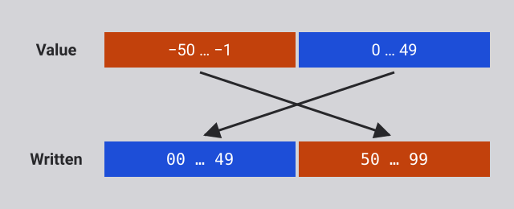

What a computer physically does when it runs a program, from the bottom up, and
what the processes of a deployment actually are.

<!-- more -->

**Recommended reading**

- [Unix Processes]()
- [Deploy a web application with SFTP]()

## Everything is numbers

Everything a computer holds is made of **bits**. A bit is a single binary digit:
0 or 1. Eight bits make a **byte**, the unit a computer's memory is counted in.
Eight bits can be set in 2⁸ = 256 different ways, from `00000000` to
`11111111`.

Here's a byte:

<p class="text-center font-mono text-4xl">01010011</p>

**Nothing in the bits themselves says what they mean.** The same byte can be a
number, a shade of gray, a color, part of a color (R, G or B), a letter, or an
instruction for the processor. The meaning comes from the program that reads it,
not from the bits.

### Counting in binary

Read as a number written in base 2, or **binary**, each position of a byte is
worth twice the position to its right, as each position of a decimal number is
worth ten times the position to its right:

| Position value | 128 | 64  | 32  | 16  |  8  |  4  |  2  |  1  |
| :------------- | :-: | :-: | :-: | :-: | :-: | :-: | :-: | :-: |
| Bit            |  0  |  1  |  0  |  1  |  0  |  0  |  1  |  1  |

`01010011` has a 1 in the positions worth 64, 16, 2 and 1, so it is the decimal
number 64 + 16 + 2 + 1 = **83**. A byte read this way holds any whole number from
0 (`00000000`) to 255 (`11111111`).

To write a decimal number in binary, go the other way: take the largest position
value that fits, write a 1 there, subtract it, and go on with what is left. 83
is 64 + 19, 19 is 16 + 3, and 3 is 2 + 1.

### The same byte, read differently

Read as a **gray level**, a byte goes from black (0) to white (255). 83 is about
a third of the way, a dark gray.

Read as a **color**, the same byte can be split into how much red, green and
blue light to mix: 3 bits for red, 3 for green and 2 for blue, a scheme called
8-bit color. `010` `100` `11` is a little red, some green and all the blue
there is: a light sky blue.




<!-- col -->






An **image** is a grid of such colors, called **pixels**, so an image is a list
of numbers, one per pixel, row by row. This Mario is 12 pixels wide and 16
high: 192 pixels, so 192 bytes.

A **video** is a sequence of images shown fast enough for the eye to see
movement, so it is a longer list of numbers.

<!-- col -->




Read as **text**, a byte is a character, through a table that gives every
character a number. In [ASCII][ascii], the table most others build on, 83 is
the letter `S`. [UTF-8][utf8], the encoding of almost all text on the web,
starts with the same 128 characters, each stored as the same single byte.

### Processing data is arithmetic

A computer does not know what letters, colors or images are. It only
manipulates numbers, but since everything is stored as numbers, manipulating
numbers is enough to manipulate any data:

- **Changing a letter's case** is adding or subtracting 32: `S` is 83 and `s` is 115. In binary, 32 is a single bit, so it is the only bit that differs between
  the two letters.
- **Inverting a gray image**, black for white, is subtracting each pixel's value
  from 255.
- **Brightening an image** is adding the same amount to every pixel, stopping at
  the maximum.
- **Fading a video to black** is multiplying every pixel by a fraction that gets
  smaller from one frame to the next, until it reaches 0.

Every program you use, however complex, comes down to calculations like these,
on a very large number of numbers.

### Adding in binary

Binary numbers add like decimal ones, column by column from the right, carrying
into the next column whatever does not fit. In binary, 1 + 1 does not fit in one
digit: it is `10` (2 in decimal), so you write the 0 and carry the 1:

```text
  111     carries
  0111    7
+ 0011    3
------
  1010    10
```

Every column adds two bits, plus the carry from the column on its right, and
gives a **sum** bit and a **carry** for the column on its left. Adding two bits
gives these two bits:

|  A  |  B  | Sum | Carry |
| :-: | :-: | :-: | :---: |
|  0  |  0  |  0  |   0   |
|  0  |  1  |  1  |   0   |
|  1  |  0  |  1  |   0   |
|  1  |  1  |  0  |   1   |

The sum is 1 when exactly one of the two bits is 1. The carry is 1 only when
both are.

## From switches to a machine

There is no magic in a computer, only **switches controlled by electricity**.
Say that **1 means current and 0 means no current**: a switch whose current
closes another switch can make one bit control another. Wired in different
ways, such switches make the operations of Boolean logic, the `!`, `&&` and `||`
of your programming languages, which are called **logic gates**. Here, two
switches in a row make AND: the lamp is lit only when A and B are both 1. Click
the switches to try it:

<logic-diagram name="relay-and" controls="none" style="max-width: 420px; margin: 0 auto"></logic-diagram>

Computers use binary because "no current" and "current" are easy to tell apart.
Ten levels of current, one per decimal digit, would not be.

The first computers used relays, electromagnets moving a metal bar; then vacuum
tubes; and since the 1950s, transistors. A modern processor holds billions of
transistors on one chip. The logic does not depend on what the switches are made
of.

The sum and carry above are two logic gates: the sum is **XOR**, "exclusive or"
(A or B, but not both), and the carry is **AND**. Together, they add two bits:

<logic-diagram name="half-adder" names="true" controls="none" style="max-width: 700px; margin: 0 auto"></logic-diagram>

Chain such circuits, one per column, and you have an adder. Wired in other ways,
gates can also **remember** a bit, **select** one of several inputs to pass on,
do the opposite and **send** one input to one of several outputs, and **count**.
The presentation shows each of these circuits working. That is everything a
processor needs.

**What matters here is not how switches are wired into gates, nor what the
gates' symbols look like: you do not need to remember either.** What matters is
what such circuits can do. Manipulating numbers, and therefore [processing any
data](#processing-data-is-arithmetic), takes nothing more than fairly simple
electrical circuits, and they do it very fast.

### Memory is addressed

A computer's memory is a long row of cells, usually of one byte each, and every
cell has a number: its **address**. The processor reads or writes a cell by
giving its address. Any cell can be reached directly, in any order, which is the
"random access" of **RAM**, random access memory.

Each bit of a cell is a small circuit that keeps the last value it was given.
This one stores DATA while WRITE is 1, and keeps it once WRITE is back to 0,
whatever DATA does afterwards:

<logic-diagram name="d-latch-block" names="true" controls="none" style="max-width: 480px; margin: 0 auto"></logic-diagram>

The number of bits in an address decides how many cells can be reached. A 4-bit
address gives 2⁴ = 16 addresses, so a 16-byte memory. A 32-bit address gives
4,294,967,296 bytes (4 GiB), and a 64-bit address, far more than any computer
has.

### The clock

A **clock** is a circuit that switches between 0 and 1 at a steady pace:

<logic-diagram name="clock-lamp" names="true" controls="none" style="max-width: 480px; margin: 0 auto"></logic-diagram>

It keeps everything in the processor in step: every component that holds a
value takes its new value on the same tick, so each step's result is ready
before the next step uses it. A processor's speed in gigahertz is how many
billions of ticks its clock gives per second.

The machine demonstrated in the presentation takes one tick for each step of
its work, to keep it simple. A real processor splits an instruction into many
smaller steps, over several ticks, and works on many instructions at once.

## Running a program

A program is a sequence of **instructions** for the processor, and each
instruction is a number, stored in memory like any other data. The list of
instructions a processor understands is its **instruction set**. The machine
demonstrated in the presentation has this one, with 8-bit instructions: 4 bits
say what to do, and 4 bits give an address in its 16-byte memory:

| Instruction | Bits        | Effect                          |
| :---------- | :---------- | :------------------------------ |
| `LOAD x`    | `0001 xxxx` | memory[x] → acc                 |
| `STORE x`   | `0100 xxxx` | acc → memory[x]                 |
| `ADD x`     | `0010 xxxx` | acc + memory[x] → acc           |
| `SUB x`     | `0011 xxxx` | acc − memory[x] → acc           |
| `JUMP x`    | `0110 xxxx` | go to instruction x             |
| `JUMPZ x`   | `1000 xxxx` | if acc = 0, go to instruction x |
| `HALT`      | `1111 0000` | stop                            |

`memory[x]` is the value in the cell at address `x` (4 bits). `acc` is the
**accumulator**, a **register**: a small memory inside the processor, built of
the same circuits as memory cells, which holds a value while the processor works
on it. Every calculation of this machine goes through its accumulator: it loads
a number into it, adds to it or subtracts from it, and stores the result back
into memory. This machine has a single register; a modern processor has many,
such as the 16 general-purpose registers of an x86-64 processor.

The instructions come in three kinds:

- **Moving data** between memory and the processor: `LOAD` and `STORE`.
- **Computing**: `ADD` and `SUB`, done by the processor's **arithmetic logic
  unit** (ALU), which is built around the adder.
- **Deciding which instruction runs next**: the jumps. Every `if` and every loop
  of your programs comes down to such jumps.

A real processor has many more instructions, of these kinds and [a few
others](#kinds-of-instructions).

### The processor does what it is told

The processor keeps the address of the next instruction in its **program
counter**. It repeats the same cycle for every instruction: it **fetches** the
instruction at that address from memory, **decodes** it, and **executes** it.
Then the program counter moves on to the next instruction, unless the
instruction was a jump, which sets it to a new address.

The processor has no intelligence of its own. It does not choose anything: the
program does. A jump such as `JUMPZ` makes the next instruction depend on the
last result, but that decision is written in the program, and the processor only
carries it out. Even when a device signals it from the outside, the processor
only jumps to instructions prepared in advance and follows them.

### From program to instructions

You do not write instructions by hand. You write **source code**, in a
programming language made for people: it is easy to read, to write and to
understand (if you learned how). The processor understands none of it. What it
understands is its instructions: numbers, each one a tiny step. A program in any
language has to become instructions before the processor can run it.

This small JavaScript program multiplies 3 by 2 the way the machine demonstrated
in the presentation does. Since that machine cannot multiply: we add 3 twice (or
however many times is needed), decrementing the counter until it reaches 0:

```js
let a = 3;
let counter = 2;
let result = 0;
do {
  result = result + a;
  counter = counter - 1;
} while (counter !== 0);
```

The calculations become instructions that move values between memory and the
accumulator and compute with them, and the loop becomes jumps. The values
themselves, variables and numbers alike, are kept in memory cells.

You could just as well write it the way you would naturally, with the
multiplication operator:

```js
let result = 3 * 2;
```

That program could still run on the same machine. Translating it for a processor
that cannot multiply, a compiler would turn the multiplication into repeated
additions, much like the loop above.

A **compiler** translates a program into instructions for a specific instruction
set, either ahead of time or as it runs. Examples: C, Go, Rust, Java, Erlang.

An **interpreter** works differently: it is itself a program made of
instructions, which reads your program as data and does what it says. Examples:
Python, PHP, Ruby, JavaScript, Bash.

Either way, what the processor runs is instructions.

### The machine

The machine demonstrated in the presentation: a processor and a memory of
sixteen cells, connected by an 8-bit data bus and a 4-bit address bus. Its
memory holds the multiplication above as nine instructions, followed by its
data. Step through it to watch it run.



The memory never knows which cells are instructions and which are data. The same
bits would be read as an instruction if the program counter reached them.

Simple as it is, this machine is a real computer. With a wider address bus, and
therefore a larger memory, it could run any program, as long as the program and
its data fit in that memory. It is also conceptually very close to the
processors of the 1970s, such as the [Intel
8080](https://en.wikipedia.org/wiki/Intel_8080).

### A particular place, at a particular time

This is the one thing to take away from the machine: **a running program is
instructions in memory, executed by a processor.** Its instructions and its data
sit in physical memory chips, in a particular computer, and a specific processor
executes them, one after the other, at a particular moment.

A modern processor is far faster and more complex than this machine, but it
still works this way.

**Always keep in mind where and when a program runs.** Whenever you start a
program, deploy one, or wonder why one does not behave as you expect, ask which
computer it runs on, in whose memory, on which processor, and when. A program
running on your computer and the same program running on your server are two
different things happening in two different places. A program that has stopped
is not running anywhere, however many copies of its files exist.

## The operating system and processes

Memory (RAM) is **volatile**: it loses its contents when the power is off.
Programs and files are kept in **storage**, a disk or an SSD, which is
**persistent**: it keeps its contents without power.

The processor cannot run anything straight from storage, and cannot even read
it by address. A program has to be **copied from storage into memory** first,
which the processor asks the disk's controller to do. Copying programs into
memory and running them is one of the jobs of the **operating system**.

### Booting

At power-on, the memory is empty. **Booting is a chain of programs**: each one
has the next copied from the storage into memory, then jumps to its first
instruction.

1. The processor runs the **firmware** (UEFI), from a chip on the motherboard.
2. The firmware loads the **bootloader** (GRUB) from the disk into memory.
3. The bootloader loads the **kernel** (Linux), the core of the operating
   system.
4. The kernel starts the **first process**, also called the **init process**,
   with process ID 1 (systemd on Linux).
5. The init process starts **everything else**: the SSH server, a web server,
   your application.

Every other process on the machine was started either by the init process, or
by a process that it started, which is why the [process tree](#process-tree) has init at its root.

A cloud server is usually a virtual machine: its firmware is provided by the
cloud provider's software instead of a chip, but the chain is otherwise the
same.

### Programs and processes

A **program** is inert files in the storage: source files, or compiled ones.

A **process** is a program being executed: its instructions copied into memory,
plus the data it creates as it runs, executed by the processor. Each process has
**its own memory**, which the kernel gives it when it starts and frees when it
ends. The same program can run as several processes at once, each with its own
memory: two SSH sessions to your server are two shells running the same program.

Step through the boot of a server, then the programs it runs once booted:



### What the operating system does

The operating system is the program that manages the computer for all the
others:

- **It runs programs as isolated processes.** It copies programs from the
  storage into memory and starts them. No process can read or write another
  process's memory.
- **It hides the hardware behind system calls.** Programs do not talk to a
  physical disk or a network card directly: they ask the operating system, with
  **system calls**. It organizes the bytes of a disk into **files** in
  **directories**, and gives programs **sockets** to communicate over the
  network.
- **It decides who can do what**, with users, groups and permissions.

Programs such as the shell, `ls` or `ssh` are not the operating system: they
are ordinary programs that make system calls, like the programs you write.

### Isolated processes communicate through channels

Since processes are isolated, they can only communicate through channels the
operating system provides:

- **Files**: one process writes a file, and another reads it.
- **Pipes**: the standard output of one process goes into the standard input of
  another, as in a [shell pipeline](#pipelines).
- **Sockets**: processes communicate over the network with them, and two
  processes on the same machine can use them too.
- **Shared memory**: two processes ask the operating system for the same region
  of memory, which both then see.

Guess It and PostgreSQL, from the SFTP deployment, are two processes on the same
server. Neither can read the other's memory. Guess It talks to PostgreSQL
through a socket: its database URL says `localhost:5432`, a port on the loopback
address, which never leaves the server (it could you used an IP address).



## Your deployment, on the machine

This is the architecture of the [SFTP deployment](#architecture), as you ran it:



An architecture diagram like this one draws processes and the connections
between them, and leaves the machine out. Everything in this chapter is still
there, behind it:

- **A process box** is a program's instructions and data in the memory of one
  computer. When the diagram shows a process working, a processor of that
  computer is fetching that process's instructions from that memory and
  executing them. When it shows one waiting, the process uses no processor at
  all.
- **The two sides of the network boundary** are two computers, your own and
  your server, each with its own processor, its own memory and its own
  operating system.
- **A connection** between two processes is a channel provided by the
  operating system: a socket here. Between your computer and your server, the
  bytes go through both computers' network controllers.

When you run `npm run dev` and press Enter, the processor of your server
executes the shell's instructions, from the shell's memory on your server. The
shell asks the kernel to start Node.js, whose program the kernel copies from
the storage into memory: a new process, with its own memory. From then on, your
server's processor executes Node.js's instructions, which carry out Guess It's
JavaScript.

When your browser displays the page, it is your own computer's processor that
executes the browser's instructions, from your own computer's memory. A website
is an assembly of processes on different computers, a client (the browser on
your own computer) and a server (Node.js and PostgreSQL on your cloud server),
each with its own processor and its own memory, communicating.

Go through the rest of the diagram's steps, or through the exercise itself,
again. At each step, ask yourself which computer it happens on, which program's
instructions are executed, by which processor, and out of which memory.

For any deployment such as the one you did in the SFTP deployment exercise, you
should be able to draw the final state of the diagram (without the SSH
processes). In this case, the browser, Guess It, and PostgreSQL: where they are
running, and the connections between them.

## Appendix: the cake is a lie

You may have noticed that we saw some fundamental circuits during the
presentation, but that some of them were not explained in detail like the ALU or
the program counter. This appendix is for those who want to go deeper, and see
how some of these more complex circuits are built from the simpler ones.

### A register

The machine demonstrated in the presentation has two registers: the
**accumulator**, which holds the value being calculated, and the **instruction
register**, in the control unit, which holds the instruction being decoded and
executed. A register is memory, like the D latches of [addressable
memory](#memory-is-addressed): it keeps a value. But a D latch alone is not
enough, because a register also has to:

- **Take its new value at one precise instant.** `ADD` feeds the accumulator's
  value into the adder, and the adder's result back into the accumulator. A
  latch follows its input for as long as WRITE is 1, so it would pass the result
  straight back to the adder, and the sum would run round in circles.
- **Keep its value until it is told to change it**, however many times the
  clock ticks.

**The edge-triggered D flip-flop** solves the first problem. Its Q takes DATA's
value only at the moment CLK rises from 0 to 1, the **rising edge**, and keeps
that value the rest of the time, whatever DATA does. The wedge on its clock
input marks it as edge-triggered. The presentation shows [how it is made of two
D latches](#/57).

Its clock starts paused in the following diagram, so that you can drive it by
hand. Clicking the 0/1 half of a paused clock flips its level, and its ▶ half
lets it run:

1. Change DATA a few times: Q does not move.
2. Raise CLK when DATA is 1: Q takes DATA's value.
3. Change DATA again: Q still does not move, although CLK is 1.
4. Lower CLK: nothing changes either. Only a rising edge changes Q.

<logic-diagram name="d-flip-flop-block" clock="paused" names="true" controls="none" style="max-width: 480px; margin: 0 auto"></logic-diagram>

A flip-flop stores DATA on every rising edge, so it does not solve the second
problem: it cannot keep a value while the clock ticks. Choosing between keeping
a value and storing a new one is the job of a **selector**. SELECT opens one of
two ANDs, directly or through a NOT, and the OR passes on whatever gets through
the open one:

- While SELECT is 0, flip D0 and D1: only D0 reaches Y.
- Turn SELECT on and flip them again: only D1 reaches Y.

<logic-diagram name="selector" names="true" highlight="true" controls="none" style="max-width: 560px; margin: 0 auto"></logic-diagram>

**One bit of a register** is a selector in front of a flip-flop, with a new
input, LOAD, as SELECT:

- **While LOAD is 1**, the selector lets DATA through to the flip-flop, which
  stores it on the next rising edge.
- **While LOAD is 0**, the selector lets the flip-flop's own Q back in. Each
  rising edge stores the value the flip-flop already holds, so nothing changes.

The clock runs on its own, as it does in a processor:

1. With LOAD off, flip DATA: Q does not follow it, however many times the clock
   ticks.
2. Turn LOAD on: Q takes DATA's value on the next rising edge, and follows DATA
   from then on, one edge late.
3. Turn LOAD off: Q keeps its last value, whatever DATA does.

<logic-diagram name="register-bit" clock="running" names="true" highlight="true" controls="none" style="max-width: 800px; margin: 0 auto"></logic-diagram>

The register bit, drawn as a box, with DATA from above and Q below, as the
register uses it. It behaves the same way:

<logic-diagram name="register-bit-block" clock="running" names="true" controls="none" style="max-width: 400px; margin: 0 auto"></logic-diagram>

**An 8-bit register** is eight register bits side by side, one per bit of a
byte, sharing the same LOAD and the same clock. The bits run from the highest,
`D7`, on the left, to the lowest, `D0`, on the right, so that the inputs and the
lamps read as binary numbers:

1. Set a byte on the inputs, such as `01010011`, which is 83.
2. Turn LOAD on, and wait for a rising edge: the lamps show the byte.
3. Turn LOAD off, then change the inputs: the register keeps 83.

<logic-diagram name="eight-bit-register" names="true" controls="none"></logic-diagram>

The accumulator and the instruction register of the machine are such registers.
To execute `ADD`, the control unit turns the accumulator's LOAD on for a single
tick, so that the adder's result is stored on one rising edge, and only once. It
does the same with the instruction register during the fetch, to store the
instruction read from memory.

### Negative numbers: two's complement

The machine demonstrated in the presentation has a `SUB` instruction, and its
ALU can subtract as well as add. Yet the only arithmetic circuit the
presentation built out of gates is the adder: no circuit that subtracts was ever
shown. None is needed, as long as negative numbers are written in **two's
complement**.

A register or a memory cell has a **fixed number of digits**: a byte always has
eight bits, no more and no less. A result that needs a ninth bit loses it, since
there is no ninth bit to hold it. Two's complement uses that loss to write
negative numbers without a minus sign.

**In decimal first.** Imagine numbers of exactly two digits, from `00` to `99`,
like a counter with two wheels. Adding 1 to `99` gives `100`, but the counter
only shows `00`. So `99` behaves exactly like -1: add 1 and you get 0. In the
same way, `98` is -2, `97` is -3, and so on. Deciding that `50` to `99` stand
for -50 to -1 gives two-digit numbers from -50 to 49.



To write -23 this way:

1. Subtract each digit from 9, which gives 76. This is the **nine's
   complement**.
2. Add 1, which gives 77. This is the **ten's complement**, and it is how -23 is
   written.

Subtracting 23 is then adding 77, and dropping the digit that does not fit:

```text
   45
+  77     -23
-----
  122     22, once the third digit is dropped
```

What this avoids is **borrowing**, carrying in reverse when subtracting. In 52 -
7, the 2 is smaller than the 7, so you borrow 1 from the column on its left: 12

- 7 is 5, and the 5 of 52 becomes 4, which gives 45. (In French, a borrow and a
  carry are both a _retenue_.) Like a carry, a borrow can ripple from column to
  column. Subtracting from 9 never borrows, since no digit is larger than 9, so
  the only calculations left are additions.

**Binary works the same way.** Subtracting each bit from 1 is just inverting it,
so negating a number is **inverting every bit and adding 1**. Here is -83:

|              |       |     |     |     |     |     |     |     |     |
| :----------- | :---: | :-: | :-: | :-: | :-: | :-: | :-: | :-: | :-: |
| 83           |       |  0  |  1  |  0  |  1  |  0  |  0  |  1  |  1  |
| Inverted     |       |  1  |  0  |  1  |  0  |  1  |  1  |  0  |  0  |
| Plus 1: -83  |       |  1  |  0  |  1  |  0  |  1  |  1  |  0  |  1  |
| 83 + -83 = 0 | ~~1~~ |  0  |  0  |  0  |  0  |  0  |  0  |  0  |  0  |

With 8 bits, this gives numbers from -128 to 127:

| Bits       | Value |
| :--------- | ----: |
| `01111111` |   127 |
| `00000001` |     1 |
| `00000000` |     0 |
| `11111111` |    -1 |
| `10101101` |   -83 |
| `10000000` |  -128 |

The highest (first) bit tells the sign: it is 1 for every negative number. A
result outside the range is wrong: 100 + 50 gives `10010110`, which reads as
-106. This is called an **overflow**.

Programming languages store their integers this way, within the same kind of
fixed bounds. In Java, a `byte` has 8 bits and holds numbers from -128 to 127,
exactly as in the table above, so `(byte) 200` is -56. An `int` has 32 bits and
holds numbers from -2,147,483,648 to 2,147,483,647: `Integer.MAX_VALUE + 1`
overflows to `Integer.MIN_VALUE`, the most negative `int`.

As always, [nothing in the bits says what they mean](#everything-is-numbers):
`10101101` is 173 for a program that reads the byte as a number from 0 to 255,
and -83 for a program that reads it in two's complement. The adder does not
care: it adds bits the same way in both cases.

**This is why subtraction is an addition.** To compute A - B, the processor adds
A and -B, and -B is B with its bits inverted, plus 1. Turning [`s` into
`S`](#processing-data-is-arithmetic) is subtracting 32 from 115, so adding -32,
which is `11100000`:

```text
   01110011     115, s in UTF-8
+  11100000     -32
-----------
 1 01010011     83, S in UTF-8, once the ninth bit is dropped
```

A processor needs no separate circuit to subtract: an adder, NOT gates to invert
B, and a carry of 1 into the first column are enough.

### A simplified ALU

_To write:_ the adder turned into an adder-subtractor, its flags (the zero flag
that `JUMPZ` needs), then logic operations, and the control signals that choose
the result (`adder-subtractor`, `adder-subtractor-flags`, `alu-slice`,
`alu-slice-block`, `four-bit-alu`).

### Adding numbers wider than the machine

_To write:_ adding 16-bit numbers on 8-bit hardware: the low bytes first, then
the high bytes with the carry.

### Flip-flops with preset and clear

_To write:_ the fundamental circuits the program counter needs: a flip-flop that
can be forced to 1 or 0, and one that can be loaded with a value
(`d-flip-flop-preset-clear`, `d-flip-flop-preset-clear-block`,
`loadable-flip-flop`, `loadable-flip-flop-block`).

### The program counter

_To write:_ a counter that can also be loaded with an address, which is what a
jump does (`loadable-counter`).

### A bigger memory from smaller blocks

_To write:_ how a large RAM is assembled out of smaller blocks, part of the
address choosing the block. No diagram yet.

### The control unit

_To write:_ nothing in it is fundamentally more complex than the rest of the
processor: its own counter for the steps of the fetch, decode and execute cycle,
and decoding circuitry that turns each instruction and step into control
signals. In many processors, part of it is microcode. No diagram yet.

## Appendix: some assembly required

_To write:_ what a real processor's instructions look like, beyond the seven of
the machine.

### Kinds of instructions

_To write:_ the main kinds of instructions of a real processor, beyond the
three of the machine. Linked from "Running a program".

### Structured programming: the stack

_To write:_ push and pop, calling a function and returning from it: the stack
behind functions.

### Different instruction sets

_To write:_ x86-64 and ARM; why a compiled program runs on one family only
(Docker images for amd64 and arm64); compilers, interpreters, bytecode and
just-in-time compilation.

## Appendix: harder, better, faster, stronger

_To write:_ the model of the machine still holds for a modern processor; almost
everything that changed since makes it faster or keeps programs isolated. The
machine of a modern processor (`diagrams/machine-boot.html`).

### More speed

_To write:_ clock speeds, caches, pipelining, several cores.

### More isolation

_To write:_ kernel mode and user mode, virtual memory, system calls.

## Appendix: the numbers, Mason, what do they mean?

_To write:_ each figure of a computer as a shop describes it (processor speed,
cores, word size, cache, memory, storage) tied to the part of the machine it
belongs to.

## Appendix: two queues, one coffee machine

_To write:_ the coffee queues, one core and several cores
(`diagrams/machine-concurrent.html`, `diagrams/machine-parallel.html`), threads,
Node.js, nginx and PHP-FPM.

## Appendix: it's redstone all the way down

_To write:_ redstone computers, which climb from switches to a processor as the
presentation does, at a size you can walk around in. A few fun references, not
material to learn.

[ascii]: https://en.wikipedia.org/wiki/ASCII
[utf8]: https://en.wikipedia.org/wiki/UTF-8
