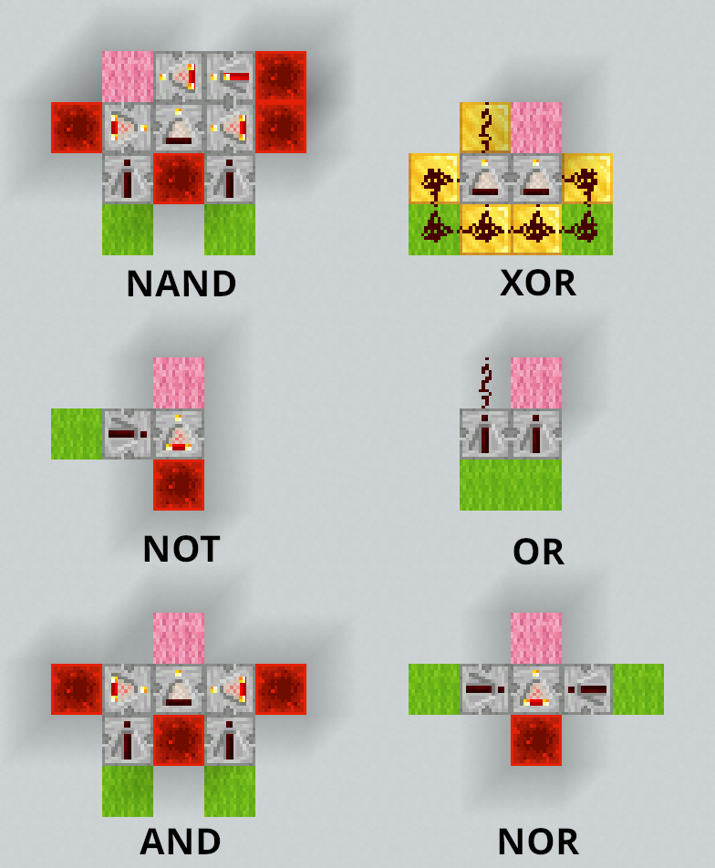
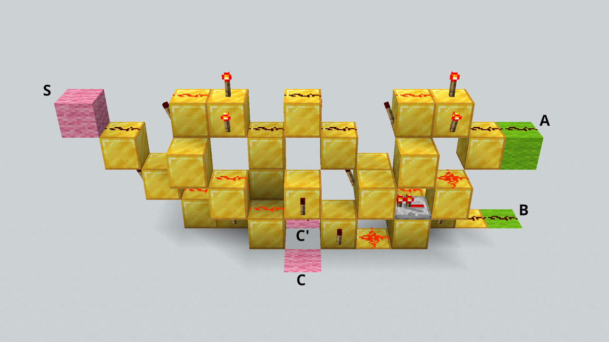

What a computer physically does when it runs a program, from the bottom up, and
what the processes of a deployment actually are.

<!-- more -->

**Recommended reading**

- [Unix Processes]()
- [Deploy a web application with SFTP]()

## Everything is numbers

Everything a computer holds is made of **bits**. A bit is a single binary digit:
0 or 1. Eight bits make a **byte**, the unit a computer's memory is counted in.
Eight bits can be set in 2⁸ = 256 different ways, from `00000000` to
`11111111`.

Here's a byte:

<p class="text-center font-mono text-4xl">01010011</p>

**Nothing in the bits themselves says what they mean.** The same byte can be a
number, a shade of gray, a color, part of a color (R, G or B), a letter, or an
instruction for the processor. The meaning comes from the program that reads it,
not from the bits.

### Counting in binary

Read as a number written in base 2, or **binary**, each position of a byte is
worth twice the position to its right, as each position of a decimal number is
worth ten times the position to its right:

| Position value | 128 | 64  | 32  | 16  |  8  |  4  |  2  |  1  |
| :------------- | :-: | :-: | :-: | :-: | :-: | :-: | :-: | :-: |
| Bit            |  0  |  1  |  0  |  1  |  0  |  0  |  1  |  1  |

`01010011` has a 1 in the positions worth 64, 16, 2 and 1, so it is the decimal
number 64 + 16 + 2 + 1 = **83**. A byte read this way holds any whole number from
0 (`00000000`) to 255 (`11111111`).

To write a decimal number in binary, go the other way: take the largest position
value that fits, write a 1 there, subtract it, and go on with what is left. 83
is 64 + 19, 19 is 16 + 3, and 3 is 2 + 1.

### The same byte, read differently

Read as a **gray level**, a byte goes from black (0) to white (255). 83 is about
a third of the way, a dark gray.

Read as a **color**, the same byte can be split into how much red, green and
blue light to mix: 3 bits for red, 3 for green and 2 for blue, a scheme called
8-bit color. `010` `100` `11` is a little red, some green and all the blue
there is: a light sky blue.




<!-- col -->






An **image** is a grid of such colors, called **pixels**, so an image is a list
of numbers, one per pixel, row by row. This Mario is 12 pixels wide and 16 high:
192 pixels, so 192 bytes with an 8-bit color scheme. It would be 576 bytes with
a modern 24-bit color scheme, 8 bits for each of red, green and blue.

A **video** is a sequence of images shown fast enough for the eye to see
movement, so it is a longer list of numbers.

<!-- col -->




Read as **text**, a byte is a character, through a table that gives every
character a number. In [ASCII][ascii], the table most others build on, 83 is
the letter `S`. [UTF-8][utf8], the encoding of almost all text on the web,
starts with the same 128 characters, each stored as the same single byte.

### Processing data is arithmetic

A computer does not know what letters, colors or images are. It only
manipulates numbers, but since everything is stored as numbers, manipulating
numbers is enough to manipulate any data:

- **Changing a letter's case** is adding or subtracting 32: `S` is 83 and `s` is 115. In binary, 32 is a single bit, so it is the only bit that differs between
  the two letters.
- **Inverting a gray image**, black for white, is subtracting each pixel's value
  from 255.
- **Brightening an image** is adding the same amount to every pixel, stopping at
  the maximum.
- **Fading a video to black** is multiplying every pixel by a fraction that gets
  smaller from one frame to the next, until it reaches 0.

Every program you use, however complex, comes down to calculations like these,
on a very large amount of numbers.

### Adding in binary

Binary numbers add like decimal ones, column by column from the right, carrying
into the next column whatever does not fit. In binary, 1 + 1 does not fit in one
digit: it is `10` (2 in decimal), so you write the 0 and carry the 1:

```text
  111     carries
  0111    7
+ 0011    3
------
  1010    10
```

Every column adds two bits, plus the carry from the column on its right, and
gives a **sum** bit and a **carry** for the column on its left. Adding two bits
gives these two bits:

|  A  |  B  | Sum | Carry |
| :-: | :-: | :-: | :---: |
|  0  |  0  |  0  |   0   |
|  0  |  1  |  1  |   0   |
|  1  |  0  |  1  |   0   |
|  1  |  1  |  0  |   1   |

The sum is 1 when exactly one of the two bits is 1. The carry is 1 only when
both are.

## From switches to a machine

There is no magic in a computer, only **switches controlled by electricity**.
Say that **1 means current and 0 means no current**: a switch whose current
closes another switch can make one bit control another. Wired in different
ways, such switches make the operations of Boolean logic, the `!`, `&&` and `||`
of your programming languages, which are called **logic gates**. Here, two
switches in a row make AND: the lamp is lit only when A and B are both 1.



Click the switches to try it.



Computers use binary because "no current" and "current" are easy to tell apart.
Ten levels of current, one per decimal digit, would not be.

The first computers used relays, electromagnets moving a metal bar; then vacuum
tubes; and since the 1950s, transistors. A modern processor holds billions of
transistors on one chip. The logic does not depend on what the switches are made
of.

The sum and carry above are two logic gates: the sum is **XOR**, "exclusive or"
(A or B, but not both), and the carry is **AND**. Together, they add two bits:




Chain such circuits, one per column, and you have an adder. Wired in other ways,
gates can also **remember** a bit, **select** one of several inputs to pass on,
do the opposite and **send** one input to one of several outputs, and **count**.
The presentation shows each of these circuits working. That is everything a
processor needs.

**What matters here is not how switches are wired into gates, nor what the
gates' symbols look like: you do not need to remember either.** What matters is
what such circuits can do. Manipulating numbers, and therefore [processing any
data](#processing-data-is-arithmetic), takes nothing more than fairly simple
electrical circuits, and they do it very fast.

### Memory is addressed

A computer's memory is a long row of cells, usually of one byte each, and every
cell has a number: its **address**. The processor reads or writes a cell by
giving its address. Any cell can be reached directly, in any order, which is the
"random access" of **RAM**, random access memory.

Each bit of a cell is a small circuit that keeps the last value it was given.
This one stores DATA while WRITE is 1, and keeps it once WRITE is back to 0,
whatever DATA does afterwards:




The number of bits in an address decides how many cells can be reached. A 4-bit
address gives 2⁴ = 16 addresses, so a 16-byte memory. A 32-bit address gives
4,294,967,296 bytes (4 GiB), and a 64-bit address, far more than any computer
has.

### The clock

A **clock** is a circuit that switches between 0 and 1 at a steady pace:




It keeps everything in the processor in step: every component that holds a
value takes its new value on the same tick, so each step's result is ready
before the next step uses it. A processor's speed in gigahertz is how many
billions of ticks its clock gives per second.

The machine demonstrated in the presentation takes one tick for each step of
its work, to keep it simple. A real processor splits an instruction into many
smaller steps, over several ticks, and works on many instructions at once.

## Running a program

A program is a sequence of **instructions** for the processor, and each
instruction is a number, stored in memory like any other data. The list of
instructions a processor understands is its **instruction set**. The machine
demonstrated in the presentation has this one, with 8-bit instructions: 4 bits
say what to do, and 4 bits give an address in its 16-byte memory:

| Instruction | Bits        | Effect                          |
| :---------- | :---------- | :------------------------------ |
| `LOAD x`    | `0001 xxxx` | memory[x] → acc                 |
| `STORE x`   | `0100 xxxx` | acc → memory[x]                 |
| `ADD x`     | `0010 xxxx` | acc + memory[x] → acc           |
| `SUB x`     | `0011 xxxx` | acc − memory[x] → acc           |
| `JUMP x`    | `0110 xxxx` | go to instruction x             |
| `JUMPZ x`   | `1000 xxxx` | if acc = 0, go to instruction x |
| `HALT`      | `1111 0000` | stop                            |

`memory[x]` is the value in the cell at address `x` (4 bits). `acc` is the
**accumulator**, a **register**: a small memory inside the processor, built of
the same circuits as memory cells, which holds a value while the processor works
on it. Every calculation of this machine goes through its accumulator: it loads
a number into it, adds to it or subtracts from it, and stores the result back
into memory. This machine has a single register; a modern processor has many,
such as the 16 general-purpose registers of an x86-64 processor.

The instructions come in three kinds:

- **Moving data** between memory and the processor: `LOAD` and `STORE`.
- **Computing**: `ADD` and `SUB`, done by the processor's **arithmetic logic
  unit** (ALU), which is built around the adder.
- **Deciding which instruction runs next**: the jumps. Every `if` and every loop
  of your programs comes down to such jumps.

A real processor has many more instructions, of these kinds and [a few
others](#kinds-of-instructions).

### The processor does what it is told

The processor keeps the address of the next instruction in its **program
counter**. It repeats the same cycle for every instruction: it **fetches** the
instruction at that address from memory, **decodes** it, and **executes** it.
Then the program counter moves on to the next instruction, unless the
instruction was a jump, which sets it to a new address.

The processor has no intelligence of its own. It does not choose anything: the
program does. A jump such as `JUMPZ` makes the next instruction depend on the
last result, but that decision is written in the program, and the processor only
carries it out. Even when a device signals it from the outside, the processor
only jumps to instructions prepared in advance and follows them.

### From program to instructions

You do not write instructions by hand. You write **source code**, in a
programming language made for people: it is easy to read, to write and to
understand (if you learned how). The processor understands none of it. What it
understands is its instructions: numbers, each one a tiny step. A program in any
language has to become instructions before the processor can run it.

This small JavaScript program multiplies 3 by 2 the way the machine demonstrated
in the presentation does. Since that machine cannot multiply: add 3 twice (or
however many times is needed), decrementing the counter until it reaches 0:

```js
let a = 3;
let counter = 2;
let result = 0;
do {
  result = result + a;
  counter = counter - 1;
} while (counter !== 0);
```

The calculations become instructions that move values between memory and the
accumulator and compute with them, and the loop becomes jumps. The values
themselves, variables and numbers alike, are kept in memory cells.

You could just as well write it the way you would naturally, with the
multiplication operator:

```js
let result = 3 * 2;
```

That program could still run on the same machine. Translating it for a processor
that cannot multiply, a compiler would turn the multiplication into repeated
additions, much like the loop above.

A **compiler** translates a program into instructions for a specific instruction
set, either ahead of time or as it runs. Examples: C, Go, Rust, Java, Erlang.

An **interpreter** works differently: it is itself a program made of
instructions, which reads your program as data and does what it says. Examples:
Python, PHP, Ruby, JavaScript, Bash.

Either way, what the processor runs is instructions.

### The machine

The machine demonstrated in the presentation: a processor and a memory of
sixteen cells, connected by an 8-bit data bus and a 4-bit address bus. Its
memory holds the multiplication above as nine instructions, followed by its
data. Step through it to watch it run.



The memory never knows which cells are instructions and which are data. The same
bits would be read as an instruction if the program counter reached them.

Simple as it is, this machine is a real computer. With a wider address bus, and
therefore a larger memory, it could run any program, as long as the program and
its data fit in that memory. It is also conceptually very close to the
processors of the 1970s, such as the [Intel
8080][intel-8080].

### A particular place, at a particular time

This is the one thing to take away from the machine: **a running program is
instructions in memory, executed by a processor.** Its instructions and its data
sit in physical memory chips, in a particular computer, and a specific processor
executes them, one after the other, at a particular moment.

A modern processor is far faster and more complex than this machine, but it
still works this way.

**Always keep in mind where and when a program runs.** Whenever you start a
program, deploy one, or wonder why one does not behave as you expect, ask which
computer it runs on, in whose memory, on which processor, and when. A program
running on your computer and the same program running on your server are two
different things happening in two different places. A program that has stopped
is not running anywhere, however many copies of its files exist.

## The operating system and processes

Memory (RAM) is **volatile**: it loses its contents when the power is off.
Programs and files are kept in **storage**, a disk or an SSD, which is
**persistent**: it keeps its contents without power.

The processor cannot run anything straight from storage, and cannot even read
it by address. A program has to be **copied from storage into memory** first,
which the processor asks the disk's controller to do. Copying programs into
memory and running them is one of the jobs of the **operating system**.

### Booting

At power-on, the memory is empty. **Booting is a chain of programs**: each one
has the next copied from the storage into memory, then jumps to its first
instruction.

1. The processor runs the **firmware** (UEFI), from a chip on the motherboard.
2. The firmware loads the **bootloader** (GRUB) from the disk into memory.
3. The bootloader loads the **kernel** (Linux), the core of the operating
   system.
4. The kernel starts the **first process**, also called the **init process**,
   with process ID 1 (systemd on Linux).
5. The init process starts **everything else**: the SSH server, a web server,
   your application.

**You do not need to remember these stages, nor the names of the programs.**
What matters is that a computer starting up is not magic either. It is a
sequence of ordinary programs, each one copying the next into memory and
handing over to it, until the operating system, the program that manages all
the others, is running.

Every other process on the machine was started either by the init process, or by
a process that it started, which is why the [process tree](#process-tree) has init (PID 1) at its
root.

A cloud server is usually a virtual machine: its firmware is provided by the
cloud provider's software instead of a chip, but the chain is otherwise the
same.



Your own computer boots the same way. On Windows, the bootloader is the Windows
Boot Manager, the kernel is `ntoskrnl.exe`, and several programs share the init
process's job. On macOS, the init process is `launchd`.



### Programs and processes

A **program** is inert files in the storage: source files, or compiled ones.

A **process** is a program being executed: its instructions copied into memory,
plus the data it creates as it runs, executed by the processor. Each process has
**its own memory**, which the kernel gives it when it starts and frees when it
ends. The same program can run as several processes at once, each with its own
memory: two SSH sessions to your server are two shells running the same program.

Step through the boot of a server, then the programs it runs once booted:



### What the operating system does

The operating system is the program that manages the computer for all the
others:

- **It runs programs as isolated processes.** It copies programs from the
  storage into memory and starts them. No process can read or write another
  process's memory.
- **It hides the hardware behind system calls.** Programs do not talk to a
  physical disk or a network card directly: they ask the operating system, with
  **system calls**. It organizes the bytes of a disk into **files** in
  **directories**, and gives programs **sockets** to communicate over the
  network.
- **It decides who can do what**, with users, groups and permissions.

Programs such as the shell, `ls` or `ssh` are not the operating system: they
are ordinary programs that make system calls, like the programs you write.

### Isolated processes communicate through channels

Since processes are isolated, they can only communicate through channels the
operating system provides:

- **Files**: one process writes a file, and another reads it.
- **Pipes**: the standard output of one process goes into the standard input of
  another, as in a [shell pipeline](#pipelines).
- **Sockets**: processes communicate over the network with them, and two
  processes on the same machine can use them too.
- **Shared memory**: two processes ask the operating system for the same region
  of memory, which both then see.

Guess It and PostgreSQL, from the SFTP deployment, are two processes on the same
server. Neither can read the other's memory. Guess It talks to PostgreSQL
through a socket: its database URL says `localhost:5432`, a port on the loopback
address, which never leaves the server (it could if you used an IP address).



## Your deployment, on the machine

This is the architecture of the [SFTP deployment](#architecture), as you ran it:



An architecture diagram like this one draws processes and the connections
between them, and leaves the machine out. Everything in this chapter is still
there, behind it:

- **A process box** is a program's instructions and data in the memory of one
  computer. When the diagram shows a process working, a processor of that
  computer is fetching that process's instructions from that memory and
  executing them. When it shows one waiting, the process uses no processor at
  all.
- **The two sides of the network boundary** are two computers, your own and
  your server, each with its own processor, its own memory and its own
  operating system.
- **A connection** between two processes is a channel provided by the
  operating system: a socket here. Between your computer and your server, the
  bytes go through both computers' network controllers.

When you run `npm run dev` and press Enter, the processor of your server
executes the shell's instructions, from the shell's memory on your server. The
shell asks the kernel to start Node.js, whose program the kernel copies from
the storage into memory: a new process, with its own memory. From then on, your
server's processor executes Node.js's instructions, which carry out Guess It's
JavaScript.

When your browser displays the page, it is your own computer's processor that
executes the browser's instructions, from your own computer's memory. A website
is an assembly of processes on different computers, a client (the browser on
your own computer) and a server (Node.js and PostgreSQL on your cloud server),
each with its own processor and its own memory, communicating.

Go through the rest of the diagram's steps, or through the exercise itself,
again. At each step, ask yourself which computer it happens on, which program's
instructions are executed, by which processor, and out of which memory.

For any deployment such as the one you did in the SFTP deployment exercise, you
should be able to draw the final state of the diagram (without the SSH
processes). In this case, the browser, Guess It, and PostgreSQL: where they are
running, and the connections between them.

## Appendix: what's in the box?

A shop might describe a desktop computer like this:

- **Processor**: AMD Ryzen 7 7700X, 8 cores, 4.5 GHz (up to 5.4 GHz), 32 MB
  L3 cache, 64-bit
- **Memory**: 32 GB RAM (2 × 16 GB), Corsair Vengeance DDR5 6000 MHz
- **Storage**: 2 TB Samsung 990 PRO NVMe M.2 SSD, PCIe 4.0, up to 7450 MB/s
  read
- **Graphics card**: NVIDIA GeForce RTX 4070, 12 GB GDDR6X
- **Motherboard**: ASUS TUF Gaming B650-PLUS WIFI, UEFI
- **Network**: Wi-Fi 6, 2.5 Gb Ethernet
- **Power supply**: 750 W
- **Operating system**: Windows 11 Home 64-bit

Every figure belongs to a part of [the modern machine of the presentation](#a-more-modern-machine):

| In the description    | What it means                                                                                                                      | Part of the machine  |
| :-------------------- | :--------------------------------------------------------------------------------------------------------------------------------- | :------------------- |
| 8 cores               | Eight processors in one chip: up to eight programs, or parts of one, run at the same time                                          | Processor            |
| 4.5 GHz (up to 5.4)   | Ticks per second, limited by the time signals take to cross the circuits, and by heat: it only speeds up while the chip stays cool | Clock                |
| 64-bit                | The largest numbers added in one instruction, without carrying through software, and the size of an address                        | Registers and buses  |
| 32 MB L3 cache        | The more of a program's data fits near the cores, the less often they wait for the memory                                          | Caches               |
| 32 GB RAM (2 × 16 GB) | How much the running programs can hold at once. Two sticks, but one memory                                                         | Memory               |
| DDR5 6000 MHz         | How much data the memory sends per second once it has started (not how long it takes to arrive)                                    | Memory               |
| 2 TB SSD              | How many programs and files are kept with the power off                                                                            | Storage              |
| NVMe, PCIe 4.0        | How the processor asks the storage for copies, and how the storage is connected                                                    | Disk controller      |
| M.2                   | The shape of the slot                                                                                                              | None                 |
| Up to 7450 MB/s read  | How fast programs and files are copied from the storage into memory, at best                                                       | Disk controller      |
| RTX 4070, 12 GB       | A graphics card, with thousands of small processors of its own to compute pixels in parallel, and its own memory for them          | A device             |
| B650, UEFI            | The board everything plugs into, and the program the processor runs first at power-on                                              | Buses and firmware   |
| Wi-Fi 6, 2.5 Gb       | Network devices: at most 2.5 billion bits per second on the cable                                                                  | Devices              |
| 750 W                 | The power the parts can draw at most: faster parts need more                                                                       | None                 |
| Windows 11 64-bit     | Not hardware: a program on the storage, copied into memory at boot, made of the processor's 64-bit instructions                    | Storage, then memory |

## Appendix: the cake is a lie

You may have noticed that some fundamental circuits were explained during the
presentation, but that some of them were not shown in detail like the ALU or the
program counter. This appendix is for those who want to know more, and see how
some of these more complex circuits are built from the simpler ones.

### A register

The machine demonstrated in the presentation has two registers: the
**accumulator**, which holds the value being calculated, and the **instruction
register**, in the control unit, which holds the instruction being decoded and
executed. A register is memory, like the D latches of [addressable
memory](#memory-is-addressed): it keeps a value. But a D latch alone is not
enough, because a register also has to:

- **Take its new value at one precise instant.** `ADD` feeds the accumulator's
  value into the adder, and the adder's result back into the accumulator. A
  latch follows its input for as long as WRITE is 1, so it would pass the result
  straight back to the adder, and the sum would run round in circles.
- **Keep its value until it is told to change it**, however many times the
  clock ticks.

**The edge-triggered D flip-flop** solves the first problem. Its Q takes DATA's
value only at the moment CLK rises from 0 to 1, the **rising edge**, and keeps
that value the rest of the time, whatever DATA does. The wedge on its clock
input marks it as edge-triggered. The presentation shows [how it is made of two
D latches](#two-latches-make-a-flip-flop).



Its clock starts paused in the following diagram, so that you can drive it by
hand. Clicking the 0/1 half of a paused clock flips its level, and its ▶ half
lets it run:

1. Change DATA a few times: Q does not move.
2. Raise CLK when DATA is 1: Q takes DATA's value.
3. Change DATA again: Q still does not move, although CLK is 1.
4. Lower CLK: nothing changes either. Only a rising edge changes Q.



A flip-flop stores DATA on every rising edge, so it does not solve the second
problem: it cannot keep a value while the clock ticks. Choosing between keeping
a value and storing a new one is the job of a **selector**. SELECT opens one of
two ANDs, directly or through a NOT, and the OR passes on whatever gets through
the open one:



- While SELECT is 0, flip D0 and D1: only D0 reaches Y.
- Turn SELECT on and flip them again: only D1 reaches Y.



**One bit of a register** is a selector in front of a flip-flop, with a new
input, LOAD, as SELECT:

- **While LOAD is 1**, the selector lets DATA through to the flip-flop, which
  stores it on the next rising edge.
- **While LOAD is 0**, the selector lets the flip-flop's own Q back in. Each
  rising edge stores the value the flip-flop already holds, so nothing changes.



The clock runs on its own, as it does in a processor:

1. With LOAD off, flip DATA: Q does not follow it, however many times the clock
   ticks.
2. Turn LOAD on: Q takes DATA's value on the next rising edge, and follows DATA
   from then on, one edge late.
3. Turn LOAD off: Q keeps its last value, whatever DATA does.



The register bit, drawn as a box, with DATA from above and Q below, as the
register uses it. It behaves the same way:



The clock runs on its own, as it does in a processor:

1. With LOAD off, flip DATA: Q does not follow it, however many times the clock
   ticks.
2. Turn LOAD on: Q takes DATA's value on the next rising edge, and follows DATA
   from then on, one edge late.
3. Turn LOAD off: Q keeps its last value, whatever DATA does.



**An 8-bit register** is eight register bits side by side, one per bit of a
byte, sharing the same LOAD and the same clock. The bits run from the highest,
`D7`, on the left, to the lowest, `D0`, on the right, so that the inputs and the
lamps read as binary numbers:



1. Set a byte on the inputs, such as `01010011`, which is 83.
2. Turn LOAD on, and wait for a rising edge: the lamps show the byte.
3. Turn LOAD off, then change the inputs: the register keeps 83.



The accumulator and the instruction register of the machine are such registers.
To execute `ADD`, the control unit turns the accumulator's LOAD on for a single
tick, so that the adder's result is stored on one rising edge, and only once. It
does the same with the instruction register during the fetch, to store the
instruction read from memory.

### Negative numbers: two's complement

The machine demonstrated in the presentation has a `SUB` instruction, and its
ALU can subtract as well as add. Yet the only arithmetic circuit the
presentation built out of gates is the adder: no circuit that subtracts was ever
shown. None is needed, as long as negative numbers are written in **two's
complement**.

A register or a memory cell has a **fixed number of digits**: a byte always has
eight bits, no more and no less. A result that needs a ninth bit loses it, since
there is no ninth bit to hold it. Two's complement uses that loss to write
negative numbers without a minus sign.

**In decimal first.** Imagine numbers of exactly two digits, from `00` to `99`,
like a counter with two wheels. Adding 1 to `99` gives `100`, but the counter
only shows `00`. So `99` behaves exactly like -1: add 1 and you get 0. In the
same way, `98` is -2, `97` is -3, and so on. Deciding that `50` to `99` stand
for -50 to -1 gives two-digit numbers from -50 to 49.


To write -23 this way:

1. Subtract each digit from 9, which gives 76. This is the **nine's
   complement**.
2. Add 1, which gives 77. This is the **ten's complement**, and it is how -23 is
   written.

Subtracting 23 is then adding 77, and dropping the digit that does not fit:

```text
   45
+  77     -23
-----
  122     22, once the third digit is dropped
```

What this avoids is **borrowing**, carrying in reverse when subtracting. In 52 -
7, the 2 is smaller than the 7, so you borrow 1 from the column on its left: 12

- 7 is 5, and the 5 of 52 becomes 4, which gives 45. (In French, a borrow and a
  carry are both a _retenue_.) Like a carry, a borrow can ripple from column to
  column. Subtracting from 9 never borrows, since no digit is larger than 9, so
  the only calculations left are additions.

**Binary works the same way.** Subtracting each bit from 1 is just inverting it,
so negating a number is **inverting every bit and adding 1**. Here is -83:

|              |       |     |     |     |     |     |     |     |     |
| :----------- | :---: | :-: | :-: | :-: | :-: | :-: | :-: | :-: | :-: |
| 83           |       |  0  |  1  |  0  |  1  |  0  |  0  |  1  |  1  |
| Inverted     |       |  1  |  0  |  1  |  0  |  1  |  1  |  0  |  0  |
| Plus 1: -83  |       |  1  |  0  |  1  |  0  |  1  |  1  |  0  |  1  |
| 83 + -83 = 0 | ~~1~~ |  0  |  0  |  0  |  0  |  0  |  0  |  0  |  0  |

With 8 bits, this gives numbers from -128 to 127:

| Bits       | Value |
| :--------- | ----: |
| `01111111` |   127 |
| `00000001` |     1 |
| `00000000` |     0 |
| `11111111` |    -1 |
| `10101101` |   -83 |
| `10000000` |  -128 |

The highest (first) bit tells the sign: it is 1 for every negative number. A
result outside the range is wrong: 100 + 50 gives `10010110`, which reads as
-106. This is called an **overflow**.

Programming languages store their integers this way, within the same kind of
fixed bounds. In Java, a `byte` has 8 bits and holds numbers from -128 to 127,
exactly as in the table above, so `(byte) 200` is -56. An `int` has 32 bits and
holds numbers from -2,147,483,648 to 2,147,483,647: `Integer.MAX_VALUE + 1`
overflows to `Integer.MIN_VALUE`, the most negative `int`.

As always, [nothing in the bits says what they mean](#everything-is-numbers):
`10101101` is 173 for a program that reads the byte as a number from 0 to 255,
and -83 for a program that reads it in two's complement. The adder does not
care: it adds bits the same way in both cases.

**This is why subtraction is an addition.** To compute A - B, the processor adds
A and -B, and -B is B with its bits inverted, plus 1. Turning [`s` into
`S`](#processing-data-is-arithmetic) is subtracting 32 from 115, so adding -32,
which is `11100000`:

```text
   01110011     115, s in UTF-8
+  11100000     -32
-----------
 1 01010011     83, S in UTF-8, once the ninth bit is dropped
```

A processor needs no separate circuit to subtract. An adder is enough, given a
way to invert the bits of B and a carry of 1 into the first column, which the
next section builds.

### The adder-subtractor

A **full adder** adds one column of an addition: A, B, and the carry from the
column on its right, Cin. It gives the column's SUM, and Cout, the carry for the
column on its left. The presentation shows [how it is made of two half adders
and an OR](#the-full-adder):




Four full adders, each one's Cout going into the next one's Cin, add two 4-bit
numbers. The carry ripples from right to left, one full adder after the other,
which is why this is called a **ripple-carry adder**.



Set A to `0111` and B to `0011`: S shows `1010`, as in [adding in
binary](#adding-in-binary).



To subtract B instead, the adder has to add the two's complement of B: B with
its bits inverted, plus 1. Adding 1 is easy: the first Cin is set to 1. Bits
are inverted by XOR gates, which invert a bit only when told to:



- While INVERT is 0, OUT is B, unchanged.
- While INVERT is 1, OUT is B, inverted.



So a single input, SUBTRACT, goes into the first Cin, and into an XOR on each bit
of B as its INVERT. While SUBTRACT is 0, the circuit adds. While it is 1, it
subtracts:



1. Set A to `0110` (6) and B to `0010` (2): S shows `1000` (8).
2. Turn SUBTRACT on: the XORs give `1101`, B inverted, and S shows `0100` (4).
   Cout is lit: it is the fifth bit, which is dropped.
3. Swap A and B: S shows `1100`, which is -4 in 4-bit two's complement, where
   numbers go from -8 to 7. Cout is now off. When subtracting, an unlit Cout
   means that the subtraction would have had to borrow from a fifth bit that
   does not exist: A was less than B, and the result went below 0.



Cout says something about the result besides the result itself. Such a bit is
called a **flag**, and Cout is the **carry flag**. One more gate adds a **zero
flag**, ZERO, which is 1 when every bit of the result is 0: what a jump such as
`JUMPZ` needs to know. That gate is a NOR of the result's bits: an OR followed
by a NOT, whose output is 1 only when all its inputs are 0.



1. Turn SUBTRACT on, then set A and B to the same number: ZERO is lit, and so is
   Cout.
2. Make A smaller than B: ZERO and Cout are both off.
3. Make A larger than B: Cout is lit, and ZERO is off.



So a circuit built to add and subtract also **compares** numbers, with nothing
added but a NOR. To compare A and B, a processor subtracts B from A, ignores the
result, and reads the flags:

| Comparison | Flags after A - B       |
| :--------- | :---------------------- |
| A == B     | ZERO is 1               |
| A != B     | ZERO is 0               |
| A < B      | Cout is 0               |
| A >= B     | Cout is 1               |
| A > B      | Cout is 1 and ZERO is 0 |
| A <= B     | Cout is 0 or ZERO is 1  |

This holds for A and B read as numbers from 0 to 15. Comparing numbers in two's
complement takes two more flags, not shown here: the **sign flag** and the
**overflow flag**. Every `if (a < b)` of your programs comes down to such a
subtraction.

### A simplified ALU

As its name implies, an **A**rithmetic **L**ogic **U**nit (**ALU**) does more
than arithmetic. It also performs **logic operations**, such as AND, OR and XOR,
on each pair of bits of A and B. For example, `s` is `S` with the bit worth 32
set, so `S` OR `00100000` is `s`. This works for any other letter.

This section explains how to build a simplified ALU with two arithmetic
operations (addition and subtraction), and three logic operations (AND, OR and
XOR). As has already been demonstrated, the same adder circuit can perform both
addition and subtraction with the two's complement of B, so actually only four
different kinds of circuits are needed, one arithmetic and three logic.

An ALU computes every operation at once, and a selector passes on the one that
is asked for. With four circuits to choose from, it needs a **4-to-1 selector**:
two select bits, S1 and S0, read as a binary number, pick which of four data
inputs reaches Y. It is built like the 2-to-1 selector [of the
register](#a-register), as the presentation [shows](#4-to-1-selector).



Set S1 and S0 to `00`, `01`, `10` and `11` in turn, and see which input gets
through.



**One bit of an ALU** is a full adder with its SUBTRACT XOR, an AND, an OR, an
XOR, and a 4-to-1 selector whose select bits, OP1 and OP0, choose the
operation:

| OP1 OP0 | RESULT                           |
| :-----: | :------------------------------- |
|  `00`   | A + B, or A - B with SUBTRACT on |
|  `01`   | A AND B                          |
|  `10`   | A OR B                           |
|  `11`   | A XOR B                          |

The logic gates take B before the SUBTRACT XOR, so that SUBTRACT only changes
the arithmetic. Cin is an input here, since this bit has no neighbour on its
right yet:



1. Set A and B to 1, with Cin at 0.
2. Set OP1 and OP0 to `00`, `01`, `10` and `11` in turn: RESULT shows 0 (A + B
   is `10`, so Cout is `1` and S is `0`), then 1 (A AND B is `1`), 1 (A OR B is
   `1`), and 0 (A XOR B is `0`).
3. Watch the gates that are not selected: they go on computing all the time. The
   selector only picks which result gets through.



So we have a circuit that can perform addition, subtraction, AND, OR, and XOR,
on 1 bit. Here's our 1-bit ALU slice, drawn as a box, as the ALU uses it:



1. Set A and B to 1, with Cin at 0.
2. Set OP1 and OP0 to `00`, `01`, `10` and `11` in turn: RESULT shows 0 (A + B
   is `10`, so Cout is `1` and S is `0`), then 1 (A AND B is `1`), 1 (A OR B is
   `1`), and 0 (A XOR B is `0`).



**A 4-bit ALU** is four 1-bit ALU slices side by side, chained by their carries
like the full adders of the adder. SUBTRACT, OP1 and OP0 go to all four, and
SUBTRACT is also the first Cin, as in the adder-subtractor. Its ZERO flag takes
the results after the selectors, so it also works for the logic operations: ZERO
after an AND means that A and B have no 1 bit in common. Each bit's box shows
the operation it performs.



Set A to `0110` (6) and B to `0011` (3), then try each operation:

| Operation | OP1 OP0 | SUBTRACT | RESULT     |
| :-------- | :-----: | :------: | :--------- |
| ADD       |  `00`   |    0     | `1001` (9) |
| SUB       |  `00`   |    1     | `0011` (3) |
| AND       |  `01`   |    0     | `0010`     |
| OR        |  `10`   |    0     | `0111`     |
| XOR       |  `11`   |    0     | `0101`     |



The machine's ALU works the same way, with eight bits instead of four. It only
needs OP `00`: the control unit turns SUBTRACT off for `ADD` and on for `SUB`. A
real processor also has [instructions](#kinds-of-instructions) for the logic
operations.

### Adding numbers wider than the machine

The machine's accumulator and ALU have 8 bits, so they handle numbers from 0 to 255. Programs still need larger numbers, and an 8-bit processor adds them the
way you add on paper: one column at a time, carrying into the next. The columns
are just wider: each one is a whole byte, instead of a digit.

A 16-bit number is two bytes: a **high byte**, worth 256 times its value, and a
**low byte**. To add two 16-bit numbers, a program:

1. Adds the two low bytes. The [carry flag](#the-adder-subtractor) keeps the
   ninth bit of the result, if there is one.
2. Adds the two high bytes, plus the carry flag.

For example, 300 + 500:

| Number    | High byte      | Low byte         |
| :-------- | :------------- | :--------------- |
| 300       | `00000001` (1) | `00101100` (44)  |
| 500       | `00000001` (1) | `11110100` (244) |
| 300 + 500 | `00000011` (3) | `00100000` (32)  |

44 + 244 is 288, which does not fit in a byte: the low byte of the result is 288

- 256 = 32, and the carry flag is 1. The high byte is then 1 + 1, plus the
  carry: 3. And 3 × 256 + 32 is 800.

The second addition needs an instruction that adds the carry flag as well. Real
processors have one, usually called **add with carry**, `ADC`: the [Intel
8080][intel-8080] did. The machine demonstrated in the presentation does not,
but its ALU would only need its first Cin to come from the carry flag of the
previous instruction, instead of being 0.

You can do the same on the 4-bit adder, to add 8-bit numbers, four bits at a
time.



To add 23 (`0001 0111`) and 45 (`0010 1101`):

1. Add the low halves: set A to `0111` and B to `1101`, with Cin at 0. S shows
   `0100`, and Cout is lit: 7 + 13 is 20, which does not fit in 4 bits.
2. Write down `0100` as the low half of the result, and remember the carry.
3. Add the high halves: set A to `0001` and B to `0010`, and Cin to 1 for the
   carry. S shows `0100`.
4. The result is `0100 0100`: 68.



Subtraction works the same way, with a **subtract with borrow** instruction for
the high bytes. And numbers wider than any register, such as Java's `BigInteger`
or JavaScript's `BigInt`, are added the same way, one register-sized piece at a
time.

### Flip-flops with preset and clear

The machine's **program counter** holds the address of the next instruction. The
presentation showed [a counter](#program-counter) made of D
flip-flops, each one feeding its Q̅ back into its DATA, so that it flips on
every rising edge of its clock. The first flip-flop is clocked by the clock.
Each of the others is clocked by the Q̅ of the one before, so that it flips when
the one before goes back to 0, like a carry.



Read from right to left, Q2 Q1 Q0 count from `000` to `111`, then start over.



This counter can only count up, from wherever it happens to be. A program
counter needs two more things:

- **Jumping**: `JUMP` and `JUMPZ` load it with a new address.
- **Resetting**: at power-on, it has to start at 0, the address of the first
  instruction.

The [register's](#a-register) way of loading a value, a selector in front of
DATA, does not work here. It loads on a rising edge of the clock, but only the
first flip-flop of this counter gets the clock: the others flip when the one
before them goes back to 0, each at a different moment. The counter's
flip-flops have to be forced to a value at once, whatever their clock does.

**Preset and clear** do that.



Its clock starts paused, and Q starts at 0:

1. Turn PRESET on: Q becomes 1 at once, while CLK stays at 0.
2. Turn PRESET off: Q stays 1.
3. Turn CLEAR on: Q becomes 0 at once.
4. Turn CLEAR off: Q stays 0.
5. Set DATA to 1, then raise CLK: Q becomes 1, as with any D flip-flop.



A flip-flop normally changes only on a rising edge of its clock. Preset and
clear are a way around the clock: they force the flip-flop to 1 or to 0 straight
away, whatever its clock and its DATA are doing. Once they are released, the
flip-flop keeps that value, and works with its clock again.

This flip-flop is built differently from the one of the presentation, out of
three [SR latches](#sr-latch) instead of two D latches. The latch on the right holds Q, and the
two on the left set or reset it when the clock rises. Preset and clear act
directly on the latch on the right, as its SET and RESET. Turning them on at the
same time is therefore not allowed, by convention, as for the SR latch: it would
make both Q and Q̅ 0.

The same flip-flop drawn as a box, with PRESET on top and CLEAR below:



Its clock starts paused, and Q starts at 0:

1. Turn PRESET on: Q becomes 1 at once, while CLK stays at 0.
2. Turn PRESET off: Q stays 1.
3. Turn CLEAR on: Q becomes 0 at once.
4. Turn CLEAR off: Q stays 0.
5. Set DATA to 1, then raise CLK: Q becomes 1, as with any D flip-flop.



**A loadable bit** uses preset and clear to load any value, 0 or 1, straight
away.



Its clock starts paused, and Q starts at 0:

1. Set A to 1: Q stays 0.
2. Turn LOAD on: Q becomes 1 at once.
3. Set A to 0: Q becomes 0. Set A back to 1: Q becomes 1.
4. Turn LOAD off, then set A to 0: Q stays 1.
5. Turn RESET on: Q becomes 0.
6. Turn RESET off: Q stays 0.



A is the value to load, and LOAD copies it into the flip-flop: it presets the
flip-flop when A is 1, and clears it when A is 0. As long as LOAD is on, the
flip-flop follows A. RESET clears it, whatever A is. When neither is on, the
flip-flop is left alone, and works with its clock like any other.

The loadable bit drawn as a box, with A on top, and LOAD and RESET below:



Its clock starts paused, and Q starts at 0:

1. Set A to 1: Q stays 0.
2. Turn LOAD on: Q becomes 1 at once.
3. Set A to 0: Q becomes 0. Set A back to 1: Q becomes 1.
4. Turn LOAD off, then set A to 0: Q stays 1.
5. Turn RESET on: Q becomes 0.
6. Turn RESET off: Q stays 0.



### The program counter

Built out of loadable bits instead of plain flip-flops, the
[counter](#flip-flops-with-preset-and-clear) can jump.



Its clock runs:

1. Watch it count, reading Q2 Q1 Q0 from right to left: `000`, `001`, `010`, and
   so on up to `111`, then `000` again.
2. Set A2 to 1, A1 to 0 and A0 to 1, which is `101`, 5: the count goes on as
   before.
3. Turn LOAD on, and leave it on for a few ticks: Q2 Q1 Q0 show `101`, and stay
   there whatever the clock does.
4. Turn LOAD off: the counter counts on from `101`: `110`, `111`, `000`, and so
   on.
5. Turn RESET on, and leave it on for a few ticks: Q2 Q1 Q0 show `000`, and stay
   there.
6. Turn RESET off: the counter counts from 0 again: `001`, `010`, and so on.



Each bit still feeds its Q̅ back into its DATA and clocks the next bit, so the
counter counts as before. LOAD and RESET take over from the clock: while one of
them is on, the counter holds the value it is given, A or 0. Once it is
released, the counter counts on from there.

The machine's program counter works this way, with four bits for its sixteen
addresses. The control unit drives it:

- **To move on to the next instruction**, it gives the counter a single clock
  pulse, once per instruction.
- **To execute `JUMP x`**, it sends the address `x` to the counter's A inputs,
  and turns LOAD on for a moment. `JUMPZ x` does the same, but only if the
  accumulator is 0.
- **At power-on**, RESET sets the counter to 0, so that the program starts with
  the instruction at address 0.

### A bigger memory from smaller blocks

The presentation already showed [a 4-bit addressable memory](#addressable-memory): four
D latches, a [decoder](#2-to-4-decoder) that sends
WRITE to the latch at the address, and a 4-to-1 selector that passes that
latch's value on to OUT. It has four [cells](#memory-is-addressed), one per
address, and each cell is a single latch:



It starts empty, with A1 A0 at `00`:

1. Set DATA to 1, then turn WRITE on and off again: the lamp of cell `00` lights
   up, and OUT shows 1.
2. Set A1 A0 to `10`: OUT shows 0, the value of cell `10`.
3. Turn WRITE on and off again, with DATA still at 1: cell `10` lights up too.
4. Set DATA to 0, then A1 A0 back to `00`: OUT shows 1. Cell `00` keeps its 1,
   whatever DATA is, as long as WRITE stays off.



This memory grows in two ways:

- **More addresses**: a third address bit, A2, gives 2³ = 8 addresses, with a
  3-to-8 decoder and an 8-to-1 selector. That makes 8 cells of 1 bit each, an
  8 × 1 memory: 8 bits, or 1 byte.
- **More bits per address**: eight such 8 × 1 circuits side by side, given the
  same address and the same WRITE, each with its own DATA line and its own OUT,
  store 8 bits at each address. Each cell is now eight latches, one in each
  circuit, read and written together over 8 data lines. That makes an 8 × 8
  memory: 64 bits, or 8 bytes.

A single decoder cannot grow forever, though: with 32 address bits, it would
need 4,294,967,296 outputs. A large memory is built from smaller **blocks**
instead, and the address is split in two:

- **The high bits pick the block**, through a small decoder. Its output, the
  block's **chip select**, turns that block on. Only the selected block reacts
  to WRITE, and only it puts its value on the data bus.
- **The low bits pick the cell**, in every block at once. Only the cell of the
  selected block counts.

The machine's sixteen cells of 8 bits could be four blocks of four such cells.
A3 and A2 would go to a decoder picking the block, and A1 and A0 to every block.
Address `1001` would be cell `01` of block `10`.

Real memory repeats this at every level. A memory module is several chips side
by side, each storing some of the bits of every address. Inside a chip, the bits
are split into banks, and each bank is a grid whose bits are picked by row and
by column, so that every decoder stays small.



Real RAM does not keep its bits in latches. A latch takes several transistors,
and the memory of a computer has billions of bits. [**DRAM**, **d**ynamic
**RAM**](https://en.wikipedia.org/wiki/Dynamic_random-access_memory), the memory
of your computer, stores each bit as an electric charge in a tiny capacitor,
with a single transistor to reach it. The charge leaks away, so the memory has
to read and rewrite every bit many times a second: it is **refreshed**.

Memory built of latches, [**SRAM** (**s**tatic
**RAM**](https://en.wikipedia.org/wiki/Static_random-access_memory), is faster
but larger, and is kept for the processor's registers and caches.



### The control unit

The **control unit** gives every other part of the machine its orders: which
component puts its value on the data bus, which one takes it in, what the ALU
computes. It is the part that [follows the
instructions](#the-processor-does-what-it-is-told), yet nothing in it is new. It
is made of the circuits above:

- **The instruction register**, a [register](#a-register) that holds the
  instruction being executed.
- **A step counter**, a [counter](#flip-flops-with-preset-and-clear) of its own,
  separate from the program counter. It counts the steps of the cycle, fetch,
  decode and execute, one per tick of the clock, and is reset to 0 for the next
  instruction.
- **Decoders and gates**, which turn the instruction and the current step into
  **control signals**.

One decoder takes the instruction's 4-bit operation code and lights one of its
16 outputs, one per instruction: one line for `LOAD`, one for `ADD`, and so on.
Another one takes the step counter, and lights one line per step, such as the
`FETCH` and `EXECUTE` lines. Each control signal is then a few ANDs and ORs of
those lines. A control unit for the machine could compute these, for example:

| Control signal                   | On with these lines                                   |
| :------------------------------- | :---------------------------------------------------- |
| LOAD of the instruction register | `FETCH`                                               |
| Address from the program counter | `FETCH` (the instruction's address otherwise)         |
| Memory READ                      | `FETCH` OR (`EXECUTE` AND (`LOAD` OR `ADD` OR `SUB`)) |
| Memory WRITE                     | `EXECUTE` AND `STORE`                                 |
| LOAD of the accumulator          | `EXECUTE` AND (`LOAD` OR `ADD` OR `SUB`)              |
| SUBTRACT of the ALU              | `EXECUTE` AND `SUB`                                   |
| LOAD of the program counter      | `EXECUTE` AND (`JUMP` OR (`JUMPZ` AND the ZERO flag)) |

Memory WRITE, for example, is one AND of the `EXECUTE` line and the `STORE`
line. The address of the memory comes from a selector, as in the register, whose
SELECT is the `FETCH` line: the program counter's address during the fetch, and
the instruction's address otherwise.

There is no `DECODE` line: decoding is the gates of the control unit computing
the control signals, exemplified by the table above.

A real processor has hundreds of instructions, and some of them take many more
steps than others: the instructions of the [Intel 8080][intel-8080] took from 4
to 18 ticks of its clock. The step counter is reset as soon as an instruction is
done, and the gates turning instructions and steps into control signals become
very many. Built of gates, such a control unit is called **hardwired**.



Many processors use **microcode** instead: a small memory inside the control
unit, addressed by the operation code and the step, whose cells each hold the
control signals of one step, one bit per signal. Decoding an instruction then
comes down to reading that memory, with a decoder and selectors, like any other.
Changing what an instruction does means changing the contents of a memory
instead of rewiring gates. Modern x86-64 processors decode their simple
instructions with gates and run microcode for the complex ones, and their
microcode can be updated to fix bugs, including security flaws.





<!-- col md:col-span-4 -->

This is the one circuit of the machine the appendix does not draw. We are very
sorry. Instead of a control unit, have this slice of cake. It is delicious and
moist.

<!-- col -->




## Appendix: some assembly required

The 8-bit machine that was demonstrated in the presentation has seven
instructions of one byte each: four bits for the operation, and four for an
address. A real processor's instructions follow the same idea, with more of
everything. Each one is still a number: an **operation code**, followed by
**operands** saying what the operation works on, such as a register, a memory
address, or a value written in the instruction itself. An x86-64 instruction
takes from 1 to 15 bytes, depending on its operation and operands. An ARM
instruction always takes 4.

Nobody writes these numbers by hand, even when programming at that level.
Instructions are written in [**assembly language**][assembly], one line per
instruction, with a short name for each operation, as `LOAD x` and `ADD x` are
for the machine. A program called an **assembler** turns each line into its
number. Since each line is one instruction, an assembly language belongs to one
instruction set.

### Kinds of instructions

A real processor's instructions are of the same [three kinds](#running-a-program)
as the machine's, with many more of each, and a few others:

- **Moving data**, between memory and registers, and between registers. The
  machine has a single register, so `LOAD x` does not need to say where the
  value goes: always into the accumulator. A processor with [several
  registers](#a-more-modern-machine) has to say which one, and its instruction set
  repeats the same operation for each of them. The [Intel 8080][intel-8080],
  with its seven 8-bit registers, has a `MOV` for every pair of them and of
  memory: 63 of its 256 operation codes are `MOV`s. An x86-64 processor has 16
  general-purpose registers, and an ARM one 31. For example:
  - `MOV B, C`, on the 8080, copies register C into register B. It is the byte
    `01 000 001`: `01` for `MOV`, `000` for B and `001` for C.
  - `MOV RAX, RBX`, on x86-64, copies register RBX into register RAX.
- **Computing**. Besides addition and subtraction: multiplication and division,
  which the machine does not have; the [logic operations](#a-simplified-alu);
  shifts, which move every bit of a number to the left or to the right; and
  comparisons, which [subtract and only keep the
  flags](#the-adder-subtractor). Most processors also have instructions for
  decimal numbers, and for computing on several numbers at once. For example,
  on x86-64:
  - `ADD RAX, RBX` adds RBX to RAX, and `IMUL RAX, RBX` multiplies RAX by RBX.
  - `SHL RAX, 1` **sh**ifts the bits of RAX one place to the **l**eft, which
    doubles it, just as adding a 0 to the right of a decimal number multiplies
    it by 10.
  - `CMP RAX, RBX` subtracts RBX from RAX, but only keeps the flags for
    **c**o**mp**arison.
- **Deciding which instruction runs next**: jumps, conditional jumps for each
  comparison (equal, less than, greater than, and so on), and [calling and
  returning from functions](#structured-programming-the-stack). For example, on
  x86-64:
  - `JMP x` **j**u**mp**s to `x`, like the machine's `JUMP x`.
  - `JE x`, "**j**ump if **e**qual", jumps to `x` if the zero flag is 1, like
    the machine's `JUMPZ x`. After `CMP RAX, RBX`, that is when RAX and RBX are
    equal. `JL x`, "**j**ump if **l**ess", jumps if RAX was less than RBX.
- **The others**, such as [system calls](#more-isolation). On x86-64:
  - `SYSCALL`, "**sys**tem **c**all", asks the operating system's kernel to
    do something for the program, such as reading a file.
  - `HLT` stops (**h**a**lt**s) the processor until a device needs it.

An x86-64 processor has [about a thousand][x86-instructions] operations, and
several thousand variants of them, for different registers and sizes.

### Structured programming: the stack

Programs are made of **functions**, which call one another. Here is the
multiplication [from earlier](#from-program-to-instructions), as a function
called twice:

```js
function multiply(a, b) {
  return a * b;
}

let six = multiply(3, 2);
let twelve = multiply(6, 2);
```

The function's instructions are in memory only once. Calling it is a jump to its
first instruction. Returning is harder: the function must jump back to the
instruction after the call, and that address is different for every call. The
first call returns to store its result in the `six` variable, and the second, in
the `twelve` variable. A jump to a fixed address cannot do that. The processor
has to remember where to return. And since a function can call another one,
which calls another, it has to remember a whole list of such addresses, and
return to the latest one first.

That list is the [**stack**][call-stack]: an area of memory, and a register,
the **stack pointer**, holding the address of its top. Two instructions use it:

- **`PUSH`** puts a value on top of the stack.
- **`POP`** takes the value on top of the stack off it.

Like a stack of plates, the last value pushed is the first one popped. Calling
and returning are built on top of them:

- **`CALL x`** pushes the address of the next instruction, the **return
  address**, and jumps to `x`.
- **`RET`** (for **RET**URN) pops the return address, and jumps to it.

A function also keeps its own values on the stack, its local variables, and the
registers it needs to give back as it found them. Each call gets its own part of
the stack, which is why a function can call itself: each call has its own
variables.

Not every function call of your code becomes a `CALL`: a compiler often copies a
small function's instructions where it is called, and passes values in registers
rather than on the stack. An interpreter keeps a stack of its own for your
program's functions. But the idea is the same everywhere, and you have already
seen the stack:

- **A stack trace**, printed when a program crashes, is the list of the
  functions on the stack, read from their return addresses: the function that
  failed, the one that called it, and so on.
- **A stack overflow** happens when the stack is full, usually because a
  function calls itself endlessly. Node.js stops with `RangeError: Maximum call
stack size exceeded`, and Java with a `StackOverflowError`.

### Different instruction sets

Each family of processors has its own instruction set. Two of them run almost
every computer today:

- [**x86-64**][x86-64], also called **amd64** or x64, by Intel and AMD: most
  PCs and servers. It descends from the 8080, through the Intel 8086 of 1978.
- [**ARM**][arm] (64-bit), also called **arm64** or AArch64: phones and
  tablets, Macs since 2020, the Raspberry Pi, and more and more servers.

Both families add, compare, jump and call, but the same operation is a
different number in each. A compiled program is made of the instructions of one
set, so it only runs on processors of that family. This is why software is
often downloaded in one version per family, and why Docker images are [published
for several platforms][docker-multi-platform], such as `linux/amd64` and
`linux/arm64`, Docker pulling the one that matches your processor. Running a
program built for the other family takes an **emulator**, which translates its
instructions as it runs, more slowly: [Rosetta 2][rosetta] on Macs, or QEMU for
Docker.

A program written in an [interpreted language](#from-program-to-instructions)
does not have this problem: the interpreter is compiled for each family, and
your JavaScript or PHP is the same everywhere. Java sits in between: it is
compiled to [**bytecode**][java-bytecode], the instructions of a processor that
does not exist, the Java virtual machine (JVM), which is itself a program
compiled for each family.

To run fast, the JVM translates the parts of a program that run most often into
the instructions of the real processor, while the program runs. This is
[**just-in-time compilation**][jit] (JIT). Node.js does the same with
JavaScript, and PHP can since version 8. The line between compilers and
interpreters is blurry: what the processor runs, in the end, is always its own
instructions.

## Appendix: harder, better, faster, stronger

A modern processor still works like the 8-bit machine demonstrated in the
presentation: a program counter, registers, an ALU and a control unit, fetching,
decoding and executing instructions from memory. Almost everything that changed
since the 1970s does one of two things: it makes the processor **faster**, or it
keeps programs **isolated** from one another. The same machine, with the numbers
of a modern x86-64 processor:



### More speed

- **A faster clock.** The Intel 8080 ticked 2 million times per second (2 MHz);
  a modern processor ticks billions of times per second (several GHz). Clock
  speeds have barely risen since the mid-2000s, though: a faster clock makes a
  processor too hot. Most of the speed gained since comes from doing more per
  tick.
- **Caches.** Reading from memory takes hundreds of ticks of a modern
  processor's clock, which would leave it waiting most of the time.
  [**Caches**][cpu-cache], small and fast memories inside the processor, keep
  copies of the memory it used recently, and of what is next to it, since
  programs tend to use the same data again, and data close together. The L1
  cache is the smallest and the fastest, the L3 cache the largest and the
  slowest.
- **Pipelining.** Fetching, decoding and executing are done by different parts
  of the processor, so they can work at the same time on different
  instructions, like an assembly line: while one instruction executes, the next
  one is decoded, and the one after it fetched. This is
  [**pipelining**][pipelining]. A modern processor also has several ALUs, and
  executes several instructions per tick, sometimes in a different order than
  the program's, when they do not depend on one another.
- **Guessing.** A conditional jump leaves the pipeline not knowing which
  instruction comes next until it executes. Rather than wait, the processor
  [**predicts**][branch-predictor] which way the jump will go, from which way it
  went before, and starts on those instructions. If it guessed wrong, it throws
  their results away. It is right most of the time.
- **Several cores.** A processor today is several processors, called
  **cores**, on one chip, sharing the same memory. Each core runs its own
  instructions, so several programs, or several parts of one, can [truly run at
  the same time](#appendix-two-queues-one-coffee-machine).

### More isolation

The 8-bit machine demonstrated in the presentation runs a single program, which
can do anything: read and write any memory cell, or stop the processor. On a
computer that runs many processes, for many users, the operating system must be
the only one that can do such things. The processor gives it the means:

- **Kernel mode and user mode.** The processor has a bit saying whether it is
  running the operating system's kernel, in **kernel mode**, or any other
  program, in **user mode**. In user mode, the instructions that would affect
  other programs, such as talking to devices or stopping the processor, are
  forbidden: trying one stops the program and hands control to the kernel.
- **System calls.** To get something done that it is not allowed to do, a
  program uses a [system call](#kinds-of-instructions), such as `SYSCALL`. It
  switches the processor to kernel mode, but jumps to an address the kernel
  chose, never to one the program chose. The kernel checks the request, does the
  work, and returns to user mode. This is how the operating system [hides the
  hardware](#what-the-operating-system-does).
- **Virtual memory.** Each process sees its memory as if it were alone in the
  computer, from address 0 upwards. The processor translates every address a
  process uses into an address of the physical memory, with tables that only the
  kernel can change. A process cannot even name another process's memory. An
  address with no translation stops the program: the infamous **segmentation
  fault**. This is [**virtual memory**][virtual-memory], and it is how the
  operating system [isolates processes](#what-the-operating-system-does).
- **Interrupts.** A timer interrupts the processor many times a second, and
  makes it jump into the kernel, whatever program was running. The kernel then
  decides which process runs next, so that no program can keep the processor to
  itself.

Isolation is also where speed and safety meet. [Spectre and
Meltdown][spectre-meltdown], discovered in 2018, showed that the guesses a
processor makes to go faster could leak, through the cache, memory that a
program is not allowed to read, such as the kernel's or another process's.
Fixing them cost some of that speed.

## Appendix: two queues, one coffee machine

The presentation compared programs to [queues at a coffee machine](#taking-turns). Two queues
at one machine take turns: they are **concurrent**. On a single core, the kernel
switches between processes many times a second, fast enough that they all seem
to run at once, but only one runs at any moment:



Two queues at two machines are served at the same time: they are **parallel**.
Each core is a complete processor, and several processes, or several
**threads** of one process, really run at the same time:



A program does not get faster on more cores by itself. A single flow of
instructions runs on one core, however many the computer has, while the others
stay idle. To use them all, a program has to be organized so that its work can
be split into parts that run at the same time. This is one of the most useful
things to learn if you want to program better: today's processors get faster by
adding cores much more than by ticking faster.

Some work cannot be split. When each step needs the result of the previous one,
such as the many rounds of hashing a password, more cores do not help: that
part of the work limits how fast the whole can go, as [Amdahl's
law][amdahl] describes. Knowing which work waits and which work computes also
matters. Node.js runs all your JavaScript on a single thread, and handles many
requests at once only because waiting for the network or the disk does not need
it. A synchronous call such as `fs.readFileSync`, or a long computation, holds
that thread: [every other request waits][node-event-loop] until it is done.

Each language and platform has its own ways of organizing concurrent and
parallel work, worth exploring:

- **Processes**, isolated from one another, which the operating system runs on
  any core. [PHP-FPM][php-fpm] keeps a pool of PHP processes, so that one can
  run while the others wait for the database. nginx starts one worker process
  per core.
- **Threads**, several flows of instructions in one process, sharing its memory,
  as in [Java][java-concurrency]. They are fast to communicate but complex to
  manage: two threads changing the same data at the same time cause bugs that
  only appear sometimes.
- **An event loop**, as in Node.js and nginx: a single thread that never waits,
  and moves on to other work while the network or the disk answers. JavaScript
  writes it with [callbacks, promises, `async` and `await`][mdn-async]. Node.js
  can also run JavaScript on several cores with [worker threads][node-workers].
- **Goroutines** in [Go][go-concurrency]: lightweight threads, thousands of them
  in one program, spread by Go across the cores, and communicating through
  channels.
- **Erlang and Elixir processes**: lightweight [processes][elixir-processes]
  that share no memory and only exchange messages, the [actor model][actors].
  The Erlang virtual machine, which also runs Elixir, starts one scheduler per
  core and spreads its processes across them.
- **Graphics cards**, with thousands of small processors applying the same
  computation to many values at once, now used for [much more than
  graphics][gpgpu], such as training AI models.

## Appendix: it's redstone all the way down

Remember [the switches](#from-switches-to-a-machine): the logic does not depend
on what they are made of. Relays, vacuum tubes and transistors all compute the
same way. So does anything else that can make one signal turn another on or off,
including blocks in a video game.

In Minecraft, **redstone** dust carries a signal from block to block, like a
wire. A **redstone torch** stuck to a block is lit unless the block is powered:
it is a NOT. Two lines of dust that join make an OR, since either one powers
what comes next. With NOT and OR, you can build every other gate: an AND is a
NOT of the OR of two NOTs, so a torch on each input and one on the output. The
inputs are green and the outputs pink:



From there, players climb the same ladder as the presentation: gates make
adders, latches and clocks, and those make a processor. Here is a full adder,
which adds A, B and the carry C, and gives the sum S and the carry C' for the
next column:



_Screenshots by Jjlrjjlr, from the [Minecraft Wiki][wiki-redstone-logic],
licensed under [CC BY-NC-SA 3.0][cc-by-nc-sa-3]._

Redstone is not fast. Each torch takes a tenth of a second to react, so you can
watch a carry ripple from one column of an adder to the next, and a redstone
processor ticks about once a second, where yours ticks billions of times. It is
not small either: a processor is the size of a building, which has the advantage
that you can walk inside it.

That did not stop anyone. In 2022, sammyuri and friends built a redstone
computer that runs a tiny version of Minecraft, inside Minecraft. It needs a
special server running the game thousands of times faster than normal; at normal
speed, drawing a single frame would take days:

<iframe src="https://www.youtube-nocookie.com/embed/-BP7DhHTU-I" title="I made Minecraft in Minecraft with redstone!" style="width: 100%; aspect-ratio: 16 / 9; border: 0" allow="encrypted-media; picture-in-picture" allowfullscreen></iframe>

_[I made Minecraft in Minecraft with redstone!][minecraft-in-minecraft], by
sammyuri._

To dig further:

- **The Minecraft Wiki's [redstone circuits][wiki-redstone]**: every gate and
  circuit of the presentation, in blocks, from the [logic
  gates][wiki-redstone-logic] to adders and memory.
- **[Digital Logic & Computer Architecture in Minecraft][umd-redstone]**: a
  University of Maryland course that goes from gates to a processor, in
  redstone.
- **[Let's Make a Redstone Computer][mattbatwings]**: a video series by
  mattbatwings, building a programmable processor one part at a time, the ALU
  and registers included.
- **[Nand2Tetris][nand2tetris]**: the same climb outside of any game, from a
  single gate, NAND, to a computer running Tetris, in a simulator.

And if you prefer your switches even less electric: Matt Parker built [a
computer out of 10,000 dominoes][domino-computer]. It adds two binary numbers,
once, and then someone has to set all the dominoes up again.

[actors]: https://en.wikipedia.org/wiki/Actor_model
[amdahl]: https://en.wikipedia.org/wiki/Amdahl%27s_law
[arm]: https://en.wikipedia.org/wiki/AArch64
[ascii]: https://en.wikipedia.org/wiki/ASCII
[assembly]: https://en.wikipedia.org/wiki/Assembly_language
[branch-predictor]: https://en.wikipedia.org/wiki/Branch_predictor
[call-stack]: https://en.wikipedia.org/wiki/Call_stack
[cc-by-nc-sa-3]: https://creativecommons.org/licenses/by-nc-sa/3.0/
[cpu-cache]: https://en.wikipedia.org/wiki/CPU_cache
[docker-multi-platform]: https://docs.docker.com/build/building/multi-platform/
[domino-computer]: https://www.youtube.com/watch?v=OpLU__bhu2w
[elixir-processes]: https://hexdocs.pm/elixir/processes.html
[go-concurrency]: https://go.dev/tour/concurrency/1
[gpgpu]: https://en.wikipedia.org/wiki/General-purpose_computing_on_graphics_processing_units
[intel-8080]: https://en.wikipedia.org/wiki/Intel_8080
[java-bytecode]: https://en.wikipedia.org/wiki/Java_bytecode
[java-concurrency]: https://docs.oracle.com/javase/tutorial/essential/concurrency/
[jit]: https://en.wikipedia.org/wiki/Just-in-time_compilation
[mattbatwings]: https://www.youtube.com/watch?v=osFa7nwHHz4
[mdn-async]: https://developer.mozilla.org/en-US/docs/Learn_web_development/Extensions/Async_JS
[minecraft-in-minecraft]: https://www.youtube.com/watch?v=-BP7DhHTU-I
[nand2tetris]: https://www.nand2tetris.org/
[node-event-loop]: https://nodejs.org/en/learn/asynchronous-work/dont-block-the-event-loop
[node-workers]: https://nodejs.org/api/worker_threads.html
[php-fpm]: https://www.php.net/manual/en/install.fpm.php
[pipelining]: https://en.wikipedia.org/wiki/Instruction_pipelining
[rosetta]: https://en.wikipedia.org/wiki/Rosetta_(software)
[spectre-meltdown]: https://meltdownattack.com
[umd-redstone]: https://www.cs.umd.edu/class/fall2021/cmsc389E/digital-logic-computer-architecture-minecraft/
[utf8]: https://en.wikipedia.org/wiki/UTF-8
[virtual-memory]: https://en.wikipedia.org/wiki/Virtual_memory
[wiki-redstone]: https://minecraft.wiki/w/Redstone_circuits
[wiki-redstone-logic]: https://minecraft.wiki/w/Redstone_circuits/Logic
[x86-64]: https://en.wikipedia.org/wiki/X86-64
[x86-instructions]: https://en.wikipedia.org/wiki/X86_instruction_listings
