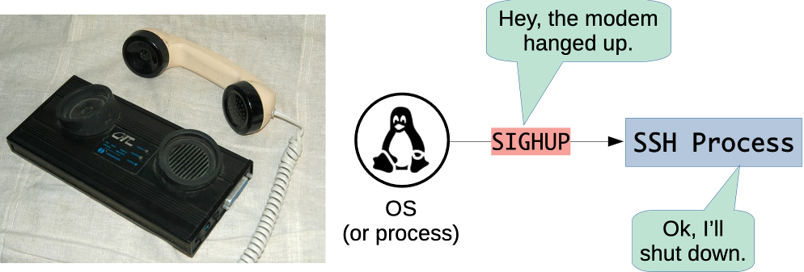
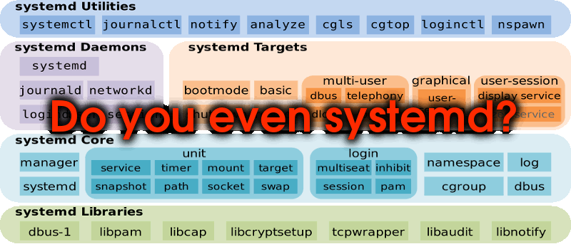

# Process Management on Linux

Architecture & Deployment <!-- .element: class="subtitle" -->

**Notes:**

Learn how processes are told to stop or reload with signals, and how systemd
starts, stops and restarts the processes of a Linux server.

---

## Signals

- A **notification** the kernel delivers to a process
- The process stops what it was doing, and runs a **handler**
- Its own handler, or the **default** one, which usually terminates it

**Notes:**

Processes are isolated, so one cannot reach into another to tell it to stop or
reload. It asks the kernel, with a system call, to send a **signal**. The kernel
also sends signals of its own.

A signal does to a process what [an interrupt](#the-machine-at-boot) does
to a processor: it can arrive at any moment, and the process runs the code that
handles it. The `kill` command sends a signal to a process by its PID, and is
named after the default handler of most signals.

---

## `Ctrl-C`

- The kernel turns `Ctrl-C` into a **`SIGINT`** signal
- It goes to the command running in the **foreground** of the terminal
- The program never sees the key

**Notes:**

The terminal is managed by the kernel, which recognizes `Ctrl-C` and sends
`SIGINT` to every process of the foreground command: with `npm run dev`, to both
`npm` and `node`. A program that handles `SIGINT` itself can choose not to stop.

---

## Ask, then force

<table class="text-3xl">
  <thead>
    <tr>
      <th>Signal</th>
      <th>Means</th>
      <th>Can the process handle it?</th>
    </tr>
  </thead>
  <tbody>
    <tr>
      <td><code>SIGTERM</code></td>
      <td>Please terminate</td>
      <td>Yes: it can clean up first</td>
    </tr>
    <tr>
      <td><code>SIGKILL</code></td>
      <td>Terminated by the kernel</td>
      <td>No: none of its code runs</td>
    </tr>
  </tbody>
</table>

**Notes:**

`kill` sends `SIGTERM` by default. A program can handle it to finish its
requests, write its files and close its connections before it exits, or ignore
it. `kill -9` sends `SIGKILL`, which the kernel carries out itself: the process
ends with no chance to clean up, so it is the last resort.

---

## Hang up

- Closing a terminal sends **`SIGHUP`** to its processes
- This is why an application **stops when you disconnect**
- Many services use it to **reload their configuration**

**Notes:**

The name comes from the modem that connected a terminal to the computer hanging
up. When an SSH connection closes, the kernel sends `SIGHUP` to the shell and
the programs it was running, which terminate. Programs that run without a
terminal never receive it that way, so nginx and PostgreSQL, among others, use
it to mean "read your configuration again".

---

## Managing processes

- An application started by hand, in an SSH session:
  - **stops** when the session closes
  - **does not come back** after a crash or a reboot
- A server needs its processes started, in order, and restarted

**Notes:**

Some processes depend on others: Guess It needs PostgreSQL to load and save the
leaderboard, so the database has to start first.

---

## Process managers

- A **process manager** starts, watches and restarts other processes
- The **init process**, PID 1, manages them all
- On Ubuntu, it is **systemd**

**Notes:**

The init process is the first process the kernel starts [at boot](#booting), and every other
process descends from it. Other systems have their own: launchd on macOS, the
Service Control Manager on Windows. Smaller ones, such as PM2 for Node.js, run a
single application.

---

## Describe, do not type

<table class="text-3xl">
  <thead>
    <tr>
      <th>What is done by hand</th>
      <th>What a unit file says</th>
    </tr>
  </thead>
  <tbody>
    <tr>
      <td>Connect as a user</td>
      <td><code>User=</code></td>
    </tr>
    <tr>
      <td>Make sure the database runs</td>
      <td><code>After=</code></td>
    </tr>
    <tr>
      <td>Go to the application's directory</td>
      <td><code>WorkingDirectory=</code></td>
    </tr>
    <tr>
      <td>Set the environment variables</td>
      <td><code>EnvironmentFile=</code></td>
    </tr>
    <tr>
      <td>Run the command</td>
      <td><code>ExecStart=</code></td>
    </tr>
    <tr>
      <td><em>Nothing, after a crash</em></td>
      <td><code>Restart=</code></td>
    </tr>
    <tr>
      <td><em>Nothing, after a reboot</em></td>
      <td><code>WantedBy=</code></td>
    </tr>
  </tbody>
</table>

**Notes:**

systemd does not replay typed commands: a **unit file** describes the process
to manage. One that describes a long-running process is a **service**, named
after its file (`guessit.service`). `systemctl` asks systemd to enable, start,
stop or restart it. To stop it, systemd sends `SIGTERM`, then `SIGKILL` if the
process is still running 90 seconds later.

---

## Restarting on failure

- A process **fails** when it exits with a status other than `0`
- Or when it is **killed** by a signal such as `SIGKILL`
- systemd can **restart** it, with a new PID

**Notes:**

This is `Restart=on-failure`. An [exit status](#exit-status) of `0`, or `SIGTERM`,
`SIGINT` or `SIGHUP`, counts as a stop that was asked for, not a failure. Under
`node --watch`, a crashed application [waits for a file to change]() instead of exiting, so systemd would
never see it fail: under systemd, it runs in production mode.

---

## Logs

- A service has **no terminal**
- Its standard output and error go to the **journal**
- When a service misbehaves, **read its logs first**

**Notes:**

systemd collects the [standard streams](#standard-streams) of its services, and
journald records them, timed, along with what systemd did to each service and
why. `journalctl` reads them.
