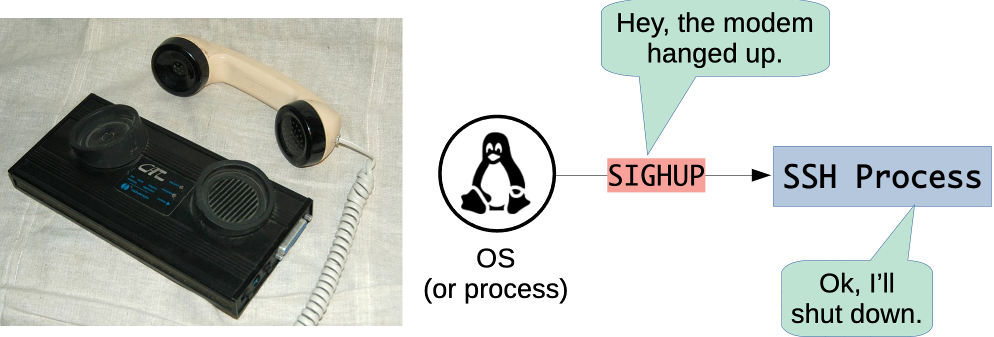
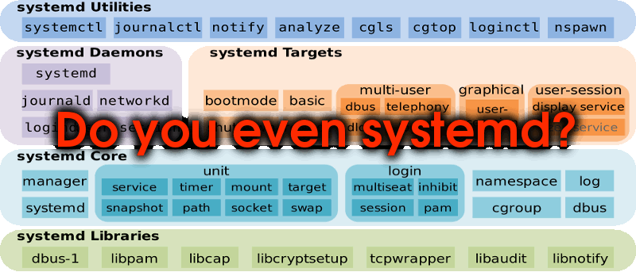
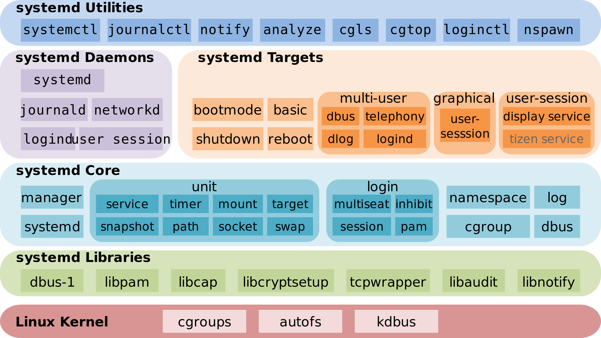

Learn how processes are told to stop or reload with signals, and how to manage
them on Linux with [systemd][systemd].

<!-- more -->

**You will need**

- A Unix CLI
- An Ubuntu server to connect to

**Recommended reading**

- [Unix Processes]()
- [How a computer works](#the-operating-system)

## What is process management?

Many processes must run for a computer to do its job.

Which processes to run and when to run them depends on the use case:

- On a desktop computer, you need processes to be launched to display the
  graphical user interface (GUI), for example.
- On a web-facing server, you probably need to run a database and a web server
  at least.

Some processes may have **dependencies**: i.e. they might need other processes
to be already running in order to run properly themselves. For example, Guess It
needs its PostgreSQL database to load and save the leaderboard.

Processes also need to be **managed**, i.e. it should be easy to start them,
stop them, restart them, or to configure them to automatically restart if they
crash.

### Process managers

**Process managers** are programs that fulfill this role: they make sure that
the correct processes are run in the correct order, and keep managing them
afterwards. A process manager is a process like any other, whose job is to
start other processes, watch them, and restart them when they stop.

The most important one is the first process of the machine. As you saw [when
the machine boots][booting], the kernel starts a single program, the **init
process**, with process ID 1. Everything else the machine runs is started by the
init process, or by a process that it started. This makes it the natural process
manager of the whole system.

Most operating systems have a process manager built in:

| Process manager                              | Operating system                  |
| :------------------------------------------- | :-------------------------------- |
| [launchd][launchd]                           | [macOS][macos]                    |
| [Service Control Manager (SCM)][windows-scm] | [Windows][windows]                |
| [systemd][systemd]                           | Many [Linux][linux] distributions |
| [Unix System V][unix-system-v] init system   | [Unix][unix]                      |

### Lightweight process managers

Simpler process managers also exist, meant to be used to run and manage one
application. Some of them are generic while others are specific to a
programming language:

| Process manager           | Written in       | Can run          |
| :------------------------ | :--------------- | :--------------- |
| [PHP FPM][php-fpm]        | [PHP][php]       | PHP programs     |
| [PM2][pm2]                | [Node.js][node]  | Node.js programs |
| [Supervisor][supervisord] | [Python][python] | _Any executable_ |

They are easier to use but have fewer features. For example, none of those can
handle dependencies between processes.

## Signals

<div class="w-full flex justify-center">
  
</div>

To stop a process, restart it or tell it to reload its configuration, a process
manager has to be able to tell the process so. Processes are isolated from each
other, so it cannot simply reach into the other process's memory. It uses the
operating system to send it a **signal** instead.

### What is a signal?

A signal is an **[asynchronous][asynchrony] notification sent to a process** to
notify it that an event has occurred. The process may be doing anything at the
time: it does not wait for the signal, or ask for it.

Signals are always delivered by the kernel. A process sends one by asking the
kernel to, with a [system call][os], and the kernel also sends signals of its
own, for example when the terminal a process is running in is closed.

<div class="w-full p-4 rounded-2xl flex justify-center dark:bg-radial dark:from-gray-500 dark:from-40% dark:to-transparent">
  
</div>

A signal does to a process what [an interrupt][machine-at-boot] does to a
processor. The process stops whatever it was doing, and runs the code that
handles that signal:

- If the program has registered a **signal handler** for that specific signal,
  that handler runs. When it is done, the process carries on where it stopped.
- Otherwise the **default handler** runs. For most signals, the default handler
  terminates the process.

### Common Unix signals

A signal is named with the `SIG` prefix followed by a short name. Most signals
also have a number. Here are the ones you are most likely to meet:

| Signal     | Number | Default handler                         | Description                                                    |
| :--------- | -----: | :-------------------------------------- | :------------------------------------------------------------- |
| `SIGHUP`   |      1 | Terminate                               | Hangup (the terminal was closed)                               |
| `SIGINT`   |      2 | Terminate                               | Interrupt (sent when you press `Ctrl-C`)                       |
| `SIGQUIT`  |      3 | Terminate (with [core dump][core-dump]) | Quit                                                           |
| `SIGKILL`  |      9 | Terminate                               | Kill (cannot be caught or ignored)                             |
| `SIGTERM`  |     15 | Terminate                               | Termination signal (default signal sent by the `kill` command) |
| `SIGUSR1`  |      - | Terminate                               | User-defined signal 1                                          |
| `SIGUSR2`  |      - | Terminate                               | User-defined signal 2                                          |
| `SIGWINCH` |      - | Ignore                                  | Terminal window size changed                                   |



You can **l**ist the signals of your system by running `kill -l`. Here is a more
complete list: [POSIX signals][signals-list].





`SIGUSR1`, `SIGUSR2` and `SIGWINCH` have a number too, but it is not the same on
every system, so programs refer to them by name.



#### The terminal interrupt signal (`SIGINT`)

When you press `Ctrl-C` to stop a command, you are using signals. You have done
it since the start of the course, for example to stop Guess It when it was
running in your terminal.

The program does not read `Ctrl-C` as a key. The terminal is managed by the
kernel, which recognizes the key combination and sends a **terminal interrupt
signal**, or **`SIGINT`**, to the processes running in the foreground of that
terminal. When you stopped `npm run dev`, both `npm` and the `node` processes it
had started received it.

Most programs handle that signal by terminating. Some interactive programs use
it for something else instead. For example, `Ctrl-C` does not quit the pager of
`man ls`: you have to press `q`.

### The `kill` command

The `kill` command **sends a signal to a process**, identified by its PID.

Since the default handler for most signals is to terminate the process, it often
has that effect, hence the name "kill".

Its syntax is:

```
kill [-<SIGNAL>] <PID>
kill [-s <SIGNAL>] <PID>
```

| Command             | Effect                                                                 |
| :------------------ | :--------------------------------------------------------------------- |
| `kill 10000`        | Send the **default `SIGTERM` signal** to the process with PID `10000`  |
| `kill -s HUP 10000` | Send the `SIGHUP` signal to that same process                          |
| `kill -HUP 10000`   | Equivalent to the previous command                                     |
| `kill -1 10000`     | Equivalent to the previous command (1 is the POSIX number of `SIGHUP`) |



You can only send signals to your own processes. To send a signal to a process
of another user, such as a service run by systemd, you need `sudo`.



#### Trapping signals

[This script][trap-script] is badly behaved on purpose: it registers a handler
for every signal it can, which prints a message and does nothing else. You can
run it like this:

```bash
$> curl -fsSL https://tinyurl.com/archidep-trap | sh
Hi, I'm running with PID 10000
Try and kill me!
```

Since it handles the `SIGINT` signal itself, among others, `Ctrl-C` does not
stop it. The script prints a message, and carries on.

From another terminal, for example a second SSH connection to the same server,
you can send it other signals with `kill`, using the PID it printed (`10000` in
this example, which will be different on your machine):

```bash
$> kill 10000
$> kill -s HUP 10000
$> kill -s QUIT 10000
$> kill -s USR1 10000
```

The script handles each of them the same way, and stays alive:

```
Nice try, I am ignoring your SIGTERM signal
Nice try, I am ignoring your SIGHUP signal
Nice try, I am ignoring your SIGQUIT signal
Nice try, I am ignoring your SIGUSR1 signal
```

#### The `KILL` signal

There is one signal that cannot be handled or ignored: **`SIGKILL`**.

The kernel does not deliver it to the process. It ends the process itself,
without running any more of its code, so the program cannot prevent it:

```bash
$> kill -s KILL 10000
```

The script finally dies, without printing anything.

Because the program gets no chance to run any code, it cannot clean up before
it ends: finish writing a file, answer the requests it is handling, or close its
connection to a database. This is why you ask a process to stop with `SIGTERM`
first, and only use `SIGKILL` on a process that does not stop.

### Unix signals in the real world

Many widely-used programs react to Unix signals, for example:

- [Nginx][nginx-signals]
- [PostgreSQL][postgres-signals]
- [OpenSSH][sshd-signals]



<!-- col md:col-span-2 -->

A common example is the `SIGHUP` signal. Originally, it meant that the modem
connecting a terminal to the computer had hung up.

Terminals are no longer connected to computers by modem, but the kernel still
sends `SIGHUP` to the processes of a terminal that is closed. When your SSH
connection closes, the shell on the server and the programs it was running in
the foreground receive it, and terminate. This is why an application you started
in an SSH session stops when you disconnect.

Programs that do not run in a terminal never receive it that way, so some of
them repurposed it. Many background services like Nginx and PostgreSQL reload
their configuration, without shutting down, when they receive a `SIGHUP`.

<!-- col -->




## Systemd



### What is systemd?

On most Linux distributions, including Ubuntu, [systemd][systemd] is the [init
process][booting]: the first process the kernel starts, with PID 1. It is the
process manager of the whole system.

It also provides many of the other fundamental building blocks of a
[Linux][linux] operating system, such as the logging of all the processes it
runs:





Systemd is a replacement for the [Unix System V][unix-system-v] init system and
has been the de facto standard for most Linux distributions since 2015.



### Unit files

Systemd records the instructions on how to launch and manage a process in a
configuration file referred to as a [**unit file**][systemd-unit]. It supports
many unit file types such as `service`, `socket`, `timer`, etc.

A unit file usually looks like this:

```
[Unit]
Description=Something to run
After=something-else.service

[Install]
WantedBy=multi-user.target

...
```

`[Unit]` is one section in the configuration file. There will be other sections
depending on the type of unit file. It holds the unit's description and its
dependencies. Here, the `After` option specifies that this unit must be started
after the `something-else` unit, if both are to be started.

`[Install]` is an optional section that says when the unit should be started
automatically, once it has been enabled. Here, the `WantedBy` option specifies
that the unit is started when the system reaches the `multi-user.target`, which
it does every time it boots.

### Service unit file

The unit file type that interests us is [`service`][systemd-service], which will
configure, launch and manage a long-running process such as a database or
application.

A service unit file will have a `[Service]` section. Common options are:

| Option             | Description                                                  |
| :----------------- | :----------------------------------------------------------- |
| `ExecStart`        | Command to run to start the service                          |
| `WorkingDirectory` | Directory in which to run the command                        |
| `User`             | User to run the process as (can be used to limit access)     |
| `EnvironmentFile`  | File of environment variables to set for the process         |
| `Restart`          | When to restart the process automatically after it has ended |



And [many more][systemd-service-options].



With `Restart=on-failure`, systemd restarts the process when it fails: when it
exits with an [exit status][exit-status] other than 0, or when it is terminated
by a signal such as `SIGKILL`. A process that exits with a status of 0, or that
is terminated by `SIGTERM`, `SIGINT` or `SIGHUP`, is considered to have stopped
as it was asked to, and is not restarted.

### Location of unit files

Unit files are named after their type. For example, a `service` unit file will
be named `something.service`.

Systemd will look in several directories for unit files:

| Location                  | Description                                                                   |
| :------------------------ | :---------------------------------------------------------------------------- |
| `/usr/lib/systemd/system` | Unit files installed by the operating system or by packages (e.g. a database) |
| `/etc/systemd/system`     | Unit files installed by the system administrator                              |



On Ubuntu, `/lib` is a link to `/usr/lib`, so you will also see the first
directory written as `/lib/systemd/system`.



### The `systemctl` command

The `systemctl` or **system** **c**on**t**ro**l** command can be used to
enable/disable and start/stop units once their configuration file is in place:

| Command                          | Description                                                                                   |
| :------------------------------- | :-------------------------------------------------------------------------------------------- |
| `systemctl status <unit>`        | Display the current status of a unit, including the PID of its main process.                  |
| `sudo systemctl enable <unit>`   | Enable a unit, so that it starts automatically as its `[Install]` section says, e.g. on boot. |
| `sudo systemctl disable <unit>`  | Disable a unit, so that it no longer starts automatically.                                    |
| `sudo systemctl start <unit>`    | Start a unit.                                                                                 |
| `sudo systemctl stop <unit>`     | Stop a unit.                                                                                  |
| `sudo systemctl restart <unit>`  | Restart (stop and start) a unit.                                                              |
| `sudo systemctl reload <unit>`   | Ask a unit to reload its configuration, without stopping it, if it supports it.               |
| `sudo systemctl reenable <unit>` | Enable a unit again, after its `[Install]` section has been modified.                         |
| `sudo systemctl daemon-reload`   | Reload unit files after they have been modified.                                              |

`systemctl` does not stop a service itself: it asks systemd, which sends the
service's process a `SIGTERM` signal. If the process is still running 90
seconds later, systemd sends it a `SIGKILL`. Many services implement `reload`
by having systemd send them a `SIGHUP`.

### The `journalctl` command

Services started with systemd have their [standard output and standard
error][streams] streams collected and logged by [journald][systemd-journald],
one of the default services provided by systemd itself. The `systemctl status`
command sometimes shows you an excerpt of these logs.

The `journalctl` command allows you to read the full logs:

| Command                        | Description                                    |
| :----------------------------- | :--------------------------------------------- |
| `sudo journalctl -u <unit>`    | Display a unit's logs.                         |
| `sudo journalctl -f -u <unit>` | Display and follow a unit's logs in real time. |

The logs are often the most useful thing to read when a service does not behave
as expected. A service has no terminal to show you its errors in: if it fails to
start, keeps restarting or does not answer, the error messages it printed are in
its logs, along with what systemd did to it and when.

## References

- [Signals - Unix fundamentals 201 - Ops School
  Curriculum](http://www.opsschool.org/unix_signals.html)
- [SIGINT And Other Termination Signals in
  Linux](https://www.baeldung.com/linux/sigint-and-other-termination-signals)
- [Systemd Unit Configuration][systemd-unit]
- [Systemd Service Configuration][systemd-service]
- [Systemd Execution Environment Configuration][systemd-exec]
- [Systemd Process Killing Procedure
  Configuration](https://www.freedesktop.org/software/systemd/man/systemd.kill.html)
- [Red Hat Enterprise Linux - System Administrator's Guide - Managing Services
  With
  Systemd](https://access.redhat.com/documentation/en-us/red_hat_enterprise_linux/7/html/system_administrators_guide/chap-managing_services_with_systemd)
- [Systemd journald Service][systemd-journald]

[asynchrony]: https://en.wikipedia.org/wiki/Asynchrony_(computer_programming)
[core-dump]: https://en.wikipedia.org/wiki/Core_dump
[launchd]: https://en.wikipedia.org/wiki/Launchd
[linux]: https://en.wikipedia.org/wiki/Linux
[macos]: https://en.wikipedia.org/wiki/MacOS
[nginx-signals]: https://nginx.org/en/docs/control.html
[node]: https://nodejs.org/en/
[php]: http://www.php.net/
[php-fpm]: http://php.net/manual/en/install.fpm.php
[pm2]: https://pm2.keymetrics.io/
[postgres-signals]: https://www.postgresql.org/docs/current/server-shutdown.html
[python]: https://www.python.org/
[signals-list]: https://en.wikipedia.org/wiki/Signal_(IPC)#POSIX_signals
[sshd-signals]: https://man.openbsd.org/sshd
[supervisord]: http://supervisord.org/
[systemd]: https://en.wikipedia.org/wiki/Systemd
[systemd-exec]: https://www.freedesktop.org/software/systemd/man/systemd.exec.html
[systemd-journald]: https://www.freedesktop.org/software/systemd/man/systemd-journald.service.html
[systemd-service]: https://www.freedesktop.org/software/systemd/man/systemd.service.html
[systemd-service-options]: https://www.freedesktop.org/software/systemd/man/systemd.service.html#Options
[systemd-unit]: https://www.freedesktop.org/software/systemd/man/systemd.unit.html
[trap-script]: https://gist.github.com/AlphaHydrae/162f28e3e2bd9355a95914e04cd4dd0c/7ae3f17844809bee9423c412ef02390834221ee8
[unix]: https://en.wikipedia.org/wiki/Unix
[unix-system-v]: https://en.wikipedia.org/wiki/UNIX_System_V
[windows]: https://en.wikipedia.org/wiki/Microsoft_Windows
[windows-scm]: https://en.wikipedia.org/wiki/Service_Control_Manager

[booting]: #booting
[exit-status]: #exit-status
[machine-at-boot]: #the-machine-at-boot
[os]: #the-operating-system
[streams]: #standard-streams
