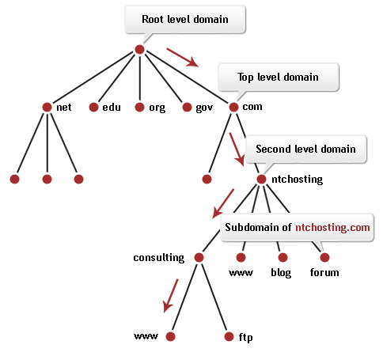
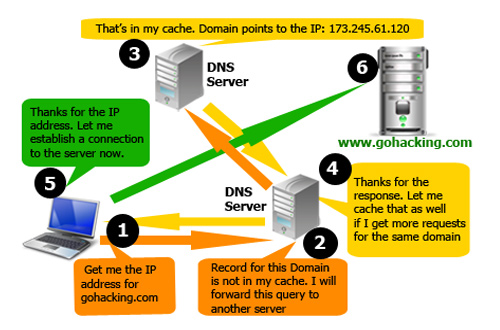

# Domain Name System (DNS)

Architecture & Deployment <!-- .element: class="subtitle" -->

**Notes:**

Learn the basics of the [Domain Name System (DNS)][dns], and how a DNS zone maps
domain names to IP addresses.

**Recommended reading**

- [Unix Networking]()

---

## What is the Domain Name System?

---

### Domain name system

**Notes:**

The [**Domain Name System (DNS)**][dns] is a hierarchical decentralized naming
system for computers connected to the Internet or a private network. Most
prominently, it **translates human-readable domain names** (like `google.com`)
**to numerical IP addresses** (like `172.217.21.238`) needed for locating computers
with the underlying network protocols. The Domain Name System has been an
essential component of the functionality of the Internet since 1985.

---

### DNS hierarchy

<!-- Each level of the tree is highlighted in turn, then the thread follows the
     name www.microsoft.com from the root down, through each of its parents. -->
<svg class="mx-auto block w-full" viewBox="0 0 1480 570" font-family="Lato, Helvetica, Arial, sans-serif" font-size="28" fill="#586e75" role="img" aria-label="The DNS hierarchy: the root, the top-level domains ch, com and org, second-level domains under them, and third-level domains under those">
  <g fill="#00000008">
    <rect x="0" y="20" width="1480" height="125" />
    <rect x="0" y="280" width="1480" height="135" />
  </g>
  <g fill="none" stroke="#c9c2ad" stroke-width="2">
    <path d="M815 104 C815 148 440 148 440 191" />
    <path d="M815 104 C815 148 815 148 815 191" />
    <path d="M815 104 C815 148 1270 148 1270 191" />
    <path d="M440 239 C440 282 440 282 440 326" />
    <path d="M815 239 C815 282 680 282 680 326" />
    <path d="M815 239 C815 282 950 282 950 326" />
    <path d="M1270 239 C1270 282 1240 282 1240 326" />
    <path d="M440 374 C440 418 440 418 440 461" />
    <path d="M950 374 C950 418 950 418 950 461" />
    <path d="M1240 374 C1240 418 1300 418 1300 461" />
  </g>
  <g>
    <g class="fragment highlight-current-blue [&.current-fragment_rect]:fill-blue-100 [&.current-fragment_rect]:stroke-blue-500 [&.current-fragment_text]:fill-blue-600 [&.current-fragment_tspan]:fill-blue-600" data-fragment-index="1">
      <text x="24" y="88" font-size="24" fill="#93a1a1">Root</text>
      <rect x="779" y="56.0" width="72" height="48" rx="24.0" fill="#fff" stroke="#c9c2ad" stroke-width="2" />
      <text x="815" y="84" text-anchor="middle" font-size="44" font-weight="700"><tspan fill="#c0603a">.</tspan></text>
    </g>
    <g class="fragment highlight-current-blue [&.current-fragment_rect]:fill-blue-100 [&.current-fragment_rect]:stroke-blue-500 [&.current-fragment_text]:fill-blue-600 [&.current-fragment_tspan]:fill-blue-600" data-fragment-index="2">
      <text x="24" y="223" font-size="24" fill="#93a1a1">Top-level domains</text>
      <rect x="403" y="191.0" width="74" height="48" rx="24.0" fill="#fff" stroke="#c9c2ad" stroke-width="2" />
      <text x="440" y="225" text-anchor="middle"><tspan fill="#c0603a">ch</tspan></text>
      <rect x="770" y="191.0" width="90" height="48" rx="24.0" fill="#fff" stroke="#c9c2ad" stroke-width="2" />
      <text x="815" y="225" text-anchor="middle"><tspan fill="#c0603a">com</tspan></text>
      <rect x="1225" y="191.0" width="90" height="48" rx="24.0" fill="#fff" stroke="#c9c2ad" stroke-width="2" />
      <text x="1270" y="225" text-anchor="middle"><tspan fill="#c0603a">org</tspan></text>
    </g>
    <g class="fragment highlight-current-blue [&.current-fragment_rect]:fill-blue-100 [&.current-fragment_rect]:stroke-blue-500 [&.current-fragment_text]:fill-blue-600 [&.current-fragment_tspan]:fill-blue-600" data-fragment-index="3">
      <text x="24" y="358" font-size="24" fill="#93a1a1">Second-level domains</text>
      <rect x="336" y="326.0" width="208" height="48" rx="24.0" fill="#fff" stroke="#c9c2ad" stroke-width="2" />
      <text x="440" y="360" text-anchor="middle"><tspan fill="#c0603a">heig-vd</tspan><tspan>.ch</tspan></text>
      <rect x="568" y="326.0" width="225" height="48" rx="24.0" fill="#fff" stroke="#c9c2ad" stroke-width="2" />
      <text x="680" y="360" text-anchor="middle"><tspan fill="#c0603a">example</tspan><tspan>.com</tspan></text>
      <rect x="821" y="326.0" width="258" height="48" rx="24.0" fill="#fff" stroke="#c9c2ad" stroke-width="2" />
      <text x="950" y="360" text-anchor="middle"><tspan fill="#c0603a">microsoft</tspan><tspan>.com</tspan></text>
      <rect x="1111" y="326.0" width="258" height="48" rx="24.0" fill="#fff" stroke="#c9c2ad" stroke-width="2" />
      <text x="1240" y="360" text-anchor="middle"><tspan fill="#c0603a">wikipedia</tspan><tspan>.org</tspan></text>
    </g>
    <g class="fragment highlight-current-blue [&.current-fragment_rect]:fill-blue-100 [&.current-fragment_rect]:stroke-blue-500 [&.current-fragment_text]:fill-blue-600 [&.current-fragment_tspan]:fill-blue-600" data-fragment-index="4">
      <text x="24" y="493" font-size="24" fill="#93a1a1">Third-level domains</text>
      <rect x="302" y="461.0" width="275" height="48" rx="24.0" fill="#fff" stroke="#c9c2ad" stroke-width="2" />
      <text x="440" y="495" text-anchor="middle"><tspan fill="#c0603a">www</tspan><tspan>.heig-vd.ch</tspan></text>
      <rect x="787" y="461.0" width="326" height="48" rx="24.0" fill="#fff" stroke="#c9c2ad" stroke-width="2" />
      <text x="950" y="495" text-anchor="middle"><tspan fill="#c0603a">www</tspan><tspan>.microsoft.com</tspan></text>
      <rect x="1146" y="461.0" width="309" height="48" rx="24.0" fill="#fff" stroke="#c9c2ad" stroke-width="2" />
      <text x="1300" y="495" text-anchor="middle"><tspan fill="#c0603a">fr</tspan><tspan>.wikipedia.org</tspan></text>
    </g>
  </g>
  <g class="fragment" data-fragment-index="5" fill="#c0603a">
    <path d="M815 104 C875 144 755 151 815 191 M815 239 C755 279 1010 286 950 326 M950 374 C1010 414 890 421 950 461" fill="none" stroke="#c0603a" stroke-width="5" stroke-linecap="round" />
    <circle cx="815" cy="104" r="6" />
    <circle cx="815" cy="191" r="6" />
    <circle cx="815" cy="239" r="6" />
    <circle cx="950" cy="326" r="6" />
    <circle cx="950" cy="374" r="6" />
    <circle cx="950" cy="461" r="6" />
  </g>
</svg>

[ICANN][icann] manages [top-level domains (TLDs)][tld].

**Notes:**

The DNS is a tree of names. At its top is the **root**. Its name is empty, and
is written as a single dot.

Under the root are the **top-level domains (TLDs)**, such as `ch`, `com` and
`org`. [ICANN][icann] manages the root, and delegates each top-level domain to
an organization that runs it, for example SWITCH for `ch` and Verisign for
`com`.

Under each top-level domain are **second-level domains**, such as
`microsoft.com`. They are delegated in turn to the organizations or people who
bought them.

The manager of a second-level domain can create **third-level domains** under
it, such as `www.microsoft.com`, and so on.

A domain name is read from right to left, from the root down:
`www.microsoft.com` is `www`, under `microsoft`, under `com`, under the root.
The rest of a name is always its parent: `www.microsoft.com` is under
`microsoft.com`, and has nothing to do with `www.heig-vd.ch`.

Since 2012, an organization can apply to run a [generic top-level domain][gtld]
of its own. The application fee alone was $185,000 that year.

---

### DNS zone

<!-- The same tree as the DNS hierarchy: the manager of com is highlighted, then
     the zone it delegated to Microsoft, microsoft.com and what is under it. -->
<svg class="mx-auto block w-full" viewBox="0 0 1480 570" font-family="Lato, Helvetica, Arial, sans-serif" font-size="28" fill="#586e75" role="img" aria-label="The DNS hierarchy: the root, the top-level domains ch, com and org, second-level domains under them, and third-level domains under those">
  <g fill="#00000008">
    <rect x="0" y="20" width="1480" height="125" />
    <rect x="0" y="280" width="1480" height="135" />
  </g>
  <g fill="none" stroke="#c9c2ad" stroke-width="2">
    <path d="M815 104 C815 148 440 148 440 191" />
    <path d="M815 104 C815 148 815 148 815 191" />
    <path d="M815 104 C815 148 1270 148 1270 191" />
    <path d="M440 239 C440 282 440 282 440 326" />
    <path d="M815 239 C815 282 680 282 680 326" />
    <path d="M815 239 C815 282 950 282 950 326" />
    <path d="M1270 239 C1270 282 1240 282 1240 326" />
    <path d="M440 374 C440 418 440 418 440 461" />
    <path d="M950 374 C950 418 950 418 950 461" />
    <path d="M1240 374 C1240 418 1300 418 1300 461" />
  </g>
  <g class="fragment" data-fragment-index="2">
    <path d="M807 312 H1093 V418 H1127 V523 H773 V418 H807 Z" fill="#3b82f61a" stroke="#3b82f6" stroke-width="3" stroke-dasharray="12 8" stroke-linejoin="round" />
  </g>
  <g>
    <g>
      <text x="24" y="88" font-size="24" fill="#93a1a1">Root</text>
      <rect x="779" y="56.0" width="72" height="48" rx="24.0" fill="#fff" stroke="#c9c2ad" stroke-width="2" />
      <text x="815" y="84" text-anchor="middle" font-size="44" font-weight="700"><tspan fill="#c0603a">.</tspan></text>
    </g>
    <g>
      <text x="24" y="223" font-size="24" fill="#93a1a1">Top-level domains</text>
      <rect x="403" y="191.0" width="74" height="48" rx="24.0" fill="#fff" stroke="#c9c2ad" stroke-width="2" />
      <text x="440" y="225" text-anchor="middle"><tspan fill="#c0603a">ch</tspan></text>
      <g class="fragment highlight-current-blue [&.current-fragment_rect]:fill-blue-100 [&.current-fragment_rect]:stroke-blue-500 [&.current-fragment_text]:fill-blue-600 [&.current-fragment_tspan]:fill-blue-600" data-fragment-index="1">
        <rect x="770" y="191.0" width="90" height="48" rx="24.0" fill="#fff" stroke="#c9c2ad" stroke-width="2" />
        <text x="815" y="225" text-anchor="middle"><tspan fill="#c0603a">com</tspan></text>
      </g>
      <rect x="1225" y="191.0" width="90" height="48" rx="24.0" fill="#fff" stroke="#c9c2ad" stroke-width="2" />
      <text x="1270" y="225" text-anchor="middle"><tspan fill="#c0603a">org</tspan></text>
    </g>
    <g>
      <text x="24" y="358" font-size="24" fill="#93a1a1">Second-level domains</text>
      <rect x="336" y="326.0" width="208" height="48" rx="24.0" fill="#fff" stroke="#c9c2ad" stroke-width="2" />
      <text x="440" y="360" text-anchor="middle"><tspan fill="#c0603a">heig-vd</tspan><tspan>.ch</tspan></text>
      <rect x="568" y="326.0" width="225" height="48" rx="24.0" fill="#fff" stroke="#c9c2ad" stroke-width="2" />
      <text x="680" y="360" text-anchor="middle"><tspan fill="#c0603a">example</tspan><tspan>.com</tspan></text>
      <rect x="821" y="326.0" width="258" height="48" rx="24.0" fill="#fff" stroke="#c9c2ad" stroke-width="2" />
      <text x="950" y="360" text-anchor="middle"><tspan fill="#c0603a">microsoft</tspan><tspan>.com</tspan></text>
      <rect x="1111" y="326.0" width="258" height="48" rx="24.0" fill="#fff" stroke="#c9c2ad" stroke-width="2" />
      <text x="1240" y="360" text-anchor="middle"><tspan fill="#c0603a">wikipedia</tspan><tspan>.org</tspan></text>
    </g>
    <g>
      <text x="24" y="493" font-size="24" fill="#93a1a1">Third-level domains</text>
      <rect x="302" y="461.0" width="275" height="48" rx="24.0" fill="#fff" stroke="#c9c2ad" stroke-width="2" />
      <text x="440" y="495" text-anchor="middle"><tspan fill="#c0603a">www</tspan><tspan>.heig-vd.ch</tspan></text>
      <rect x="787" y="461.0" width="326" height="48" rx="24.0" fill="#fff" stroke="#c9c2ad" stroke-width="2" />
      <text x="950" y="495" text-anchor="middle"><tspan fill="#c0603a">www</tspan><tspan>.microsoft.com</tspan></text>
      <rect x="1146" y="461.0" width="309" height="48" rx="24.0" fill="#fff" stroke="#c9c2ad" stroke-width="2" />
      <text x="1300" y="495" text-anchor="middle"><tspan fill="#c0603a">fr</tspan><tspan>.wikipedia.org</tspan></text>
    </g>
  </g>
</svg>

**Notes:**

A [DNS zone][dns-zone] is a subset of the domain name space for which
administrative responsibility has been delegated to a single manager.

For example, Microsoft has purchased the rights to manage the `microsoft.com`
domain and all its subdomains from the manager of the `.com` [top-level domain
(TLD)][tld]. Once they have those rights, they can create any number of
subdomains for their business needs.

You can also purchase a domain name as an individual, giving you the right to
manage that portion of the DNS hierarchy.

---

### DNS zone file

<!-- The last record is shown first as a whole, then field by field. Each field
     and its line of the legend share a fragment index, so that the legend
     explains whichever field is highlighted, and stays behind as the next one
     is. -->
<table class="!mt-4 font-mono text-2xl">
  <thead>
    <tr>
      <th>Name</th>
      <th>TTL</th>
      <th>Class</th>
      <th>Type</th>
      <th>Data</th>
    </tr>
  </thead>
  <tbody>
    <tr>
      <td>@</td>
      <td>10800</td>
      <td>IN</td>
      <td>A</td>
      <td>203.0.113.10</td>
    </tr>
    <tr>
      <td>@</td>
      <td>10800</td>
      <td>IN</td>
      <td>MX</td>
      <td>10 mail.example.com.</td>
    </tr>
    <tr>
      <td>www</td>
      <td>10800</td>
      <td>IN</td>
      <td>CNAME</td>
      <td>example.com.</td>
    </tr>
    <tr class="fragment highlight-current-blue [&.current-fragment]:bg-blue-500/10" data-fragment-index="1">
      <td class="fragment highlight-current-blue [&.current-fragment]:bg-blue-500/10" data-fragment-index="2">jde</td>
      <td class="fragment highlight-current-blue [&.current-fragment]:bg-blue-500/10" data-fragment-index="3">1800</td>
      <td class="fragment highlight-current-blue [&.current-fragment]:bg-blue-500/10" data-fragment-index="4">IN</td>
      <td class="fragment highlight-current-blue [&.current-fragment]:bg-blue-500/10" data-fragment-index="5">A</td>
      <td class="fragment highlight-current-blue [&.current-fragment]:bg-blue-500/10" data-fragment-index="6">203.0.113.42</td>
    </tr>
  </tbody>
</table>

<ul class="!mt-8 text-2xl">
  <li class="fragment [&.current-fragment]:text-blue-500 [&.current-fragment_strong]:text-blue-500!" data-fragment-index="1"><strong>Resource record</strong>: one line of the zone file</li>
  <li class="fragment [&.current-fragment]:text-blue-500 [&.current-fragment_strong]:text-blue-500!" data-fragment-index="2"><strong>Name</strong>: <code>jde.example.com</code></li>
  <li class="fragment [&.current-fragment]:text-blue-500 [&.current-fragment_strong]:text-blue-500!" data-fragment-index="3"><strong>TTL</strong>: time to live, in seconds</li>
  <li class="fragment [&.current-fragment]:text-blue-500 [&.current-fragment_strong]:text-blue-500!" data-fragment-index="4"><strong>Class</strong>: Internet</li>
  <li class="fragment [&.current-fragment]:text-blue-500 [&.current-fragment_strong]:text-blue-500!" data-fragment-index="5"><strong>Type</strong>: Address (IPv4)</li>
  <li class="fragment [&.current-fragment]:text-blue-500 [&.current-fragment_strong]:text-blue-500!" data-fragment-index="6"><strong>Data</strong>: the IPv4 address</li>
</ul>

**Notes:**

The manager of a DNS zone describes it in a [zone file][dns-zone-file], with one
line per **resource record**. This is part of the zone of `example.com`. The
first three records are the kind a domain often has: an IPv4 address for
`example.com` itself, the server that receives its mail (`MX`), and `www` as an
alias of `example.com` (`CNAME`).

The last record adds a subdomain. Its fields are:

- **Name**: a name in a zone file is relative to the zone's domain, so `jde` in
  the zone of `example.com` means `jde.example.com`. The name `@` means the
  domain itself, `example.com`.
- **TTL**: the record's _time to live_. Whoever receives this answer may keep it
  in a cache for up to 1800 seconds (30 minutes), and answer from that cache
  instead of asking again.
- **Class**: `IN` stands for Internet. It is the only class you will meet.
- **Type**: `A` stands for Address. An `A` record maps a name to an IPv4
  address.
- **Data**: what the record maps the name to. Its form depends on the type: for
  an `A` record, it is an IPv4 address, here `203.0.113.42`.

---

### Mapping names to addresses

<!-- Each row is highlighted in turn, together with the names it maps, which
     share its fragment index and stay behind as the next row is. -->
<table class="!mt-4 font-mono text-2xl">
  <thead>
    <tr>
      <th>Name</th>
      <th>TTL</th>
      <th>Class</th>
      <th>Type</th>
      <th>Data</th>
    </tr>
  </thead>
  <tbody>
    <tr class="fragment highlight-current-blue [&.current-fragment]:bg-blue-500/10" data-fragment-index="1">
      <td>@</td>
      <td>10800</td>
      <td>IN</td>
      <td>A</td>
      <td>203.0.113.10</td>
    </tr>
    <tr class="fragment highlight-current-blue [&.current-fragment]:bg-blue-500/10" data-fragment-index="2">
      <td>jde</td>
      <td>1800</td>
      <td>IN</td>
      <td>A</td>
      <td>203.0.113.42</td>
    </tr>
    <tr class="fragment highlight-current-blue [&.current-fragment]:bg-blue-500/10" data-fragment-index="3">
      <td>*.jde</td>
      <td>1800</td>
      <td>IN</td>
      <td>A</td>
      <td>203.0.113.42</td>
    </tr>
  </tbody>
</table>

<!-- A grid rather than a list, so that the arrows line up. Every cell of a
     mapping is a fragment of its own, with the index of its row. -->

  example.com
  →
  203.0.113.10
  jde.example.com
  →
  203.0.113.42
  foo.jde.example.com
  →
  203.0.113.42
  bar.jde.example.com
  →
  203.0.113.42

**Notes:**

Each record maps one name to an address: `@` maps `example.com` itself, and
`jde` maps `jde.example.com`.

The name `*.jde` is a **wildcard**: it maps any name under `jde.example.com`
that has no record of its own, such as `foo.jde.example.com` or
`bar.jde.example.com`, without having to add a record for each one.

A wildcard does not match the name it is under: `*.jde` does not map
`jde.example.com` itself. That is why it takes two records, `jde` and `*.jde`,
for both `jde.example.com` and every name under it to reach the same server.

[dns]: https://en.wikipedia.org/wiki/Domain_Name_System
[dns-zone]: https://en.wikipedia.org/wiki/DNS_zone
[dns-zone-file]: https://en.wikipedia.org/wiki/Zone_file
[gtld]: https://en.wikipedia.org/wiki/Generic_top-level_domain
[icann]: https://en.wikipedia.org/wiki/ICANN
[tld]: https://en.wikipedia.org/wiki/Top-level_domain
