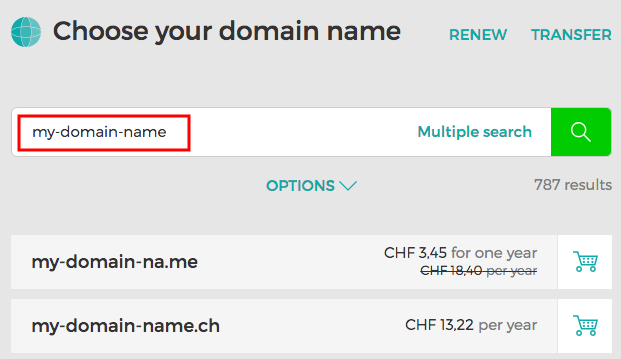

Learn the basics of the [Domain Name System (DNS)][dns], and how a DNS zone
maps domain names to IP addresses.

<!-- more -->

**Recommended reading**

- [Unix Networking]()

## DNS zone

A [DNS zone][dns-zone] is a subset of the domain name space for which
administrative responsibility has been delegated to a single manager.

### DNS zone file

As the manager of a DNS zone, you can modify the [DNS zone file][dns-zone-file],
a text file which describes that zone. It contains **mappings between domain
names and IP addresses** and other resources, in the form of resource records.

A **resource record** is described by one line in the following format:

```
name   ttl   record class   record type   record data
```

The meaning of each field is:

- `name` - Subdomain name (or `@` for the domain itself).
- `ttl` - Time to live: how many seconds the answer for this record may be
  cached.
- `record class` - Namespace of the record information, usually `IN` for the Internet.
- `record type` - Type of record.
- `record data` - Record data (depending on the record type).

### DNS record types

There are multiple [record types][dns-record-types]. These are some of the
most common:

| Type    | Description           | Function                                                                                                |
| :------ | :-------------------- | :------------------------------------------------------------------------------------------------------ |
| `A`     | Address record        | Maps a domain name to an IPv4 address.                                                                  |
| `AAAA`  | IPv6 address record   | Maps a domain name to an IPv6 address.                                                                  |
| `CNAME` | Canonical name record | Alias of one name to another (e.g. `www`).                                                              |
| `MX`    | Mail exchange record  | Maps a domain name to a list of message transfer agents.                                                |
| `NS`    | Name server record    | Names the DNS servers that answer for a zone.                                                           |
| `SOA`   | Start of authority    | Authoritative information about the zone, e.g. primary name server & email of the domain administrator. |
| `TXT`   | Text record           | Arbitrary machine-readable data.                                                                        |

### DNS record example

Let's look at a real example which you might find in a zone file. The first
line only names the fields: it is not part of the zone file.

```
name   ttl   record class   record type   record data
@      1800  IN             A             18.213.200.101
```

Assuming this is the zone file for the domain `example.com`,
here is how to read that record:

- It is an Internet record (`IN`).
- The `@` name indicates that it concerns the domain `example.com` itself.
- It is an `A` record, meaning that it maps `example.com` to the IPv4 address
  `18.213.200.101`.
- It defines a cache time of 1800 seconds (30 minutes) during which clients will
  not perform DNS resolution again if they have the mapping already.

### DNS subdomain record example

Let's look at another example:

```
name   ttl   record class   record type   record data
blog   300   IN             A             3.120.180.32
```

Assuming this is the zone file for the domain `example.com`,
here is how to read that record:

- It is an Internet record (`IN`).
- It concerns the subdomain `blog.example.com`.
- It is an `A` record, meaning that it maps `blog.example.com` to the IPv4
  address `3.120.180.32`.
- It defines a cache time of 300 seconds (5 minutes) during which clients will
  not perform DNS resolution again if they have the mapping already.

## Resolving a domain name

You have probably seen how DNS resolution works before. This is a reminder,
since it explains why the TTL of a record matters.

When your browser needs the IP address of `blog.example.com`:

1. Your computer asks a **DNS resolver**, a server whose job is to find the
   answer for you. It is usually run by your Internet provider, or by the
   organization whose network you are on.
2. If the resolver has no answer in its cache, it asks one of the **root name
   servers**. They do not know the address of `blog.example.com`, but they know
   which name servers are responsible for `.com`.
3. The resolver asks one of the name servers of `.com`. They do not know the
   address either, but they know which name servers are responsible for the
   zone of `example.com`: the zone of `.com` has `NS` records for it.
4. The resolver asks one of the name servers of `example.com`. They are
   **authoritative** for that zone: they answer from its zone file, with the `A`
   record of `blog.example.com`.
5. The resolver gives the answer to your computer.

Each answer is kept in a cache for as long as its TTL allows: by the resolver,
and also by your computer. Until it expires, the next question for the same name
is answered from a cache, without asking the authoritative name servers again.
This makes the DNS fast, and it is why a changed record takes time to be seen by
everyone: a cache may still hold the old answer until its TTL runs out.

## Managing DNS on Gandi.net


### Buying a domain name

Most web hosting companies like [Gandi][gandi] allow you to easily check whether a domain name is available,
i.e. whether there is already a manager for that subset of the DNS hierarchy, or if you are free to buy it for yourself.

Check out [their shop][gandi-shop] to see if your dream domain name is available.

<p class='center'></p>

### Configuring a domain

Once you have bought a domain name, you access its management interface from
your account. There, you can manage the domain's DNS zone: you will do so in the
[next exercise]().

[dns]: https://en.wikipedia.org/wiki/Domain_Name_System
[dns-record-types]: https://en.wikipedia.org/wiki/List_of_DNS_record_types
[dns-zone]: https://en.wikipedia.org/wiki/DNS_zone
[dns-zone-file]: https://en.wikipedia.org/wiki/Zone_file
[gandi]: https://www.gandi.net/
[gandi-shop]: https://shop.gandi.net/
