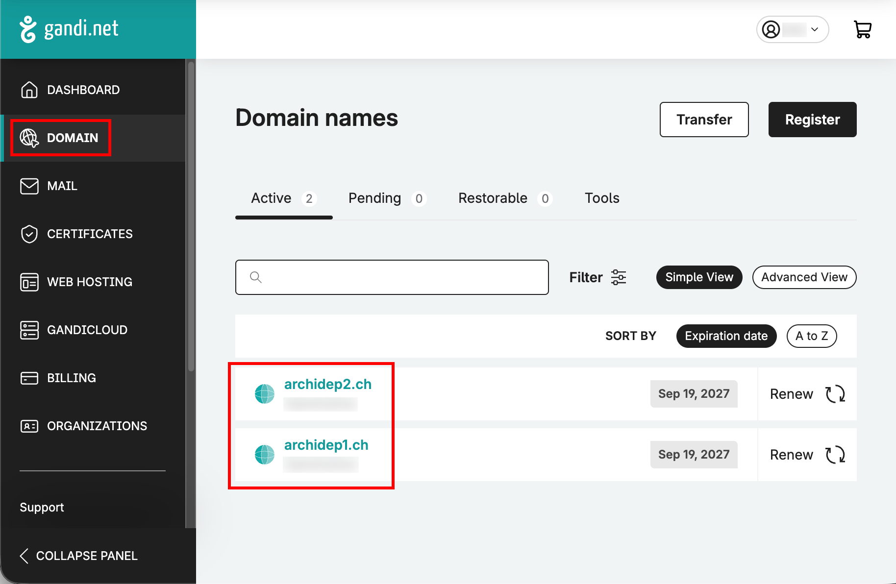
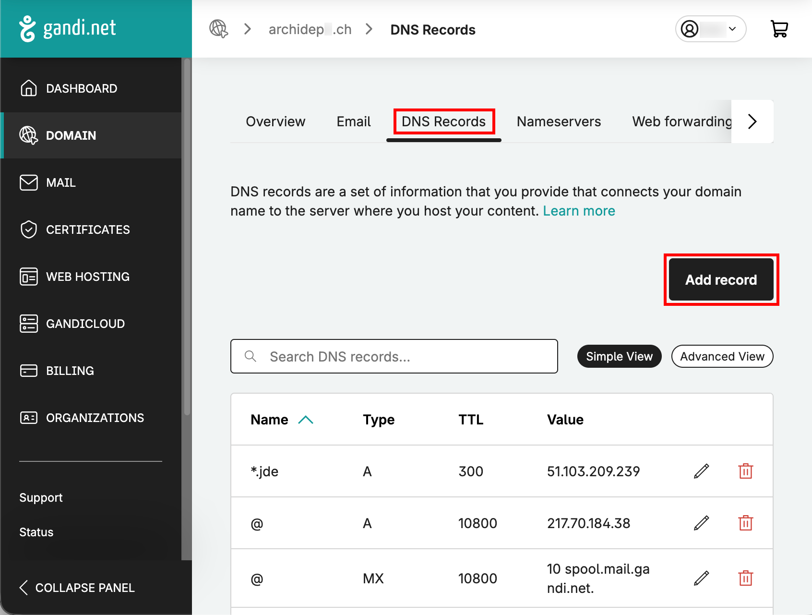
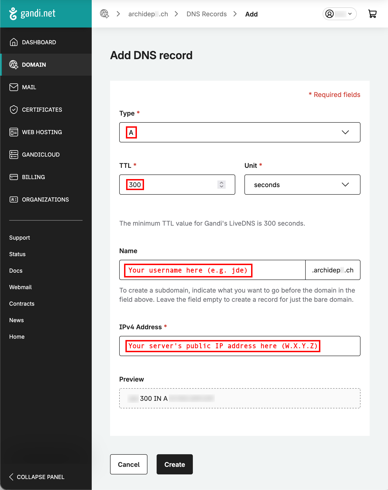
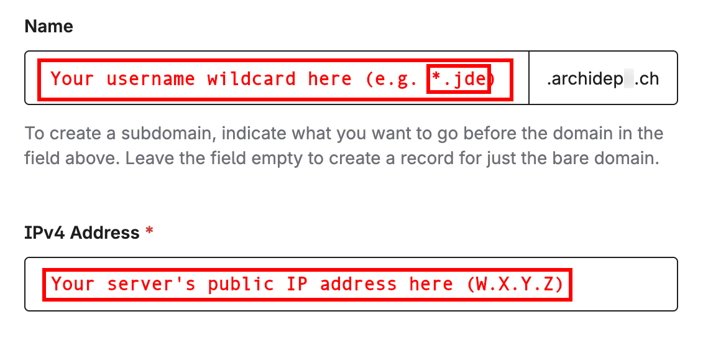
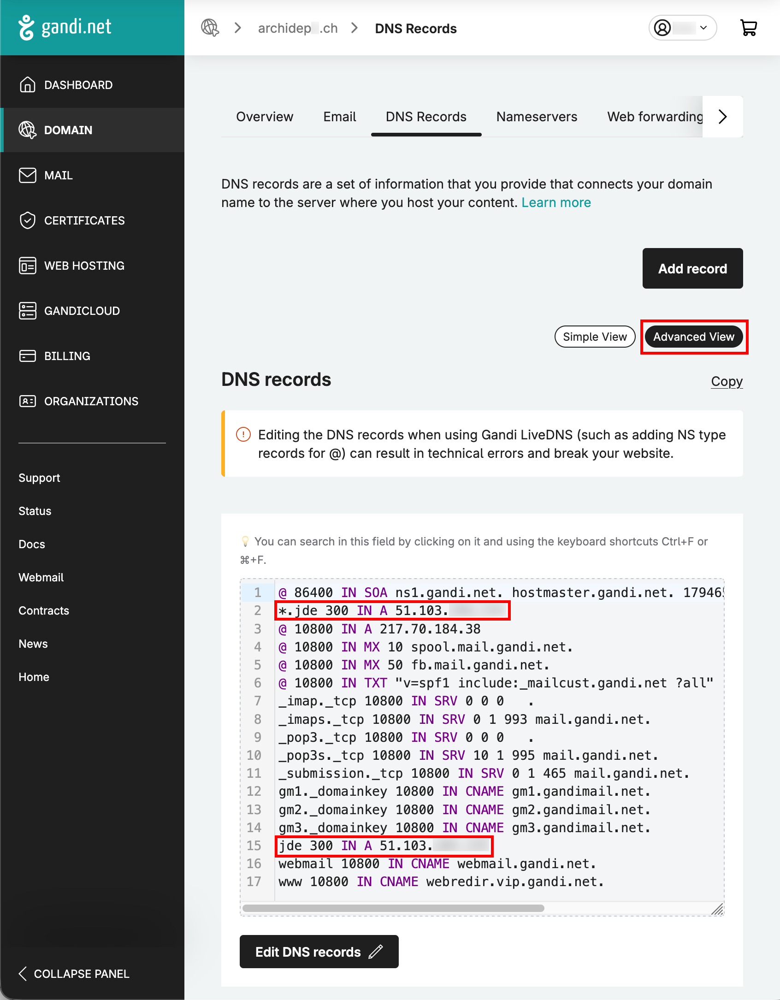
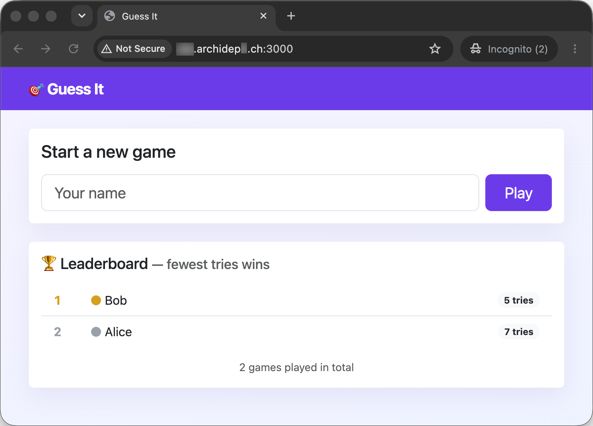

The goal of this exercise is to set up a real domain name for your application.



You only need your favorite browser for this exercise, as long as you have
completed the previous exercises and Guess It is running on your server.



<!-- more -->

## :exclamation: Requirements

Make sure you have completed the [previous exercise]().

## :exclamation: Find your subdomain

In this exercise, you will configure actual subdomains in the worldwide DNS
system to point to your server.

You must use the subdomain that has been assigned to you for this course: the
**Hostname** shown on your cloud server's details card, on this page if you are
logged in, or on the [dashboard](/app). Make a note of it. For example, if your
hostname is `jde.archidep2.ch`:

- `archidep2.ch` is the domain you will select in Gandi.net.
- `jde` is the name you will give to your DNS records.

## :exclamation: Configure a DNS zone with Gandi.net

- By now, you should have received an email from Gandi.net on your
  `@heig-vd.ch` address, inviting you to join the course's organization. Accept
  the invitation, and create a Gandi.net account when asked if you do not have
  one yet. If you cannot find the email, ask the teacher.
- Connect to [Gandi.net](https://gandi.net) with your account.
- Go under the "Domain" tab in the left menu and select the domain of the
  hostname you noted above.

  <p class='center'></p>

- Go under the "DNS Records" tab in the domain's top menu. Gandi.net shows the
  records of the domain's DNS zone in a table:

  <p class='center'></p>

- Add two new `A` records with the "Add record" button, to map subdomains to
  **your server's public IP address**:
  1. Assuming your personal subdomain for the course is `jde.archidep2.ch`, use
     `jde` as the **name of the DNS record**.
  2. Then, create a wildcard subdomain using `*.jde` as the **name of the DNS
     record**, and the same IP address. This will direct any second-level
     subdomain like `foo.jde.archidep2.ch` to your server.

  For both records, set the TTL to 300 seconds (5 minutes), the shortest
  Gandi.net allows, instead of its default of 10800 seconds (3 hours). If you
  make a mistake in a record, you will then wait at most 5 minutes for the
  corrected one to be seen.

  <p class='center'></p>

  Create the second wildcard record in the same way. Only the name changes:

  <p class='center'></p>

Assuming your server's IP address is `W.X.Y.Z` and your username is `jde`,
the domain's zone file should now contain the following DNS records (among
others):

```
*.jde 300 IN A W.X.Y.Z
jde 300 IN A W.X.Y.Z
```

You can see the zone file itself in Gandi.net's "Advanced View". Look for your
own lines in it, with your owner username and your server's public IP address:

<p class='center'></p>

## :exclamation: Access the domain name

Once you have configured it correctly, you (and everybody else) can reach Guess
It at `http://jde.archidep2.ch:3000` in a browser, instead of
`http://W.X.Y.Z:3000`. It is the same application, still listening on port 3000:
only the name in the address has changed.





You might have to wait a few minutes for the change to take effect, especially
if you make a mistake in configuring the DNS record and then fix it. This is
because DNS records are cached for a time (the TTL you configured), by all
intermediaries and also by your machine.



### :question: Optional: check the DNS resolution yourself

You can ask the DNS for the IP address of your domain name yourself, without
opening Guess It.

The simplest is an online tool such as [Google's Dig][google-dig]: enter your
domain name, and it shows the `A` record of that name, with your server's public
IP address. It asks the DNS from Google's servers rather than from your machine,
so its answer does not depend on what your machine has cached, which is useful
after you have fixed a mistake in a record.

On the command line, the `dig` command asks a DNS server and prints its answer:

<div
  class="archidep-randomize"
  data-regexp="(?<username>[a-z][a-z0-9]+)\.(?<domain>archidep[0-9]\.ch)"
  data-template="<username>.<domain>"></div>

```bash
$> dig jde.archidep2.ch
...
;; ANSWER SECTION:
jde.archidep2.ch.       300     IN      A       W.X.Y.Z
...
```

The answer section must contain your server's public IP address. It is the
record you added in Gandi.net, in the same format as in the zone file above. The
number after the name is how many seconds the answer may still be cached: 300 at
most, the TTL of your record, and less if it was already in a cache.

A name under your wildcard record, such as `foo.jde.archidep2.ch`, must give the
same address.



If your shell says `dig: command not found`, run it on your server, over SSH.



You can also use `ping`, as you did to find Google's IP address in [Make TCP
connections][tcp-ping]. It prints the address the name resolves to on its first
line:

<div
  class="archidep-randomize"
  data-regexp="(?<username>[a-z][a-z0-9]+)\.(?<domain>archidep[0-9]\.ch)"
  data-template="<username>.<domain>"></div>

```bash
$> ping -c 1 jde.archidep2.ch
PING jde.archidep2.ch (W.X.Y.Z) 56(84) bytes of data.
```

What follows does not matter here. If your server does not answer `ping`, `ping`
reports `100% packet loss` after a few seconds: the name still resolved to your
server's address, which is what you are checking.

## :checkered_flag: What have I done?

You have given your server a name. Anyone on the Internet can now reach Guess It
at `http://jde.archidep2.ch:3000` (for example), without knowing your server's
IP address.

The name works because you added records to a [DNS zone][dns-zone]: the part of
the [domain name system][dns] that one manager is responsible for. The course
manages the zone of its domain at Gandi.net, and gave you access to add your own
records to it, as a company does with the subdomains of its own domain.

An `A` record maps a name to an IPv4 address, and nothing else. A browser first
asks the DNS for the address of the name you typed, then connects to that
address exactly as if you had typed the address yourself. The port is not part
of the DNS: `:3000` is still needed, and the connection still reaches the same
process listening on that port.

Your wildcard record, `*.jde`, maps every name under `jde.archidep2.ch` to the
same address, so that a name such as `foo.jde.archidep2.ch` needs no record of
its own.

An answer from the DNS is kept in caches, on your machine and on the DNS servers
in between, for as long as the record's TTL allows. That is why a corrected
record can take minutes to work: the old answer is still served from a cache. A
name that was never looked up is in no cache, so it works straight away.

Several problems from [the list of improvements to the basic
deployment][improve] are still unsolved. One of them is that the address still
needs a port. Your server will host several sites, each under a name of its own,
and they cannot all listen on the same port, since only one process can listen
on a given port. The DNS does not solve this: it maps names to addresses, never
to ports. Something more will be needed.

### :classical_building: Architecture

This is a simplified architecture of the main running processes and
communication flow at the end of this exercise. The only thing that has changed
compared to [the previous exercise][systemd-architecture] is that you are now
using a domain name instead of an IP address to reach your application. Step
through the diagram to see what happens when a browser requests the home page.



## :boom: Troubleshooting

Here's a few tips about some problems you may encounter during this exercise.

### :boom: I used the wrong IP address and then fixed it, but it doesn't work

DNS records are cached for a time (the TTL you configured). Your machine has
this cache, and all intermediary DNS servers also have it. When you change an
existing DNS entry that you have already consulted in your browser, you have to
wait for the TTL to expire on your machine and all intermediaries before the
changes take effect.



In the meantime, you can simply create a new DNS entry. For example, if you
created `jde.archidep2.ch`, you can create `jde2.archidep2.ch`. This new entry
will work immediately. The old one you fixed will work eventually once the cache
has cleared.



[dns]: https://en.wikipedia.org/wiki/Domain_Name_System
[dns-zone]: https://en.wikipedia.org/wiki/DNS_zone
[google-dig]: https://toolbox.googleapps.com/apps/dig/

[improve]: 
[systemd-architecture]: #architecture
[tcp-ping]: #talk-dirty-http-to-google
