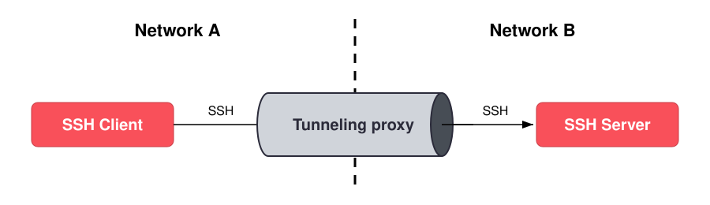
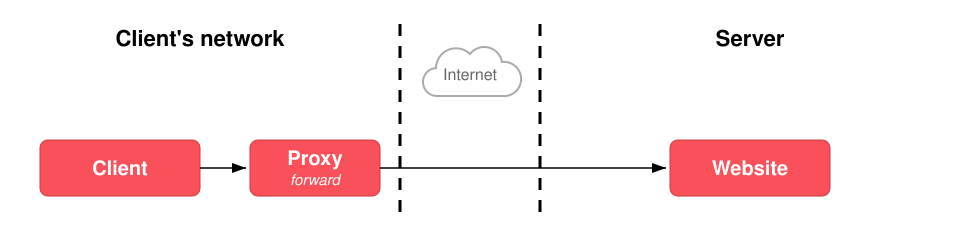
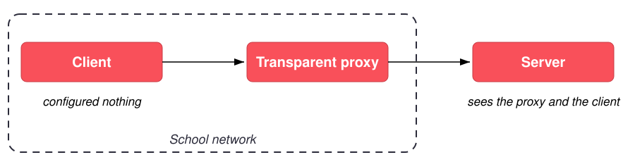
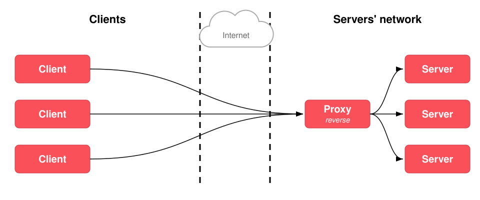
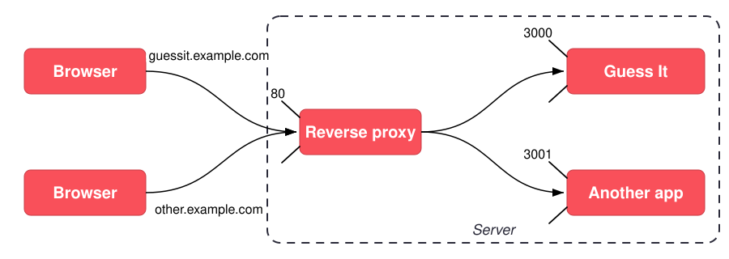
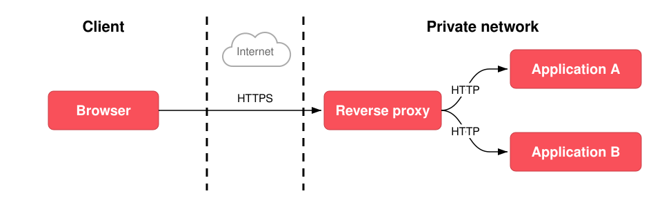
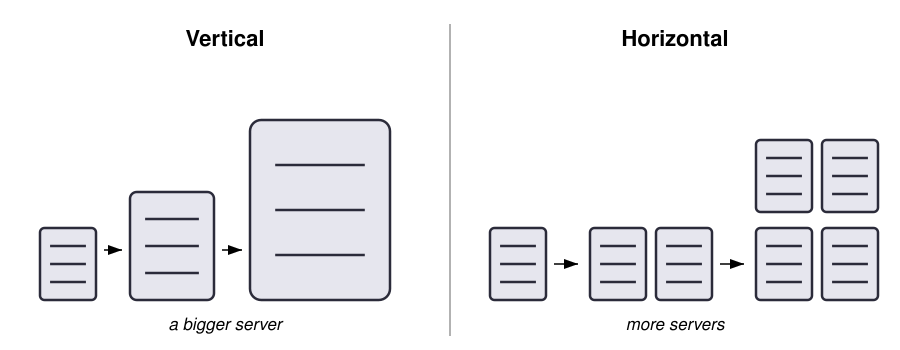
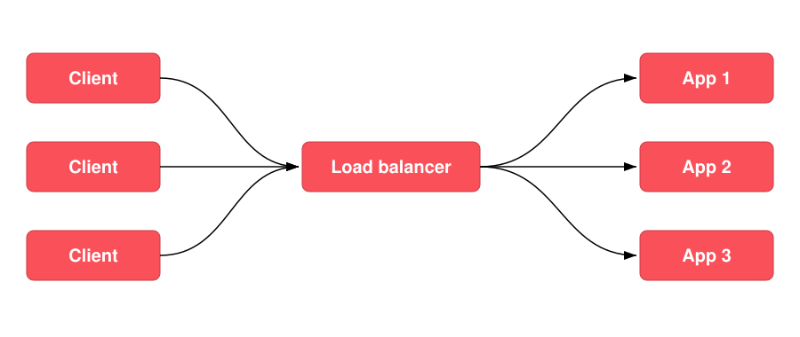
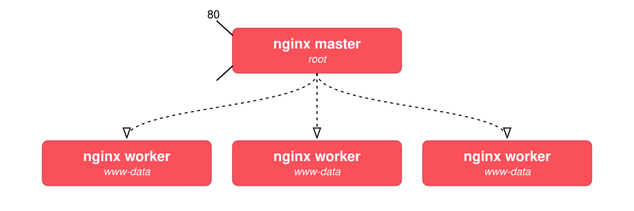

# Reverse Proxying

Architecture & Deployment <!-- .element: class="subtitle" -->

---

## What is a proxy?

A [**proxy server**][proxy] is a computer or application that acts as an
**intermediary** for requests from clients seeking resources from other servers.

---

## Types of proxy servers

There are 3 main kinds:

- [**Tunneling proxy**][tunneling-proxy] or [**gateway**][gateway]
- [**Forward proxy**][open-proxy]
- [**Reverse proxy**][reverse-proxy]

---

## Tunneling proxy

A [tunneling proxy][tunneling-proxy] can pass **unmodified requests and
responses** from one network to another.

**Notes:**

It can also be used to encapsulate a protocol into another, such as running IPv6
over IPv4. For example, an SSH connection may be relayed by a proxy server to a
different target server. The proxy server simply passes the packets through,
with no ability to compromise the security of the communication.

[**Virtual private networks (VPN)**][vpn] use tunneling protocols, usually with
an additional layer of encryption.

---

## Forward proxy

A **forward proxy** retrieves data from a server on behalf of a client. It is
said to be [**open**][open-proxy] if it is accessible by any Internet user.

**Notes:**

A forward proxy works for its clients. It sits on their side, often in their own
network, and they go through it to reach any server on the Internet.

---

### Anonymous forward proxy

<!-- The fragment shows what the website sees: the client and its connection
     disappear, and the website is left seeing only the proxy. -->
<svg class="proxy-diagram mx-auto block w-10/12" viewBox="0 0 960 225" role="img" aria-label="A client connects to an anonymous proxy, which connects across the Internet to the website; the website sees only the proxy">
  
  <defs>
    <marker id="anonymous-proxy-arrow" viewBox="0 0 14 10" refX="14" refY="5" markerWidth="14" markerHeight="10" markerUnits="userSpaceOnUse" orient="auto">
      <path class="marker-comm" d="M0,0 L14,5 L0,10 z"/>
    </marker>
  </defs>
  <rect class="card" width="960" height="225" rx="12"/>
  <g class="boundary">
    <line x1="480" y1="24" x2="480" y2="190"/>
    <line x1="620" y1="24" x2="620" y2="190"/>
  </g>
  <g class="cloud">
    <path d="M518,96 a14,14 0 0 1 -2,-28 a20,20 0 0 1 34,-14 a18,18 0 0 1 32,8 a14,14 0 0 1 4,34 z"/>
    <text x="550" y="80">Internet</text>
  </g>
  <g class="fragment fade-out" data-fragment-index="1">
    <g class="process">
      <rect x="30" y="120" width="160" height="56" rx="8"/>
      <text x="110" y="155">Client</text>
    </g>
    <g class="edge">
      <path d="M190,148 L246,148" marker-end="url(#anonymous-proxy-arrow)"/>
    </g>
  </g>
  <g class="process">
    <rect x="250" y="120" width="200" height="56" rx="8"/>
    <text x="350" y="155">Anonymous proxy</text>
  </g>
  <g class="process">
    <rect x="700" y="120" width="200" height="56" rx="8"/>
    <text x="800" y="155">Website</text>
  </g>
  <g class="edge">
    <path d="M450,148 L696,148" marker-end="url(#anonymous-proxy-arrow)"/>
  </g>
  <text class="note fragment" data-fragment-index="1" x="800" y="208">sees only the proxy</text>
</svg>

Conceals the identity of the client.

**Notes:**

An **anonymous forward proxy** reveals its identity as a server but conceals
that of the client. Since the target server does not know who the original
client is, it can be used to protect privacy. [VPNs][vpn] are often used in
combination with this type of proxy server.

---

### Transparent forward proxy

Intercepts the client's requests without the client having to configure
anything, and does not hide the client.

**Notes:**

A **transparent forward proxy** is transparent to its clients: they do not
configure it, and may not even know it is there. The network they are connected
to sends their requests through it. Schools and companies often use this kind of
proxy to cache websites, or to restrict access to particular websites (e.g.
Facebook).

It does not hide the clients: it usually tells the server who the original
client is, through HTTP headers.

The word is not used consistently. Some only mean a proxy that reveals the
original client, whether the client configured it or not.

When many clients go through the same forward proxy server, its IP address may
get banned, since the target server only sees one computer (the proxy) making
too many requests at the same time.

---

## Reverse proxy

A [**reverse proxy**][reverse-proxy] is an **internal-facing proxy** used to
control and protect access to servers in a **private network**.

**Notes:**

A reverse proxy **appears to clients to be an ordinary server**, but actually
**transmits their requests to** one or more **other servers in an internal
private network** which handle the requests.

It is the mirror image of a forward proxy: it works for the servers, and sits
on their side.

---

## Why use a reverse proxy?

<!-- slide-front-matter class: center, middle -->

---

### Sharing a port

Only **one process** can listen on a port: the reverse proxy listens on port 80
**for every site**, and forwards each request **by the name of the site**.

**Notes:**

A port is a number the kernel uses to hand incoming data to the one process
listening on it. If two processes could listen on the same port, the kernel
would not know which of them to hand the data to. So it refuses to let a second
process listen on a port that is already taken.

When an address has no port, browsers connect to port 80 for HTTP, and 443 for
HTTPS. If an application listens on port 80 itself, no other application on the
same server can be reached without a port in its address.

A reverse proxy is one more process between the browser and the application,
with a connection on each side. It is the only process listening on port 80.
Each application listens on a port of its own, which nobody needs to type.

The DNS gives all the names of the sites on the server the same IP address, so
the name is the only thing that tells the sites apart. The browser sends it in
the `Host` header of every HTTP request, and the reverse proxy forwards the
request to the application configured for that name. This is called
[**name-based virtual hosting**][name-based-virtual-hosting].

---

### Hiding internal architecture

<!-- The slide opens on what the client knows: example.com, which is the reverse
     proxy. The fragment reveals what is behind it, which the client never
     sees. -->
<svg class="proxy-diagram mx-auto block w-10/12" viewBox="0 0 1040 300" role="img" aria-label="A client connects to example.com, which is a reverse proxy; behind it, out of the client's sight, the proxy forwards requests to two websites of its private network and to a third in another network">
  
  <defs>
    <marker id="hidden-architecture-arrow" viewBox="0 0 14 10" refX="14" refY="5" markerWidth="14" markerHeight="10" markerUnits="userSpaceOnUse" orient="auto">
      <path class="marker-comm" d="M0,0 L14,5 L0,10 z"/>
    </marker>
  </defs>
  <rect class="card" width="1040" height="300" rx="12"/>
  <text class="heading" x="110" y="46">Client</text>
  <g class="boundary">
    <line x1="230" y1="24" x2="230" y2="276"/>
    <line x1="370" y1="24" x2="370" y2="276"/>
  </g>
  <g class="cloud">
    <path d="M268,96 a14,14 0 0 1 -2,-28 a20,20 0 0 1 34,-14 a18,18 0 0 1 32,8 a14,14 0 0 1 4,34 z"/>
    <text x="300" y="80">Internet</text>
  </g>
  <g class="process">
    <rect x="30" y="132" width="160" height="56" rx="8"/>
    <text x="110" y="167">Client</text>
  </g>
  <g class="process">
    <rect x="400" y="132" width="160" height="56" rx="8"/>
    <text x="480" y="167">Reverse proxy</text>
  </g>
  <g class="edge">
    <path d="M190,160 L396,160" marker-end="url(#hidden-architecture-arrow)"/>
    <text x="300" y="148">example.com</text>
  </g>
  <g class="fragment">
    <text class="heading" x="610" y="46">Private network</text>
    <text class="heading" x="945" y="46">Another network</text>
    <g class="boundary">
      <line x1="850" y1="24" x2="850" y2="276"/>
    </g>
    <g class="process">
      <rect x="660" y="62" width="150" height="56" rx="8"/>
      <text x="735" y="97">Website A</text>
    </g>
    <g class="process">
      <rect x="660" y="202" width="150" height="56" rx="8"/>
      <text x="735" y="237">Website B</text>
    </g>
    <g class="process">
      <rect x="875" y="132" width="150" height="56" rx="8"/>
      <text x="950" y="167">Website C</text>
    </g>
    <g class="edge">
      <path d="M560,160 C600,160 600,90 640,90 L656,90" marker-end="url(#hidden-architecture-arrow)"/>
    </g>
    <g class="edge">
      <path d="M560,160 C600,160 600,230 640,230 L656,230" marker-end="url(#hidden-architecture-arrow)"/>
    </g>
    <g class="edge">
      <path d="M560,160 L871,160" marker-end="url(#hidden-architecture-arrow)"/>
    </g>
  </g>
</svg>

Reverse proxies can **hide the existence and characteristics of an internal
network's private servers**.

**Notes:**

The client only sees the proxy server. The response from the private server is
returned as if it was coming from the proxy server itself, leaving the client
with no knowledge of the structure of the internal network. It is unaware of the
complexity of the internal architecture, and does not have to worry about it:
the proxy can hide anything from a single application to many servers, in
several networks.

In a scenario where you have only a single public IP address available, a
reverse proxy allows you to make multiple private servers accessible on that IP
address through the proxy server.

The other way round, the servers behind the proxy only see the proxy. For them,
it is a client like any other: every connection they receive comes from the
proxy, not from the original client. If a server needs to know who the original
client is, for example to record their IP address, the proxy has to tell it, by
adding HTTP headers to the requests it forwards. The [appendix of the
subject][what-the-application-sees] shows how.

---

### Hiding multi-component websites

<!-- The slide opens on two origins: the browser talks to the frontend and to the
     backend at a name of their own. The first fragment puts a reverse proxy in
     front of both, at one name, and the second leaves only what the browser
     sees of it.

     A PDF prints the slide once, which shows the fragments that fade out but
     not those that fade in then out. It is made to print the reverse proxy
     with the frontend and the backend behind it: without the arrows of the two
     origins, and with those from the proxy. -->
<svg class="proxy-diagram mx-auto block w-10/12" viewBox="0 0 960 300" role="img" aria-label="Without a reverse proxy, the browser talks to the frontend at www.example.com and to the backend at api.example.com, two origins; with a reverse proxy, the browser talks to example.com only, which forwards to both, and the browser no longer sees them">
  
  <defs>
    <marker id="multi-component-arrow" viewBox="0 0 14 10" refX="14" refY="5" markerWidth="14" markerHeight="10" markerUnits="userSpaceOnUse" orient="auto">
      <path class="marker-comm" d="M0,0 L14,5 L0,10 z"/>
    </marker>
  </defs>
  <rect class="card" width="960" height="300" rx="12"/>
  <text class="heading" x="150" y="46">Client</text>
  <text class="heading" x="700" y="46">Servers' network</text>
  <g class="boundary">
    <line x1="300" y1="24" x2="300" y2="276"/>
    <line x1="440" y1="24" x2="440" y2="276"/>
  </g>
  <g class="cloud">
    <path d="M338,96 a14,14 0 0 1 -2,-28 a20,20 0 0 1 34,-14 a18,18 0 0 1 32,8 a14,14 0 0 1 4,34 z"/>
    <text x="370" y="80">Internet</text>
  </g>
  <g class="process">
    <rect x="70" y="132" width="160" height="56" rx="8"/>
    <text x="150" y="167">Browser</text>
  </g>
  <g class="fragment fade-out" data-fragment-index="2">
    <g class="process">
      <rect x="740" y="72" width="180" height="56" rx="8"/>
      <text x="830" y="107">Frontend</text>
    </g>
    <g class="process">
      <rect x="740" y="192" width="180" height="56" rx="8"/>
      <text x="830" y="227">Backend</text>
    </g>
  </g>
  <g class="fragment fade-out print:hidden" data-fragment-index="1">
    <g class="edge">
      <path d="M230,160 C480,160 480,100 736,100" marker-end="url(#multi-component-arrow)"/>
      <text x="610" y="90">www.example.com</text>
    </g>
    <g class="edge">
      <path d="M230,160 C480,160 480,220 736,220" marker-end="url(#multi-component-arrow)"/>
      <text x="610" y="242">api.example.com</text>
    </g>
  </g>
  <g class="fragment" data-fragment-index="1">
    <g class="process">
      <rect x="470" y="132" width="170" height="56" rx="8"/>
      <text x="555" y="167">Reverse proxy</text>
    </g>
    <g class="edge">
      <path d="M230,160 L466,160" marker-end="url(#multi-component-arrow)"/>
      <text x="370" y="148">example.com</text>
    </g>
  </g>
  <g class="fragment fade-in-then-out print:visible! print:opacity-100!" data-fragment-index="1">
    <g class="edge">
      <path d="M640,160 C675,160 675,100 710,100 L736,100" marker-end="url(#multi-component-arrow)"/>
    </g>
    <g class="edge">
      <path d="M640,160 C675,160 675,220 710,220 L736,220" marker-end="url(#multi-component-arrow)"/>
    </g>
  </g>
</svg>

**Notes:**

Modern websites can be complex applications, often with a **separate frontend
and backend** developed by different teams with different technologies. Putting
a reverse proxy in front can make it **appear as one single website** on a
single domain name, avoiding [CORS][cors] issues.

---

### SSL/TLS termination

A reverse proxy can be the **secure endpoint** with all the SSL/TLS
certificates, then **forwarding unencrypted requests** to other servers in the
private network.

**Notes:**

Managing SSL/TLS certificates to provide websites over HTTPS is rather complex.
It can be hard to configure some frameworks or tools to ensure they are only
using secure communications.

---

### Scalability

[Scalability][scalability] is the capability of a computer system to handle a
growing amount of work (e.g. client requests).

**Notes:**

There are [2 broad ways][horizontal-and-vertical-scaling] of adding more
resources for a particular application.

**Vertical scaling** consists in using a more powerful computer, with more CPU,
RAM, throughput, etc. The added power will allow the server to serve more
clients.

**Horizontal scaling** means adding more computers to handle the same work. For
example, 3 instances of a web application can probably handle 3 times as many
clients at the same time. Computers or applications can be combined in
[clusters][cluster] to improve performance.

---

#### Load balancing

A common function of reverse proxies is to perform [**load
balancing**][load-balancing], i.e. the distribution of workloads across multiple
applications or servers to achieve **horizontal scaling**.

**Notes:**

As multiple clients arrive simultaneously, the reverse proxy will distribute
requests to different servers, spreading the load between them.

---

### Other uses

- [Web acceleration][web-acceleration]
- On-the-fly compression
- Spoon-feeding
- [Denial-of-service (DoS)][dos] protection
- [A/B testing][ab-testing]
- Authentication

**Notes:**

- [Web acceleration][web-acceleration] is the caching of static content and
  dynamic content to reduce load on internal servers.
- Optimize content by transparently compressing it to speed up loading times.
- _Spoon-feeding_ is a technique where the reverse proxy temporarily stores a
  dynamically generated page, then serves it to the client a little bit at a
  time. This avoids the internal server having to wait for slow clients such as
  mobile applications.
- A reverse proxy can require **authentication** before letting a client access
  an insecure application, adding security without having to modify the
  application itself.
- And [more][reverse-proxy-uses]

---

## nginx

<!-- .element: class="hidden" -->

---

### What is nginx?

[nginx][nginx] is a competitor of the well-known [Apache HTTP server][apache],
first released in 2004 to solve the [C10k problem][c10k].

**Notes:**

[nginx][nginx] is an HTTP and reverse proxy server, and one of the most used
web servers in the world. It was developed to solve the [C10k problem][c10k],
i.e. the capability of a computer system to handle ten thousand concurrent
connections, thanks to its [event-driven architecture][nginx-performance]. It
also has [many other features][nginx-features] to serve modern web
applications.

---

### How nginx runs

A **master** process, started as `root`, opens the ports. **Worker** processes,
running as an unprivileged user, handle the requests.

**Notes:**

On Linux, only `root` may listen on a port below 1024, such as 80 or 443. An
application that listened on port 80 itself would have to run as `root`, and so
would anyone who found a vulnerability in it.

nginx starts as `root` only to open its ports. Its master process then starts
worker processes, usually one per processor core, which run as an unprivileged
user, `www-data` on Ubuntu, and handle all the requests. Each worker can handle
many connections at once. The applications behind nginx listen on ports above
1024, which any user may do, so each can run as a dedicated user of its own.

The master process also reacts to signals. When it receives the `HUP` signal, it
reads its configuration again, starts new workers with it, and lets the old ones
finish the requests they are handling. The configuration changes without nginx
ever stopping listening. If the new configuration has an error, nginx keeps the
old one.

---

#### Apache vs. nginx

**Notes:**

nginx is used by more websites than Apache, and by more high-traffic websites.
In November 2026, [W3Techs][w3techs-web-servers] found nginx on 30.0% of the
websites whose web server it knows, and Apache on 20.9%.

Cloudflare Server, used by even more websites (33.8%), is not a server you
install: it is Cloudflare's own network of reverse proxies, which many websites
put in front of their own servers.

[ab-testing]: https://en.wikipedia.org/wiki/A/B_testing
[apache]: https://httpd.apache.org/
[c10k]: https://en.wikipedia.org/wiki/C10k_problem
[cluster]: https://en.wikipedia.org/wiki/Computer_cluster
[cors]: https://en.wikipedia.org/wiki/Cross-origin_resource_sharing
[dos]: https://en.wikipedia.org/wiki/Denial-of-service_attack
[gateway]: https://en.wikipedia.org/wiki/Gateway_(telecommunications)
[horizontal-and-vertical-scaling]: https://en.wikipedia.org/wiki/Scalability#Horizontal_and_vertical_scaling
[load-balancing]: https://en.wikipedia.org/wiki/Load_balancing_(computing)
[name-based-virtual-hosting]: https://en.wikipedia.org/wiki/Virtual_hosting#Name-based
[nginx]: https://nginx.org/
[nginx-features]: https://nginx.org/en/#basic_http_features
[nginx-performance]: https://blog.nginx.org/blog/inside-nginx-how-we-designed-for-performance-scale
[open-proxy]: https://en.wikipedia.org/wiki/Open_proxy
[proxy]: https://en.wikipedia.org/wiki/Proxy_server
[reverse-proxy]: https://en.wikipedia.org/wiki/Reverse_proxy
[reverse-proxy-uses]: https://en.wikipedia.org/wiki/Reverse_proxy#Uses_of_reverse_proxies
[scalability]: https://en.wikipedia.org/wiki/Scalability
[tunneling-proxy]: https://en.wikipedia.org/wiki/Tunneling_protocol
[vpn]: https://en.wikipedia.org/wiki/Virtual_private_network
[w3techs-web-servers]: https://w3techs.com/technologies/overview/web_server
[web-acceleration]: https://en.wikipedia.org/wiki/Web_accelerator

[what-the-application-sees]: #appendix-what-the-application-sees
