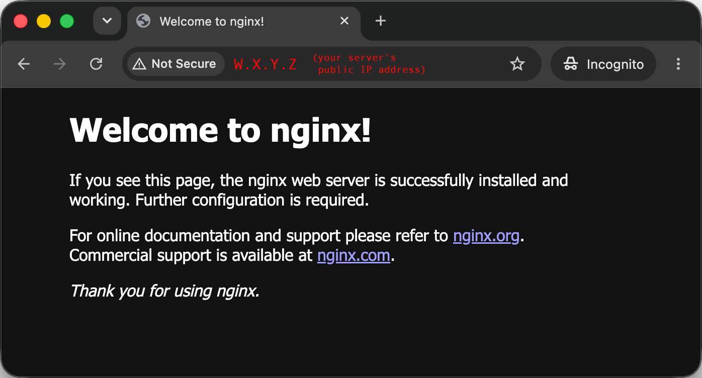

The goal of this exercise is to deploy a static website (only HTML, JavaScript
and CSS) with [nginx][nginx]. It is a simple first use of nginx: it only serves
files, with no application behind it to reverse proxy to. Once you know how to
configure nginx for something this simple, you will use it to continue improving
the basic deployment of Guess It.



Connect to your cloud server with SSH for this exercise.



<!-- more -->

## :exclamation: Requirements

This exercise assumes that you are familiar with [reverse proxying]() and that you have completed the
[previous DNS configuration exercise][dns-exercise], where you configured DNS
records for your server in the domain name system.

## :exclamation: Install nginx on the server

**Connect to your server** and install nginx with APT:

```bash
$> sudo apt install nginx
```

APT starts nginx right away, through systemd, and nginx starts listening on
port 80. Check that it does (`sudo` lets `ss` show the processes of other
users, such as nginx):

```bash
$> sudo ss -tlpn
State  Recv-Q Send-Q Local Address:Port ... Process
LISTEN 0      511          0.0.0.0:80   ... users:(("nginx",pid=345,fd=5))
LISTEN 0      511             [::]:80   ... users:(("nginx",pid=345,fd=6))
...
```

Check that its systemd service is running:

```bash
$> sudo systemctl status nginx
```

Visit your server's public IP address in a browser. You should see nginx's
welcome page:



## :exclamation: Put the static website on the server

It is suggested that you use the provided [HTML, JavaScript and CSS
clock][repo], but you could deploy any other static HTML website.

You will deploy it in `/srv/clock`, as you deployed Guess It in `/srv/guessit`.
nginx reads the files of the sites it serves as the `www-data` user, as the
first line of its main configuration file says:

```bash
$> head -n 1 /etc/nginx/nginx.conf
user www-data;
```

Create the directory, give it to yourself and to the `www-data` group, and close
it to every other user (replace `jde` with your Unix username):

```bash
$> sudo mkdir /srv/clock

$> sudo chown jde:www-data /srv/clock

$> chmod 750 /srv/clock

$> ls -ld /srv/clock
drwxr-x--- 2 jde www-data 4096 Nov 19 10:12 /srv/clock
```

You own the directory (`rwx`), so you can deploy in it without `sudo`. The
`www-data` user, the only member of the `www-data` group, can read and enter it
(`r-x`), but not change it. Every other user can do nothing with it (`---`).
This is what you did for the `guessit` user when you [let Guess It read its
code][read-code].



Your home directory would not do: it is closed to other users (`drwxr-x---`),
and `www-data` is one of them.



**Still on your server**, clone the following repository into the directory:
[https://github.com/ArchiDep/static-clock-website][repo]

```bash
$> git clone https://github.com/ArchiDep/static-clock-website.git /srv/clock
```

Make sure the files are there:

```bash
$> ls /srv/clock
index.html  README.md  script.js  style.css
```

## :exclamation: Choose the name of the site

The clock gets a name of its own: `clock.` followed by the hostname you noted
in the [DNS exercise][dns-exercise]. For example, if your hostname is
`jde.archidepN.ch`, the clock will be at `clock.jde.archidepN.ch`.

You do not need to add a DNS record for it. Your wildcard record, `*.jde`,
already points every name under your hostname to your server.

Every site you deploy on your server from now on gets a name of its own in the
same way, so that each name stands for one site.

## :exclamation: Create an nginx configuration file to serve the website

Create an nginx configuration file for the website. You may name the file
`clock` and put it in nginx's `/etc/nginx/sites-available` directory. You can do
that with nano or Vim. You will need to use `sudo` as that directory is only
writable by `root`.



You can add the `.conf` extension to the file or not, as you wish. Nginx does
not need its configuration to have a particular extension.



Take the [static configuration example from the course](#static-website-configuration) and put
it in the file. You must modify it to:

- Use the name you chose for the site, such as `clock.jde.archidepN.ch`. This is
  done by customizing [nginx's `server_name`
  directive](http://nginx.org/en/docs/http/server_names.html) in your `server`
  block.
- Serve the files in the repository you just cloned. This is done by customizing
  [nginx's `root`
  directive](http://nginx.org/en/docs/http/ngx_http_core_module.html#root).



Read [How nginx processes a
request](http://nginx.org/en/docs/http/request_processing.html) and [Serving
Static Content section of the nginx Beginner's
Guide](http://nginx.org/en/docs/beginners_guide.html#static) if you want to know
more.





Your `/etc/nginx/sites-available/clock` file on your server should look
something like this:

```nginx
server {
  listen 80;
  server_name clock.jde.archidepN.ch;
  root /srv/clock;
  index index.html;

  # Instruct the browser to cache images, icons,
  # video and audio for 30 days, and do not log
  # requests for them.
  location ~* \.(?:jpg|jpeg|gif|png|ico|gz|svg|mp4|ogg|ogv|webm)$ {
    access_log off;
    add_header Cache-Control "max-age=2592000";
  }
}
```



### :exclamation: Enable the nginx configuration

By default, configurations stored in the `sites-available` directory are
available, but not enabled: the main configuration file [includes
`sites-enabled`, but not `sites-available`](#includes).

To enable a configuration file, the convention is to create a symbolic link in
`sites-enabled`, which points to the actual configuration file in
`sites-available`. This allows you to work on your configuration for a while
before enabling it.

Enable the `clock` configuration by creating the correct symbolic link:

```bash
$> sudo ln -s /etc/nginx/sites-available/clock /etc/nginx/sites-enabled/clock
```



The `-s` option makes the `ln` (**l**i**n**k) command create a **s**ymbolic
link, i.e. a simple pointer to a file that resides in another directory. Without
the `-s` option, it would create a [hard link][hard-link].



Make sure the symbolic link points to the correct file:

```bash
$> ls -l /etc/nginx/sites-enabled/clock
lrwxrwxrwx 1 root root 32 Nov 19 10:20 /etc/nginx/sites-enabled/clock -> /etc/nginx/sites-available/clock
```

## :exclamation: Reload the nginx configuration

Nginx does not automatically reload its configuration files when they change.

First, you should check whether the changes you have made are valid. The `nginx
-t` command (as in **t**est) loads all the nginx configuration (including files
added with `include`) and checks that they are valid:

```bash
$> sudo nginx -t
nginx: the configuration file /etc/nginx/nginx.conf syntax is ok
nginx: configuration file /etc/nginx/nginx.conf test is successful
```



If an error occurs here, you may have made a mistake in the configuration. See
[Troubleshooting](#troubleshooting) for the most common errors.



Nginx reloads its configuration [when it receives the `HUP`
signal][nginx-signals]. You could find the process ID of the `nginx` master
process and send the signal with `kill -s HUP <ID>`. The `nginx` command does it
more simply, with its `-s` option, which sends a **s**ignal to the master
process: `sudo nginx -s reload`.

You will not even need that. The systemd service of nginx runs that same `nginx
-s reload` command when you reload it, so you can reload nginx the same way you
manage Guess It, or any other service:

```bash
$> sudo systemctl reload nginx
```

If the command indicates no errors, nginx should have reloaded its
configuration. This is how you will reload nginx from now on.



Do not confuse it with `sudo systemctl restart nginx`, which stops nginx and
starts it again. A restart closes the connections in progress, and if the new
configuration has an error, nginx does not start again: every site it serves is
down. A reload keeps nginx running, and if the new configuration has an error,
nginx keeps the old one.



## :exclamation: See it in action

Visit the name of the site in your browser, e.g. `http://clock.jde.archidepN.ch`
(with your own hostname after `clock.`), and you should see the clock. The
address has no port: the browser connects to port 80 (the default port for
insecure HTTP), where nginx listens.


Now visit your hostname without `clock.` in front of it, e.g.
`http://jde.archidepN.ch`. You get nginx's welcome page instead, because none of
your configurations has that name. nginx answers it with its default site, the
`default` configuration in `/etc/nginx/sites-enabled`.

Guess It is still at `http://jde.archidepN.ch:3000`, as before. nginx is not
involved: the browser connects to Guess It directly, on port 3000.

## :question: Optional: hide the Git repository for security

Your clone contains a `.git` directory, where Git keeps the history of the
repository, and nginx serves it like any other file. Try it: visit
`/.git/config` on the clock's address, e.g.
`http://clock.jde.archidepN.ch/.git/config`.

The clock's repository is public anyway, so it's not a security concern in this
particular exercise. But the repository of another site could hold something you
do not want to publish, such as an old version of a file with a password in it.

To refuse such requests, add this `location` block inside the `server` block of
your configuration:

```nginx
  # Refuse requests for the Git repository.
  location ~ /\.git {
    deny all;
  }
```

Test the configuration and reload it as above. The same address now gives a 403
Forbidden error.

## :checkered_flag: What have I done?

You have deployed a static website: files that nginx sends to the browser
unchanged. Nothing of the site runs on your server. The browser runs the clock's
JavaScript itself.

nginx listens on port 80, the default port of HTTP. A browser connects to it
when the address has no port, which is why the clock's address needs none.
systemd started nginx when you installed it, and starts it again whenever the
server boots, as it does Guess It.

Only one process can listen on port 80, but nginx can serve several sites on
it. The browser sends the name of the site in the `Host` header of its request,
as you did yourself when you [talked HTTP to Google][tcp-host]. nginx serves the
site whose `server_name` is that name, and its default site when no
configuration has it.

The DNS sends every name under your hostname to the same address, thanks to
your wildcard record. It cannot tell the sites apart: nginx does, by name. A new
site needs a configuration with a new name, and no new DNS record.

A configuration in `sites-available` does nothing until a symbolic link in
`sites-enabled`, which nginx includes, points to it. nginx reads a changed
configuration only when told to reload it: the `HUP` signal makes it read its
configuration again without stopping. `nginx -t` checks a configuration before
you do that.

nginx reads the files of the site as the `www-data` user. `/srv/clock` belongs
to the `www-data` group, so nginx can read the site but not modify it, while you
own it and deploy it as yourself.

Several problems from [the list of improvements to the basic
deployment][improve] are still unsolved. One of them is that Guess It still
needs its port in the address, since nginx has nothing to do with it. Guess It
is not a set of files nginx can send: it is a program that builds each page when
it is asked for it. Serving it on port 80, beside the clock, will need something
more.

### :classical_building: Architecture

This is a simplified architecture of the main running processes and
communication flow at the end of this exercise. Step through the diagram to see
what happens when a browser requests the clock.





Note that this diagram only shows the processes involved in this exercise,
ignoring Guess It, which is still running on the server.



## :file_folder: Where is everything?

These are the files and directories of your server that matter for this
deployment.

<div class="file-map">

| Path                                                                                  | What it is                                                                                   | What you did                                                                                                             | Who uses it                                             |
| :------------------------------------------------------------------------------------ | :------------------------------------------------------------------------------------------- | :----------------------------------------------------------------------------------------------------------------------- | :------------------------------------------------------ |
| :page_facing_up: `/etc/nginx/sites-available/clock` <span class="new">new</span>      | The configuration of the clock: its name and where its files are                             | Wrote it with `sudo nano`                                                                                                | nginx, through the link in `sites-enabled`              |
| :page_facing_up: `/etc/nginx/sites-enabled/clock` <span class="new">new</span>        | A symbolic link to the configuration of the clock, which enables it                          | Created it with `sudo ln -s`                                                                                             | nginx, which includes everything in `sites-enabled`     |
| :page_facing_up: `/etc/nginx/sites-enabled/default` <span class="new">new</span>      | A symbolic link to nginx's default site, its welcome page                                    | Installed nginx with `apt`, which created it                                                                             | nginx, for a name that none of your configurations has  |
| :page_facing_up: `/etc/nginx/nginx.conf` <span class="new">new</span>                 | The main configuration of nginx, which includes `sites-enabled` and sets the `www-data` user | Installed nginx with `apt`, which created it                                                                             | nginx                                                   |
| :file_folder: `/srv/clock` <span class="new">new</span>                               | The deployment of the clock: a clone of its repository                                       | Created it with `sudo mkdir`, gave it to yourself and the `www-data` group with `sudo chown`, and closed it with `chmod` | You, to deploy; nginx, as `www-data`, to read it        |
| :page_facing_up: `/srv/clock/index.html` <span class="new">new</span>                 | The home page of the clock                                                                   | Cloned it with `git clone`, with `style.css` and `script.js`                                                             | nginx, which sends it unchanged to the browser          |
| :page_facing_up: `/usr/lib/systemd/system/nginx.service` <span class="new">new</span> | The unit file of nginx                                                                       | Installed nginx with `apt`, which created it and enabled the service                                                     | systemd, to start nginx when the server boots           |
| :page_facing_up: `/var/log/nginx/error.log` <span class="new">new</span>              | The errors nginx has met, such as a file it could not read                                   | Nothing, unless something went wrong                                                                                     | You, to [find out why][error-page] a page does not work |

</div>

Two directories of the [file hierarchy][unix-directories] matter most here:
`/etc/nginx` holds the configuration of nginx, and `/var/log` the logs of the
server's programs.

You can explore all of this yourself: `ls -l` shows what a directory contains,
with its permissions, and `cat`, `head` and `tail` what a file contains, as in
the [command line cheatsheet][command-line-cheatsheet]. Use `sudo` for what only
`root` can read. For example:

```bash
# The configurations nginx has enabled, and where their links point.
$> ls -l /etc/nginx/sites-enabled

# The unit systemd has loaded for nginx.
$> sudo systemctl status nginx
```

## :boom: Troubleshooting

Here's a few tips about some problems you may encounter during this exercise.

### :boom: `git clone` says `Permission denied`

`/srv/clock` still belongs to `root`, because the `sudo chown` command of [Put
the static website on the server][put-website] did not run, or had a typo. Check
who owns the directory:

```bash
$> ls -ld /srv/clock
```

It must belong to your username and to the `www-data` group. Run the `sudo
chown` and `chmod` commands again, then clone the repository again.

Do not clone with `sudo` to get past the error: the files would belong to
`root`, and you could not update them later without `sudo`.

### :boom: `nginx -t` reports an `[emerg]` error with a file and a line number

For example:

```
... [emerg] ... invalid number of arguments in "root" directive in /etc/nginx/sites-enabled/clock:5
nginx: configuration file /etc/nginx/nginx.conf test failed
```

```
... [emerg] ... unexpected "}" in /etc/nginx/sites-enabled/clock:15
nginx: configuration file /etc/nginx/nginx.conf test failed
```

Your configuration has a typo. Look at the line the error names, and at the line
just before it. A missing `;` at the end of a directive is the most common
cause: nginx reads the next line as part of the same directive, so the error
names the line after the typo.

### :boom: `nginx -t` says `open() "/etc/nginx/sites-enabled/clock" failed` or `Too many levels of symbolic links`

The symbolic link in `sites-enabled` points to a file that does not exist, or to
itself, because its target was mistyped or was not a full path. Look at where it
points, after the arrow:

```bash
$> ls -l /etc/nginx/sites-enabled
```

It must point to `/etc/nginx/sites-available/clock`. If it does not, remove the
link (this removes only the link, not your configuration) and create it again
with the `ln -s` command of [Enable the nginx configuration][enable]:

```bash
$> sudo rm /etc/nginx/sites-enabled/clock
```

### :boom: `[emerg] could not build server_names_hash, you should increase server_names_hash_bucket_size`

If you get an error about `server_names_hash_bucket_size`, it may be because
your domain name (the value of your `server_name` directive) is too long for
nginx's default settings.

In that case, edit the main nginx configuration with `sudo nano
/etc/nginx/nginx.conf` and add the following line **in the `http` section**:

```
server_names_hash_bucket_size 256;
```

### :boom: `systemctl reload nginx` says `Job for nginx.service failed`

Your new configuration has an error, so nginx did not load it. It keeps serving
the configuration it had before. Run `sudo nginx -t` to see the error, fix it,
then reload nginx again.

### :boom: My changes to the configuration have no effect

If you have reloaded nginx and your changes to
`/etc/nginx/sites-available/clock` still have no effect, check
`/etc/nginx/sites-enabled`:

```bash
$> ls -l /etc/nginx/sites-enabled
```

If `clock` has no arrow after it, it is a copy of your configuration, not a
symbolic link, and nginx reads the copy. Remove the copy and create the link with
the `ln -s` command of [Enable the nginx configuration][enable]:

```bash
$> sudo rm /etc/nginx/sites-enabled/clock
```

### :boom: I see nginx's welcome page instead of the clock

nginx has no enabled configuration with the name in your browser's address bar,
so it answers with its default site. Check that:

- The address is the name of the site, with `clock.` in front of your hostname.
- The `server_name` directive in `/etc/nginx/sites-available/clock` is exactly
  that name, and ends with `;`. Without the `;`, nginx reads the words of the
  next line as more names for the site, and `nginx -t` only prints a `[warn]`
  about a server name that `has suspicious symbols`.
- The symbolic link `/etc/nginx/sites-enabled/clock` exists and points to your
  configuration (`ls -l /etc/nginx/sites-enabled`).
- You have reloaded nginx's configuration since your last change.

### :boom: The browser shows a security error, or the address starts with `https://`

Some browsers try HTTPS first when you type a name without `http://`. Nothing
listens on port 443, the port of HTTPS, on your server yet. Type the address in
full, with `http://` in front of it, e.g. `http://clock.jde.archidepN.ch`.

### :boom: The nginx configuration is correct but I get an error page in the browser

If your nginx configuration is syntactically correct (i.e. `sudo nginx -t` shows
no error) but you still get an error page in the browser, you can take a look at
the nginx error log to see if it helps identify the issue:

```bash
$> sudo tail /var/log/nginx/error.log
```

Also take a look at the following subsections depending on the error you see in
your browser.

#### :boom: 403 Forbidden

If you get a 403 Forbidden error, it usually means that nginx has insufficient
permissions to access the directory you have specified with the `root` directive
(or the `index.html` file in that directory). The error log says so:

```
... [error] ... "/srv/clock/index.html" is forbidden (13: Permission denied), ...
```

Check the permissions of the directory:

```bash
$> ls -ld /srv/clock
drwxr-x--- 3 jde www-data 4096 Nov 19 10:14 /srv/clock
```

Its group must be `www-data`, and the group's permissions `r-x`. If they are
not, run the `sudo chown` and `chmod` commands of [Put the static website on the
server][put-website] again.

#### :boom: 404 Not Found

If you get a 404 Not Found error page, it usually means nginx cannot find a file
to serve (e.g. the `index.html` page) in the directory you have specified with
the `root` directive. The error log says which file it looked for:

```
... [error] ... "/srv/clok/index.html" is not found (2: No such file or directory), ...
```

Are you sure that the value of your `root` directive is correct? Does that
directory actually exist?

[enable]: #enable-the-nginx-configuration
[error-page]: #the-nginx-configuration-is-correct-but-i-get-an-error-page-in-the-browser
[hard-link]: https://en.wikipedia.org/wiki/Hard_link
[nginx]: http://nginx.org/
[nginx-signals]: http://nginx.org/en/docs/control.html
[put-website]: #put-the-static-website-on-the-server
[repo]: https://github.com/ArchiDep/static-clock-website

[command-line-cheatsheet]: #whats-in-this-file-cat-head-tail-less
[dns-exercise]: 
[improve]: 
[read-code]: #let-the-application-read-its-code
[tcp-host]: #talk-dirty-http-to-google
[unix-directories]: #common-unix-directories
