The goal of this exercise is to show how a web application can be
[scaled][scaling] to handle a growing amount of work, by running several
instances of it with a systemd unit template, and configuring nginx as a [load
balancer][load-balancing] in front of them.

This guide assumes that you have completed the [previous
exercise][reverse-proxy-deployment]: nginx is installed and running on your
server, and your wildcard DNS record points every name under your hostname
(`*.jde.archidepN.ch` in this guide) to it.



Connect to your cloud server with SSH for this exercise.



<!-- more -->

## :exclamation: Meet Brewscale

The application you will deploy is [Brewscale][brewscale], a café whose
baristas take a while to brew each coffee. You order a drink, optionally with a
name for the cup, and a barista brews it and hands it to you.

Each running instance of Brewscale is a **barista**: one process, which serves
one customer at a time. Brewing a coffee takes about a second, and while it
brews, the barista waits. Customers who arrive in the meantime wait in the
queue.

You can visit the café at <https://brewscale.archidep.ch> before you deploy your
own. Three baristas work there: reload the page a few times, and look at the
number and the colour of the barista who serves you.

## :exclamation: Requirements

Brewscale is written in [Java][java], and built with [Maven][maven], a build
tool for Java. Install both on your server:

```bash
$> sudo apt update
$> sudo apt install openjdk-25-jdk-headless maven
```

`openjdk-25-jdk-headless` is the Java Development Kit (JDK), version 25: the
compiler that turns Java code into a program, and the Java virtual machine (JVM)
that runs that program. "Headless" means without the parts needed by graphical
applications, which a server does not have.

Check that both are installed:

```bash
$> java -version
openjdk version "25.0.5.0.3" 2026-10-24
OpenJDK Runtime Environment (build 25.0.5.0.3+1-1-26.04.1-Ubuntu)
OpenJDK 64-Bit Server VM (build 25.0.5.0.3+1-1-26.04.1-Ubuntu, mixed mode, sharing)

$> mvn -version
Apache Maven 3.9.12
Maven home: /usr/share/maven
Java version: 25.0.5.0.3, vendor: Ubuntu, runtime: /usr/lib/jvm/java-25-openjdk-amd64
...
```

Your versions may be slightly different, but Java must be version 25.



Maven is Java's package manager, much like npm for Node.js or Composer for PHP.
It also builds the application, as you will see below.



## :exclamation: Build the application

As you did for Guess It in the [Git clone deployment][git-clone-directory],
create a directory for Brewscale in `/srv`, give it to yourself, and clone the
repository into it:

```bash
$> sudo mkdir /srv/brewscale
$> sudo chown jde:jde /srv/brewscale
$> git clone https://github.com/ArchiDep/brewscale.git /srv/brewscale
```



Replace `jde` with your username in the `chown` command.



Guess It is written in JavaScript, which Node.js runs as it is. Brewscale is
written in Java, which must first be **compiled**: turned into bytecode, the
instructions the JVM runs. This is the first deployment of this course with a
**build step**, which turns the code of the repository into a program that can
run.

Build it with Maven:

```bash
$> cd /srv/brewscale
$> mvn package
...
[INFO] Tests run: 95, Failures: 0, Errors: 0, Skipped: 0
...
[INFO] Building jar: /srv/brewscale/target/brewscale.jar
...
[INFO] BUILD SUCCESS
...
```

The first build takes a while: Maven downloads the libraries Brewscale uses, and
the plugins it builds with, into your `~/.m2` directory. Later builds reuse
them.

Maven has compiled the code, run Brewscale's automated tests, and packaged
everything into a single **jar** file (a **j**ava **ar**chive):
`target/brewscale.jar`. The jar is the program you will run. It contains
Brewscale's compiled code and the libraries it uses, so the JVM needs nothing
else to run it.

## :exclamation: Create a dedicated user

Like Guess It in the [systemd exercise][dedicated-user], Brewscale will run as a
system user of its own, which can read its code but not modify it. Create it,
give it the directory, and close the directory to every other user:

```bash
$> sudo useradd --system --shell /usr/sbin/nologin brewscale

$> sudo chown :brewscale /srv/brewscale

$> chmod 750 /srv/brewscale

$> ls -ld /srv/brewscale
drwxr-x--- 6 jde brewscale 4096 Nov 19 10:05 /srv/brewscale
```

You still own the directory and everything in it, including the jar you have
built, so you will keep building Brewscale as yourself. The `brewscale` user can
read the jar, which is all it needs to run it.

## :exclamation: Run a barista with systemd

Create a systemd unit file named `/etc/systemd/system/brewscale.service` with
`sudo nano`, to run Brewscale:

```conf
[Unit]
Description=Brewscale

[Service]
# Run the jar with the JVM.
ExecStart=/usr/bin/java -jar target/brewscale.jar
WorkingDirectory=/srv/brewscale
User=brewscale

# Listen on the loopback address and on a port of its own.
Environment="BREWSCALE_HOST=127.0.0.1"
Environment="BREWSCALE_PORT=4200"

# Limit the memory the JVM may use for the application's data.
Environment="JAVA_TOOL_OPTIONS=-Xmx64m"

Restart=on-failure

[Install]
WantedBy=multi-user.target
```

Brewscale reads its configuration from [environment variables][brewscale-config]:

- It listens on port 3000 by default, which Guess It already uses, so
  `BREWSCALE_PORT` gives it a port of its own.
- It listens on every address of the server by default. `BREWSCALE_HOST` limits
  it to `127.0.0.1`, the server's [loopback address][loopback]: only programs
  running on the server itself can connect to it. nginx is the only client a
  barista needs, and it runs on the server.

This time, the variables are in the unit file, with the `Environment` option,
rather than in a file of their own in `/etc` read with `EnvironmentFile` as for
Guess It. Every user of the server can read unit files, but Brewscale has no
password or other secret in its configuration.



What is `-Xmx64m` for? The JVM keeps the data of the program it runs, its
objects, in an area of memory called the **heap**, which grows as the program
needs it. `-Xmx` is the JVM option that sets the maximum size of the heap, here
64 MiB.

Without it, the JVM picks a maximum of its own, a quarter of the memory of the
machine it runs on: about 200 MiB on a server with less than 1 GiB of memory,
such as yours. A barista needs far less. It uses about 30 MiB of memory when it
has just started, and about 50 MiB after a few minutes of orders. But a JVM does
not hurry to give memory back once it has used it, and you will soon run three
baristas, next to Guess It, PostgreSQL and nginx. The limit makes sure that
three baristas cannot, even in the worst case, take most of your server's
memory.

`JAVA_TOOL_OPTIONS` is an environment variable that every JVM reads when it
starts, and adds to the options of its command line.



Enable and start the service:

```bash
$> sudo systemctl enable brewscale
$> sudo systemctl start brewscale
```

Check that it is running:

```bash
$> sudo systemctl status brewscale
● brewscale.service - Brewscale
     Loaded: loaded (/etc/systemd/system/brewscale.service; enabled; preset: enabled)
     Active: active (running) since Thu 2026-11-19 10:12:03 UTC; 3s ago
...
Nov 19 10:12:03 jde.archidep.ch systemd[1]: Started brewscale.service - Brewscale.
Nov 19 10:12:03 jde.archidep.ch java[10482]: Picked up JAVA_TOOL_OPTIONS: -Xmx64m
Nov 19 10:12:04 jde.archidep.ch java[10482]: The barista listening on 127.0.0.1:4200, brewing in 1s
```

The last line is printed by Brewscale itself. It says where the barista listens,
and how long it takes to brew each drink.

## :exclamation: Serve the café through nginx

Brewscale is an nginx site of its own, like the clock and Guess It: `brewscale.`
followed by your hostname, for example `brewscale.jde.archidepN.ch`.

Create the nginx configuration file `/etc/nginx/sites-available/brewscale` with
`sudo nano`:

```nginx
server {
  listen 80;
  server_name brewscale.jde.archidepN.ch;

  # Forward every request to Brewscale.
  location / {
    proxy_pass http://127.0.0.1:4200;
  }
}
```



Replace `jde.archidepN.ch` with your hostname in the `server_name` directive.



Enable it, then check and reload nginx's configuration:

```bash
$> sudo ln -s /etc/nginx/sites-available/brewscale /etc/nginx/sites-enabled/brewscale

$> sudo nginx -t
nginx: the configuration file /etc/nginx/nginx.conf syntax is ok
nginx: configuration file /etc/nginx/nginx.conf test is successful

$> sudo nginx -s reload
```

## :exclamation: Order a coffee

Visit the café in your browser, e.g. `http://brewscale.jde.archidepN.ch`, and
order a drink, with your name for the cup if you like.

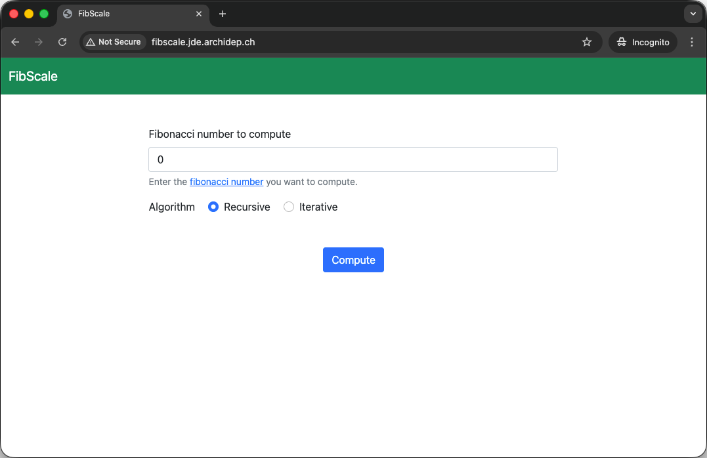

The button says "Brewing…" for about a second, then the barista hands you your
drink, and tells you how long it took to brew. Every drink takes about the same
time: that is how long brewing a coffee takes in this café.

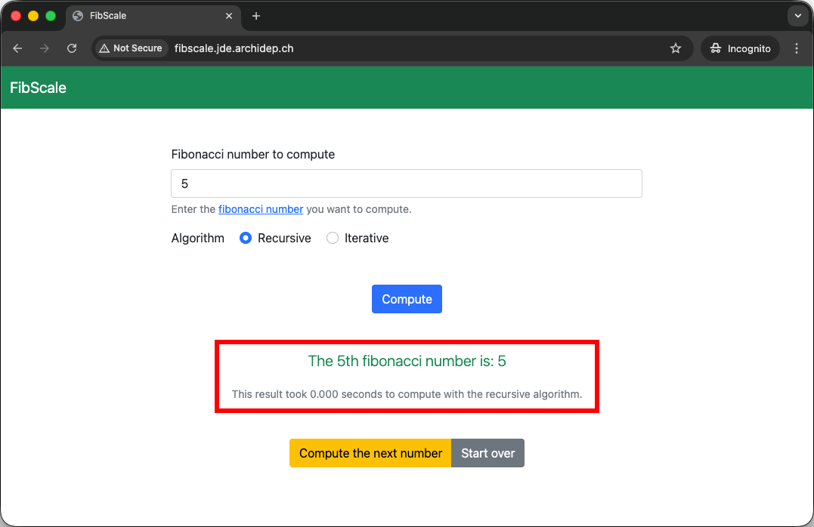

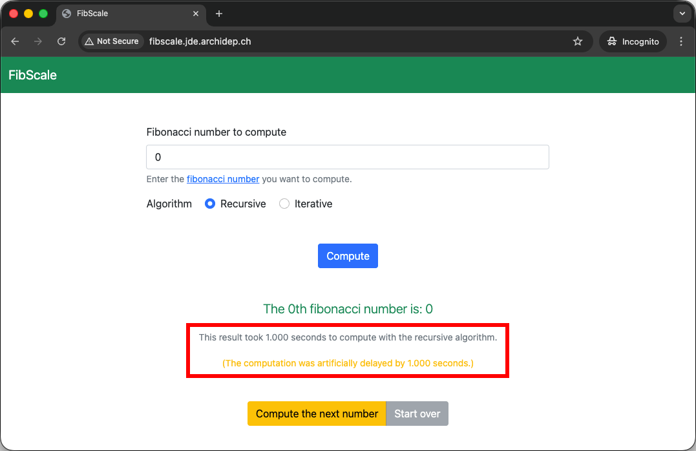

Look at the logs of the service: the barista has logged your order.

```bash
$> sudo journalctl -u brewscale -n 1
Nov 19 10:15:41 jde.archidep.ch java[10482]: The barista brewed a flat white for Alice in 1.001s
```

It takes a while to brew coffee, everyone knows it. The question is what happens
when many customers come at once. As the saying goes:

- **Don't guess, measure!**

## :exclamation: Load test the café

You will use [Locust][locust], an open source [load testing][load-testing] tool
written in Python, to measure the performance of the café. **Load testing** is
the process of putting demand on a system and measuring its response time and
error rate. In this case, you will simulate customers ordering coffee at the
same time, and see how long each of them waits for their drink.



Follow the instructions below when it comes to the number of users. You are
going to simulate many users sending requests to your server at the same time.
If you simulate too many users, you may bring down your server, or your test may
easily be mistaken for a [DoS attack][dos] by the Azure cloud. Your server may
end up being blacklisted.



### :exclamation: Run Locust with Docker Desktop

You will run Locust on your computer, not on your server. A load testing tool
running on the server it tests uses that server's CPU and memory to simulate its
users, and makes the application look slower than it is.



Do this part of the exercise on your computer, not on your server: in a new
terminal (in the WSL on Windows). Keep your other terminal connected to your
server, you will need it again later.



You will use Docker Desktop to run Locust, as you did for PostgreSQL in the
[Guess It exercise][guessit-docker]. If you did not install Docker Desktop then,
install it as that exercise explains. Make sure Docker Desktop is running.

To use Locust, you would normally [write a locustfile][locustfile] describing a
load testing scenario: the users, and what they do with your application.
Brewscale's repository already has [one][brewscale-locustfile], named
`locustfile.py`. Clone the repository on your computer to get it:

```bash
$> cd
$> git clone https://github.com/ArchiDep/brewscale.git
$> cd brewscale
```

You do not have to write anything: the file is already in your clone:

```bash
$> cat locustfile.py
```

This is what you should see:

```python
from locust import HttpUser, constant, task

class Customer(HttpUser):
    wait_time = constant(1)

    @task
    def order_a_flat_white(self):
        self.client.post("/orders", data={"drink": "flat-white"})
```

Each user is a customer, who orders a flat white, waits one second once they
have it, and orders again.

Still in the `brewscale` directory, run Locust in a container (the `\` at the
end of a line continues the command on the next line):

```bash
$> docker run -d --rm --name locust \
     -p 127.0.0.1:8089:8089 \
     -v "$PWD:/home/locust:ro" \
     locustio/locust:2.47.0
c1ffe65eb41b11a2235d5b5c90f6b26ccee00011097e65fe46424559603a22ee
```

- `locustio/locust:2.47.0` is Locust's official image, at the version this
  exercise was written with. Docker downloads it the first time.
- `-d` runs the container in the background: the command prints the
  container's ID, and gives you your prompt back while Locust keeps running.
- `--name locust` names the container, and `--rm` removes it once it stops.
- `-p 127.0.0.1:8089:8089` forwards port 8089 of your computer to port 8089 of
  the container, where Locust's web interface listens. `127.0.0.1` makes it
  reachable from your computer only, not from the other computers of your
  network.
- `-v "$PWD:/home/locust:ro"` makes the current directory, your clone, appear in
  the container as `/home/locust`, read-only (`ro`). That is the directory
  Locust runs in, where it looks for `locustfile.py`. `$PWD` is a variable of
  your shell that holds the current directory.

Leave Locust running until the end of this exercise. You can check that it has
started by displaying what it has printed so far:

```bash
$> docker logs locust
... Starting Locust 2.47.0
... Starting web interface at http://0.0.0.0:8089, ...
```

You should now be able to access Locust at [http://localhost:8089](http://localhost:8089).

### :exclamation: Send one customer, then two

The **Host** field tells Locust where the application to test is. Enter the
address of your café, e.g. `http://brewscale.jde.archidepN.ch`. Set the **Number
of users** to 1 and the **Ramp up** to 1 for now, and start the test.

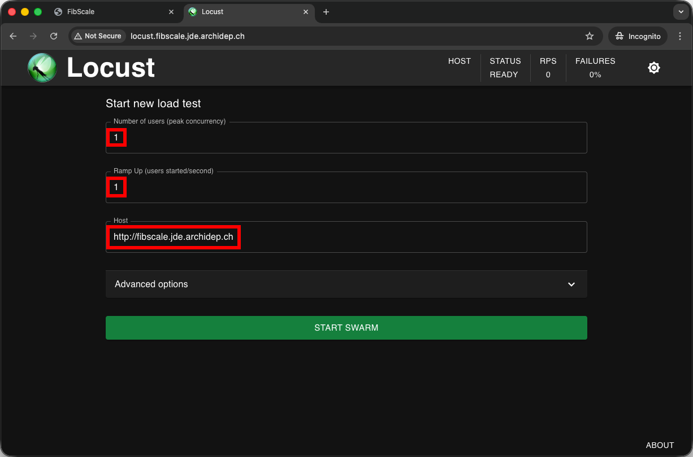

The **Statistics** tab shows the number of requests made, in total and per
second, and how long they took. The **Charts** tab shows the same numbers as
line charts.

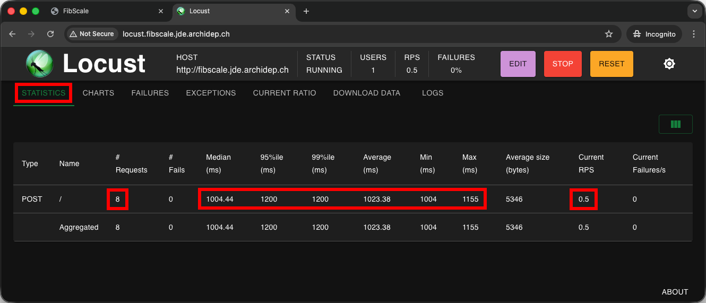

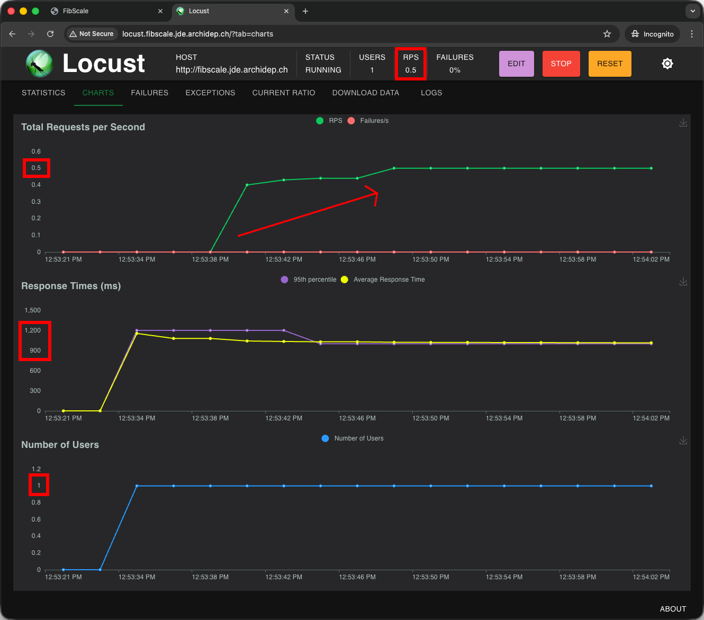

You should quickly see the number of **r**equests **p**er **s**econd (RPS)
settle at about 0.5. This is what you would expect with one customer: the
customer orders a flat white, which takes about one second to brew, as the
response time chart shows. Then the customer waits one second, as the
locustfile says, and orders again. One order every two seconds is 0.5 orders per
second.

Click the **Edit** button in the top bar, and change the **Number of users** to
2, without changing the ramp up.

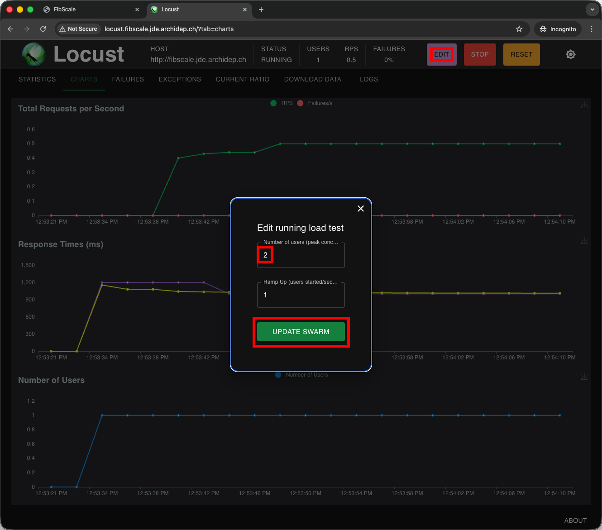

With two customers ordering every two seconds each, you should see the number of
requests per second settle at about 1, with the same response time. Everything
is as expected so far. But the barista is now brewing all the time: while one
customer waits their second, the other's coffee is brewing.

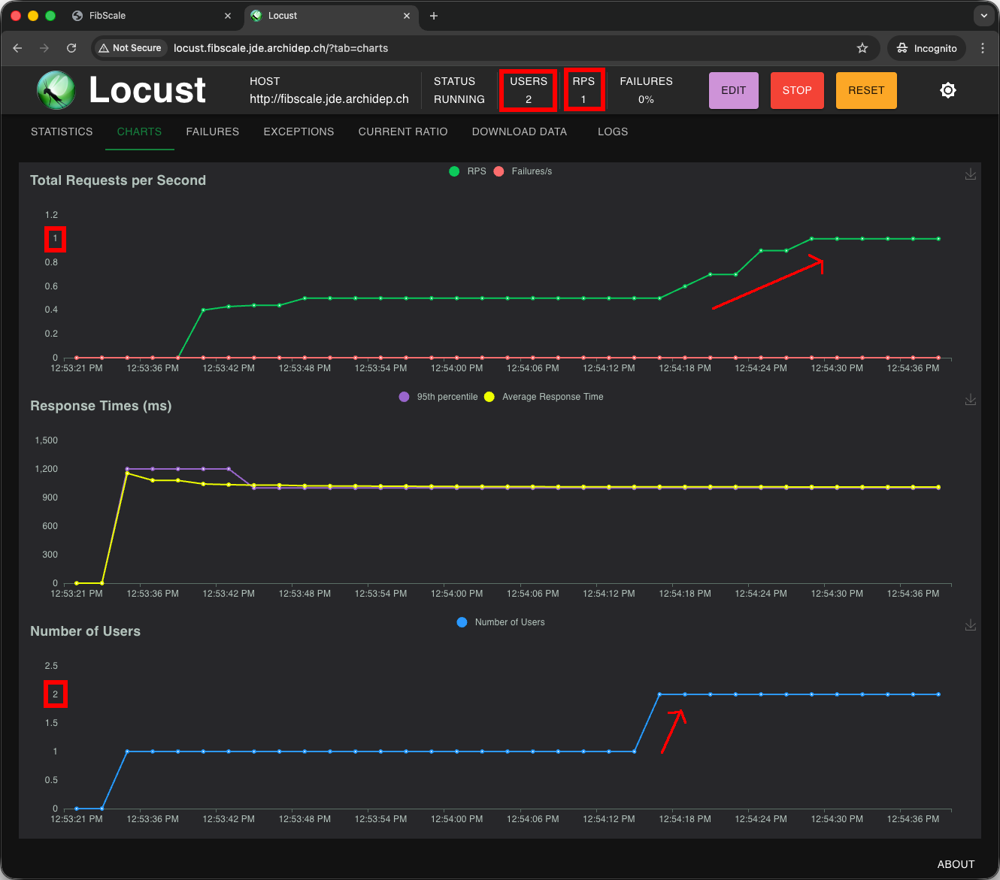

### :exclamation: Send ten customers

Now change the **Number of users** to 10, and leave the **Ramp up** at 1. This
adds 8 more customers to the 2 already there.

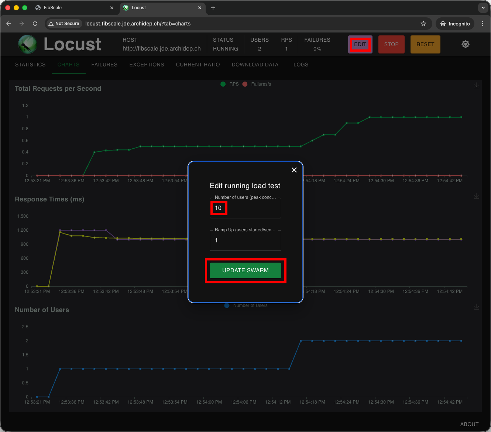



The **Ramp up** is the number of users added every second, so it takes 8 seconds
to go from the 2 users you already have to 10.



The number of requests per second stays at about 1, while the average response
time, in the **Statistics** tab, grows to about 9 seconds. Some customers wait
much longer than that.

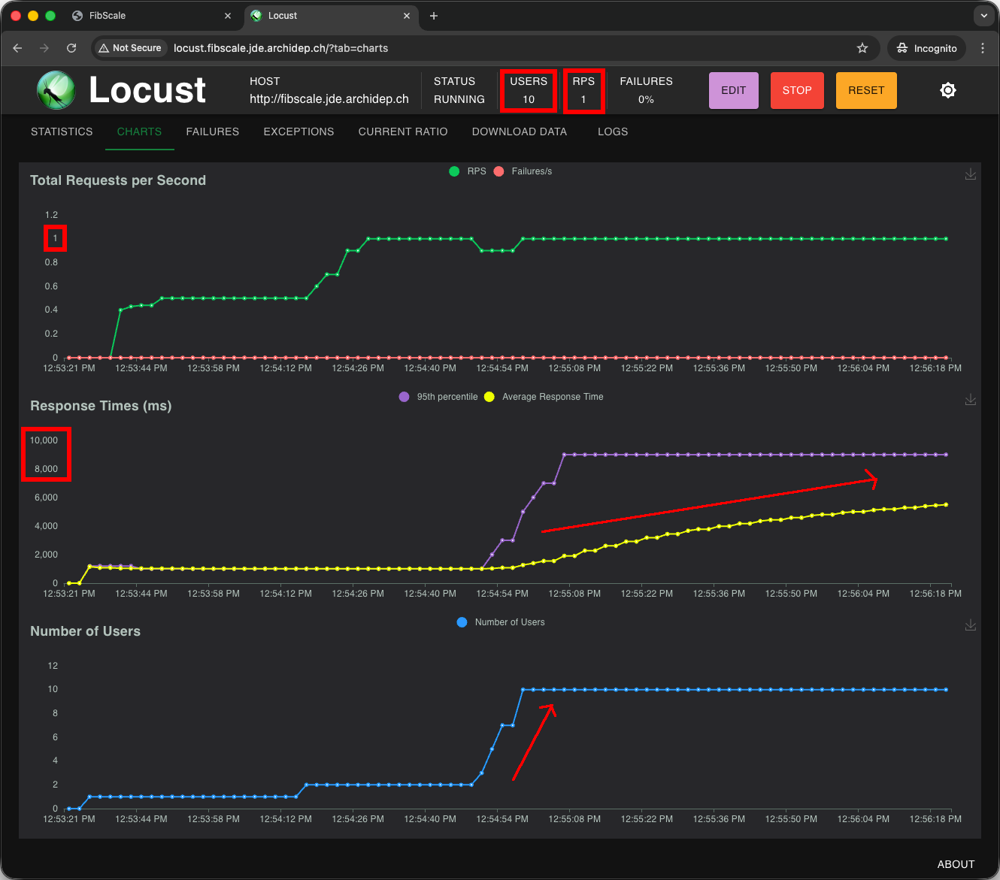

### :exclamation: Join the queue

While the ten customers are still ordering, order a coffee yourself in your
browser. You have to wait a while for your drink. When it comes, the page tells
you how long it took to brew it, and how long you waited, something like:
"Brewed in 1.0s by the barista. You waited 9.6s: the rest of the time, you were
in the queue."

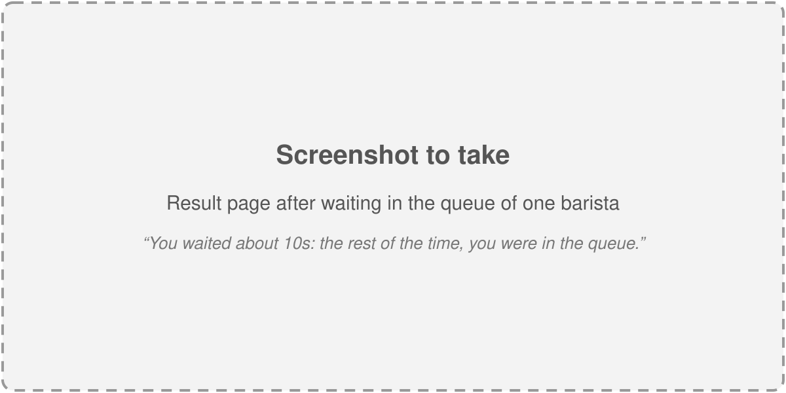

Your coffee took a second to brew. Why did you wait so much longer?

Your barista is one process, which **serves one customer at a time**. While it
brews a coffee, the next customers wait for it to finish, in the queue. When it
is done, it serves the next one, and the others keep waiting:

```
customer 1  --1s--
customer 2        --1s--
customer 3              --1s--
customer 4                    --1s--
customer 5                          --1s--
customer 6                                --1s--
customer 7                                      --1s--
customer 8                                            --1s--
customer 9                                                  --1s--
you                                                               --1s--
            ------------------------------------------------------------ 10s
```

The barista brews about one coffee per second, however many customers wait.
That is why the number of requests per second stayed at about 1 with ten
customers. The ten Locust customers spend most of their time in the queue, and
so did you when you joined it: almost every second of your wait was the turn of
another customer.

The barista does not always serve customers in the order they arrived, so your
own wait may have been shorter, or much longer. But on average, a customer who
finds nine others waiting waits about nine seconds before their turn.

You may now **stop** the load test.

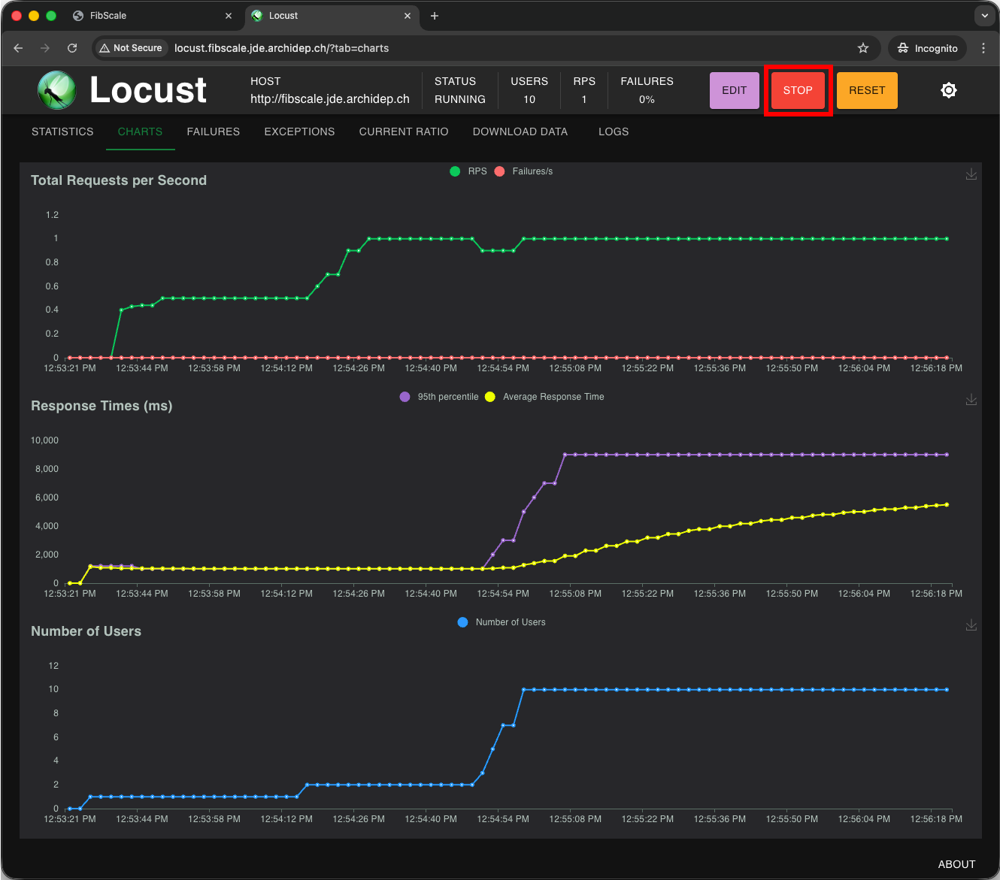

## :question: What to do?

Nobody wants to wait ten seconds for a coffee that takes one second to brew. How
do you make the queue move faster?

In a café, you would hire more baristas. Two facts make that work here too:

- **The baristas mostly wait.** A barista brewing a coffee is a process waiting,
  which uses no CPU. As in [two queues at one coffee machine][taking-turns], the
  processor is free to run something else in the meantime: other baristas.
- **The server has room for more.** A barista uses little CPU and memory, and
  your server has some to spare.



Brewing a coffee stands for what makes most web applications slow in real life:
waiting for something outside the process, such as a database, a file on a
disk, or another service on the internet. While it waits, the process uses no
CPU, and it cannot serve anybody else.



If one barista cannot serve enough customers, and the server has room to spare,
let's **hire more baristas**: run more instances of Brewscale, and see what
happens.

## :exclamation: Hire more baristas



Go back to your terminal that is still connected to your server over SSH for the
rest of the exercise, or reconnect if necessary.



First, stop and disable the `brewscale` service:

```bash
$> sudo systemctl stop brewscale
$> sudo systemctl disable brewscale
```

To run several instances of Brewscale, you could write a unit file for each, but
systemd also supports **unit templates**: units that can be started several
times from a single file.

### :exclamation: Turn the unit file into a template

To turn the `brewscale` service into a template, rename the `brewscale.service`
file to `brewscale@.service`:

```bash
$> sudo mv /etc/systemd/system/brewscale.service /etc/systemd/system/brewscale@.service
```

Each instance of a template is started with an **instance name**, which comes
after the `@`: `brewscale@1`, `brewscale@2`, and so on. In the template, `%i`
stands for that name. You will use it as the barista number.

Modify `/etc/systemd/system/brewscale@.service` as follows:

- Remove the `[Install]` section and the `WantedBy` option it contains. You will
  no longer start the template directly, but a group of its instances.
- Add `%i` at the end of the description, so that each instance has its own.
- Add `%i` at the end of the `ExecStart` command, to give Brewscale its barista
  number as an argument. As [Brewscale's documentation][brewscale-run] says, the
  number changes the colour of the café, and is shown on every page and in every
  line of the logs.
- Change the value of the `BREWSCALE_PORT` environment variable from `4200` to
  `420%i`. Only one process can listen on a port, so each barista needs a port
  of its own. systemd replaces `%i` with the instance name as text, not as a
  number: barista 1 listens on port 4201, barista 2 on port 4202, and so on.
- Add a `PartOf=brewscale.target` option to the `[Unit]` section. A systemd
  **target** is a group of units. The `brewscale.target` group does not exist
  yet, but you will create it below.



Since `%i` is replaced as text, `420%i` is a port number up to barista 99, which
listens on port 42099. Barista 100 would listen on port 420100, which does not
exist: ports go up to 65535.





The `/etc/systemd/system/brewscale@.service` file on your server should look
something like this:

```conf
[Unit]
Description=Brewscale barista %i
PartOf=brewscale.target

[Service]
# Run the jar with the JVM, with the barista number as an argument.
ExecStart=/usr/bin/java -jar target/brewscale.jar %i
WorkingDirectory=/srv/brewscale
User=brewscale

# Listen on the loopback address and on a port of its own: 4201 for barista 1,
# 4202 for barista 2, and so on.
Environment="BREWSCALE_HOST=127.0.0.1"
Environment="BREWSCALE_PORT=420%i"

# Limit the memory the JVM may use for the application's data.
Environment="JAVA_TOOL_OPTIONS=-Xmx64m"

Restart=on-failure
```



### :exclamation: Group the baristas in a target

Create the target file `/etc/systemd/system/brewscale.target`:

```conf
[Unit]
Description=Brewscale café
Requires=brewscale@1.service

[Install]
WantedBy=multi-user.target
```

The target runs **one instance** of the `brewscale@` template, with the instance
name `1`: a service named **`brewscale@1`**. `PartOf` in the template is the
other way round: stopping or restarting the target stops or restarts each of its
baristas with it.

Reload systemd's configuration, then enable and start the target as you would a
service:

```bash
$> sudo systemctl daemon-reload
$> sudo systemctl enable brewscale.target
$> sudo systemctl start brewscale.target
```

Check the status of the target, then of its only barista:

```bash
$> sudo systemctl status brewscale.target
$> sudo systemctl status brewscale@1
● brewscale@1.service - Brewscale barista 1
     Loaded: loaded (/etc/systemd/system/brewscale@.service; static)
     Active: active (running) since Thu 2026-11-19 10:31:12 UTC; 4s ago
...
Nov 19 10:31:13 jde.archidep.ch java[10601]: Barista 1 listening on 127.0.0.1:4201, brewing in 1s
```

### :exclamation: Put the barista behind an nginx upstream

The barista now listens on port 4201, and nginx still forwards requests to port
4200, where nothing listens any more. Update the nginx configuration file
`/etc/nginx/sites-available/brewscale` to forward them to an [**upstream**][nginx-upstream]:
a named group of servers, the addresses where nginx can reach your baristas.
There is only one barista for now, but there will be more soon.

Define the upstream, and **change the `proxy_pass` directive** to forward
requests to it:

```nginx
# The baristas of the café.
upstream brewscale {
  server 127.0.0.1:4201;
}

server {
  listen 80;
  server_name brewscale.jde.archidepN.ch;

  location / {
    # Forward every request to one of the baristas.
    proxy_pass http://brewscale;
  }
}
```

`brewscale` in `http://brewscale` is the name of the upstream, not a domain
name: nginx does not look it up in the DNS.

Check and reload nginx's configuration:

```bash
$> sudo nginx -t
$> sudo nginx -s reload
```

Visit your café again. It has changed colour, and says that barista 1 serves
you: the barista number you passed as an argument.

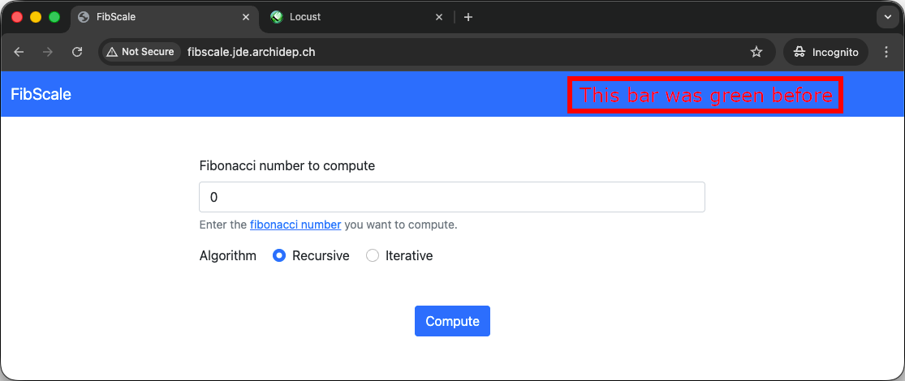

### :exclamation: Load test a single barista again

Go back to Locust, at `http://localhost:8089`, and run the same test as before:
the **Host**
`http://brewscale.jde.archidepN.ch`, with the **Number of users** set to 10 and
the **Ramp up** set to 1.

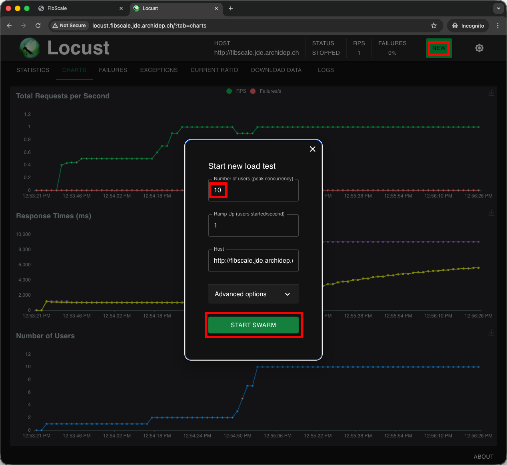

You should see the same numbers as before: about one request per second, and a
response time of about 9 seconds. Nothing has really changed yet: there is still
a single barista.

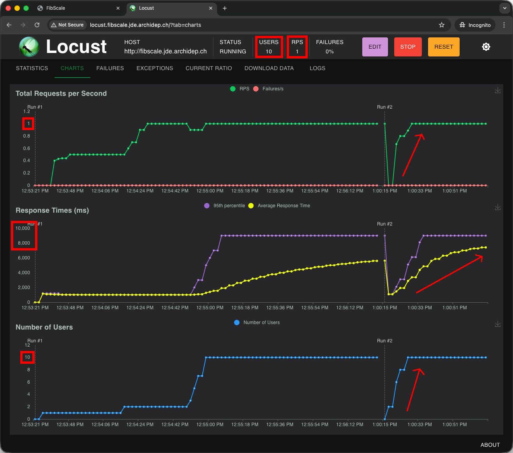

### :exclamation: Hire two more baristas

To hire more baristas, change the `Requires` option of
`/etc/systemd/system/brewscale.target` to start more instances of the template.
Let's run three:

```conf
[Unit]
Description=Brewscale café
Requires=brewscale@1.service brewscale@2.service brewscale@3.service

[Install]
WantedBy=multi-user.target
```

Reload systemd's configuration, and start the target again. There is no need to
restart it: starting it starts whatever it requires that is not running yet.

```bash
$> sudo systemctl daemon-reload
$> sudo systemctl start brewscale.target
```

Check the status of each barista:

```bash
$> sudo systemctl status brewscale@1
$> sudo systemctl status brewscale@2
$> sudo systemctl status brewscale@3
```

Each barista is a process of its own, running the same jar with a different
number. List the processes of the `brewscale` user:

```bash
$> ps -f -u brewscale
UID          PID    PPID  C STIME TTY          TIME CMD
brewsca+   10601       1  0 10:31 ?        00:00:03 /usr/bin/java -jar target/brewscale.jar 1
brewsca+   10744       1  1 10:38 ?        00:00:01 /usr/bin/java -jar target/brewscale.jar 2
brewsca+   10745       1  1 10:38 ?        00:00:01 /usr/bin/java -jar target/brewscale.jar 3
```

`ps` cuts usernames longer than 8 characters, and marks the cut with a `+`.

The Locust charts do not change yet: nginx does not know about the new baristas.

### :exclamation: Configure nginx to balance the load among the baristas

Add your new baristas to the `upstream` block of
`/etc/nginx/sites-available/brewscale`. Their barista numbers are `2` and `3`,
so they listen on ports `4202` and `4203`:

```nginx
upstream brewscale {
  server 127.0.0.1:4201;
  server 127.0.0.1:4202;
  server 127.0.0.1:4203;
}
```

Check and reload nginx's configuration:

```bash
$> sudo nginx -t
$> sudo nginx -s reload
```

nginx is now a **load balancer**: it forwards each request to one of the
servers of the upstream, taking them in turn.

Look at Locust again. You should quickly see the number of requests per second
grow to about 3, and the average response time fall to between 2 and 3 seconds.

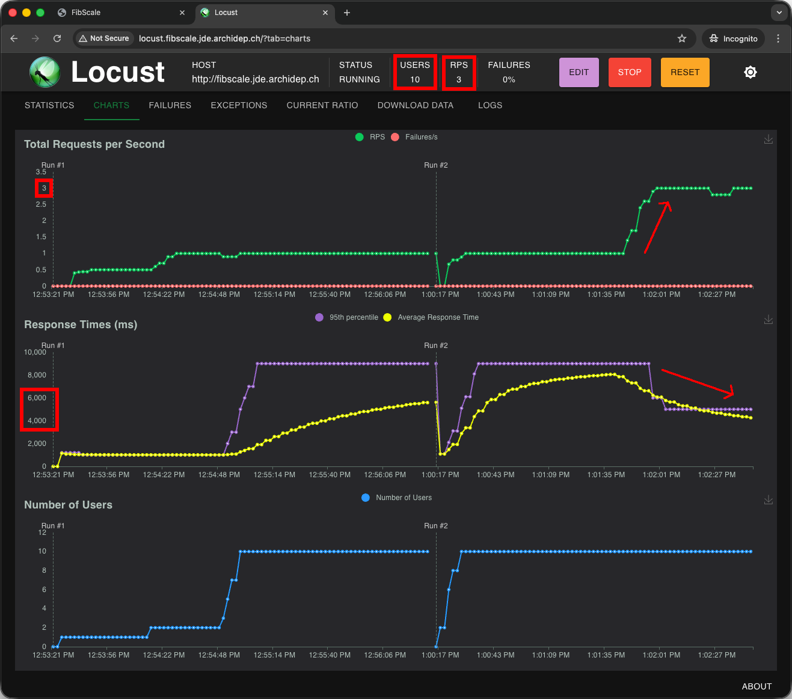

Visit your café and reload the page a few times. The colour and the number of
the barista change: nginx sends your requests to each barista in turn.

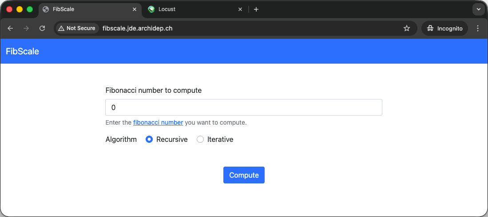

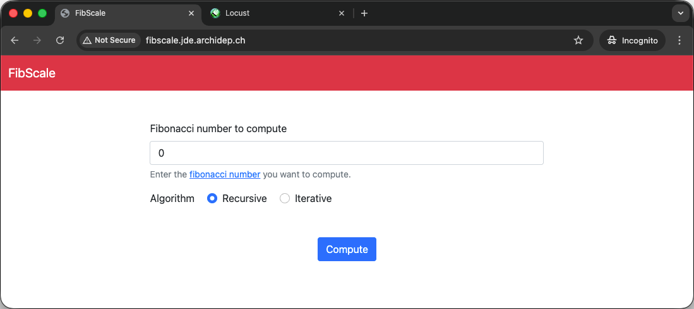

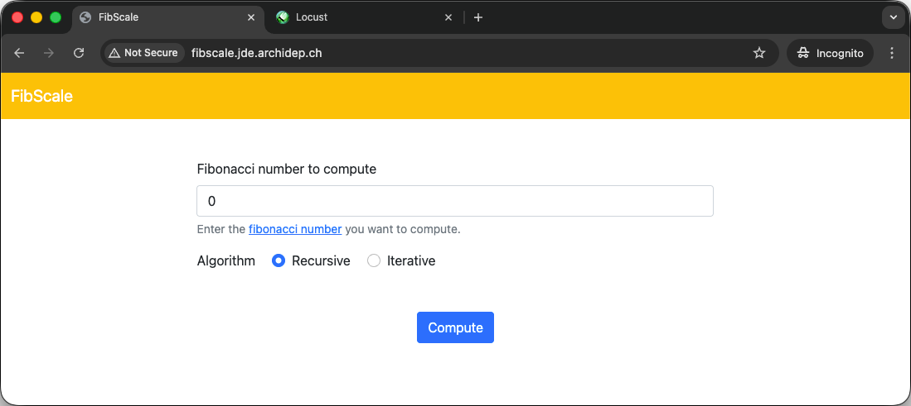

While the test runs, order a coffee yourself again. The queue moves three times
faster: three baristas brew three coffees at the same time.

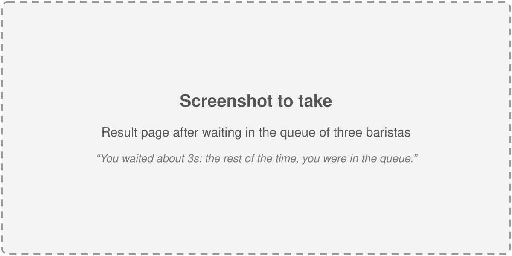

```
customer 1  --1s--
customer 2  --1s--
customer 3  --1s--
customer 4        --1s--
customer 5        --1s--
customer 6        --1s--
customer 7              --1s--
customer 8              --1s--
you                     --1s--
            ------------------ 3s
```

You may now stop the load test.

## :exclamation: Not the solution to all your problems

This exercise shows how to balance the load among several instances of an
application with nginx. But horizontal scaling does not solve every performance
problem, especially on a single server.

**Running more instances of an application on the same server can even make the
problem worse**, depending on its cause!



Three of the main causes of performance problems are using too much CPU, not
having enough memory, and performing too much I/O (input/output, such as reading
and writing files). In a café, think of the grinder, the space behind the
counter, and the stockroom. Whether horizontal scaling helps depends on the
cause, and on many other factors:

- If your application is slow because it uses **too much CPU** (for example, it
  makes many complex calculations), **running more instances may not make it
  faster**, and **may even make it slower** once your server's processor cores
  are overloaded.

  Imagine that every drink had to be ground by hand, on the café's only
  grinder: a CPU-bound task, on a single processor core. Hiring more baristas
  would not make the queue move any faster. They would only queue at the grinder
  instead of at the counter. It depends on the following factors:
  - Does your server have only one CPU core?

    If you run a CPU-bound application on a machine with one CPU core, **running
    more instances of the application only makes it faster as long as there is
    CPU capacity to spare**.

    **Once CPU usage reaches 100%, running more instances is unlikely to make it
    faster**, because one core cannot do several things in parallel. It can run
    several processes or threads concurrently, [taking turns][taking-turns], but
    that does not let it do more work in the same time. The application starts
    getting slower as you add more instances.

  - Does your server have several CPU cores?
    - Is the application single-threaded, serving one request at a time like a
      barista? This depends on the programming language it is written in, and
      on how it is written.

      In this case, running more instances will probably make it faster, because
      the cores can run your code in parallel: several grinders. But it depends
      on how many instances you run, and on the other programs that also use
      the CPU on your server. At some point, all of the CPU cores will be
      working at 100% capacity. Running more instances then only makes the
      application, and the whole server, slower.

    - Is the application already spreading its work across several CPU cores
      by itself?

      In this case, running more instances only makes it faster as long as there
      is CPU capacity to spare, that is as long as some CPU cores are not at
      100%. Once all of them are, more instances only make the application, and
      the whole server, slower.

- If your application is slow because it uses **too much memory** (for example,
  it keeps a lot of data in memory), **running more instances may make it faster
  IF your server has memory to spare**. Every barista needs some space behind
  the counter.

  If memory usage is already close to 100%, all you achieve by running more
  instances of your application is to bring down your whole server for lack of
  memory.

- If your application is **slow because of I/O** (for example, it often reads
  and writes data on disk, or in a database), **running more instances will
  probably make it faster, but only IF the I/O work can be done in parallel**,
  which depends entirely on what kind of work it is.

  Imagine that the baristas fetch milk and beans from a stockroom with a narrow
  door. A few of them can go through at once, but past that, they queue at the
  door. Files work the same way: they can be read and written in parallel up to
  a point, but at some point there are too many for your server's disk to keep
  up.

  Database servers are designed to serve many clients at once, like a supplier
  who delivers to many baristas, and they make the most of your hardware. But
  again there is a limit, especially if the database runs on the same server as
  your application. At some point, running more instances slows everything
  down.

:books: **Optimizing the application**

If your application uses too much CPU or memory, or performs too much I/O, you
can of course look for the bottlenecks in its code, and optimize them to use
fewer resources. It may then be able to process more requests, or respond
faster.

This is a programming problem, not directly related to architecture.

:books: **Scaling further**

Your computer has limits too. Simulating more users takes more CPU and memory,
and at some point a single computer cannot simulate enough of them to load-test
a large application. Load testing tools such as Locust can then spread the
simulated users across several computers.

Whatever the reason your application is slow, you also have to make sure that it
supports running several instances at once before you start more of them: two
instances writing the same file, or the same rows of a database, may conflict
with each other.

Once you reach the limits of a single server, you can run more servers, and more
instances of your application on them: open a second café. In this exercise,
your nginx `upstream` only lists `127.0.0.1`, your server itself, but nothing
prevents you from listing the IP addresses or domain names of other servers, to
spread the work among them. Of course, your application must then support being
spread across several servers.

If you are very successful and reach tens of thousands of clients at once, nginx
itself may become a bottleneck, and you may have to balance the load at the DNS
level, among several load balancers.

:books: **Performance is hard!**

In summary: **performance is a very complex problem**.

Again, before setting up anything: **don't guess, measure!**

And again, **beware of [rate limiting][rate-limiting] and [(D)DoS][dos]
protection when you load test**. A load test can look a lot like a DoS attack,
and your cloud provider may ban you if you are not careful.

:books: **Scaling Brewscale horizontally**

For your information, Brewscale is very easy to scale horizontally on a single
server because:

- Brewing a coffee is a wait, which uses neither CPU nor memory, and performs no
  I/O: Brewscale calls Java's `Thread.sleep` method, which pauses it for a
  second.
- Each barista serves one request at a time: Brewscale uses the HTTP server that
  comes with Java, which handles every request on a single thread unless it is
  told otherwise, and Brewscale never tells it otherwise. That is what makes
  running several processes clearly faster.
- Each order is independent of the others, and there is no shared resource such
  as a database. The baristas never need to talk to each other, or to take turns
  using anything.



## :exclamation: Stop Locust



Do this on your computer, not on your server: in the terminal where you started
Locust.



You are done with load testing. Stop Locust's container:

```bash
$> docker stop locust
locust
```

`--rm` made Docker remove the container once it stopped. Your clone of Brewscale
stays on your computer: you can start Locust again with the same `docker run`
command, from its directory.

## :checkered_flag: What have I done?

You have deployed an application that is slow by nature, measured how slow it
gets under load with [Locust][locust], a [load testing][load-testing] tool, and
made it serve more customers by running several instances of it, with nginx
balancing the load among them.

Brewscale had to be **built** before it could run: Maven compiled its Java code
and packaged it into a jar. What you deploy is no longer the code of the
repository as it is, but a program built from it. The build happens on the
server, as you, and the application runs as a user of its own, which only needs
to read the result.

Under load, the time a request takes is not the time the application needs to
handle it. A barista brews a coffee in a second, but a customer who finds nine
others in front of them waits ten. One process serves one request at a time,
and the requests that arrive in the meantime wait in a **queue**. Load testing
measures what the customers experience, queue included.

Adding customers did not add orders served per second: one barista brews about
one coffee per second, however many customers wait. The extra customers only
made the queue longer.

**Horizontal scaling** runs more instances of the same application, each one a
process of its own, here three. Each instance needs a port of its own, since
only one process can listen on a port. The three baristas serve three
customers at the same time, and the queue moves three times faster.

systemd can start several instances of the same application for you, each with
its own arguments and environment. It can start a group of them at once, and
stop or restart them together. The baristas are now a group, the café, which
starts when the server boots, and stops when it shuts down.

nginx, which you used as a reverse proxy, is now also a **load balancer**: its
upstream lists the addresses of the baristas, and it forwards each request to
one of them, in turn. A browser still sees a single café, at a single address.

It worked on a single server because the baristas mostly wait, and waiting uses
no CPU: the processor runs another barista in the meantime. An application that
is slow because it computes, or because its disk is busy, would not be helped
as much, and might even be slowed down: horizontal scaling only helps when there
is something to spare.

### :classical_building: Architecture

This is a simplified architecture of the main running processes and
communication flow at the end of this exercise. Unlike in the [previous
exercise][reverse-proxy-architecture], nginx does not forward every request to
the same process: it balances them among the three baristas. Step through the
diagram to follow the exercise: one barista serving your order, then the orders
of Locust's customers one at a time, then three baristas serving your page in
turn, and Locust's orders at the same time.





Note that this diagram simplifies nginx by showing only one process, while in
reality it has a master process and several worker processes, but this is
sufficient to understand the architecture.



## :file_folder: Where is everything?

These are the files and directories of your server that matter for this
deployment.

<div class="file-map">

| Path                                                                                   | What it is                                                                | What you did                                                                                      | Who uses it                                                           |
| :------------------------------------------------------------------------------------- | :------------------------------------------------------------------------ | :------------------------------------------------------------------------------------------------ | :-------------------------------------------------------------------- |
| :file_folder: `/srv/brewscale` <span class="new">new</span>                            | Your deployment: a clone of Brewscale's repository                        | Created it with `sudo mkdir`, cloned the repository into it, and gave it to the `brewscale` group | You, to build. The `brewscale` user reads it                          |
| :page_facing_up: `/srv/brewscale/target/brewscale.jar` <span class="new">new</span>    | The program: Brewscale's compiled code, with the libraries it uses        | Built it with `mvn package`                                                                       | `java`, run by systemd as the `brewscale` user, once for each barista |
| :page_facing_up: `/etc/systemd/system/brewscale@.service` <span class="new">new</span> | The unit template: how to run one barista, `%i` being its number          | Wrote it as `brewscale.service`, then renamed it with `sudo mv` and turned it into a template     | systemd, for each barista                                             |
| :page_facing_up: `/etc/systemd/system/brewscale.target` <span class="new">new</span>   | The café: the group of the baristas, which says how many there are        | Wrote it with `sudo nano`, and enabled it                                                         | systemd, to start the baristas when the server boots                  |
| :page_facing_up: `/etc/nginx/sites-available/brewscale` <span class="new">new</span>   | The configuration of the café: its name, and the upstream of the baristas | Wrote it with `sudo nano`, enabled it with a link in `sites-enabled`, and added an upstream       | nginx, to balance the café's requests among the baristas              |
| :page_facing_up: `/etc/passwd` <span class="changed">changed</span>                    | The list of the server's Unix users                                       | Ran `useradd`, which added the `brewscale` user                                                   | systemd, to find the `brewscale` user that runs the baristas          |
| :page_facing_up: `/usr/bin/java` <span class="new">new</span>                          | The Java virtual machine, which runs the jar                              | Installed it with `apt install`                                                                   | systemd runs it, as `ExecStart` says                                  |

</div>

You can explore all of this yourself: `ls -l` shows what a directory contains,
with its permissions, and `cat`, `head` and `tail` what a file contains, as in
the [command line cheatsheet][command-line-cheatsheet]. Use `sudo` for what only
`root` can read. For example:

```bash
# The units systemd has loaded for Brewscale.
$> systemctl list-units 'brewscale*'

# What a barista logs: the orders it brews, as they come.
$> sudo journalctl -u brewscale@2 -f
```

## :boom: Troubleshooting

Here's a few tips about some problems you may encounter during this exercise.

### :boom: `[emerg] could not build the server_names_hash, you should increase server_names_hash_bucket_size`

Your domain name is too long for nginx's default settings. Fix it as in the
[same problem in the static site exercise][server-names-hash].

### :boom: `Unable to access jarfile target/brewscale.jar`

The logs of a barista show this error, and it does not start:

```bash
$> sudo journalctl -u brewscale@1
...
Nov 19 10:31:13 jde.archidep.ch java[10601]: Error: Unable to access jarfile target/brewscale.jar
```

There is no jar in `/srv/brewscale/target`: check with `ls -l
/srv/brewscale/target`. Build it with `mvn package` in `/srv/brewscale`, as in
[Build the application][build], and make sure the build ends with `BUILD
SUCCESS`. Then restart the target with `sudo systemctl restart
brewscale.target`.

### :boom: `The command 'docker' could not be found in this WSL 2 distro`

Docker Desktop provides the `docker` command in the WSL only while it is
running, and only in the WSL distributions it is integrated with. Start Docker
Desktop, then open a new terminal. If the command is still missing, open Docker
Desktop's settings, and under **Resources**, then **WSL integration**, enable
the integration with Ubuntu.

### :boom: `Cannot connect to the Docker daemon`

Docker Desktop is not running. Start it, wait until it says that it is running,
and run your command again.

### :boom: A barista does not start

See the troubleshooting of the [systemd exercise][systemd-troubleshooting]: its
errors are the same for a barista, with `brewscale@1` instead of `guessit` in
the commands.

### :boom: 502 Bad Gateway

nginx received the request, but could not get an answer from a barista. Look at
the end of nginx's error log:

```bash
$> sudo tail /var/log/nginx/error.log
```

If it says `connect() failed (111: Connection refused) while connecting to
upstream`, nothing listens at the address of one of your upstream's servers, or
of your `proxy_pass` directive:

- Check that each barista is running with `sudo systemctl status brewscale@1`
  (and `@2`, `@3`), and that the last line of its logs says it is listening on
  the port you expect.
- Check that the ports of your `upstream` block are `4201`, `4202` and `4203`,
  one per barista you have started.

### :boom: The café always shows the same barista

nginx only sends requests to the servers of its upstream. Check that:

- Your `upstream` block lists the three baristas, and you have reloaded nginx's
  configuration since you changed it.
- The three baristas are running: `sudo systemctl status brewscale.target`, and
  each barista's status.

[build]: #build-the-application
[brewscale]: https://github.com/ArchiDep/brewscale
[brewscale-config]: https://github.com/ArchiDep/brewscale#configuration
[brewscale-locustfile]: https://github.com/ArchiDep/brewscale/blob/main/locustfile.py
[brewscale-run]: https://github.com/ArchiDep/brewscale#run-the-application
[dos]: https://en.wikipedia.org/wiki/Denial-of-service_attack
[java]: https://openjdk.org
[load-balancing]: https://en.wikipedia.org/wiki/Load_balancing_(computing)
[load-testing]: https://en.wikipedia.org/wiki/Load_testing
[locust]: https://locust.io
[locustfile]: https://docs.locust.io/en/stable/writing-a-locustfile.html
[maven]: https://maven.apache.org
[nginx-upstream]: https://nginx.org/en/docs/http/ngx_http_upstream_module.html
[rate-limiting]: https://en.wikipedia.org/wiki/Rate_limiting
[scaling]: https://en.wikipedia.org/wiki/Scalability

[command-line-cheatsheet]: #whats-in-this-file-cat-head-tail-less
[dedicated-user]: #create-a-dedicated-user
[guessit-docker]: #run-postgresql-with-docker-desktop
[git-clone-directory]: #create-the-deployment-directory
[loopback]: #theres-no-place-like-127001
[reverse-proxy-architecture]: #architecture
[reverse-proxy-deployment]: 
[server-names-hash]: #emerg-could-not-build-the-server_names_hash-you-should-increase-server_names_hash_bucket_size
[systemd-troubleshooting]: #troubleshooting
[taking-turns]: #taking-turns
