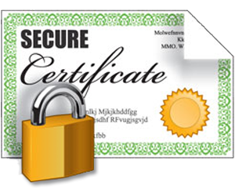
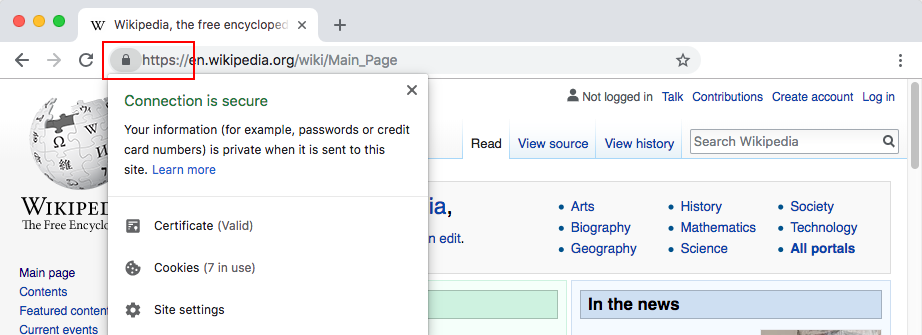
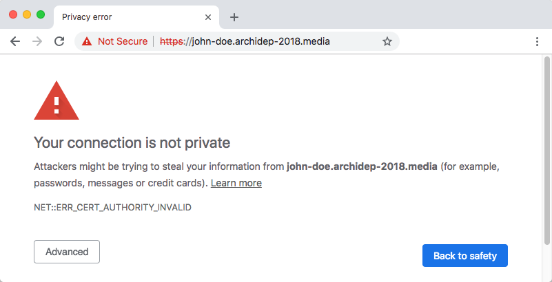
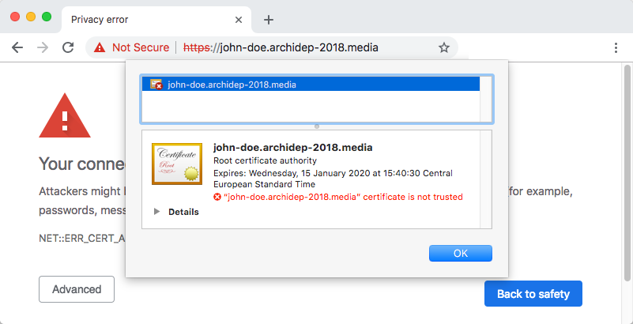
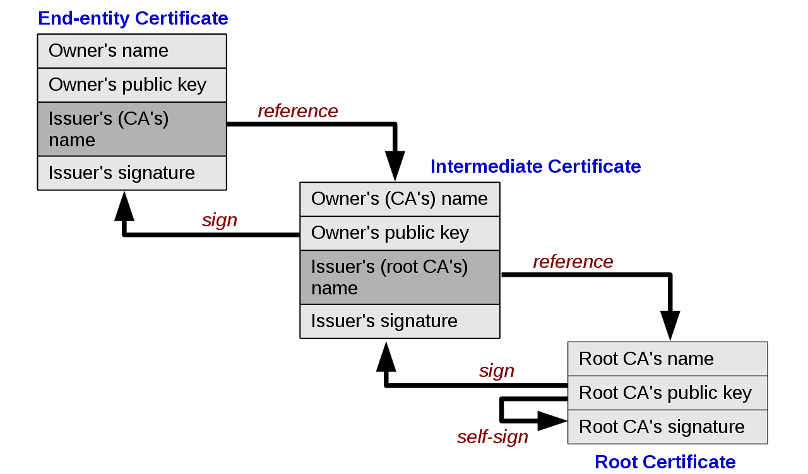
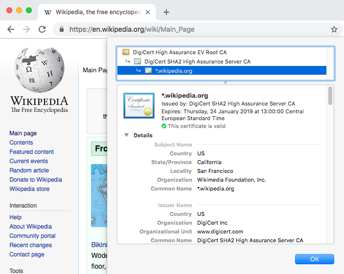
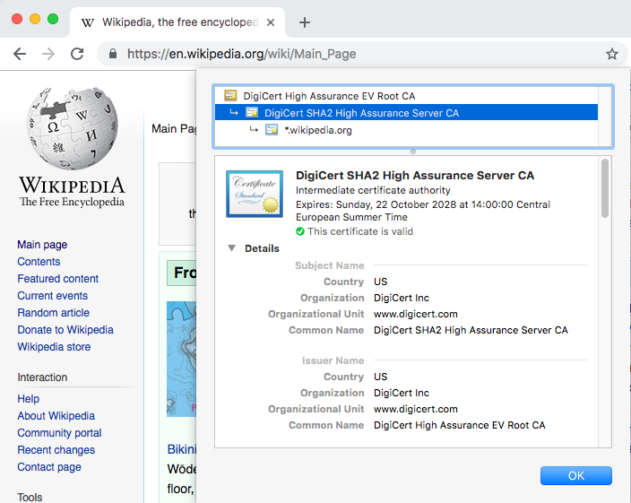
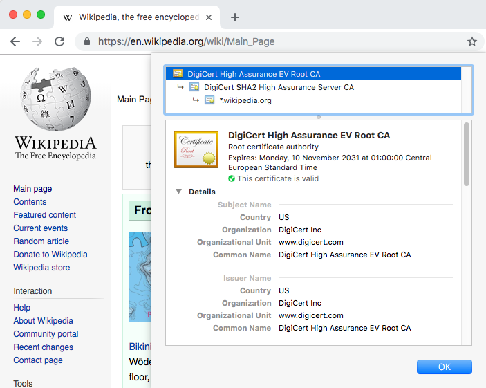

# {{ page.title }}

Architecture & Deployment <!-- .element: class="subtitle" -->

**Notes:**

Learn what a TLS certificate is, why a browser trusts one, and how to obtain one
for free from [Let's Encrypt][letsencrypt].

**Recommended reading**

- [Secure Shell (SSH)]()
- [Reverse Proxying]()

---

## What is a TLS or SSL certificate?

<!-- slide-front-matter class: center, middle -->



---

## Public key certificates

A [**public key certificate**][pubkey-certificate] is an electronic document
that proves the ownership of a public key using [public key
cryptography][pubkey].

**Notes:**

A certificate binds a **name** to a **public key**. Someone else, the
**issuer**, vouches for that binding by signing the certificate.

A certificate contains:

- The name or names it is valid for.
- The owner's public key.
- The dates between which it is valid.
- The issuer's name.
- The issuer's digital signature of all of the above.

---

## TLS certificate

A [**TLS (formerly SSL) certificate**][tls-certificate] is a type of public key
certificate that allows a computer such as a **web server** to prove that it
owns a public key. Its validity is linked to one or multiple **domain names**.

<ul class="text-3xl">
  <li><code>google.com</code></li>
  <li><code>download.microsoft.com</code> & <code>www.microsoft.com</code></li>
  <li><code>*.example.com</code> (wildcard)</li>
</ul>

**Notes:**

SSL is the original **S**ecure **S**ockets **L**ayer protocol, first published
in 1995 and now deprecated. TLS is the newer and more secure [**T**ransport
**L**ayer **S**ecurity][tls] protocol, first published in 1999. Its latest
version is TLS 1.3, published in 2018. Although TLS is used today, TLS
certificates are often still called "SSL certificates".

A TLS certificate can be valid for one or multiple domain names. It can also be
a wildcard certificate, valid for all the subdomains of a domain:
`*.example.com` is valid for `foo.example.com` and `bar.example.com`.

---

### What is a TLS certificate good for?

A TLS certificate is one of the components that allows a server to **communicate
securely over HTTPS** using the TLS protocol.



**Notes:**

When a browser connects to a server over HTTPS, simplified:

- The browser and the server agree on a [cipher suite][cipher-suite]: the
  algorithms they both support.
- They agree on a shared secret key with a [Diffie-Hellman key exchange][dh], as
  SSH does. The key itself never travels over the network.
- The server sends its certificate, and **signs** the handshake with its
  private key.
- The browser checks the certificate: the name, the dates, and the issuer's
  signature. It then checks the server's signature with the public key in the
  certificate.
- Both use the shared key to encrypt all traffic with fast symmetric
  encryption.

---

### A certificate is public

Anyone can download a server's certificate. What proves the server's identity is
its **private key**, which never leaves the server.

**Notes:**

A certificate is not a secret: the server sends it to every client. An attacker
can copy it and send it to your browser, but cannot sign the handshake without
the private key that goes with it. Your browser checks that signature with the
public key in the certificate, so the copied certificate is useless.

This is the same mechanism as SSH's host key: the server signs with its private
key, the client checks with the public key. The difference is how the client
knows that the public key is the right one. In SSH, you checked the
fingerprint yourself. In TLS, a certificate authority vouches for it.

---

## Validity of TLS certificates

Your browser will not simply accept any TLS certificate. You can generate your
own TLS certificate to test this.

--v

### Generating a self-signed certificate

```bash
$> sudo openssl req -x509 -newkey rsa:2048 -noenc -days 365 \
     -subj "/CN=clock.jde.archidep2.ch" \
     -addext "subjectAltName=DNS:clock.jde.archidep2.ch" \
     -keyout /etc/ssl/private/clock.jde.archidep2.ch.key \
     -out /etc/ssl/certs/clock.jde.archidep2.ch.pem
```

```nginx
listen 443 ssl;
ssl_certificate /etc/ssl/certs/clock.jde.archidep2.ch.pem;
ssl_certificate_key /etc/ssl/private/clock.jde.archidep2.ch.key;
```

**Notes:**

This command generates a new key pair and a certificate for the public key,
signed with the private key of the same pair: a **self-signed** certificate.

- `-x509` makes a certificate rather than a request for one.
- `-newkey rsa:2048` generates a new 2048-bit RSA key pair.
- `-noenc` does not encrypt the private key with a password, so that nginx can
  read it without asking anyone for one.
- `-days 365` makes the certificate valid for a year.
- `-subj` and `-addext` give the name the certificate is valid for. Browsers
  read the name in the _subject alternative name_ extension.
- `-keyout` and `-out` are where the private key and the certificate are saved.

`/etc/ssl/private` is only accessible to `root`, hence the `sudo`: nobody else
may read the private key. The certificate goes in `/etc/ssl/certs`, which
everyone may read, since a certificate is public anyway.

The second block holds the lines to add to the `server` block of a site's nginx
configuration, to serve it over HTTPS with this certificate:

- `listen 443 ssl` makes nginx listen on port 443, the port of HTTPS, and use
  TLS on it.
- `ssl_certificate` is the certificate nginx sends to the browser.
- `ssl_certificate_key` is the private key nginx signs with. nginx reads it when
  it starts, as `root`.

--v

### Invalid certificate authority



**Notes:**

If you configure nginx to serve a site over HTTPS with this certificate and visit
it, Chrome shows an error of type `NET::ERR_CERT_AUTHORITY_INVALID`. This means
that no valid **certificate authority** guarantees that this certificate is
valid.

--v

### Self-signed root certificate

This **self-signed root certificate** is invalid.



**Notes:**

The certificate details indicate that it is a **root certificate**, meaning
that no other certificate authority guarantees its validity. Since you signed it
yourself, and you are not a trusted certificate authority, your browser
considers it invalid.

---

## How to make a certificate valid

To be valid, a TLS certificate must be **signed by a valid certificate
authority**. This signature is a [digital signature][digital-signature] using
[public key cryptography][pubkey].

**Notes:**

- The certificate authority has a **private and public key pair**.
- It **uses its private key to sign** your certificate.
- It **distributes its public key** so that anyone in possession of your
  certificate and its public key can **verify the signature**.

---

## How do I know the certificate authority is valid?

The certificate authority that signed your certificate must itself prove that it
owns the public key that is being distributed by providing a **public key
certificate of its own**.

---

## Chain of trust



**Notes:**

Your TLS certificate and other public key certificates are thus linked together
in a **chain of trust**.

Each certificate, starting with your own **end-entity certificate**, is signed
by the next certificate authority, proving its validity to the client. This is a
type of [public key infrastructure][pki].

_Diagram by Yanpas, CC BY-SA 4.0, from [Wikimedia Commons][commons-chain]_

---

### Viewing a certificate's chain of trust



**Notes:**

Browsers allow you to view a TLS certificate's chain of trust.

---

### Intermediate certificates



**Notes:**

In this example, there are 3 certificates in the chain, but there could be more.
All certificates in the middle are **intermediate certificate authorities**.

A certificate authority keeps the private key of its root certificate offline,
and signs the certificates of its customers with the keys of its intermediate
certificates. If an intermediate key is compromised, it can be replaced without
replacing the root.

---

### Root certificate authorities



**Notes:**

The **root certificate authority** is the one at the top of the chain.

---

## Root certificate validity

How then does the browser know that a root certificate authority is valid?


**Notes:**

As you can see in the chain of trust diagram, the **root certificate** is
self-signed: there is no inherent difference between it and a certificate you
have generated yourself with `openssl req`.

_Diagram by Yanpas, CC BY-SA 4.0, from [Wikimedia Commons][commons-chain]_

---

### Trusted CA certificate lists

Browsers and operating systems have **lists of root certificates** that are
considered to be **trusted**, installed with them.

- [Trusted Root Certificates in Apple operating systems][apple-root-ca-list]
- [Trusted Root Certificates in Mozilla Firefox][mozilla-root-ca-list]

**Notes:**

When your browser checks a certificate's chain of trust, it expects the chain's
root certificate to be one of the **already trusted** ones; otherwise, the TLS
certificate is deemed invalid.

These lists are updated with the browser or the operating system. A root
certificate can also be removed from them, if its certificate authority stops
being trustworthy.

---

### Becoming a trusted CA

To launch a new company to issue valid TLS certificates, browser and operating
system vendors must include your new root certificate in their programs:

- [Apple Root Certificate Program][apple-root-ca]
- [Chrome Root Program][chrome-root-ca]
- [Microsoft Trusted Root Program][microsoft-root-ca]
- [Mozilla Root Store Policy][mozilla-root-ca]

**Notes:**

Each program has strict requirements, such as regular audits. Most of them are
shared, and written by the [CA/Browser Forum][cab-forum], where certificate
authorities and browser vendors agree on them.

---

## Obtaining a TLS certificate

To obtain a valid TLS certificate, you need to request one from a
[**certificate authority (CA)**][ca]:

- [Let's Encrypt][letsencrypt]
- [DigiCert][digicert]
- [Sectigo][sectigo]

---

### Domain validation

You must **prove that you control the domain** before a CA will issue you a
valid TLS certificate. There are various techniques to do this.

--v

### HTTP validation

The CA asks you to put a file at
`http://example.com/.well-known/acme-challenge/<token>` containing a random
validation token. Doing this **proves that you control the server** which serves
the content for the domain.

**Notes:**

The CA then connects to the domain on port 80 from its own servers, on the
Internet, and checks that it gets the token back. The domain must therefore
already point to your server, and your server must answer on port 80.

--v

### DNS validation

The CA asks you to create a `TXT` record with a random token in your domain's
DNS zone. Doing this **proves that you control the DNS zone** of the domain.

**Notes:**

A wildcard certificate, such as `*.example.com`, can only be obtained with DNS
validation: a file on one server does not prove that you control every name
under the domain.

--v

### Email validation

The CA sends you an email with a validation link at an address such as
`admin@example.com`. Following the link **proves that you are the administrator
of the domain**, since only you should receive email at that address.

---

### Purchasing TLS certificates

Some certificate authorities sell you TLS certificates.

--v

### Paying for compatibility

Not all root certificates are as widespread. Some may be present in more
browsers and operating systems, including older ones. By paying more, you may
get a certificate that is **compatible with more clients**.

--v

### Paying for warranty

Many certificate authorities will pay you a given sum of money if your users
suffer losses because the certificate authority made a mistake in issuing a
certificate. You may increase that warranty by purchasing a more expensive
certificate.

--v

### Paying for extended validation

**[Extended Validation Certificate (EV)][ev-certificate]:** Certificate
authorities can validate that a legal entity is the owner of a domain.

**Notes:**

Browsers used to display the name of the organization next to the address of a
site with an EV certificate, in a "green bar". They stopped in 2019, since
studies showed that users did not notice it. An EV certificate encrypts
connections exactly like any other.

---

## Certificate lifetimes

Certificates expire, and their maximum lifetime is getting shorter.

| Since      | Maximum lifetime |
| :--------- | ---------------: |
| 2020       |         398 days |
| March 2026 |         200 days |
| March 2027 |         100 days |
| March 2029 |          47 days |

**Notes:**

A certificate has an end date, after which browsers refuse it. The shorter its
lifetime, the shorter the time a stolen private key or a wrongly issued
certificate can be abused.

The [CA/Browser Forum][cab-forum] voted in 2025 to reduce the maximum lifetime
of certificates step by step, down to 47 days in 2029. At that point, nobody can
renew certificates by hand anymore: renewal must be automated.

---

## Let's Encrypt

[Let's Encrypt][letsencrypt] is a **certificate authority (CA)** run for the
public's benefit by the [Internet Security Research Group (ISRG)][isrg]:

- **Free**, **Automatic**, **Secure**
- **Transparent**, **Open**, **Cooperative**

**Notes:**

- **Free:** Anyone who owns a domain name can use Let's Encrypt to obtain a
  valid TLS certificate at zero cost.
- **Automatic:** Software running on a web server can obtain a certificate,
  configure the server to use it, and renew it, with no human involved.
- **Secure:** Let's Encrypt promotes TLS security best practices, both on the CA
  side and by helping site operators properly secure their servers.
- **Transparent:** All the certificates it issues or revokes are publicly
  recorded and available for anyone to inspect.
- **Open:** The issuance and renewal protocol, [ACME][acme], is an open standard
  that other certificate authorities and tools also use.
- **Cooperative:** Let's Encrypt is a joint effort to benefit the community,
  beyond the control of any one organization.

Let's Encrypt has issued certificates since 2015, and has become the largest
certificate authority in the world. Its certificates are valid for 90 days.

---

### Certbot

[Certbot][certbot] is a tool made by the [Electronic Frontier Foundation
(EFF)][eff]:

- Helps you **obtain Let's Encrypt certificates**
- **Configures your web server** ([Apache][apache], [nginx][nginx])
- Sets up **automatic renewal**

**Notes:**

Certbot is an ACME client: it talks to Let's Encrypt's servers for you, proves
that you control your domains with HTTP validation, and saves the certificate
and its private key on your server. On Ubuntu, a systemd timer runs it twice a
day to renew the certificates that are about to expire.

---

## Where TLS ends

<!-- slide-front-matter class: center, middle -->

Browser —**HTTPS**→ nginx —**HTTP**→ application

**Notes:**

When nginx is a reverse proxy, it is nginx that holds the certificate and its
private key, and that encrypts and decrypts the traffic: it **terminates** TLS.
It forwards the requests to the application over plain HTTP, on the server's
loopback address, which never leaves the server.

The application does not change at all to be served over HTTPS, and one nginx
can do it for every site on the server.

---

## References

- [Public-key Certificate][pubkey-certificate]
  - [Public Key Cryptography][pubkey]
  - [Chain of Trust][chain-of-trust]
- [Certificate Authority (CA)][ca]
  - [Let's Encrypt][letsencrypt]
  - [How It Works (Let's Encrypt)][letsencrypt-how-it-works]
- [Nginx - Configuring HTTPS servers][nginx-ssl]

[acme]: https://en.wikipedia.org/wiki/Automatic_Certificate_Management_Environment
[apache]: https://httpd.apache.org
[apple-root-ca]: https://www.apple.com/certificateauthority/ca_program.html
[apple-root-ca-list]: https://support.apple.com/en-us/103272
[ca]: https://en.wikipedia.org/wiki/Certificate_authority
[cab-forum]: https://cabforum.org
[certbot]: https://certbot.eff.org/
[chain-of-trust]: https://en.wikipedia.org/wiki/Chain_of_trust
[commons-chain]: https://commons.wikimedia.org/wiki/File:Chain_of_trust.svg
[chrome-root-ca]: https://www.chromium.org/Home/chromium-security/root-ca-policy/
[cipher-suite]: https://en.wikipedia.org/wiki/Cipher_suite
[dh]: https://en.wikipedia.org/wiki/Diffie%E2%80%93Hellman_key_exchange
[digicert]: https://www.digicert.com
[digital-signature]: https://en.wikipedia.org/wiki/Digital_signature
[eff]: https://www.eff.org
[ev-certificate]: https://en.wikipedia.org/wiki/Extended_Validation_Certificate
[isrg]: https://www.abetterinternet.org
[letsencrypt]: https://letsencrypt.org/
[letsencrypt-how-it-works]: https://letsencrypt.org/how-it-works/
[microsoft-root-ca]: https://learn.microsoft.com/en-us/security/trusted-root/program-requirements
[mozilla-root-ca]: https://www.mozilla.org/en-US/about/governance/policies/security-group/certs/policy/
[mozilla-root-ca-list]: https://wiki.mozilla.org/CA/Included_Certificates
[nginx]: https://nginx.org/
[nginx-ssl]: https://nginx.org/en/docs/http/configuring_https_servers.html
[pki]: https://en.wikipedia.org/wiki/Public_key_infrastructure
[pubkey]: https://en.wikipedia.org/wiki/Public-key_cryptography
[pubkey-certificate]: https://en.wikipedia.org/wiki/Public_key_certificate
[sectigo]: https://www.sectigo.com
[tls]: https://en.wikipedia.org/wiki/Transport_Layer_Security
[tls-certificate]: https://en.wikipedia.org/wiki/Public_key_certificate#TLS/SSL_server_certificate
