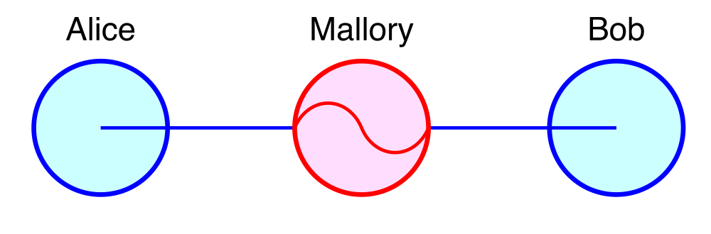
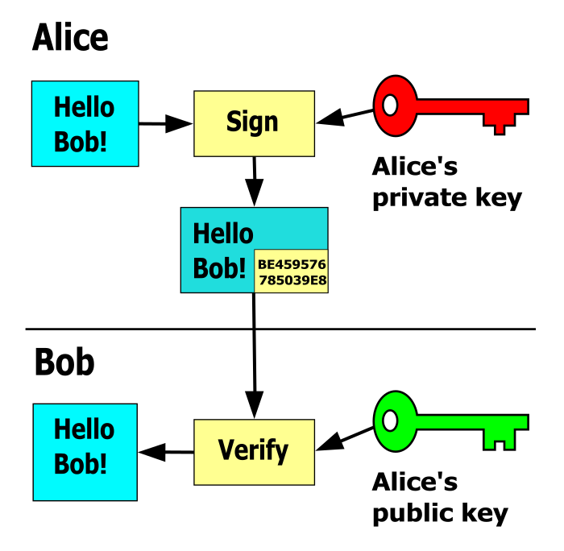
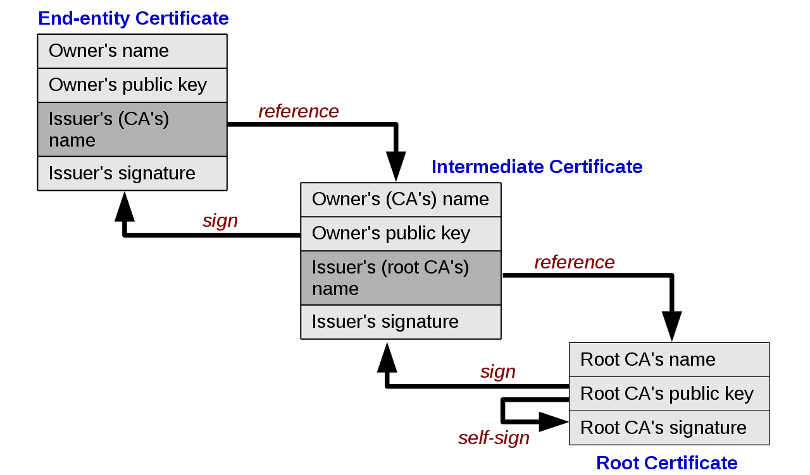

Learn what a [TLS][tls] certificate is, why a browser trusts one, and how to
obtain one for free from [Let's Encrypt][letsencrypt].

<!-- more -->

**Recommended reading**

- [Secure Shell (SSH)]()
- [Reverse Proxying]()

## The problem TLS solves

Plain HTTP sends everything in clear text. Between your browser and a server,
your requests cross many machines that you do not control: the Wi-Fi access
point, your Internet provider's routers, and others along the way. Anyone in
control of one of them can:

- **Read** what you send and receive, such as a password or the contents of a
  page.
- **Modify** it, for example to insert something into a page.
- **Pretend to be the server**, and answer in its place. This is a
  man-in-the-middle attack.



_Diagram by Miraceti, CC BY-SA 3.0, from [Wikimedia Commons][commons-mitm]._

The [Transport Layer Security (TLS)][tls] protocol solves these problems. It
**encrypts** the traffic so that nobody else can read or modify it, and it
**authenticates** the server so that you know who you are talking to. HTTPS is
HTTP sent through a TLS connection, by default on port 443 instead of 80.



SSL, the original **S**ecure **S**ockets **L**ayer protocol, was first published
in 1995 and is now deprecated. TLS replaced it in 1999, and its latest version
is TLS 1.3, published in 2018. TLS certificates are often still called "SSL
certificates".



## You have seen this problem before

SSH solves the same problem. When it establishes a secure channel, the client
and the server agree on a secret encryption key with a [Diffie-Hellman key
exchange][dh], and the server **signs** the exchange with its private key. Your
SSH client checks the signature with the server's public key.

The difficulty is knowing that this public key is really the server's. As
[explained in the SSH subject][ssh-mitm], the first time you connect, an
attacker could send you their own public key instead. You solved this yourself,
by comparing the key's fingerprint with one obtained from a trusted source.

A browser cannot ask you to check a fingerprint for every site you visit. TLS
solves this differently: a third party that your browser already trusts, a
**certificate authority**, vouches that the public key belongs to the site.
It does so in a **certificate**.

## What a certificate is

A [public key certificate][pubkey-certificate] binds a **name** to a **public
key**, and is signed by someone who vouches for that binding, its **issuer**. A
TLS certificate contains:

- The domain names it is valid for, such as `example.com` and `www.example.com`,
  or a wildcard such as `*.example.com`, which is valid for every subdomain of
  `example.com`.
- The server's public key.
- The dates between which it is valid.
- The name of its issuer.
- The issuer's [digital signature][digital-signature] of all of the above.

A certificate is **not a secret**. The server sends it to every client that
connects, and anyone can download it. The secret is the **private key** that
goes with the public key in the certificate, and it never leaves the server.

## How a browser connects over HTTPS

Simplified, this is what happens when your browser opens a connection to
`https://example.com`:

1. The browser connects to the server on port 443.
2. The browser and the server agree on a [cipher suite][cipher-suite]: the
   algorithms they both support.
3. They agree on a shared secret key with a Diffie-Hellman key exchange, as SSH
   does. The key itself never travels over the network.
4. The server sends its certificate, and **signs** the handshake with its
   private key.
5. The browser checks the certificate: that it is valid for `example.com`, that
   it has not expired, and that it is signed by an issuer the browser trusts.
   It then checks the server's signature with the public key in the
   certificate.
6. Both use the shared key to encrypt all the HTTP traffic, with fast
   symmetric encryption.

The certificate alone proves nothing, since anyone can copy it. An attacker
could send your browser a copy of `example.com`'s certificate, but could not
sign the handshake without `example.com`'s private key. The signature is what
proves that the server holds that private key, and the certificate is what
proves that this key belongs to `example.com`.



_Diagram by FlippyFlink, CC BY-SA 4.0, from [Wikimedia Commons][commons-signing]._

A digital signature works as in this diagram, with the server as Alice and the
browser as Bob: only the holder of the private key can sign, and anyone with the
public key can verify the signature.

If any check fails, the browser refuses to show the page, and shows a warning
instead.

## The chain of trust

A browser trusts a certificate because of who signed it, and trusts that signer
because of who signed its own certificate, and so on, up to a certificate that
the browser already has.



_Diagram by Yanpas, CC BY-SA 4.0, from [Wikimedia Commons][commons-chain]._

### Certificate authorities

A [certificate authority (CA)][ca] is an organization that issues certificates.
It has a key pair of its own. It signs your certificate with its private key,
and anyone who has its public key can check the signature.

But how does the browser get the public key of the certificate authority, and
know that it is really the authority's? From another certificate: the
certificate authority has one of its own, which contains its public key.

### Intermediate and root certificates

This leads to a [**chain of trust**][chain-of-trust]:

- Your certificate, the **end-entity certificate**, is signed by an
  **intermediate certificate authority**.
- The intermediate certificate is signed by a **root certificate authority**.
  There may be more than one intermediate certificate in between.
- The root certificate is **self-signed**: it is signed with its own private key.

A certificate authority keeps the private key of its root certificate offline,
and signs its customers' certificates with the keys of its intermediate
certificates. If an intermediate key is compromised, it can be replaced without
replacing the root.

The server sends its own certificate and the intermediate certificates to the
browser. The root certificate is not needed: the browser already has it.

### Trusted root certificates

A self-signed root certificate is technically no different from a certificate
you could generate yourself on your own computer. What makes it trusted is that
it is in a **list of trusted root certificates** installed with your browser or
your operating system.

To be included in these lists, a certificate authority must be accepted by the
programs of the vendors, such as the [Chrome Root Program][chrome-root-ca] or
[Mozilla's][mozilla-root-ca]. They require regular audits, and follow rules
written by the [CA/Browser Forum][cab-forum], where certificate authorities and
browser vendors agree on them. A certificate authority that breaks these rules
can be removed from the lists, and the certificates it issued stop being
trusted.

When your browser checks a certificate, it follows the chain up to a root
certificate, and the certificate is valid only if that root is in its list.

### Self-signed certificates

A certificate you generate and sign yourself, with a tool such as `openssl`, is
a **self-signed** certificate. It encrypts the traffic like any other, but no
browser trusts it, since it is not in any list: your browser shows a warning
such as `NET::ERR_CERT_AUTHORITY_INVALID`. Self-signed certificates are useful
for testing, or between machines that you configure to trust them, but not for a
public website.

## Obtaining a certificate

A certificate authority does not issue a certificate to just anyone. This
section describes what it checks before it does, what you may pay it for, and
how long a certificate lasts.

### Domain validation

Before a certificate authority issues a certificate for a domain name, you must
**prove that you control that domain**. The most common methods are:

- **HTTP validation:** The certificate authority gives you a random token, and
  asks you to make it available at
  `http://example.com/.well-known/acme-challenge/<token>`. It then connects to
  `example.com` on port 80, from its own servers on the Internet, and checks
  that it gets the token back. This proves that you control the server that the
  domain points to. The domain must therefore already point to your server, and
  your server must already answer on port 80.
- **DNS validation:** The certificate authority asks you to put the token in a
  `TXT` record of the domain's DNS zone. This proves that you control the DNS
  zone of the domain. It is the only way to obtain a wildcard certificate: a
  file on one server does not prove that you control every name under the
  domain.
- **Email validation:** The certificate authority sends a validation link to an
  address such as `admin@example.com`, which only the administrator of the
  domain should receive.

These prove that you control the domain, not who you are. That is all a browser
needs to know that it is talking to the right server.

### Free and paid certificates

Some certificate authorities, such as [DigiCert][digicert] or
[Sectigo][sectigo], sell certificates. Paying can get you a certificate that is
compatible with older clients, or a warranty if the certificate authority makes
a mistake.

You can also pay for an [Extended Validation (EV) certificate][ev-certificate],
for which the certificate authority also checks the legal identity of the
organization that owns the domain. Browsers used to show that organization's
name in a "green bar" next to the address, but stopped in 2019, since studies
showed that users did not notice it. An EV certificate encrypts connections
exactly like any other.

### Certificate lifetimes

Every certificate has an end date. The shorter its lifetime, the shorter the
time a stolen private key or a wrongly issued certificate can be abused. The
CA/Browser Forum voted in 2025 to shorten the maximum lifetime of certificates
step by step:

| Since      | Maximum lifetime |
| :--------- | ---------------: |
| 2020       |         398 days |
| March 2026 |         200 days |
| March 2027 |         100 days |
| March 2029 |          47 days |

A certificate must be renewed before it expires, or browsers refuse it. With
lifetimes this short, nobody can renew certificates by hand: renewal must be
automated.

## Let's Encrypt

[Let's Encrypt][letsencrypt] is a free certificate authority, run for the
public's benefit by the [Internet Security Research Group (ISRG)][isrg]. It has
issued certificates since 2015, and has become the largest certificate authority
in the world. Its root certificate is in the lists of every major browser and
operating system.

Let's Encrypt is **automatic**: nobody at Let's Encrypt ever looks at a request.
A program on your server requests a certificate, proves that you control the
domain, and renews the certificate before it expires, through an open protocol,
[ACME][acme] (Automatic Certificate Management Environment). Its certificates
are valid for 90 days, and [will be valid for 45][letsencrypt-45-days] by 2028.

[Certbot][certbot], made by the [Electronic Frontier Foundation (EFF)][eff], is
one such program. It talks to Let's Encrypt for you, completes the HTTP
validation through your web server, saves the certificate and its private key on
your server, and can configure [nginx][nginx] to use them. On Ubuntu, a systemd
timer runs it regularly to renew the certificates that are about to expire.

### Certificate Transparency

Let's Encrypt, like every trusted certificate authority, publishes every
certificate it issues in public [Certificate Transparency][ct] logs, which anyone
can search, for example with [crt.sh][crt-sh]. Browsers require it: this way, a
certificate issued by mistake, or by an attacker, for a domain that is not
theirs, cannot go unnoticed.

A consequence is that the names you obtain certificates for are public as soon
as they are issued. Bots read these logs and start probing new names within
minutes.

## Where TLS ends

When [nginx is used as a reverse proxy][reverse-proxy] in front of an
application, the browser's TLS connection ends at nginx. nginx holds the
certificate and its private key, decrypts the browser's requests, and forwards
them to the application over plain HTTP, on the server's loopback address. It
then encrypts the application's answers for the browser. This is called **TLS
termination**.

```
Browser ---HTTPS (port 443)---> nginx ---HTTP (127.0.0.1)---> application
```

The traffic between nginx and the application is not encrypted, but it never
leaves the server. The application does not change at all to be served over
HTTPS, and a single nginx can do this for every site on the server.

## References

- [Public-key Certificate][pubkey-certificate]
  - [Public Key Cryptography][pubkey]
  - [Chain of Trust][chain-of-trust]
- [Certificate Authority (CA)][ca]
  - [Let's Encrypt][letsencrypt]
  - [How It Works (Let's Encrypt)][letsencrypt-how-it-works]
  - [Challenge Types (Let's Encrypt)][letsencrypt-challenges]
- [Nginx - Configuring HTTPS servers][nginx-ssl]

[acme]: https://en.wikipedia.org/wiki/Automatic_Certificate_Management_Environment
[ca]: https://en.wikipedia.org/wiki/Certificate_authority
[cab-forum]: https://cabforum.org
[certbot]: https://certbot.eff.org/
[chain-of-trust]: https://en.wikipedia.org/wiki/Chain_of_trust
[commons-chain]: https://commons.wikimedia.org/wiki/File:Chain_of_trust.svg
[commons-mitm]: https://commons.wikimedia.org/wiki/File:Man_in_the_middle_attack.svg
[commons-signing]: https://commons.wikimedia.org/wiki/File:Private_key_signing.svg
[chrome-root-ca]: https://www.chromium.org/Home/chromium-security/root-ca-policy/
[cipher-suite]: https://en.wikipedia.org/wiki/Cipher_suite
[crt-sh]: https://crt.sh
[ct]: https://en.wikipedia.org/wiki/Certificate_Transparency
[dh]: https://en.wikipedia.org/wiki/Diffie%E2%80%93Hellman_key_exchange
[digicert]: https://www.digicert.com
[digital-signature]: https://en.wikipedia.org/wiki/Digital_signature
[eff]: https://www.eff.org
[ev-certificate]: https://en.wikipedia.org/wiki/Extended_Validation_Certificate
[isrg]: https://www.abetterinternet.org
[letsencrypt]: https://letsencrypt.org/
[letsencrypt-45-days]: https://letsencrypt.org/2025/12/02/from-90-to-45/
[letsencrypt-challenges]: https://letsencrypt.org/docs/challenge-types/
[letsencrypt-how-it-works]: https://letsencrypt.org/how-it-works/
[mozilla-root-ca]: https://www.mozilla.org/en-US/about/governance/policies/security-group/certs/policy/
[nginx]: https://nginx.org/
[nginx-ssl]: https://nginx.org/en/docs/http/configuring_https_servers.html
[pubkey]: https://en.wikipedia.org/wiki/Public-key_cryptography
[pubkey-certificate]: https://en.wikipedia.org/wiki/Public_key_certificate

[reverse-proxy]: 
[sectigo]: https://www.sectigo.com
[ssh-mitm]: #are-you-really-the-ssh-server-im-looking-for
[tls]: https://en.wikipedia.org/wiki/Transport_Layer_Security
