The goal of this exercise is to understand the challenges of deploying a web
application made of several components, developed separately, and how a
[reverse proxy][reverse-proxy] like nginx can make them appear as a single
website.

This guide assumes that you have completed the [nginx reverse proxy
exercise][reverse-proxy-deployment]: nginx is installed and running on your
server, and your wildcard DNS record points every name under your hostname
(`*.jde.archidepN.ch` in this guide) to it.



Connect to your cloud server with SSH for this exercise.



<!-- more -->

## :exclamation: Meet The Revolutionary Product

The application you will deploy is **Revprod**, the website of **The
Revolutionary Product**, which you can visit at [revprod.archidep.ch][revprod].
It presents the product, and lets customers share testimonials about it. Share
a testimonial, and go back and forth between the home page and the form: it
looks like one website.

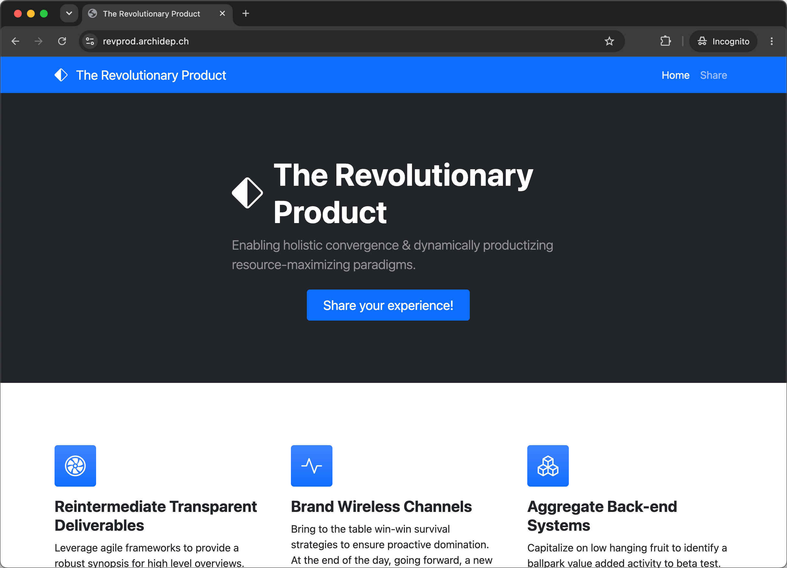

Imagine that Revprod is a large application, too large for one team. Its
development is split between two teams, each responsible for one
**component**:

- The **landing page** team builds the main page, which presents the product and
  displays the customers' testimonials. This team writes [Python][python].
- The **backend** team builds the form where customers share their testimonials,
  and stores them in the database. This team writes JavaScript, run by
  [Node.js][node].

The two teams have agreed on two things: the **same visual theme**, so that a
customer does not notice going from one component to the other, and **links
between the components**. The landing page links to the backend's form, and
displays the testimonials the backend has stored. The backend's pages link back
to the landing page.



Revprod is split for the purposes of this exercise, but large applications are
often split like this for various reasons.

Some **advantages** of a multi-component application are:

- Each component could be developed by a separate team, using their favorite
  programming language and tools.
- Each team could deploy new versions of their component independently.

The **disadvantages** are:

- It is more complex to manage the development and deployment of a
  multi-component application.
- Separate teams working together must agree on how the components communicate,
  and not break that agreement.
- On the deployment side, you have to make sure that you always deploy
  compatible versions of all components together.



## :exclamation: Requirements

The backend needs Node.js 26, which you installed in the [SFTP
exercise][sftp-node]. The landing page needs Python 3.12 or later, and uses only
Python's standard library: Ubuntu comes with Python, so there is nothing to
install. Check both:

```bash
$> node --version
v26.13.1

$> python3 --version
Python 3.14.0
```

Your versions may be slightly different, but Node.js must be version 26, and
Python 3.12 or later.

## :exclamation: Deploy the backend

You will deploy the backend first, the same way you deployed Guess It: clone its
repository into `/srv`, create a user to run it, and run it with systemd.

### :exclamation: Clone the backend

As you did for Guess It in the [Git clone deployment][git-clone-directory],
create a directory for the backend in `/srv`, give it to yourself, and clone the
[backend's repository][revprod-backend] into it:

```bash
$> sudo mkdir /srv/revprod-backend
$> sudo chown jde:jde /srv/revprod-backend
$> git clone https://github.com/ArchiDep/revprod-backend.git /srv/revprod-backend
```



Replace `jde` with your username in the `chown` command.



Install its dependencies:

```bash
$> cd /srv/revprod-backend
$> npm ci
```

### :exclamation: Create a dedicated user for the backend

Like Guess It in the [systemd exercise][dedicated-user], the backend will run as
a system user of its own, which can read its code but not modify it. Create it,
give it the directory, and close the directory to every other user:

```bash
$> sudo useradd --system --shell /usr/sbin/nologin revprod-backend

$> sudo chown :revprod-backend /srv/revprod-backend

$> chmod 750 /srv/revprod-backend
```

The directory, the user, and the service you will create below are all named
`revprod-backend`: one name for everything that belongs to this component.

### :exclamation: Run the backend with systemd

Create a systemd unit file named `/etc/systemd/system/revprod-backend.service`
with `sudo nano`:

```ini
[Unit]
Description=Revprod backend

[Service]
ExecStart=/usr/bin/node bin.js
WorkingDirectory=/srv/revprod-backend
User=revprod-backend

# Listen on port 3001, which your server's firewall lets through.
Environment="REVPROD_LISTEN_PORT=3001"

# Store the testimonials in a directory the backend may write to.
StateDirectory=revprod-backend
Environment="REVPROD_DB_FILE=/var/lib/revprod-backend/db.json"

Restart=on-failure

[Install]
WantedBy=multi-user.target
```

The backend reads its configuration from [environment variables][revprod-backend-config]:

- It listens on port 3000 by default, which Guess It already uses, so
  `REVPROD_LISTEN_PORT` gives it port 3001. Your server's firewall lets this
  port through, so you can reach the backend directly from your browser. This
  is **temporary**, so that you can try the backend on its own: by the end of
  this exercise, it will be reached only through nginx, like Guess It and
  Brewscale.
- It stores the testimonials in a file, `db.json`, in its own directory by
  default. But the `revprod-backend` user cannot create files in
  `/srv/revprod-backend`, and must not. `StateDirectory` tells systemd to create
  the `/var/lib/revprod-backend` directory, and to give it to the user of the
  service, before starting it. `REVPROD_DB_FILE` tells the backend to store its
  file there.



`/var/lib` is the standard Linux directory for **variable data**: the data that
programs keep and change while they run, such as what a database stores.
PostgreSQL, for example, stores its databases in `/var/lib/postgresql`.



As for Brewscale, the configuration has no password or other secret, so it can
stay in the unit file.

Enable and start the service:

```bash
$> sudo systemctl enable revprod-backend
$> sudo systemctl start revprod-backend
```

Check that it is running:

```bash
$> sudo systemctl status revprod-backend
● revprod-backend.service - Revprod backend
     Loaded: loaded (/etc/systemd/system/revprod-backend.service; enabled; preset: enabled)
     Active: active (running) since Thu 2026-11-26 10:12:03 UTC; 3s ago
...
Nov 26 10:12:03 jde.archidep.ch node[11482]: [2026-11-26T10:12:03.722] [INFO] www - Listening on 0.0.0.0:3001
```

## :exclamation: Try the backend on its own

Visit the backend in your browser, at your hostname and port 3001, e.g.
`http://jde.archidepN.ch:3001`. You get the form to share a testimonial.

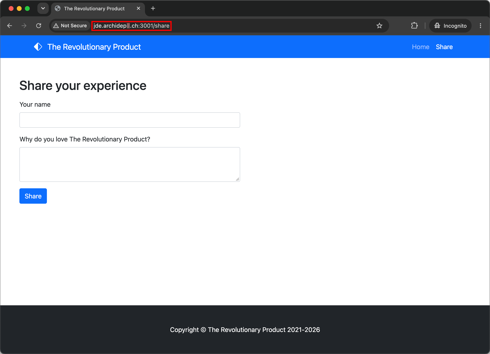



If you get a "Page Web Bloquée" page instead, the school's network is blocking
your server. Your browser may also fail to connect if it tried `https://`
instead of `http://`. See [The school's network blocks your
server][troubleshooting-blocked] and [Your browser cannot make a secure
connection][troubleshooting-https].




Take the time to share your thoughts about The Revolutionary Product! Fill in
your name and why you love it, and click **Share**.

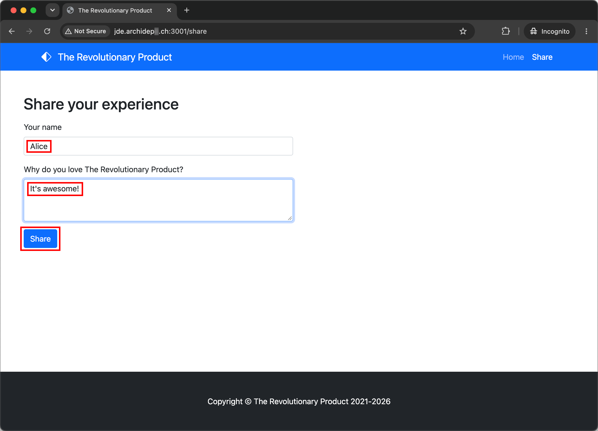

The backend stores the testimonials, and gives them to anyone who asks for them
at `/comments`, in the [JSON][json] format. Visit
`http://jde.archidepN.ch:3001/comments` to see yours:

```json
[
  {
    "name": "Alice",
    "text": "It's awesome!",
    "date": "2026-11-26T10:14:35.785+00:00"
  }
]
```

Now you will click **Home**, in the navigation bar, or **Close**, on the page
that thanked you for your testimonial. What do you think will happen, and why?
Then click it.

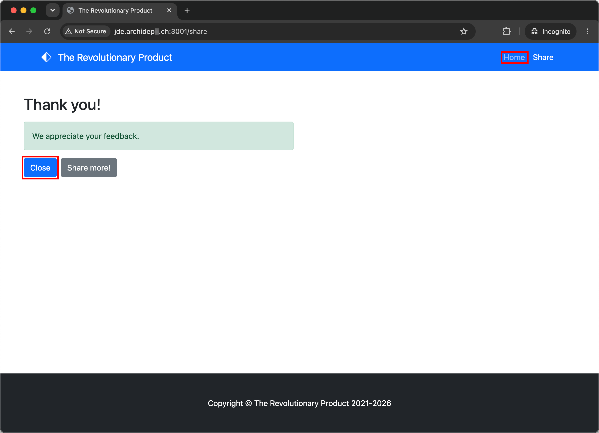



You end up on the form again, at `/share`.

Remember that Revprod is split in two. The home page is the landing page, built
by the other team: the backend does not have it. The backend's
[**Home**][backend-home-link] and [**Close**][backend-close-link] links go to `/`
on the server they come from, which is the backend itself.

The backend team could have shown an error page there. Instead, the backend
[redirects][backend-home-redirect] your browser from `/` to its form, the only
page it has.



## :exclamation: Deploy the landing page

You will deploy the landing page the same way as the backend, with a directory,
a user and a systemd service of its own, and then serve it through nginx.

### :exclamation: Clone the landing page

Create a directory for the landing page in `/srv`, give it to yourself, and
clone the [landing page's repository][revprod-landing-page] into it:

```bash
$> sudo mkdir /srv/revprod-landing
$> sudo chown jde:jde /srv/revprod-landing
$> git clone https://github.com/ArchiDep/revprod-landing-page.git /srv/revprod-landing
```



Replace `jde` with your username in the `chown` command.



There are no dependencies to install: the landing page uses only Python's
standard library.

### :exclamation: Create a dedicated user for the landing page

Each component runs as a user of its own. Create one for the landing page, and
give it the directory:

```bash
$> sudo useradd --system --shell /usr/sbin/nologin revprod-landing

$> sudo chown :revprod-landing /srv/revprod-landing

$> chmod 750 /srv/revprod-landing
```

### :exclamation: Run the landing page with systemd

Create a systemd unit file named `/etc/systemd/system/revprod-landing.service`
with `sudo nano`:

```ini
[Unit]
Description=Revprod landing page

[Service]
ExecStart=/usr/bin/python3 -m revprod_landing
WorkingDirectory=/srv/revprod-landing
User=revprod-landing

# Listen on the loopback address and on a port of its own.
Environment="REVPROD_LISTEN_HOST=127.0.0.1"
Environment="REVPROD_LISTEN_PORT=4300"

Restart=on-failure

[Install]
WantedBy=multi-user.target
```

`python3 -m revprod_landing` runs the Python module named `revprod_landing`: the
code in the `revprod_landing` directory of the repository.

The landing page listens on the [loopback address][loopback], `127.0.0.1`, and
on a port that nobody outside the server needs to know: it will be reached only
through nginx, like Guess It and Brewscale.

Enable and start the service, and check that it is running:

```bash
$> sudo systemctl enable revprod-landing
$> sudo systemctl start revprod-landing

$> sudo systemctl status revprod-landing
● revprod-landing.service - Revprod landing page
     Loaded: loaded (/etc/systemd/system/revprod-landing.service; enabled; preset: enabled)
     Active: active (running) since Thu 2026-11-26 10:21:40 UTC; 2s ago
...
Nov 26 10:21:40 jde.archidep.ch python3[11603]: 2026-11-26 10:21:40,659 INFO [revprod_landing] Listening on 127.0.0.1:4300
```

### :exclamation: Serve the landing page through nginx

Revprod is an nginx site of its own: `revprod.` followed by your hostname, for
example `revprod.jde.archidepN.ch`.

Create the nginx configuration file `/etc/nginx/sites-available/revprod` with
`sudo nano`:

```nginx
server {
  listen 80;
  server_name revprod.jde.archidepN.ch;

  # Forward every request to the landing page.
  location / {
    proxy_pass http://127.0.0.1:4300;
  }
}
```



Replace `jde.archidepN.ch` with your hostname in the `server_name` directive.



Enable it, then check and reload nginx's configuration:

```bash
$> sudo ln -s /etc/nginx/sites-available/revprod /etc/nginx/sites-enabled/revprod

$> sudo nginx -t
nginx: the configuration file /etc/nginx/nginx.conf syntax is ok
nginx: configuration file /etc/nginx/nginx.conf test is successful

$> sudo systemctl reload nginx
```

## :exclamation: Try the landing page on its own

Visit Revprod in your browser, e.g. `http://revprod.jde.archidepN.ch`. You get
the landing page, in the same theme as the backend's form.

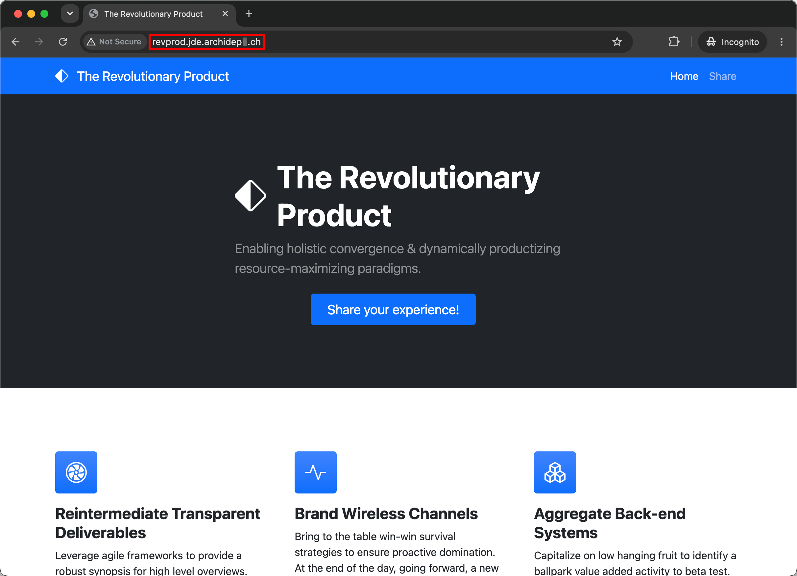



If you get a "Page Web Bloquée" page instead, the school's network is blocking
your server, as it may have blocked the backend. See [The school's network
blocks your server][troubleshooting-blocked].




The top of the page works. But something is wrong further down. Scroll down to
the testimonials: there are none, only an error message.

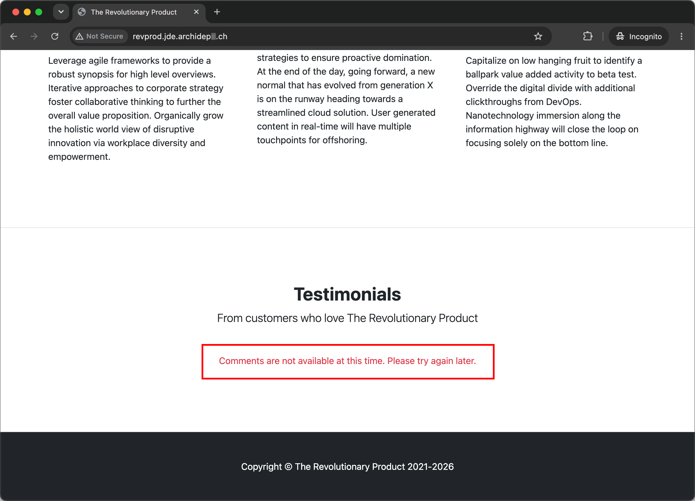

Now you will click **Share**, in the navigation bar, or **Share your
experience!**. What do you think will happen, and why? And why are the
testimonials missing? Then click it.



You end up on a "Not Found" page, at `/share` on the landing page's site.

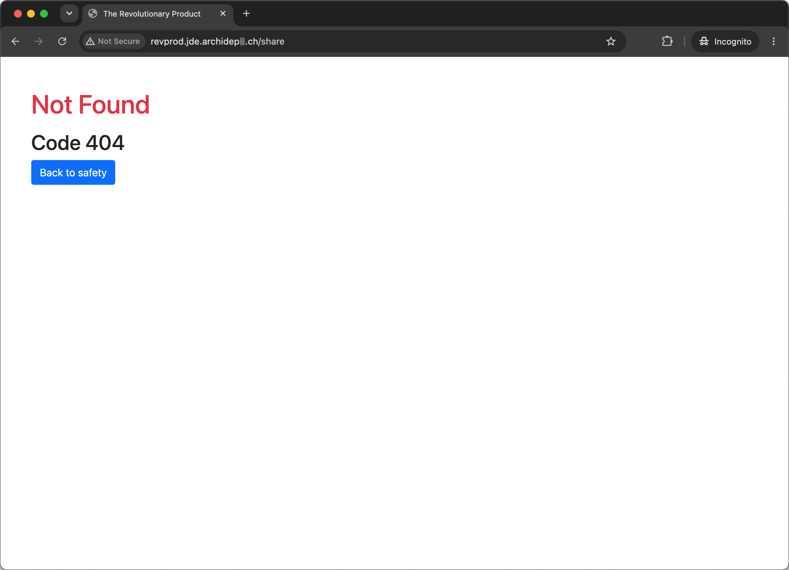

The landing page has no form. The form is the backend's, built by the other
team. The landing page's **Share** link goes to `/share` on the same site, which
the landing page does not have.

The testimonials are missing for the same reason. JavaScript code in the landing
page asks for them at `/comments`, on the same site. The landing page does not
have that either: the testimonials are stored by the backend.



## :exclamation: Two halves of one application

Each team's component runs, and each one is broken on its own:

- The backend's home page sends you back to its form.
- The landing page has no testimonials, and its form does not exist.

Neither component works alone, because each one is half of the same
application. To link to the other, each component must know **where the other
one is**: its address on the web, which only whoever deploys them knows. That is
configuration, so both components read it from an environment variable:

- `REVPROD_BACKEND_BASE_URL` tells the landing page the address of the backend,
  where its **Share** links point, and where it fetches the testimonials.
- `REVPROD_LANDING_PAGE_BASE_URL` tells the backend the address of the landing
  page, where its **Home** and **Close** links point.

This is where the two components are at this point. It is only an intermediate
step, not the deployment you will end up with. The landing page is served
through nginx, at `revprod.jde.archidepN.ch`, while the browser reaches the
backend directly, at `jde.archidepN.ch:3001`. Step through the diagram to follow
what you have done so far, and see why the testimonials are missing.



## :exclamation: Link the components

Open the landing page's unit file:

```bash
$> sudo nano /etc/systemd/system/revprod-landing.service
```

Add the address of the backend to its `[Service]` section, so that the file
looks like this:

```ini highlight_lines="13-14"
[Unit]
Description=Revprod landing page

[Service]
ExecStart=/usr/bin/python3 -m revprod_landing
WorkingDirectory=/srv/revprod-landing
User=revprod-landing

# Listen on the loopback address and on a port of its own.
Environment="REVPROD_LISTEN_HOST=127.0.0.1"
Environment="REVPROD_LISTEN_PORT=4300"

# Public address of the backend.
Environment="REVPROD_BACKEND_BASE_URL=http://jde.archidepN.ch:3001"

Restart=on-failure

[Install]
WantedBy=multi-user.target
```

Open the backend's unit file:

```bash
$> sudo nano /etc/systemd/system/revprod-backend.service
```

Add the address of the landing page to its `[Service]` section, so that the
file looks like this:

```ini highlight_lines="16-17"
[Unit]
Description=Revprod backend

[Service]
ExecStart=/usr/bin/node bin.js
WorkingDirectory=/srv/revprod-backend
User=revprod-backend

# Listen on port 3001, which your server's firewall lets through.
Environment="REVPROD_LISTEN_PORT=3001"

# Store the testimonials in a directory the backend may write to.
StateDirectory=revprod-backend
Environment="REVPROD_DB_FILE=/var/lib/revprod-backend/db.json"

# Public address of the landing page.
Environment="REVPROD_LANDING_PAGE_BASE_URL=http://revprod.jde.archidepN.ch"

Restart=on-failure

[Install]
WantedBy=multi-user.target
```



Replace `jde.archidepN.ch` with your hostname in both addresses.



Reload systemd's configuration, and restart both services:

```bash
$> sudo systemctl daemon-reload
$> sudo systemctl restart revprod-landing
$> sudo systemctl restart revprod-backend
```

Visit Revprod again, e.g. `http://revprod.jde.archidepN.ch`, and click
**Share**. You get the backend's form. Click **Home**, and you are back on the
landing page. The links work, and both pages look the same, as the teams agreed.

But look at the address bar while you click. It goes from
`revprod.jde.archidepN.ch` to `jde.archidepN.ch:3001`, and back. Anyone who
looks at it sees **two separate sites**.

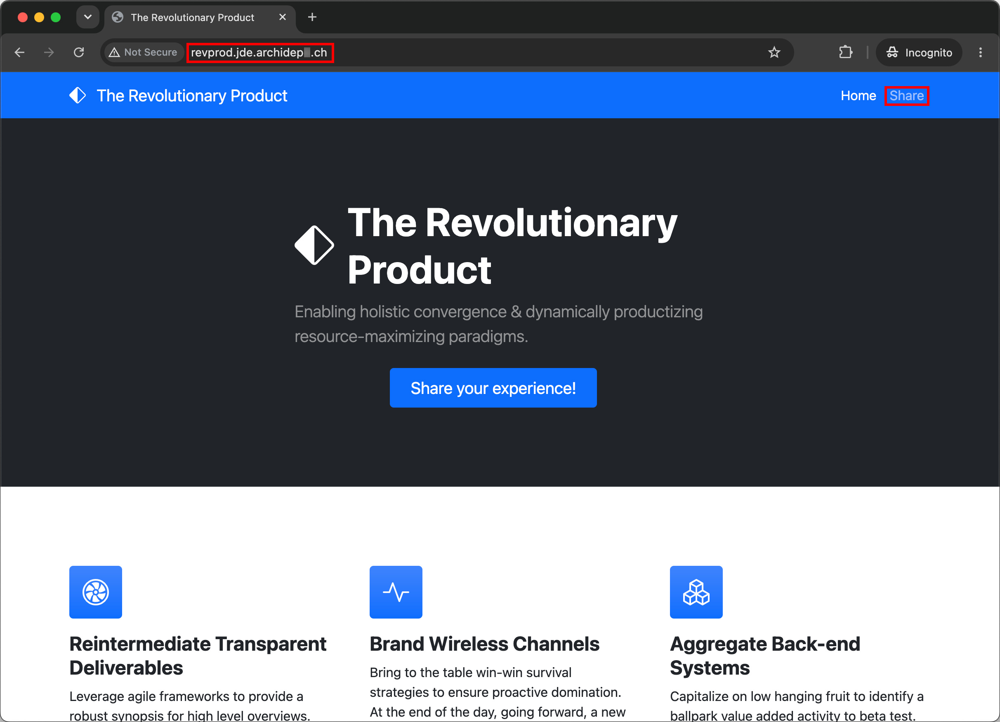


## :exclamation: It's not working!

Scroll down to the testimonials on the landing page. They are still missing!

Open your browser's developer tools, and reload the page. Look at two places:

- In the **Network** tab, the request to `comments` has failed: its status is
  **CORS error**.
- In the **Console**, you should see an error that looks something like this:

  ```
  Access to fetch at 'http://jde.archidepN.ch:3001/comments' from origin
  'http://revprod.jde.archidepN.ch' has been blocked by CORS policy: No
  'Access-Control-Allow-Origin' header is present on the requested resource.
  ```

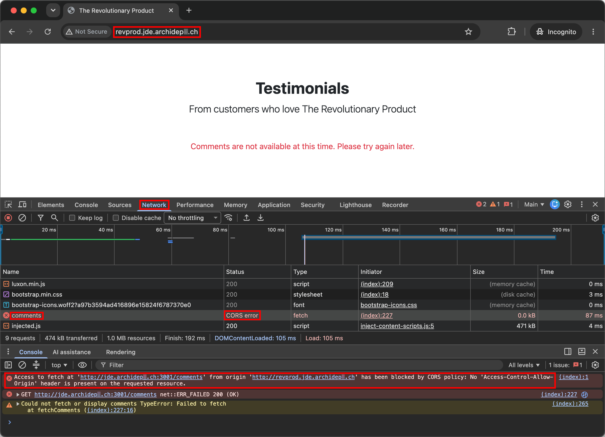

The landing page now asks the backend for the testimonials, at
`http://jde.archidepN.ch:3001/comments`. The backend answers: you can see the
request in its logs with `sudo journalctl -u revprod-backend`. But your browser
**refuses to give the answer** to the landing page's JavaScript code.

The landing page and the testimonials come from two different **origins**. An
origin is the scheme, the host name and the port of an address. The landing page
comes from `http://revprod.jde.archidepN.ch`, and the testimonials from
`http://jde.archidepN.ch:3001/comments`:

| What         | Scheme | Host                       | Port |
| :----------- | :----- | :------------------------- | :--- |
| Landing page | `http` | `revprod.jde.archidepN.ch` | 80   |
| Testimonials | `http` | `jde.archidepN.ch`         | 3001 |

The landing page's address has no port: port 80 is the default for `http`.

Two addresses have the same origin only if all three are the same. Here, both
the host name and the port differ. Even with the same host name, the port alone
would make it another origin.

Browsers apply the [**Same-Origin Policy (SOP)**][sop]: JavaScript code loaded
from one origin may send requests to another, but may not read the answers,
unless that other origin allows it. It is a critical security mechanism of the
web.



The SOP helps isolate potentially malicious documents, reducing possible attack
vectors. For example, it prevents a malicious website on the Internet from
running JS in a browser to read data from a third-party webmail or e-banking
service (which the user is signed into) or a company intranet (which is
protected from direct access by the attacker by not having a public IP address)
and relaying that data to the attacker.



There are two ways to solve this problem:

- The backend can tell browsers that the landing page's origin may read its
  answers. This is **Cross-Origin Resource Sharing (CORS)**. You will meet it in
  real life, and can try it in the next section.
- The two components can be made to share **one origin**. That is what a reverse
  proxy can do, and what the rest of this exercise does.

## :question: Optional: allow the landing page with CORS

[Cross-Origin Resource Sharing (CORS)][cors] lets a server tell browsers which
other origins may read its answers, with HTTP headers. The browser checks them,
and gives the answer to the JavaScript code only if its origin is allowed.

The backend already supports sending these headers. Open its unit file:

```bash
$> sudo nano /etc/systemd/system/revprod-backend.service
```

Add the [`REVPROD_CORS` and `REVPROD_CORS_ORIGINS`
variables][revprod-backend-config] to its `[Service]` section, so that the file
looks like this:

```ini highlight_lines="19-21"
[Unit]
Description=Revprod backend

[Service]
ExecStart=/usr/bin/node bin.js
WorkingDirectory=/srv/revprod-backend
User=revprod-backend

# Listen on port 3001, which your server's firewall lets through.
Environment="REVPROD_LISTEN_PORT=3001"

# Store the testimonials in a directory the backend may write to.
StateDirectory=revprod-backend
Environment="REVPROD_DB_FILE=/var/lib/revprod-backend/db.json"

# Public address of the landing page.
Environment="REVPROD_LANDING_PAGE_BASE_URL=http://revprod.jde.archidepN.ch"

# Allow the landing page to read the backend's answers.
Environment="REVPROD_CORS=true"
Environment="REVPROD_CORS_ORIGINS=http://revprod.jde.archidepN.ch"

Restart=on-failure

[Install]
WantedBy=multi-user.target
```



Replace `jde.archidepN.ch` with your hostname in the origin.



Reload systemd's configuration and restart the backend:

```bash
$> sudo systemctl daemon-reload
$> sudo systemctl restart revprod-backend
```

Reload the landing page. The testimonials appear!

In the developer tools, open the **Network** tab, reload the page again, and
click the request to `comments`. Among the headers of the response, the backend
now sends this one:

```
Access-Control-Allow-Origin: http://revprod.jde.archidepN.ch
```

Your browser compares it with the origin of the landing page. They match, so it
gives the answer to the landing page's code.

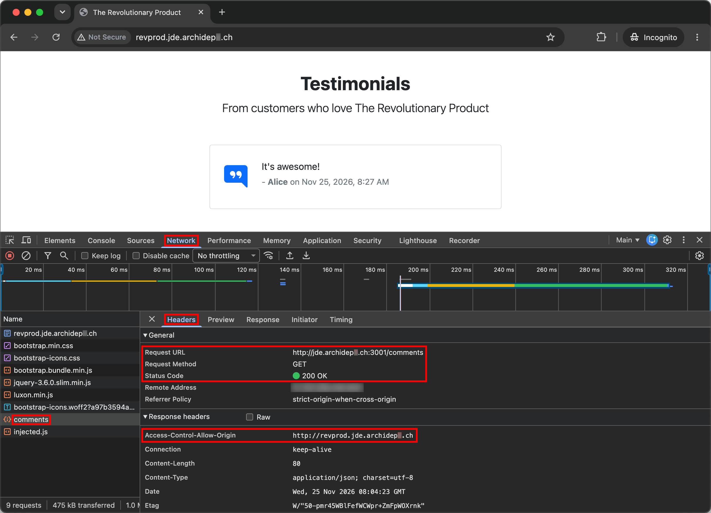

Notice that it is the **backend** that had to be changed, to allow the **landing
page**: the backend team must know every origin that the landing page is served
from, and allow each one. If the landing page moved to another address, the
testimonials would break again until the backend's configuration followed.

Before you continue, you must **turn CORS off again**, so that you can see the
reverse proxy solve the problem by itself. Open the backend's unit file again:

```bash
$> sudo nano /etc/systemd/system/revprod-backend.service
```

Comment out the two CORS lines, by adding a `#` at the start of each one, so
that the file looks like this:

```ini highlight_lines="19-21"
[Unit]
Description=Revprod backend

[Service]
ExecStart=/usr/bin/node bin.js
WorkingDirectory=/srv/revprod-backend
User=revprod-backend

# Listen on port 3001, which your server's firewall lets through.
Environment="REVPROD_LISTEN_PORT=3001"

# Store the testimonials in a directory the backend may write to.
StateDirectory=revprod-backend
Environment="REVPROD_DB_FILE=/var/lib/revprod-backend/db.json"

# Public address of the landing page.
Environment="REVPROD_LANDING_PAGE_BASE_URL=http://revprod.jde.archidepN.ch"

# Allow the landing page to read the backend's answers (turned off).
#Environment="REVPROD_CORS=true"
#Environment="REVPROD_CORS_ORIGINS=http://revprod.jde.archidepN.ch"

Restart=on-failure

[Install]
WantedBy=multi-user.target
```

Reload systemd's configuration and restart the backend:

```bash
$> sudo systemctl daemon-reload
$> sudo systemctl restart revprod-backend
```

Reload the landing page, **holding the Shift key to force a refresh** so that
your browser does not reuse what it has kept. The testimonials are missing
again:




The testimonials **must** be missing at this point, before you move on to the
next step. This is the state you want: the next step solves the problem in
another way, and you could not see it work if CORS still did.

If the testimonials are still displayed, check that you commented out both CORS
lines, reloaded systemd's configuration and restarted the backend, then reload
the page holding the Shift key again.



## :exclamation: Serve both components as a single site

The two components are reached at two origins, `revprod.jde.archidepN.ch` and
`jde.archidepN.ch:3001`. That is the source of the problem you just saw. _But
what if there was **only one origin**?_

nginx already serves the landing page at `revprod.jde.archidepN.ch`, with one
`location` block that forwards every request to it. But a `server` block can
have several `location` blocks, and forward each one to a different component,
depending on the path of the request.

The backend answers three kinds of requests:

- `/share`, its form, which also receives the testimonials it stores.
- `/comments`, the testimonials.
- Paths starting with `/css/`, the stylesheet of its form.



This step is not written down for you: you must work out yourself what to add to
nginx's configuration.



Open Revprod's nginx configuration:

```bash
$> sudo nano /etc/nginx/sites-available/revprod
```

It is the file you wrote earlier in this exercise, with a TODO where your
changes go:

```nginx highlight_lines="10"
server {
  listen 80;
  server_name revprod.jde.archidepN.ch;

  # Forward every request to the landing page.
  location / {
    proxy_pass http://127.0.0.1:4300;
  }

  # TODO: forward the requests for the backend's paths to the backend.
}
```

Replace the `TODO` comment with what makes nginx forward the requests for the
backend's paths to the backend, at `127.0.0.1:3001`. Every other request must
still go to the landing page, as before, and the file must still have **only
one `server` block**.



The [reverse proxy subject][nginx-location] explains how nginx chooses a
`location` block for a request. The ["Setting Up a Simple Proxy
Server"][nginx-beginners-guide-proxy] section of nginx's beginner's guide shows
an example of a `server` block with several `location` blocks.

Do not copy that example as it is: it is not Revprod. Once you have several
`location` blocks, think through which requests each one matches, and where
they must lead. When in doubt, browse the [reference deployment][revprod] and
look at the path of each page in the address bar.





Your `/etc/nginx/sites-available/revprod` file on your server should look
something like this, with one `location` block for each of the backend's paths:

```nginx
server {
  listen 80;
  server_name revprod.jde.archidepN.ch;

  # Forward every request to the landing page...
  location / {
    proxy_pass http://127.0.0.1:4300;
  }

  # ...except those for the backend's testimonials, form and stylesheet.
  location /comments {
    proxy_pass http://127.0.0.1:3001;
  }

  location /share {
    proxy_pass http://127.0.0.1:3001;
  }

  location /css/ {
    proxy_pass http://127.0.0.1:3001;
  }
}
```

A request for `/share` matches both `location /` and `location /share`. nginx
chooses the longest prefix that matches, `/share`.

You could also write it with only two `location` blocks, using a regular
expression for the backend's paths:

```nginx
server {
  listen 80;
  server_name revprod.jde.archidepN.ch;

  # Forward every request to the landing page...
  location / {
    proxy_pass http://127.0.0.1:4300;
  }

  # ...except those for the backend's testimonials, form and stylesheet.
  location ~ ^/(comments|share|css/) {
    proxy_pass http://127.0.0.1:3001;
  }
}
```

`~` makes the location a regular expression. `^` matches the start of the path,
and `(comments|share|css/)` any one of the three. nginx checks regular
expressions after the prefixes, and the first one that matches wins over `/`.



Check and reload nginx's configuration:

```bash
$> sudo nginx -t
$> sudo systemctl reload nginx
```

Both components are now reached at `revprod.jde.archidepN.ch`, so neither needs
the address of the other any more: a link to `/share` or `/` on the same site
reaches the right component through nginx. Without the addresses, each
component links to paths on its own site, as when you first tried it alone.

Open the landing page's unit file:

```bash
$> sudo nano /etc/systemd/system/revprod-landing.service
```

Comment out the `REVPROD_BACKEND_BASE_URL` line, by adding a `#` at its start,
so that the file looks like this:

```ini highlight_lines="13-14"
[Unit]
Description=Revprod landing page

[Service]
ExecStart=/usr/bin/python3 -m revprod_landing
WorkingDirectory=/srv/revprod-landing
User=revprod-landing

# Listen on the loopback address and on a port of its own.
Environment="REVPROD_LISTEN_HOST=127.0.0.1"
Environment="REVPROD_LISTEN_PORT=4300"

# Public address of the backend (not needed behind a single site).
#Environment="REVPROD_BACKEND_BASE_URL=http://jde.archidepN.ch:3001"

Restart=on-failure

[Install]
WantedBy=multi-user.target
```

Open the backend's unit file:

```bash
$> sudo nano /etc/systemd/system/revprod-backend.service
```

Comment out the `REVPROD_LANDING_PAGE_BASE_URL` line the same way, so that the
file looks like this:

```ini highlight_lines="16-17"
[Unit]
Description=Revprod backend

[Service]
ExecStart=/usr/bin/node bin.js
WorkingDirectory=/srv/revprod-backend
User=revprod-backend

# Listen on port 3001, which your server's firewall lets through.
Environment="REVPROD_LISTEN_PORT=3001"

# Store the testimonials in a directory the backend may write to.
StateDirectory=revprod-backend
Environment="REVPROD_DB_FILE=/var/lib/revprod-backend/db.json"

# Public address of the landing page (not needed behind a single site).
#Environment="REVPROD_LANDING_PAGE_BASE_URL=http://revprod.jde.archidepN.ch"

Restart=on-failure

[Install]
WantedBy=multi-user.target
```

Reload systemd's configuration, and restart both services:

```bash
$> sudo systemctl daemon-reload
$> sudo systemctl restart revprod-landing
$> sudo systemctl restart revprod-backend
```

Visit Revprod again, e.g. `http://revprod.jde.archidepN.ch`, and click
**Share**. You get the backend's form. Click **Home**, and you are back on the
landing page. This time, the address stays `revprod.jde.archidepN.ch` while you
go from one component to the other.


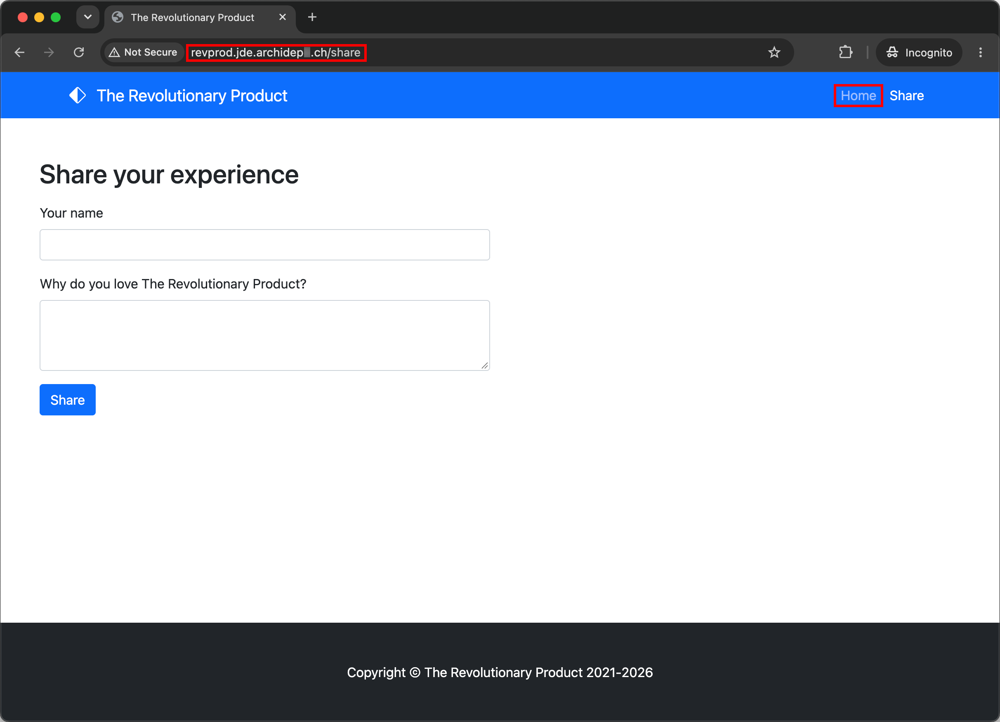

Your browser sends every request to nginx, at one origin. nginx forwards each
one **internally** to one component or the other. Neither the browser nor the
user can tell that the application is made of two components.

Click **Share** again, and share another testimonial, through Revprod's own
address this time:

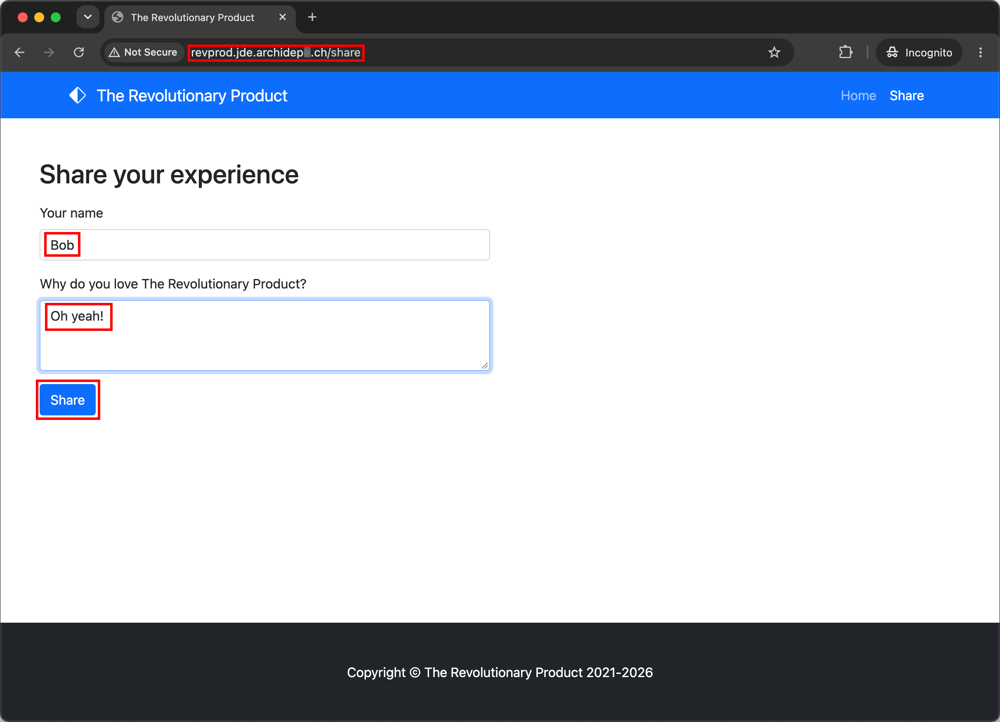

Click **Close**, and scroll down to the testimonials on the landing page. Yours
is displayed, with the earlier ones.

Open your browser's developer tools, reload the page, and click the request to
`comments` in the **Network** tab. It went to
`http://revprod.jde.archidepN.ch/comments`, the same origin as the landing page.
There is no cross-origin request any more, so the same-origin policy has nothing
to refuse: the answer has no `Access-Control-Allow-Origin` header, and needs
none. The **Console** shows no error either.

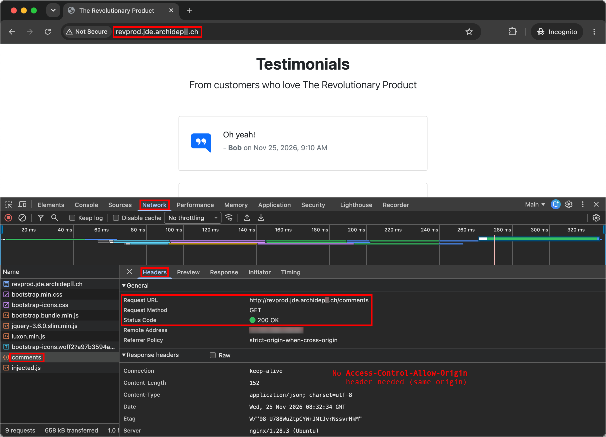



If you reload the page more than once, the status of the request to `comments`
may be `304 Not Modified` instead of `200 OK`. This is normal: your browser
already has the testimonials from the last time it loaded the page, and the
server tells it that they have not changed since.



## :exclamation: Hide the backend's port

The backend still listens on port 3001, on every address of your server, so
anyone can still reach it at `http://jde.archidepN.ch:3001`. Nothing needs this
any more: browsers reach the backend through nginx. Your server's firewall lets
only a few ports through, and port 3001 is better kept free for later.

Move the backend to a port that nobody outside the server needs to know, on the
loopback address. Open its unit file:

```bash
$> sudo nano /etc/systemd/system/revprod-backend.service
```

Change the port from 3001 to 4301, add the `REVPROD_LISTEN_HOST` variable, and
change the comment above them, so that the file looks like this:

```ini highlight_lines="9-11"
[Unit]
Description=Revprod backend

[Service]
ExecStart=/usr/bin/node bin.js
WorkingDirectory=/srv/revprod-backend
User=revprod-backend

# Listen on the loopback address and on a port of its own.
Environment="REVPROD_LISTEN_HOST=127.0.0.1"
Environment="REVPROD_LISTEN_PORT=4301"

# Store the testimonials in a directory the backend may write to.
StateDirectory=revprod-backend
Environment="REVPROD_DB_FILE=/var/lib/revprod-backend/db.json"

# Public address of the landing page (not needed behind a single site).
#Environment="REVPROD_LANDING_PAGE_BASE_URL=http://revprod.jde.archidepN.ch"

Restart=on-failure

[Install]
WantedBy=multi-user.target
```

Reload systemd's configuration and restart the backend:

```bash
$> sudo systemctl daemon-reload
$> sudo systemctl restart revprod-backend
```

The backend now listens on port 4301, but nginx still forwards the requests for
its paths to port 3001, where nothing listens any more. Visit
`http://revprod.jde.archidepN.ch/share`: nginx answers with an error page,
**502 Bad Gateway**.

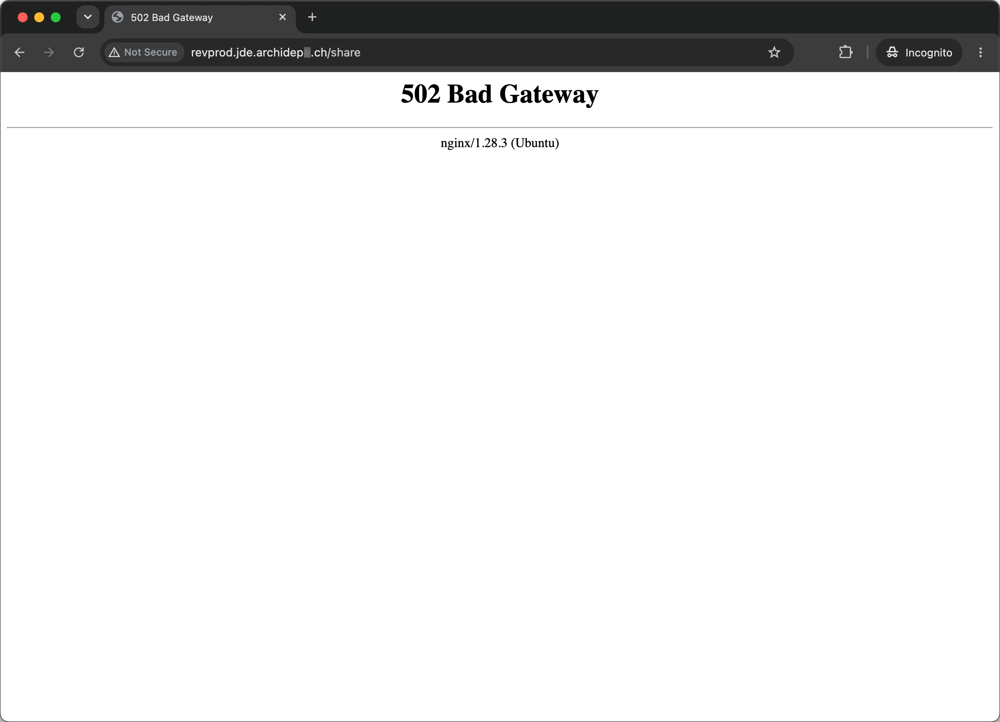

nginx stands between your browser and the components, as a gateway to them. It
received your request, but got no answer from the component it forwards that
request to. The landing page still works, because its port has not changed.

This is what you should see at this point. nginx's error log says why. Show the
last line of the log that mentions port 3001:

```bash
$> sudo grep 3001 /var/log/nginx/error.log | tail -n 1
# Note: this will be one long line with no breaks in nginx's logs.
2026/11/26 10:40:39 [error] 11021#11021: *67 connect() failed
  (111: Connection refused) while connecting to upstream,
  client: A.B.C.D, server: revprod.jde.archidepN.ch,
  request: "GET /share HTTP/1.1",
  upstream: "http://127.0.0.1:3001/share",
  host: "revprod.jde.archidepN.ch",
  referrer: "http://revprod.jde.archidepN.ch/"
```

nginx tried to connect to the backend at its old address, `127.0.0.1:3001`,
which it calls the **upstream**, and the connection was refused: nothing listens
there.

To fix it, open Revprod's nginx configuration:

```bash
$> sudo nano /etc/nginx/sites-available/revprod
```

Change every `proxy_pass` directive that forwards to the backend, from
`http://127.0.0.1:3001` to `http://127.0.0.1:4301`, in what you added to the
file in the previous step:

```nginx highlight_lines="10"
server {
  listen 80;
  server_name revprod.jde.archidepN.ch;

  # Forward every request to the landing page.
  location / {
    proxy_pass http://127.0.0.1:4300;
  }

  # What you added for the backend's paths:
  # change the port from 3001 to 4301.
}
```

Check and reload nginx's configuration:

```bash
$> sudo nginx -t
$> sudo systemctl reload nginx
```

Visit `http://jde.archidepN.ch:3001`: your browser can no longer connect to it.
The backend listens only on the loopback address now, and nothing listens on
port 3001 any more.

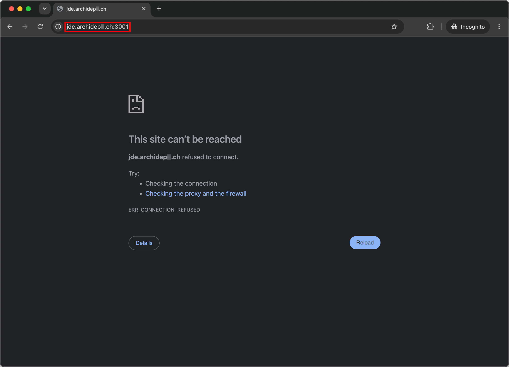

Visit Revprod at `http://revprod.jde.archidepN.ch`: it works as before. Share
another testimonial to make sure.

The backend's port changed, and no browser noticed. Behind a reverse proxy, the
port of each component is an **internal detail** of your server, which you can
change without anyone outside knowing.

## :checkered_flag: What have I done?

You have deployed an application made of two components, developed by two
teams, in two languages, and made them appear to the outside world as a single
website.

Each component is a separate program, run by systemd as a process of its own,
with a user of its own. They can be deployed and restarted separately, and they
could be updated separately by their teams.

Neither component worked alone. The landing page had no form and no
testimonials, and the backend had no home page: each was half of the same
application. To link to each other, each needed the address of the other, which
only whoever deploys them knows. That is configuration, given to each component
in an environment variable.

Once linked, the application worked, but a user could see it was two sites, and
the testimonials were missing. An **origin** is the scheme, the host name and
the port of an address. The landing page and the backend had two different
origins, and the **same-origin policy** of browsers stops a page's JavaScript
code from reading what another origin answers, unless that origin allows it.
The backend did answer: it is the browser that refused to hand over the answer.

(Optionally) You let the backend allow the landing page's origin, with
**CORS**: HTTP headers that the browser checks. It works, but the backend must
then know every origin the landing page is served from.

A reverse proxy solves it another way. nginx can choose where to forward a
request by its **path**, not only by its name: `/share`, `/comments` and `/css/`
go to the backend, everything else to the landing page. The browser talks to a
single origin, so there is no cross-origin request left. Neither component
needs the other's address any more: a link to `/share` is enough.

Behind the reverse proxy, a component's port is an internal detail. You moved
the backend to another port, on the loopback address, and only nginx had to
know.

### :classical_building: Architecture

This is a simplified architecture of the main running processes and
communication flow at the end of this exercise:

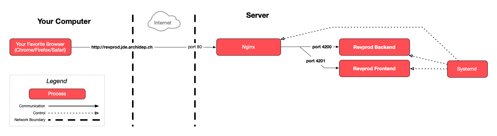

<div class="flex items-center gap-2">
  <a href="./images/architecture.pdf" download="RevProd Deployment Architecture" class="tooltip" data-tip="Download PDF">
    
  </a>
  <a href="./images/architecture.png" download="RevProd Deployment Architecture" class="tooltip" data-tip="Download PNG">
    
  </a>
</div>

## :file_folder: Where is everything?

These are the files and directories of your server that matter for this
deployment.

<div class="file-map">

| Path                                                                                        | What it is                                                                  | What you did                                                                                               | Who uses it                                            |
| :------------------------------------------------------------------------------------------ | :-------------------------------------------------------------------------- | :--------------------------------------------------------------------------------------------------------- | :----------------------------------------------------- |
| :file_folder: `/srv/revprod-backend` <span class="new">new</span>                           | The backend's deployment: a clone of its repository, with its dependencies  | Created it with `sudo mkdir`, cloned the repository into it, installed its dependencies with `npm ci`      | You, to update it. The `revprod-backend` user reads it |
| :file_folder: `/srv/revprod-landing` <span class="new">new</span>                           | The landing page's deployment: a clone of its repository                    | Created it with `sudo mkdir`, and cloned the repository into it                                            | You, to update it. The `revprod-landing` user reads it |
| :page_facing_up: `/etc/systemd/system/revprod-backend.service` <span class="new">new</span> | The unit file of the backend: how to run it, and its configuration          | Wrote it with `sudo nano`, linked it to the landing page, then commented out the link and changed its port | systemd, to run the backend                            |
| :page_facing_up: `/etc/systemd/system/revprod-landing.service` <span class="new">new</span> | The unit file of the landing page: how to run it, and its configuration     | Wrote it with `sudo nano`, linked it to the backend, then commented out the link                           | systemd, to run the landing page with `python3`        |
| :file_folder: `/var/lib/revprod-backend` <span class="new">new</span>                       | The backend's data: `db.json`, the testimonials                             | Nothing: systemd created it for the backend, as `StateDirectory` says                                      | The backend, to store and read the testimonials        |
| :page_facing_up: `/etc/nginx/sites-available/revprod` <span class="new">new</span>          | The configuration of Revprod: its name, and which component gets which path | Wrote it with `sudo nano`, then added the backend's locations, and changed their port                      | nginx, through its link in `sites-enabled`             |
| :page_facing_up: `/etc/passwd` <span class="changed">changed</span>                         | The list of the server's Unix users                                         | Ran `useradd` twice, which added the `revprod-backend` and `revprod-landing` users                         | systemd, to find the users that run the components     |

</div>

You can explore all of this yourself: `ls -l` shows what a directory contains,
with its permissions, and `cat`, `head` and `tail` what a file contains, as in
the [command line cheatsheet][command-line-cheatsheet]. Use `sudo` for what only
`root` can read. For example:

```bash
# The testimonials, and who owns the file they are in.
$> sudo ls -l /var/lib/revprod-backend
$> sudo cat /var/lib/revprod-backend/db.json

# What each component has logged (press q to quit).
$> sudo journalctl -u revprod-landing
$> sudo journalctl -u revprod-backend
```

## :boom: Troubleshooting

Here's a few tips about some problems you may encounter during this exercise.

### :boom: The school's network blocks your server

The school's network filters the web pages you visit, and may block names it
does not know, such as your server's. You then get a "Page Web Bloquée" page
from HEIG-VD instead of Revprod, whether at port 3001 or at
`revprod.jde.archidepN.ch`.

Your server is not at fault: the block is between your computer and it. Use
another network for this exercise, for example by sharing your phone's
connection (hotspot), or through a VPN.

### :boom: Your browser cannot make a secure connection

Revprod's components speak only HTTP in this exercise: the backend at port
3001, and nginx for `revprod.jde.archidepN.ch`. Some browsers try `https://`
first when you type an address without it. Check the address bar: the address
must start with `http://`. Type it in full, with `http://`.

- At port 3001, the backend does not understand an HTTPS request at all, and
  your browser shows an error such as `ERR_SSL_PROTOCOL_ERROR`.
- At `revprod.jde.archidepN.ch`, nginx does answer HTTPS on port 443, for the
  sites you obtained a certificate for in the [Certbot
  exercise][certbot-deployment], but it has no certificate for Revprod. Your
  browser warns you that the certificate is not valid for that name. Do not go
  past the warning: you would get one of your other sites, not Revprod.

### :boom: `[emerg] could not build server_names_hash, you should increase server_names_hash_bucket_size`

Your domain name is too long for nginx's default settings. Fix it as in the
[same problem in the static site exercise][server-names-hash].

### :boom: `EACCES: permission denied, open '/srv/revprod-backend/db.json'`

The backend shows this error when you share a testimonial. It tried to store
the testimonials in its own directory, which the `revprod-backend` user may not
write to. Check that its unit file has both the `StateDirectory` option and the
`REVPROD_DB_FILE` variable, as in [Run the backend with
systemd][run-the-backend], then reload systemd's configuration and restart the
backend.

### :boom: `Port 3001 is already in use`

A component does not start, and its logs say that its port, here 3001, is
already in use: another process listens on it. Find which one with `sudo ss
-tlpn`, as in the [SFTP exercise][sftp-ss], and stop it, or give the component
another port.

### :boom: 502 Bad Gateway

nginx received the request, but could not get an answer from the component it
forwards it to. Look at the end of nginx's error log:

```bash
$> sudo tail /var/log/nginx/error.log
```

If it says `connect() failed (111: Connection refused) while connecting to
upstream`, it also says which `upstream` address nothing listens on:

- Check that both components are running with `sudo systemctl status
revprod-landing` and `sudo systemctl status revprod-backend`, and that the
  last line of each one's logs says it listens on the port you expect.
- Check that each `proxy_pass` directive has the port of the component it
  forwards to.

### :boom: The testimonials are still missing behind a single site

Check that:

- Your nginx configuration has a `location` for `/comments`, and you have
  reloaded nginx since you changed it.
- The `REVPROD_BACKEND_BASE_URL` line of the landing page's unit file is
  commented out, and you have reloaded systemd's configuration and restarted
  the landing page since you changed it. Its logs say `Backend base URL: none` when
  it starts.
- Your browser is not showing an old copy of the page: reload it holding the
  Shift key to force a refresh.

### :boom: The footer covers the form

The backend's form is missing its stylesheet: nginx forwards the requests for it
to the landing page, which does not have it. Check that your nginx configuration
has a `location` for `/css/` that forwards to the backend.

[backend-close-link]: https://github.com/ArchiDep/revprod-backend/blob/7c21c3d5b9c6e53caa91d01c96d54bc8ce7244e1/app/share/share.pug#L8
[backend-home-link]: https://github.com/ArchiDep/revprod-backend/blob/7c21c3d5b9c6e53caa91d01c96d54bc8ce7244e1/app/page-layout.pug#L14
[backend-home-redirect]: https://github.com/ArchiDep/revprod-backend/blob/7c21c3d5b9c6e53caa91d01c96d54bc8ce7244e1/app/home/home.middlewares.js#L2
[cors]: https://developer.mozilla.org/en-US/docs/Web/HTTP/CORS
[nginx-beginners-guide-proxy]: https://nginx.org/en/docs/beginners_guide.html#proxy
[json]: https://en.wikipedia.org/wiki/JSON
[node]: https://nodejs.org
[python]: https://www.python.org
[revprod]: https://revprod.archidep.ch
[revprod-backend]: https://github.com/ArchiDep/revprod-backend
[revprod-backend-config]: https://github.com/ArchiDep/revprod-backend#configuration
[revprod-landing-page]: https://github.com/ArchiDep/revprod-landing-page
[run-the-backend]: #run-the-backend-with-systemd
[sop]: https://developer.mozilla.org/en-US/docs/Web/Security/Same-origin_policy
[troubleshooting-blocked]: #the-schools-network-blocks-your-server
[troubleshooting-https]: #your-browser-cannot-make-a-secure-connection

[certbot-deployment]: 
[command-line-cheatsheet]: #whats-in-this-file-cat-head-tail-less
[dedicated-user]: #create-a-dedicated-user
[git-clone-directory]: #create-the-deployment-directory
[loopback]: #theres-no-place-like-127001
[nginx-location]: #how-nginx-chooses-a-configuration
[reverse-proxy]: 
[reverse-proxy-deployment]: 
[server-names-hash]: #emerg-could-not-build-server_names_hash-you-should-increase-server_names_hash_bucket_size
[sftp-node]: #install-nodejs
[sftp-ss]: #optional-see-who-listens-where
